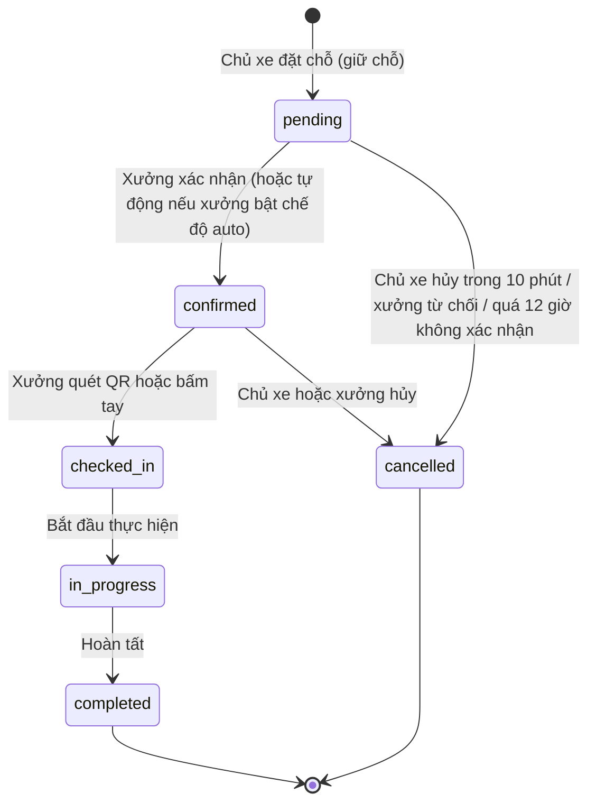
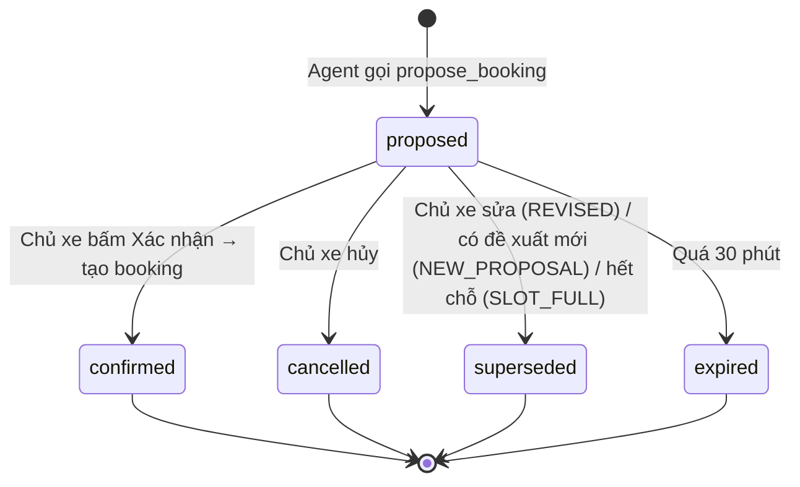
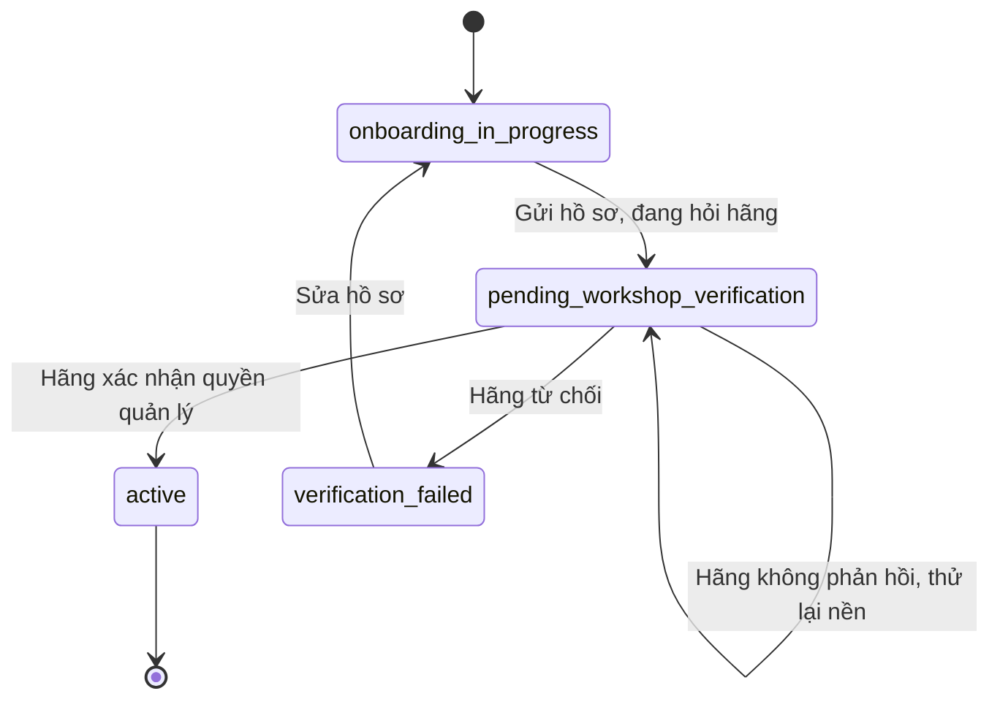
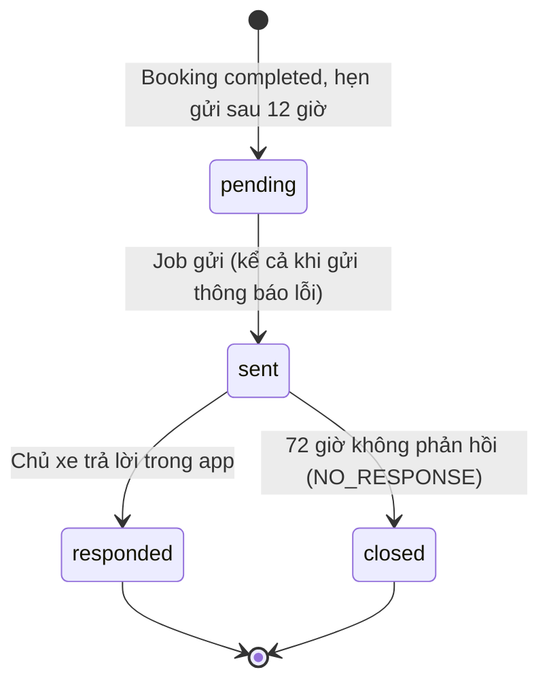
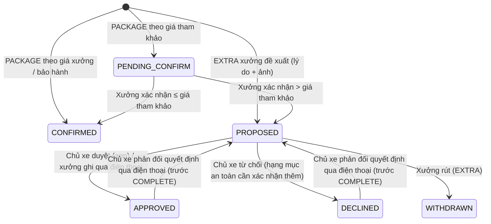

# EV Care — Kiến trúc chi tiết: bảo mật, chất lượng, vòng đời, độ tin cậy và lộ trình

> Cập nhật: 2026-10-10. Tài liệu bổ sung cho [architecture.md](architecture.md) (bức tranh tổng thể). Viết cho người **chưa biết dự án**: kỹ sư mới, người đánh giá kỹ thuật, đối tác tích hợp, người duyệt bảo mật.
> Mọi nội dung đối chiếu với code ở `backend/src`, `frontend/src` và `docs/specs`. Chỗ nào chưa kiểm chứng được thì ghi rõ "chưa kiểm chứng".

## Mục lục

1. [Hệ thống này là gì (tóm tắt 1 phút)](#0-hệ-thống-này-là-gì-tóm-tắt-1-phút)
2. [Bảo mật và phân quyền](#1-bảo-mật-và-phân-quyền)
3. [Yêu cầu phi chức năng](#2-yêu-cầu-phi-chức-năng)
4. [Vòng đời trạng thái](#3-vòng-đời-trạng-thái)
5. [Độ tin cậy và xử lý lỗi](#4-độ-tin-cậy-và-xử-lý-lỗi)
6. [Khoảng trống và hướng phát triển](#5-khoảng-trống-và-hướng-phát-triển)
7. [Thuật ngữ và tài liệu liên quan](#6-thuật-ngữ-và-tài-liệu-liên-quan)

---

## 0. Hệ thống này là gì (tóm tắt 1 phút)

**EV Care** là nền tảng chăm sóc xe điện sau bán hàng, phục vụ hai nhóm người dùng:

- **Chủ xe**: liên kết xe với hãng, xem khi nào đến hạn bảo dưỡng, xem chi phí ước tính, đặt lịch tại xưởng, nhận nhắc lịch, hỏi trợ lý AI.
- **Chủ xưởng**: quản lý bảng giá, nhận và điều phối lịch hẹn trên một bảng điều phối (Workshop Board), check-in xe bằng mã QR, xác nhận giá và đề xuất hạng mục phát sinh, cập nhật tiến độ sửa chữa.

Thành phần chính: giao diện web (React), máy chủ API (FastAPI, Python), bộ xử lý nền (Celery), cơ sở dữ liệu PostgreSQL, Redis, một trợ lý AI (LangGraph + mô hình ngôn ngữ lớn, gọi tắt **LLM**), và một hệ thống bên ngoài của hãng xe (**OEM**; khi phát triển dùng bản giả lập `mock-ev-system`). Đăng nhập dùng Firebase Authentication.

Nguyên tắc thiết kế xuyên suốt, giúp đọc hiểu các phần sau:

1. **Số liệu do code tất định tính, AI chỉ diễn giải.** Hạn bảo dưỡng, giá, sức chứa xưởng, việc tạo lịch đều do dịch vụ backend xử lý; LLM chỉ gọi công cụ (tool) và giải thích kết quả.
2. **Không có hành động có hậu quả nếu người dùng chưa bấm xác nhận.** Trợ lý AI chỉ *đề xuất* lịch hẹn; lịch chỉ được tạo khi chủ xe bấm nút trên giao diện. Tương tự, hạng mục phát sinh tại xưởng chỉ được tính tiền khi chủ xe duyệt (trên app, hoặc qua điện thoại do xưởng ghi lại và chủ xe vẫn phản đối được).
3. **Odometer (ODO, số km) chỉ lấy từ hãng**, không cho nhập tay.
4. **PostgreSQL là nguồn dữ liệu chuẩn**; Redis chỉ hỗ trợ (khóa, bộ nhớ đệm, giới hạn tần suất, phát tin thời gian thực, chỉ mục vị trí xưởng).
5. **LLM được bao bởi lớp kiểm soát tất định.** Trước khi gọi công cụ, backend kiểm tham số và các bước đọc bắt buộc; câu trả lời về số liệu được dựng thẳng từ kết quả công cụ; đầu ra luôn được che dữ liệu cá nhân.

---

## 1. Bảo mật và phân quyền

### 1.1 Ai gọi hệ thống, và xác thực bằng gì

| Tác nhân | Vào bằng | Cách xác thực | Phạm vi được phép |
| --- | --- | --- | --- |
| Chủ xe | Giao diện web, API `/api/v1/*` | Firebase ID token (header `Authorization: Bearer`), backend xác minh chữ ký + hạn token, đối chiếu `firebase_uid` với bảng `VehicleUser`; tài khoản phải ở trạng thái `ACTIVE` | Chỉ dữ liệu của chính mình (xe, lịch hẹn, hội thoại, thông báo) |
| Chủ xưởng | Cổng `/technician`, API `/api/v1/workshop-owner/*` | Firebase ID token **kèm kiểm tra thu hồi phiên** (`check_revoked`); phải là chủ xưởng `ACTIVE` đã qua xác minh với hãng | Chỉ xưởng của mình (lịch hẹn, bảng giá, dòng giá); thao tác ghi yêu cầu xưởng đang hoạt động |
| Hệ thống hãng (OEM) | `POST /integrations/oem/webhooks` | **Chữ ký HMAC** trên nội dung thô + dấu thời gian trong cửa sổ cho phép (mặc định 300 giây) để chống phát lại; không dùng Firebase | Chỉ đẩy sự kiện ODO / lịch sử dịch vụ |
| Tác vụ nền (Celery) | Không có cổng HTTP | Chạy nội bộ cùng mã nguồn, cùng DB | Đồng bộ OEM, nhắc lịch, dọn dữ liệu |
| Trợ lý AI | Gọi từ `ChatService` trong tiến trình backend | Danh tính (`user_id`, `user_vehicle_id`, `conversation_id`) lấy từ phiên chat qua `RunnableConfig`, **không** do LLM sinh ra | Chỉ công cụ đã đăng ký; mỗi công cụ gọi đúng dịch vụ mà API HTTP dùng; tham số được kiểm theo schema trước khi chạy; không công cụ nào tạo booking hay ghi trạng thái dòng giá |
| Nhà cung cấp ngoài (Amazon Location, Resend, eSMS) | Backend gọi ra | Khóa API trong cấu hình | Chỉ nhận dữ liệu tối thiểu: từ khóa/tọa độ tìm kiếm; email đã xác minh hoặc số điện thoại cùng nội dung nhắc theo mẫu |
| Công cụ cục bộ (Swagger, script) | Header `X-User-Id` | Không xác thực; **bị chặn khi `APP_ENV=production`** | Chỉ dùng phát triển |

Kiểm thử thủ công dùng **Firebase Auth Emulator**, không có cơ chế bỏ qua đăng nhập.

WebSocket hội thoại xác thực bằng Firebase ID token trong khung `auth` đầu tiên, kiểm quyền sở hữu hội thoại (đã đóng Q-621 phần WebSocket). API gửi tin chỉ nhận `clientMessageId` + `content`; vai trò tin do server gán (đã đóng Q-620).

### 1.2 Nguyên tắc phân quyền

- **Theo chủ sở hữu dữ liệu:** chủ xe chỉ thấy xe/lịch/hội thoại của mình; chủ xưởng chỉ thấy lịch và cấu hình của xưởng mình (`get_owner_workshop` luôn lọc theo `owner_id`).
- **Chủ xưởng xem hội thoại của khách có giới hạn:** chỉ "trích đoạn hội thoại" gắn với một lịch hẹn của xưởng (`/workshop/bookings/{id}/conversation-excerpt`, tối đa 20 tin), không đọc toàn bộ hội thoại.
- **Cổng xác nhận cho hành động có hậu quả:** tạo lịch từ chat chỉ xảy ra qua `POST .../booking-proposals/{id}/confirm`; thẻ đề xuất có token ngắn hạn (mặc định 600 giây) do backend kiểm chứng. Gõ chữ "xác nhận" trong chat không có tác dụng.
- **Dòng giá hai tầng:** chỉ chủ xe được duyệt/từ chối hạng mục (`/bookings/{id}/lines/{lineId}/decision`), kèm `version` đã thấy; xưởng chỉ được xác nhận giá gói, đề xuất/sửa/rút hạng mục và *ghi lại* câu trả lời qua điện thoại (`decided_via=PHONE` + người trả lời). Trước khi hoàn tất, chủ xe phản đối được quyết định qua điện thoại (`/dispute`), dòng quay về chờ quyết định và không bị tính tiền. Từ chối hạng mục an toàn cần xác nhận thêm (`SAFETY_CONFIRMATION_REQUIRED`).
- **Giới hạn số lần xác minh sai** (xe và xưởng: tối đa 5 lần) để chống dò thông tin.
- **Một lịch hẹn mở cho mỗi xe** (BR-013) và khóa phân tán để chống thao tác trùng.

### 1.3 Bảo vệ dữ liệu và quyền riêng tư

| Chủ đề | Biện pháp |
| --- | --- |
| Bí mật cấu hình | Khóa API, secret webhook, thông tin DB đọc từ biến môi trường / `.env` qua Pydantic Settings; không ghi vào mã nguồn |
| Nhật ký | Log có cấu trúc (structlog; mặc định dạng console dễ đọc, `LOG_JSON=true` cho JSON), **che dữ liệu cá nhân** (`LOG_REDACT_PII`), không ghi nội dung request/response; mỗi request có `X-Request-ID` làm mã truy vết |
| Kiểm toán (audit) | Mỗi request HTTP ghi một bản ghi audit (phương thức, đường dẫn, mã trạng thái, thời gian, `user_id`); sự kiện đăng nhập/đăng xuất của chủ xưởng lưu **60 ngày** |
| Nội dung gửi cho LLM | Không đưa số CCCD/VIN vào prompt khi không cần; tên/lý do hạng mục do xưởng nhập và nhận xét hỏi thăm của chủ xe được bọc như **dữ liệu không tin cậy**, không phải chỉ thị; ảnh phát sinh không bao giờ vào ngữ cảnh LLM; lịch sử chat mặc định lưu **180 ngày** kể từ tin cuối (PQ-09) |
| Câu trả lời của trợ lý | Output guard luôn che VIN, CCCD, số điện thoại, biển số, email trước khi lưu và gửi về client |
| Ảnh hạng mục phát sinh | Bucket private `booking-line-photos`, chỉ signed URL (mặc định 600 giây); backend kiểm prefix theo booking, thời điểm tải, kích thước ≤ 5 MB và đúng định dạng ảnh |
| Nội dung nhắc | Thông báo nhắc dùng mẫu cố định, không chứa dữ liệu nhạy cảm; email chỉ gửi tới địa chỉ đã xác minh |
| Đăng xuất | Thu hồi phiên Firebase qua tác vụ nền (`auth.revoke_session`); chủ xưởng kiểm tra thu hồi ở mỗi request |
| CORS | Chỉ cho phép một origin (`FRONTEND_URL`); giá trị `*` chỉ dùng khi phát triển |
| Chống lạm dụng chat | Tin nhắn ≤ 2000 ký tự; 10 tin/phút và 200 tin/ngày/người dùng; mỗi hội thoại chỉ chạy 1 lượt trả lời tại một thời điểm; WebSocket giới hạn số kết nối mỗi người dùng |
| Chống lạm dụng tìm địa điểm | Rate limit theo người dùng (gợi ý 30/phút, chi tiết 20/phút), trả `Retry-After`; không cache kết quả gợi ý |

### 1.4 Lỗ hổng đã biết (chưa đủ để lên production)

| Lỗ hổng | Rủi ro | Hướng xử lý |
| --- | --- | --- |
| Input guard và cờ thiếu trích dẫn / thiếu nhãn ước tính của output guard **chỉ ghi log** | Câu trả lời kỹ thuật không nguồn vẫn tới người dùng nếu lọt guardrail và RAG gate | Chặn cứng ở eval CI; cân nhắc chặn tại runtime khi tỷ lệ báo động giả đủ thấp |
| Danh sách hạng mục an toàn suy ra từ từ khóa (phanh, lốp, lái, đèn) | Bỏ sót hạng mục an toàn → chủ xe từ chối mà không có bước xác nhận thêm | Thay bằng danh mục chính thức của hãng (câu hỏi mở 3 của thiết kế báo giá hai tầng) |
| Chủ xe không bị kiểm tra thu hồi phiên ở mọi request (chỉ chủ xưởng có) | Phiên bị thu hồi vẫn dùng được tới khi token hết hạn | Cân nhắc `check_revoked` cho API nhạy cảm của chủ xe |
| Chưa có quét phụ thuộc/SAST trong CI | Lỗ hổng thư viện | Thêm bước quét vào GitHub Actions |

---

## 2. Yêu cầu phi chức năng

Chỉ tiêu lấy từ PRD §8. Cột "Cơ chế" cho biết hệ thống đáp ứng bằng cách nào; cột "Kiểm chứng" cho biết đã có phép đo hay chưa.

| Nhóm | Chỉ tiêu | Cơ chế trong hệ thống | Kiểm chứng |
| --- | --- | --- | --- |
| Hiệu năng chat | Token đầu ≤ 1,5 s (p50); trả lời đầy đủ ≤ 8 s (p90) | Phát luồng SSE từng token; thời gian chạy một lượt tối đa 30 s (`chat_run_timeout_seconds`); mỗi lời gọi LLM ≤ 10 s (`llm_call_timeout_seconds`) để fallback còn kịp; pipeline RAG làm nóng lúc khởi động (bỏ ~4 s ở câu hỏi đầu) và cache trong tiến trình. Lượt có công cụ nghiệp vụ trả câu trả lời sau guardrail, nên token đầu đến muộn hơn | Chưa có phép đo tự động |
| Hiệu năng API | API nghiệp vụ ≤ 500 ms (p90); tải 50 tin gần nhất ≤ 300 ms (p90) | Phân trang, Redis cache (TTL mặc định 300 s), index DB | Chưa có phép đo tự động |
| Tính đúng khi đặt lịch | Kiểm tra sức chứa và tạo lịch phải nguyên tử, không vượt sức chứa | Ba lớp: khóa Redis theo xe → khóa Redis theo xưởng + khung giờ → **trigger DB** `booking_capacity_guard` kiểm tra lại công thức sức chứa (lớp chốt chặn cuối) | Có test dịch vụ đặt lịch; chưa thấy test đồng thời 20 yêu cầu (AC-F6-01) |
| Tính đúng của tiền | `actual_cost` của booking two_tier bằng đúng tổng dòng đã chốt; không hoàn tất khi còn dòng chưa quyết | Khóa hàng `booking` cho mọi thao tác dòng giá; `version` cho quyết định của chủ xe; hệ thống tự tính `actual_cost`, số client gửi khác bị từ chối (`ACTUAL_COST_MISMATCH`) | Có unit test domain/service và test frontend `booking-lines/logic.test.ts` |
| Chất lượng AI | Không bịa số liệu, không bỏ bước đọc trước khi đề xuất, trích dẫn nguồn | Guardrail tất định, grounding từ kết quả công cụ, cổng bằng chứng RAG; eval agent offline | Workflow `agent-evaluation.yml` chạy bộ offline trên PR; bản gọi model thật chạy thủ công |
| Bảo mật | Mọi API xác minh Firebase ID token; phân quyền theo chủ dữ liệu | Mục 1 | Có test auth; xem lỗ hổng 1.4 |
| Riêng tư | Chỉ lưu dữ liệu cần thiết; xóa chat theo yêu cầu | Xóa hội thoại (`DELETE /conversations/{id}`), job dọn dữ liệu, `chat_retention_days=180` | Chưa kiểm chứng job xóa theo hạn lưu chat |
| Quan sát | Có mã truy vết cho mỗi phiên chat và tool call; lưu nguồn trích dẫn | `X-Request-ID`/`traceId`, `agent_run_id` và `trace_id` lưu trên tin trợ lý, trích dẫn lưu cùng tin; input/output guard ghi cảnh báo | Một phần: chưa log từng tool call có cấu trúc, chưa có metric/tracing |
| Chi phí | Ưu tiên free tier; giới hạn tần suất chat; cảnh báo chi tiêu LLM | Rate limit sliding window trên Redis | Chưa có cảnh báo chi tiêu |
| Khả dụng | Pilot trên staging, không cam kết SLA | Healthcheck `/health`, `/api/v1/health/dependencies` | — |
| Ngôn ngữ | Tiếng Việt; km, VNĐ; múi giờ `Asia/Ho_Chi_Minh`, lưu UTC | Cấu hình múi giờ cho lịch Celery (nhắc 08:00 giờ Việt Nam) | Chưa có test múi giờ |

Các tham số điều chỉnh được qua cấu hình (giá trị mặc định):

| Tham số | Mặc định | Ý nghĩa |
| --- | --- | --- |
| `slot_minutes` | 60 | Độ dài một khung giờ đặt lịch |
| `hold_minutes` | 10 | Thời gian chủ xe được hủy lịch vừa giữ chỗ |
| `booking_ws_confirm_deadline_hours` | 12 | Hạn xưởng (chế độ thủ công) phải xác nhận |
| `booking_lock_ttl_seconds` | 10 | Thời gian sống của khóa đặt lịch |
| `quick_booking_proposal_ttl_minutes` | 30 | Đề xuất lịch từ chat hết hạn sau |
| `reschedule_max_count` / `reschedule_min_lead_minutes` | 2 / 60 | Số lần đổi lịch tối đa / báo trước tối thiểu |
| `booking_reminder_lead_hours` | 24 | Nhắc lịch hẹn trước giờ hẹn |
| `follow_up_delay_hours` / `follow_up_response_window_hours` | 12 / 72 | Gửi hỏi thăm sau khi hoàn tất / hạn trả lời |
| `oem_api_timeout_seconds` / `oem_sync_interval_seconds` | 8 / 7200 | Hết hạn gọi hãng / chu kỳ đồng bộ |
| `chat_rate_limit_per_minute` / `_per_day` | 10 / 200 | Giới hạn tin nhắn chat |
| `llm_call_timeout_seconds` | 10 | Thời gian tối đa một lời gọi LLM |
| `chat_run_cleanup_timeout_seconds` | 15 | Thời gian dọn dẹp một lượt bị dừng trước khi nhả khóa hội thoại |
| `maintenance_recurring_km` | 15.000 | Chu kỳ km sau bảng định mức (VinFast từ 01/01/2026) |
| `quote_flow` | `legacy` | Luồng giá của booking **mới**: `legacy` (báo giá duyệt riêng) hoặc `two_tier` |
| `booking_line_photo_url_ttl_seconds` | 600 | Hạn signed URL ảnh hạng mục phát sinh |
| `workshop_geo_cache_ttl_seconds` / `workshop_geo_candidates` | 600 / 20 | TTL chỉ mục Redis GEO / số xưởng ứng viên trước khi xếp hạng |
| `location_provider` / `location_timeout_seconds` | `fake` / 3 | Nhà cung cấp tìm địa điểm / hạn gọi |
| `follow_up_llm_classifier_enabled` | `false` | Phân loại phản hồi hỏi thăm bằng LLM |
| `llm_booking_check_enabled` | `false` | Bật bước LLM duyệt lời gọi công cụ nhạy cảm |

---

## 3. Vòng đời trạng thái

Các thực thể có trạng thái đều chuyển qua một máy trạng thái rõ ràng; chuyển không hợp lệ bị từ chối (mã lỗi `INVALID_STATUS_TRANSITION`, HTTP 409).

### 3.1 Lịch hẹn (`booking`)



- Chỉ các chuyển trạng thái trong sơ đồ được phép (định nghĩa trong `modules/booking/state_machine.py`); mỗi lần chuyển ghi một bản ghi `BookingStatusEvent` (ai, từ đâu, lúc nào) **trong cùng giao dịch**.
- **Đổi lịch** không đổi trạng thái; lịch sử đổi lưu ở `BookingReschedule`. Tối đa 2 lần, báo trước ít nhất 60 phút.
- Khi `in_progress`, xưởng ghi tiến độ chi tiết qua `ServiceProgress` (mục 3.4); chủ xe xem được.
- Khi `completed`, hệ thống lên lịch một lượt hỏi thăm (3.5).
- Booking two_tier có thêm hai điều kiện (trong `BookingStateMachine.transition`): `checked_in → in_progress` bị chặn khi còn dòng gói chưa xác nhận giá (`BOOKING_LINES_UNCONFIRMED`); `in_progress → completed` bị chặn khi còn dòng `PENDING_CONFIRM`/`PROPOSED` (`BOOKING_LINES_UNSETTLED`) và `actual_cost` do hệ thống tính. Booking legacy giữ hành vi cũ.

### 3.2 Đề xuất đặt lịch từ trợ lý AI (`BookingProposal`)



Đề xuất **không** giữ chỗ và không tạo booking. Xác nhận, sửa, hủy cùng một đề xuất được tuần tự hóa bằng khóa Redis; ai giữ khóa trước thì quyết định.

### 3.3 Đăng ký xưởng (`WorkshopOwner.onboarding_status`)



Khi hãng không phản hồi (hết hạn 8 giây hoặc lỗi 5xx), hệ thống coi là "đang chờ" và thử lại nền sau 60 → 120 → 300 → 600 → 720 giây (tổng khoảng 30 phút). Hồ sơ dở dang quá hạn (mặc định 15 ngày) bị dọn hằng ngày. Chuyển `verification_failed → onboarding_in_progress` là suy ra từ nghiệp vụ "sửa hồ sơ", chưa kiểm chứng trong code.

### 3.4 Tiến độ dịch vụ (`ServiceProgress`)

Sáu mốc hiển thị cho chủ xe: `checked_in` → `inspecting` → `servicing` → (`waiting_parts`, khi chờ phụ tùng) → `quality_check` → `ready_for_pickup`. Thứ tự và điều kiện chuyển chính xác nằm trong spec us-057; code ở `modules/service_progress`.

### 3.5 Hỏi thăm sau dịch vụ (`FollowUp`)



Mỗi booking tối đa một hỏi thăm. Phản hồi được phân loại (luật từ khóa/điểm, hoặc LLM khi bật `follow_up_llm_classifier_enabled`) và ghi cờ `has_issue`, `safety_flag` (ràng buộc DB: có dấu hiệu an toàn thì luôn `has_issue`); app hiện lời khuyên an toàn và số hotline xưởng (không có phiếu hỗ trợ).

### 3.6 Nhắc nhở

| Đối tượng | Trạng thái |
| --- | --- |
| Nhắc mốc bảo dưỡng (`Reminder.level`) | `early` → `warning` → `urgent` → `expired` (mức độ tăng dần theo độ gần hạn) |
| Nhắc lịch hẹn 24h (`BookingReminder.status`) | `scheduled` → `sent` / `failed` / `skipped` |
| Gửi qua kênh (`*Delivery`) | Ghi từng lần gửi; lỗi tạm thời (`TIMEOUT`, `RATE_LIMITED`, `UNAVAILABLE`) được thử lại tối đa 3 lần |

### 3.7 Dòng giá hai tầng (`BookingLine.line_status`)

Chỉ áp dụng cho booking `pricing_flow = two_tier`. Quy tắc thuần nằm ở `modules/booking_line/domain.py`.



- Tiền tính = Σ giá các dòng `CONFIRMED` + `APPROVED` (giá là `confirmed_price` nếu có, không thì `unit_price`). Dòng PACKAGE bị từ chối không làm, không tính tiền, vẫn giữ trong lịch sử.
- Chủ xe chỉ quyết khi booking ở `checked_in`/`in_progress`; hạng mục EXTRA chỉ được đề xuất ở bước tiến độ `inspecting`/`servicing`/`waiting_parts`.
- Mỗi thay đổi tăng `version`; quyết định gửi kèm `version` đã thấy, lệch thì `LINE_CHANGED`.

---

## 4. Độ tin cậy và xử lý lỗi

### 4.1 Quy ước lỗi chung

Mọi lỗi trả về cùng một dạng:

```json
{ "error": { "code": "SLOT_FULL", "message": "...", "details": {}, "traceId": "..." } }
```

`traceId` trùng với header `X-Request-ID` và xuất hiện trong log, giúp truy vết một yêu cầu xuyên qua API → dịch vụ → agent. Mỗi module có lỗi riêng (`errors.py`) và bảng ánh xạ sang mã HTTP. Danh mục mã lỗi đầy đủ, quy tắc hiển thị lỗi ở frontend và các khoảng trống đã biết: [specs/platform/error-handling.md](specs/platform/error-handling.md).

### 4.2 Hành vi khi một phụ thuộc gặp sự cố

| Phụ thuộc | Sự cố | Hệ thống làm gì | Người dùng thấy |
| --- | --- | --- | --- |
| **LLM** (lỗi tạm thời: rate limit, 5xx, mất kết nối) | Model chính lỗi | Chuyển sang `LLM_FALLBACK_PROVIDER` nếu chưa phát token nào; model chính không retry để fallback còn kịp. Phản hồi rỗng kết thúc bằng `finish_reason="error"` được gọi lại đúng một lần | Không thấy khác biệt, câu trả lời có thể chậm hơn |
| **LLM / agent** | Lỗi hoặc quá 30 giây | Không chạy lại lượt (tránh side effect kép); xóa checkpoint của hội thoại; trả câu xin lỗi cố định kèm hotline (hoặc SSE `error` `AGENT_ERROR` kèm `traceId`), **không** lưu câu trả lời dở | "Trợ lý tạm thời không trả lời được"; gửi lại được |
| **Công cụ của agent** | Công cụ trả lỗi / bị guardrail hoặc tool review từ chối | Kết thúc lượt bằng câu trả lời cố định (`tool_error`) hoặc yêu cầu làm rõ (`TOOL_REVIEW_REJECTED`), không để LLM đoán tiếp | "Chưa có kết quả đã xác minh" hoặc câu hỏi làm rõ |
| **Checkpoint (PostgreSQL)** | Đọc/ghi checkpoint quá 10 giây, kết nối pooler bị rớt | Hủy thao tác thay vì treo; pool loại kết nối chết trước khi dùng; lệch dữ liệu thì xóa thread, lượt sau dựng lại từ lịch sử đã lưu | Lượt lỗi có thể phải gửi lại; hội thoại không bị khóa |
| **Client chat** | Ngắt kết nối giữa luồng | Bỏ lượt trả lời đang chạy | Gửi lại cùng `clientMessageId` thì phát lại câu trả lời đã có, không gọi LLM lần nữa |
| **Redis** (khóa đặt lịch) | Không lấy được khóa trong 2 giây | Báo `SLOT_FULL` (kèm gợi ý khung giờ khác) hoặc `OPEN_BOOKING_EXISTS` | Đặt lại hoặc chọn giờ khác |
| **Redis** (đề xuất từ chat) | Redis lỗi kết nối | Trả `SERVICE_UNAVAILABLE`, không tạo booking | "Thử lại sau" |
| **Redis** (đặt lịch qua API thường) | Redis lỗi kết nối | Chưa có xử lý riêng; lỗi chưa bắt sẽ ra HTTP 500 và **không tạo lịch** (chưa kiểm chứng bằng test) | Lỗi chung |
| **Redis** (chỉ mục GEO tìm xưởng) | Lỗi bất kỳ | Quét toàn bộ bảng `workshop` như trước, kết quả giống hệt | Tìm xưởng chậm hơn |
| **Redis** (pub/sub) | Mất kết nối | Bộ lắng nghe tự kết nối lại với backoff tăng dần; tin hỏng bị bỏ và ghi log | Thiết bị khác có thể chậm nhận tin, đồng bộ lại qua REST (dữ liệu vẫn nằm ở PostgreSQL) |
| **PostgreSQL** | Hai yêu cầu vượt sức chứa | Trigger `booking_capacity_guard` từ chối, dịch thành `SLOT_FULL` | Gợi ý khung giờ khác |
| **OEM** | Quá 8 giây / lỗi mạng / 5xx | Quy về `OemTimeoutError`: xác minh xe/xưởng ở trạng thái "đang chờ", thử lại nền; đồng bộ ODO thử lại 30 → 120 → 600 giây | "Đang xác minh" thay vì lỗi cứng |
| **OEM** (webhook) | Sai chữ ký / dấu thời gian lệch | Từ chối, không xử lý | — (phía hãng thấy lỗi) |
| **Đồng bộ OEM** | Lỗi liên tiếp ≥ 3 lần | Cảnh báo; ODO quá 30 ngày được đánh dấu cũ | Hiển thị dữ liệu cũ kèm nhãn |
| **Firebase** | Không gọi được khi kiểm tra thu hồi phiên | Trả lỗi `AuthProviderUnavailable` (có thể thử lại), khác với token sai (`INVALID_TOKEN`) | Yêu cầu thử lại, không bị đăng xuất oan |
| **Kênh thông báo** (Resend, eSMS) | Lỗi tạm thời | Thử lại ở lần chạy sau, tối đa 3 lần, giãn cách tăng dần; kênh thiếu cấu hình thì không đăng ký adapter | Vẫn thấy nhắc trong app |
| **Thông báo dòng giá** | Gửi lỗi sau khi đã commit | Best effort, không hoàn tác quyết định | Thẻ quyết định trên vé booking là nguồn sự thật |
| **Supabase Storage** (ảnh phát sinh) | Không cấp được signed URL / không kiểm được ảnh | `SERVICE_UNAVAILABLE` / `PHOTO_INVALID`, không tạo dòng | Xưởng tải lại ảnh |
| **Amazon Location** | Quá 3 giây / lỗi | `LOCATION_PROVIDER_UNAVAILABLE`; vượt hạn mức thì trả `Retry-After` | Nhập lại địa chỉ hoặc thử lại sau |
| **LLM phân loại hỏi thăm** | Lỗi / đầu ra hỏng | Quay về luật từ khóa + điểm | Không thấy khác biệt |
| **Qdrant** (RAG) | Không có/không truy cập được | Công cụ tra cứu báo không có nguồn; theo nguyên tắc "không có nguồn thì không khẳng định" | Trợ lý nói chưa có dữ liệu chính hãng và gợi ý liên hệ xưởng |

### 4.3 Tính nhất quán và chống trùng

- **Idempotency khi chat:** tin nhắn người dùng có `clientMessageId`; gửi lại không tạo bản ghi mới.
- **Một nơi ghi tin nhắn:** `MessageService` thực hiện theo thứ tự cố định *lưu DB → phát Redis → (tùy chọn) xếp hàng embedding*; Redis hoặc embedding lỗi không làm mất tin.
- **Giao dịch + sự kiện:** mỗi lần đổi trạng thái lịch hẹn ghi `BookingStatusEvent` cùng giao dịch, nên lịch sử không lệch trạng thái hiện tại.
- **Khóa theo thứ tự cố định** (khóa xe, rồi khóa khung giờ; khi đổi lịch thì khóa hai khung theo thứ tự ổn định) để tránh deadlock.
- **Dòng giá:** mọi thao tác ghi khóa hàng `booking` (`SELECT … FOR UPDATE`) giống bước COMPLETE; quyết định của chủ xe cập nhật có điều kiện `WHERE line_status='PROPOSED' AND version=:seen`. Dòng PACKAGE được chụp trong **cùng giao dịch** tạo booking và không chạy theo bảng giá thay đổi sau đó.
- **Chuyển luồng giá an toàn:** `pricing_flow` ghi trên từng booking, nên đổi `QUOTE_FLOW` chỉ ảnh hưởng booking mới.
- **Tác vụ nền bền vững:** các task chính dùng `acks_late` (chỉ xác nhận sau khi chạy xong) và giới hạn số lần thử lại; job "reconcile" định kỳ 5 phút đưa lại vào hàng các xác minh xưởng bị mất lần thử lại.

### 4.4 Điểm cần kiểm chứng thêm

- Hai bộ lập lịch Celery beat chạy cùng lúc (khi nhân bản instance) có gửi nhắc trùng không; hiện nên chạy **một** beat duy nhất.
- Hành vi của đặt lịch qua API thường khi Redis hoàn toàn không kết nối (xem bảng 4.2).
- Có nên chuyển khóa Redis sang "đóng cửa an toàn" (từ chối đặt lịch) hay "mở cửa" (dựa riêng vào trigger DB) khi Redis lỗi — hiện trigger DB đảm bảo không vượt sức chứa nên đây là bài toán trải nghiệm hơn là tính đúng.

---

## 5. Khoảng trống và hướng phát triển

Mức ưu tiên: **P0** = chặn production; **P1** = nên xong trước demo/pilot; **P2** = dọn nợ kỹ thuật.

### 5.1 Khoảng trống trong MVP

| # | Khoảng trống | Hiện trạng | Cần làm | Ưu tiên | Tham chiếu |
| --- | --- | --- | --- | --- | --- |
| 1 | Fallback `X-User-Id` | Chỉ tắt khi `APP_ENV=production` | Thêm test chặn ở production; cân nhắc bỏ hẳn | P0 | Q-621 |
| 2 | Output guard chỉ cảnh báo | Che PII là bắt buộc; thiếu trích dẫn / thiếu nhãn ước tính chỉ ghi log; input guard cũng chỉ ghi log | Đặt ngưỡng chặn trong eval CI; quyết định chặn tại runtime | P1 | `ai-eval-testing-strategy.spec.md` #5, #11 |
| 3 | Graph agent còn nhánh legacy | Một graph ReAct + `tool_error`; nhánh `hitl` (interrupt cho `create_booking_draft`) không còn tool nào kích hoạt; `route_intent` chỉ để tương thích test | Xóa nhánh `hitl` hoặc nối lại; cập nhật spec AI-001 cho khớp kiến trúc guardrail | P1 | AI-001, AI-004 |
| 4 | Hai kho vector song song | Qdrant (RAG của agent) và pgvector (embedding tin nhắn, `document_chunk`); `VECTOR_STORE` mặc định `qdrant` | Chốt một kho tri thức, ghi rõ trong tài liệu và `.env.example` | P1 | ADR-01 |
| 5 | Eval AI chưa chặn merge với model thật | `agent-evaluation.yml` chạy bộ offline trên PR; eval gọi model thật, full RAG và staging chỉ chạy thủ công (`workflow_dispatch`) | Lịch chạy định kỳ cho eval live, ngưỡng đạt/không đạt | P1 | PRD §10, Q-A07 |
| 6 | Chưa có kiểm thử giao diện trong CI | Frontend có `vitest` (có test cho `booking-lines`, `notifications`, `MoneyInput`) nhưng `ci.yml` chỉ chạy `typecheck` + `build` | Thêm `npm test` vào CI | P1 | — |
| 7 | Quan sát chưa đủ sâu | Đã có log có cấu trúc, che dữ liệu cá nhân, audit từng request, `X-Request-ID`, cảnh báo guard; **chưa** có tracing phân tán, metric, log từng tool call | Gắn `agent_run_id` + tên tool + thời gian vào log; đếm token/chi phí LLM theo stage; thêm metric | P1 | PRD §8 |
| 8 | Hạng mục an toàn theo từ khóa | `is_safety_item` dựa trên tên (phanh, lốp, lái, đèn) | Dùng danh mục chính thức của hãng | P1 | bao-gia-hai-tang câu hỏi mở 3 |
| 9 | Tài liệu chính hãng để ingest | Phụ thuộc danh sách PQ-06 | Chốt model hỗ trợ và nguồn; thiếu thì giới hạn model | P1 | PQ-06 |
| 10 | Hai luồng giá cùng tồn tại | `quote` (legacy) và `booking_line` (two_tier) cùng chạy sau `QUOTE_FLOW`; agent đổi bộ tool theo cờ | Sau pilot two_tier: chốt luồng, gỡ luồng còn lại khỏi UI/agent (dữ liệu cũ giữ chỉ đọc) | P2 | bao-gia-hai-tang D1, D3 |
| 11 | Kênh thông báo ngoài app chưa đủ | Có Email (Resend, chỉ nhắc bảo dưỡng) và SMS (eSMS); chưa có Zalo/Telegram | Viết adapter khi chốt kênh | P2 | US-021 |
| 12 | Mốc bảo dưỡng sau bảng định mức | Lịch theo model đã có trong seed; sau bảng tăng theo bước cố định 15.000 km / 12 tháng; chưa có cửa sổ "làm sớm" | PO chốt dung sai làm sớm | P2 | Q-301, Q-302 |
| 13 | Lệch spec giao diện ↔ API | Vài `TODO(spec)` ở frontend: lý do xác minh thất bại, trường CCCD, regex VIN, ngưỡng km trong cài đặt nhắc | Cập nhật spec cho khớp | P2 | us-001, Q-FE-NOTI-03 |
| 14 | Mã thừa | `examples` vẫn được đăng ký router; `agents/nodes/example_node.py`, `tools/example_tool.py` còn TODO; `route_intent` trong `graph.py` | Xóa hoặc không đăng ký ở production | P2 | — |

Đã đóng từ bản 2026-10-04: WebSocket xác thực Firebase token (Q-621 phần WS), client không còn gửi được `role` (Q-620), checkpoint LangGraph trên Postgres (`TODO(AI-001)`), có công cụ báo giá cho agent, kênh thông báo đầu tiên (email/SMS), tìm xưởng gần bằng Redis GEO + module tìm địa điểm (us-029 Q-401), eval agent offline trong CI.

### 5.2 Rủi ro kỹ thuật cần theo dõi

| Rủi ro | Ảnh hưởng | Giảm thiểu hiện có / đề xuất |
| --- | --- | --- |
| LLM bịa thông tin bảo hành hoặc giá | Sai nghiệp vụ, mất tin cậy | "Không có nguồn thì không khẳng định"; cổng bằng chứng RAG; câu trả lời số liệu dựng từ kết quả công cụ; eval offline trong CI |
| Guardrail theo luật tiếng Việt quá chặt hoặc quá lỏng | Từ chối yêu cầu hợp lệ / lọt câu sai | Bộ ca eval `agent_cases_v2*`; thêm ca khi QA phát hiện lỗi (ví dụ ISSUE-007, ISSUE-009) |
| Nhà cung cấp LLM (OpenRouter) lỗi giữa chừng | Lượt chat thất bại | Fallback Gemini trước token đầu; retry một lần với phản hồi rỗng lỗi |
| Tranh chấp quyết định qua điện thoại | Tính tiền hạng mục chủ xe không đồng ý | Ghi `decided_via` + người trả lời; chủ xe phản đối được tới khi COMPLETE |
| Đặt trùng lịch khi nhiều người cùng đặt | Vượt sức chứa xưởng | Đã có khóa Redis + trigger DB; thêm test đồng thời |
| Redis ngừng hoạt động | Mất khóa, pub/sub, giới hạn tần suất | PostgreSQL vẫn là nguồn chuẩn; quyết định rõ hành vi khi Redis lỗi (mục 4.4) |
| Chi phí LLM tăng đột biến | Vượt free tier | Rate limit đã có; thêm cảnh báo chi tiêu |
| OEM chậm hoặc lỗi | Dữ liệu ODO cũ | Thử lại có backoff, đánh dấu dữ liệu cũ |
| Nhân bản Celery beat | Nhắc hoặc hỏi thăm gửi trùng | Chỉ chạy một beat; kiểm tra job idempotent |
| Giới hạn gói miễn phí (Qdrant, Supabase, Firebase, Amazon Location) | Nghẽn băng thông/lưu trữ, phát sinh phí | Theo dõi hạn mức; chuẩn bị đường chuyển sang pgvector; rate limit tìm địa điểm |

### 5.3 Sau MVP

Nguyên tắc: không over-engineer cho lộ trình, nhưng giữ các "điểm nối" rẻ (port/adapter, pub/sub, dependency injection). Chi tiết ở `personal/tungld-03005/tech-notes-and-roadmap.md`.

| # | Hướng phát triển | Điểm bám sẵn trong code | Lưu ý khi làm |
| --- | --- | --- | --- |
| 1 | Chuyển hạ tầng sang GCP; CI/CD build image và deploy (Cloud Run/Functions) | `.github/workflows/ci.yml`, `dockerfiles/` | Mở rộng pipeline sang deploy |
| 2 | Tách microservice từ modular monolith | Ranh giới `modules/*`, port/adapter | Tách trước các module ít phụ thuộc chéo (ví dụ `oem_integration`, `notification`) |
| 3 | Thay Celery bằng Cloud Functions + Pub/Sub + Cloud Scheduler | `infrastructure/redis/pubsub.py`, hook `index_dispatch` của `MessageService` | Cần connection pooling cho DB; lịch beat chuyển sang Cloud Scheduler; WebSocket phải chạy trên Cloud Run, không chạy được trên Functions |
| 4 | Embedding tin nhắn bất đồng bộ trong worker | Task `embedding.index_message`, cờ `message.embedded` | Provider `local` (sentence-transformers) không hợp serverless, dùng OpenAI/Gemini |
| 5 | Observability: tracing, metric, log JSON đầy đủ | `traceId`, `AuditLogMiddleware`, structlog | Xem khoảng trống #7 |
| 6 | Agent phân tán qua A2A | `src/agents` (một graph) | A2A (agent↔agent) và MCP (agent↔công cụ) là hai lớp bổ trợ |
| 7 | Kết nối OEM qua MCP thay REST | Port `OemVehicleDataGateway`, chỉ thay adapter | ODO vẫn chỉ đến từ OEM |
| 8 | Chat nhiều bên: chủ xe ↔ xưởng/kỹ thuật viên, agent như một thành viên | `conversation.user_vehicle_id` đang bắt buộc (Q-622) | Bảng thành viên, loại người gửi theo tin, agent chỉ trả lời khi được thêm/nhắc; xác thực REST + WS bắt buộc |
| 9 | Khách chưa đăng ký chat với agent về lịch bảo dưỡng, dẫn vào onboarding | RAG trên tài liệu chính hãng | Phiên khách, rate limit chặt, công cụ chỉ đọc, chính sách lưu tin |
| 10 | Redis vector search + semantic cache cho LLM | Interface `VectorStore` | Chỉnh ngưỡng giống nhau; tách cache theo người dùng/xe/model; không cache câu trả lời phụ thuộc dữ liệu sống |
| 11 | Calendar widget, ứng dụng mobile | Frontend React | — |
| 12 | Thêm kênh thông báo (Zalo, Telegram, push) | `NotificationService` + `configured_adapters` | Giữ nội dung không chứa dữ liệu nhạy cảm |

---

## 6. Thuật ngữ và tài liệu liên quan

### 6.1 Thuật ngữ

| Thuật ngữ | Nghĩa |
| --- | --- |
| **OEM** | Nhà sản xuất xe (ở đây là hệ thống của hãng). Nguồn duy nhất của ODO và lịch sử dịch vụ chính thức. |
| **ODO** | Số km đã đi của xe (odometer). |
| **Mốc bảo dưỡng** | Cột mốc km/tháng theo bảng định mức của hãng (ví dụ 12.000 km hoặc 12 tháng). |
| **Đến hạn (`due status`)** | Trạng thái tính từ ODO và ngày: sắp đến hạn (còn ≤ 500 km hoặc ≤ 14 ngày), đến hạn, quá hạn. |
| **Workshop Board** | Bảng điều phối lịch hẹn dành cho chủ xưởng. |
| **Slot** | Một khung giờ đặt lịch (mặc định 60 phút) với sức chứa theo số kỹ thuật viên. |
| **Giữ chỗ (hold)** | Lịch ở trạng thái `pending`, chủ xe còn 10 phút để hủy. |
| **LLM** | Mô hình ngôn ngữ lớn (OpenAI, OpenRouter, Anthropic, Gemini, Grok, DeepSeek tùy cấu hình; mỗi giai đoạn có thể dùng model riêng). |
| **Guardrail** | Lớp kiểm tra tất định quanh LLM: kiểm tham số công cụ, ép bước đọc bắt buộc, che dữ liệu cá nhân, chặn khẳng định không có căn cứ. |
| **Báo giá hai tầng (two_tier)** | Giá gắn vào lịch hẹn: tầng 1 là gói chuẩn của mốc (PACKAGE), tầng 2 là hạng mục phát sinh tại xưởng (EXTRA) do chủ xe duyệt từng dòng. |
| **Luồng legacy** | Báo giá lập riêng và gửi xưởng duyệt (us-049), đang chạy khi `QUOTE_FLOW=legacy`. |
| **Agent / tool** | Trợ lý AI quyết định gọi *công cụ* (hàm nghiệp vụ) nào để trả lời. |
| **RAG** | Truy hồi tài liệu rồi sinh câu trả lời kèm trích dẫn nguồn. |
| **HITL** | Có con người trong vòng lặp: người dùng phải xác nhận trước khi hệ thống thực hiện hành động. |
| **SSE** | Server-Sent Events: máy chủ đẩy từng đoạn trả lời về trình duyệt qua một request. |
| **Celery beat / worker** | Bộ lập lịch / bộ thực thi tác vụ nền. |
| **Idempotent** | Thực hiện nhiều lần cho kết quả như một lần. |
| **ADR** | Architecture Decision Record: bản ghi một quyết định kiến trúc. |

### 6.2 Mã định danh trong specs

| Tiền tố | Ý nghĩa | Ví dụ |
| --- | --- | --- |
| `US-xxx` | User story | US-061 đặt lịch nhanh từ trợ lý AI |
| `FEAT-xxx` | Tính năng trong functional spec | `FEAT-BOOK-001` đặt lịch theo sức chứa |
| `F1…F9` | Tính năng trong PRD | F6 đặt lịch, F8 Workshop Board |
| `AI-00x` | Đặc tả agent | AI-004 Booking Agent |
| `ENT-xxx` | Thực thể dữ liệu | ENT-426 `BookingStatusEvent` |
| `BR-/EDGE-/AC-` | Quy tắc nghiệp vụ / trường hợp biên / tiêu chí nghiệm thu | BR-013 một lịch mở mỗi xe |
| `Q-xxx`, `PQ-xx` | Câu hỏi mở | Q-621 xác thực WebSocket |

### 6.3 Module → tính năng → spec

| Module (`backend/src/modules`) | Tính năng | Spec chính |
| --- | --- | --- |
| `vehicle_owner_onboarding`, `auth`, `oauth` | Đăng ký, đăng nhập chủ xe | `specs/sprint-1` (us-001, us-005) |
| `workshop_owner_onboarding`, `workshop_owner_auth` | Đăng ký, đăng nhập chủ xưởng | `specs/sprint-1` (us-009, us-013) |
| `user_vehicle`, `oem_integration` | Hồ sơ xe, đồng bộ OEM | `specs/sprint-2` (us-017) |
| `notification` | Cài đặt, nhắc bảo dưỡng, kênh email/SMS | `specs/sprint-2` (us-021) |
| `location` | Tìm địa điểm | `specs/platform/location-search.api.md` |
| `conversation` | Chat với trợ lý | `specs/sprint-2` (us-025), `specs/platform` |
| `cost_estimate` | Dự toán chi phí | `specs/sprint-2` (us-045) |
| `booking` | Đặt lịch, vé QR, đổi/hủy | `specs/sprint-3` (us-029, us-053) |
| `quote` | Báo giá có xưởng duyệt (legacy) | us-049, AI-005 |
| `booking_line`, `workshop_pricing` | Báo giá hai tầng, bảng giá xưởng | `designs/bao-gia-hai-tang.md` |
| `workshop_board` | Workshop Board | `specs/sprint-3` (us-037) |
| `follow_up` | Hỏi thăm sau dịch vụ, phân loại phản hồi | `specs/sprint-4` (us-041), AI-007 |
| `service_progress` | Tiến độ dịch vụ 6 bước | `specs/sprint-4` (us-057) |
| `quick_booking`, `agents/*` | Đặt lịch nhanh từ AI, agent | `specs/sprint-4` (us-061), `specs/ai-agent` |

Đã loại khỏi phạm vi từ 02/10/2026: phiếu hỗ trợ, kết nối Discord. Báo giá có duyệt (us-049) được khôi phục ngày 07/10/2026 và nay là luồng legacy bên cạnh báo giá hai tầng.

### 6.4 Tài liệu liên quan

- [architecture.md](architecture.md): kiến trúc tổng thể, sơ đồ, danh sách module và luồng chính.
- [product/PRD_EV_Care_MVP.md](product/PRD_EV_Care_MVP.md): yêu cầu sản phẩm và nguyên tắc kiểm soát AI.
- [specs/INSTRUCTION.MD](specs/INSTRUCTION.MD): cách đọc ba loại tài liệu (PRD, Functional Spec, API/Frontend Spec).
- [specs/sprint-2/pending-questions.md](specs/sprint-2/pending-questions.md): các câu hỏi hoãn xử lý.
- [specs/ai-agent/00-ai-agents-proposal.md](specs/ai-agent/00-ai-agents-proposal.md): đề xuất danh mục agent.
- [specs/ai-agent/ai-eval-testing-strategy.spec.md](specs/ai-agent/ai-eval-testing-strategy.spec.md): chiến lược eval và guardrail của agent; harness ở `eval/README.md`.
- [designs/bao-gia-hai-tang.md](designs/bao-gia-hai-tang.md): thiết kế báo giá hai tầng (quyết định D1–D16).
- [specs/platform/location-search.api.md](specs/platform/location-search.api.md): API tìm địa điểm.
- `TODOS.md`: việc còn mở, runbook bật two_tier, trạng thái staging.
- `backend/src/agents/README.md`: thiết kế agent và danh mục công cụ.
- [RUN_LOCAL_BACKEND.md](RUN_LOCAL_BACKEND.md): chạy backend cục bộ.
