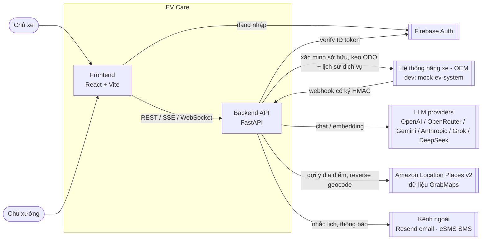
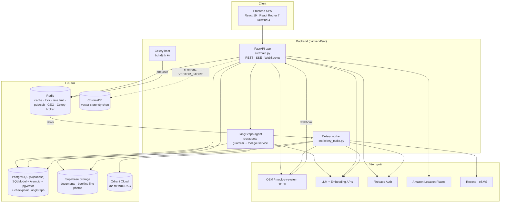
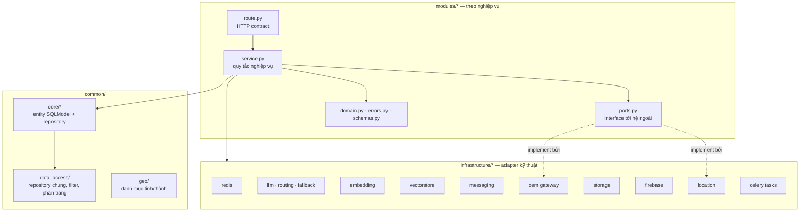
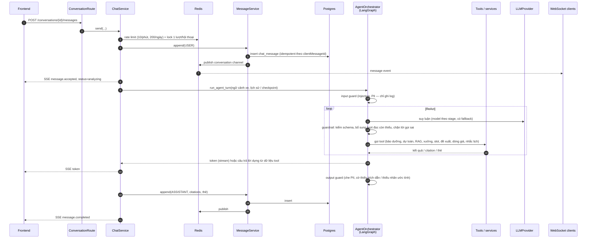
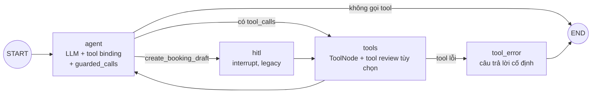
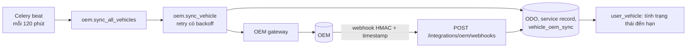
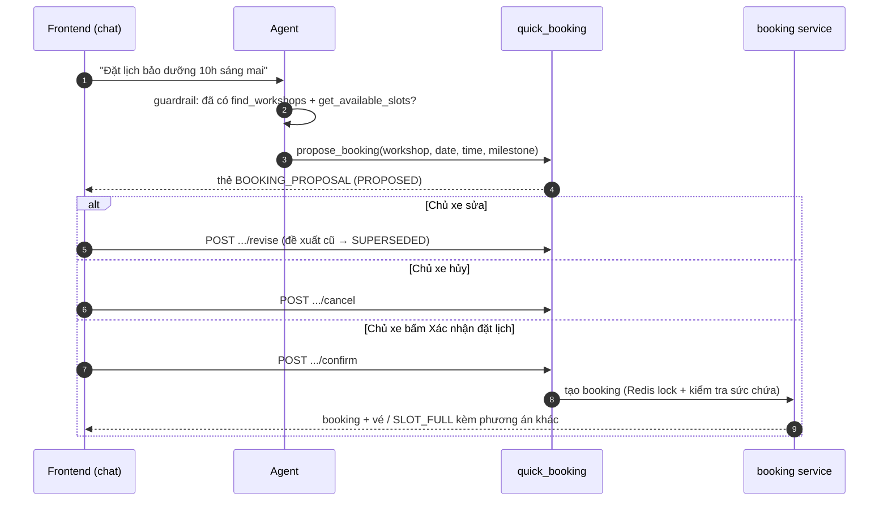
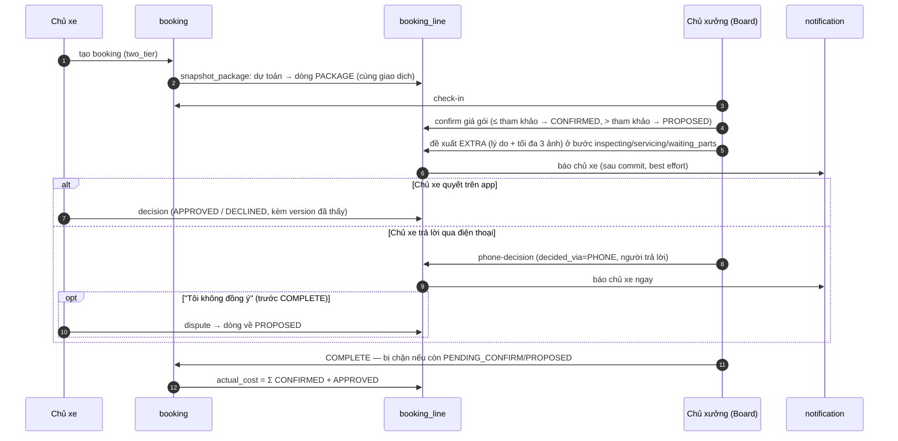

# EV Care — Kiến trúc hệ thống

> Cập nhật: 2026-10-10. Tài liệu mô tả kiến trúc **đang chạy trong code** (`backend/src`, `frontend/src`, các file compose), đối chiếu với `docs/specs` (sprint 1–4, `ai-agent`, `platform`), `docs/designs` và đánh dấu rõ phần chưa nối/đang dự kiến.
> Tài liệu cũ `docs/architecture/README.md` và `docs/architecture_diagram.md` mô tả cấu trúc `backend/app` trước tái cấu trúc — đã lỗi thời, dùng tài liệu này làm chuẩn.
> Chi tiết bảo mật, yêu cầu phi chức năng, vòng đời trạng thái, xử lý lỗi và lộ trình: [architecture-deep-dive.md](architecture-deep-dive.md).
> Lịch sử phạm vi: ngày 02/10/2026 bỏ báo giá, phiếu hỗ trợ (`support_ticket`) và Discord (`user_discord_link`). Ngày 07/10/2026 **khôi phục** báo giá có xưởng duyệt (`quote`, us-049). Ngày 09–10/10/2026 thêm **báo giá hai tầng** gắn vào lịch hẹn (`booking_line`, [designs/bao-gia-hai-tang.md](designs/bao-gia-hai-tang.md)) chạy sau cờ `QUOTE_FLOW` (mặc định `legacy`, bật `two_tier` thì luồng báo giá cũ bị ẩn). Phiếu hỗ trợ và Discord vẫn ngoài phạm vi.

## 1. Tổng quan

EV Care là nền tảng chăm sóc xe điện cho hai nhóm người dùng:

- **Chủ xe (vehicle owner)** — liên kết xe với hãng, theo dõi hạn bảo dưỡng, xem dự toán chi phí, nhận nhắc lịch (trong app, email, SMS), đặt lịch xưởng (qua form hoặc ngay trong chat), theo dõi tiến độ, **duyệt/từ chối từng hạng mục giá** khi xe ở xưởng (two_tier), trả lời hỏi thăm sau dịch vụ, hỏi đáp với trợ lý AI.
- **Chủ xưởng (workshop owner)** — đăng ký xưởng (xác minh với hãng), quản lý **bảng giá** theo model xe, điều phối lịch hẹn trên **Workshop Board** (xác nhận/từ chối, check-in QR, xác nhận giá gói, đề xuất phát sinh kèm ảnh, ghi quyết định chủ xe trả lời qua điện thoại, chuyển trạng thái, cập nhật tiến độ), cấu hình sức chứa và khóa slot, xem trích đoạn hội thoại của khách.

Hệ thống là **modular monolith**: một ứng dụng FastAPI chia module theo nghiệp vụ, kèm Celery worker/beat chạy tác vụ nền. Chưa tách microservice (xem `post-MVP roadmap`).

## 2. Sơ đồ ngữ cảnh (System Context)

## 3. Sơ đồ container

| Container | Công nghệ | Vai trò |
| --- | --- | --- |
| Frontend | React 19, Vite 8, Tailwind 4, TypeScript | Cổng chủ xe (dashboard, xe, lịch sử, dự toán + so sánh, đặt lịch 3 bước, vé booking + QR, thẻ quyết định dòng giá, đổi lịch, hỏi thăm, thông báo, trợ lý AI) và cổng chủ xưởng `/technician` (dashboard, board, check-in, **Bảng giá** `/technician/price-list`, báo giá legacy, sức chứa, cài đặt đặt lịch, thông báo). Gọi API thật qua `shared/api/client.ts` (Firebase ID token, envelope lỗi chuẩn). Mục "Báo giá" trên menu xưởng chỉ hiện khi luồng giá là `legacy` (`GET /pricing-flow`). Mock trong trình duyệt (`src/mocks`, `VITE_API_MOCKS`) **mặc định tắt**; chế độ demo (`DEMO_MODE`) mock toàn bộ để chạy không cần backend. |
| Backend API | FastAPI, SQLModel, Pydantic Settings | Cổng HTTP duy nhất; đăng ký router các module, chuẩn hóa lỗi, CORS; lifespan khởi động Redis toolkit, mở checkpointer Postgres của agent và làm nóng pipeline RAG ở nền. |
| LangGraph agent | LangGraph, LangChain | Orchestrator ReAct duy nhất cho trợ lý AI, được `ChatService` gọi qua `AgentOrchestrator`; có các lớp guardrail tất định quanh LLM. Chi tiết ở mục 5.2. |
| Celery worker + beat | Celery, broker/backend Redis (DB 0/1) | Đồng bộ OEM, nhắc bảo dưỡng và nhắc lịch hẹn, hỏi thăm sau dịch vụ, retry xác minh xưởng, dọn dữ liệu hết hạn, dọn ảnh phát sinh chưa gắn dòng giá, index embedding tin nhắn, hủy lịch không được xác nhận. |
| PostgreSQL | Supabase Postgres, Alembic migrations, pgvector | Nguồn dữ liệu chuẩn (source of truth) cho mọi entity; pgvector lưu embedding tin nhắn/semantic search; lưu checkpoint LangGraph (một thread mỗi hội thoại). Không cấu hình DB thì rơi về SQLite `data/app.db` (khi đó checkpoint chỉ nằm trong bộ nhớ). |
| Redis | Redis 7 | Cache, distributed lock, rate limit (sliding window), pub/sub realtime, chỉ mục GEO tọa độ xưởng, bloom filter, queue; broker Celery. |
| Supabase Storage | bucket `documents`, `booking-line-photos` (private) | Lưu file tài liệu và ảnh hạng mục phát sinh; chỉ cấp signed URL (`infrastructure/storage`). |
| Qdrant | Qdrant Cloud, collection `ev_care_knowledge_base` | Kho tri thức tài liệu kỹ thuật cho tool RAG của agent. `VECTOR_STORE` mặc định trong `config.py` là `qdrant` (có thể đổi `pgvector`/`chroma`). |
| mock-ev-system | FastAPI riêng (`backend/mock-ev-system`) | Giả lập hệ thống hãng: tra cứu xe, xác minh sở hữu/quản lý xưởng, usage (ODO), lịch sử bảo dưỡng, bảo hành; tự bắn webhook. Dùng chung schema với backend qua gói `backend/shared/ev-contracts`. Seed dùng chung ở `backend/mock-ev-system/seed-data/`. |

## 4. Kiến trúc bên trong backend

### 4.1 Phân lớp

Quy tắc phụ thuộc:

- **Route** chỉ nhận request, lấy dependency (`dependency.py`), gọi service, trả response. Lỗi nghiệp vụ là exception riêng của module (`errors.py`), được `main.py` dịch sang một **envelope lỗi chung** `{error: {code, message, details, traceId}}`.
- **Service** giữ quy tắc nghiệp vụ; truy cập DB qua repository trong `common/core`, gọi hệ ngoài qua **port** (ví dụ `OemVehicleGateway`, `PlaceSearchProvider`) để test có thể thay bằng fake.
- **Quy tắc thuần** (không đụng DB) tách vào `domain.py` để service, state machine và test dùng chung — ví dụ máy trạng thái dòng giá ở `modules/booking_line/domain.py`.
- **Infrastructure** là adapter kỹ thuật có interface chuẩn hóa và factory chọn provider theo cấu hình (`LLM_PROVIDER` + `LLM_<STAGE>_*`, `EMBEDDING_PROVIDER`, `VECTOR_STORE`, `FILE_STORAGE`, `LOCATION_PROVIDER`).
- **Agent tool** không truy cập DB trực tiếp: mỗi tool dựng đúng service mà endpoint HTTP dùng (BR-011, BR-1006), nên quy tắc nghiệp vụ chỉ có một nơi.
- Cấu hình tập trung ở `src/config.py` (Pydantic Settings, đọc `.env`).

### 4.2 Các module nghiệp vụ (`backend/src/modules`)

| Module | Chức năng | Endpoint chính (`/api/v1`) |
| --- | --- | --- |
| `vehicle_owner_onboarding` | Chủ xe đăng ký: đăng nhập Google/Firebase, khai báo xe, xác minh sở hữu với OEM, đồng ý điều khoản; giới hạn số lần xác minh sai. | `/oauth/sign-in`, `/onboarding/*` |
| `auth`, `oauth` | Đăng xuất / thu hồi phiên chủ xe, đọc profile từ Firebase token. | `/oauth/*` |
| `workshop_owner_onboarding` | Chủ xưởng đăng ký xưởng, xác minh quyền quản lý với OEM; timeout thì retry nền (60s→720s) qua `scheduler.py` + Celery. | `/workshop-owner/onboarding/*` |
| `workshop_owner_auth` | Đăng xuất, kiểm tra phiên, audit sự kiện đăng nhập của chủ xưởng (lưu 60 ngày). | `/workshop-owner/oauth/logout`, `/workshop-owner/oauth/session` |
| `authorization` | Mô hình phân quyền (role/permission). | — |
| `user_vehicle` | Hồ sơ xe, trạng thái đến hạn bảo dưỡng (theo km và ngày: 500 km / 14 ngày trước hạn; sau bảng định mức tăng theo chu kỳ **15.000 km / 12 tháng** — chu kỳ VinFast từ 01/01/2026). | `/user-vehicles/*` |
| `oem_integration` | Nhận webhook từ hãng (xác thực chữ ký + chống replay), đồng bộ ODO và lịch sử dịch vụ. **ODO chỉ đến từ OEM, không nhập tay.** | `/integrations/oem/webhooks` |
| `cost_estimate` | Dự toán chi phí theo mốc bảo dưỡng: ghép lịch bảo dưỡng theo model × `service_price` của xưởng (giá có hiệu lực theo ngày), thiếu giá thì dùng giá tham khảo; mọi con số gắn nhãn **"Chi phí ước tính"**. Do service tất định tính, LLM không tự cộng số. Booking two_tier dùng kết quả này để chụp dòng giá gói. | `/user-vehicles/{id}/maintenance-milestones`, `/cost-estimate`, `/cost-estimate/compare` |
| `workshop_pricing` | **Bảng giá của xưởng** (D14): xem giá của xưởng cạnh giá tham khảo theo model, sao chép giá tham khảo, đặt giá hàng loạt, thêm/sửa giá với khoảng hiệu lực không chồng lấn. | `/workshop-owner/price-list`, `/copy-reference`, `/set`, `/{priceId}` |
| `notification` | Cài đặt nhắc lịch theo người dùng (số ngày báo trước, kênh); feed thông báo trong app (nhắc bảo dưỡng, nhắc lịch hẹn, hỏi thăm, quyết định dòng giá). Kênh ngoài qua `NotificationService` + adapter: **Email (Resend)** cho nhắc bảo dưỡng, **SMS (eSMS.vn)** cho mọi loại tin; kênh chỉ bật khi đủ khóa cấu hình. Zalo/Telegram chưa có adapter. | `/notification-settings`, `/notifications` |
| `location` | **Tìm địa điểm** (API-LOC-001..003): gợi ý theo từ khóa, chi tiết địa điểm, reverse geocode. Port `PlaceSearchProvider`, adapter Amazon Location Places v2 (`aws`) hoặc `fake`; rate limit theo người dùng; không cache kết quả gợi ý (điều khoản AWS). | `/locations/suggest`, `/locations/places/{placeId}`, `/locations/reverse` |
| `booking` | Tìm xưởng gần theo vị trí (**chỉ mục Redis GEO** thu hẹp ứng viên rồi xếp hạng; Redis lỗi thì quét toàn bộ), xem khung giờ trống theo sức chứa, giữ chỗ bằng Redis lock, hủy trong thời gian hold; vé booking (tra theo mã, QR), xác nhận sẽ đến, hủy, đổi lịch, xem tiến độ. Ghi `pricing_flow` lúc tạo booking. | `/workshops/nearby`, `/workshops/{id}/availability`, `/bookings`, `/bookings/{id}/hold`, `/bookings/by-code/{code}`, `/bookings/{id}/attendance-confirmation`, `/cancel`, `/qr`, `/reschedule`, `/progress` |
| `booking_line` | **Báo giá hai tầng** ([designs/bao-gia-hai-tang.md](designs/bao-gia-hai-tang.md)): dòng PACKAGE chụp từ dự toán lúc tạo booking; xưởng xác nhận giá gói khi nhận xe, đề xuất/sửa/rút hạng mục EXTRA kèm ảnh, ghi quyết định chủ xe trả lời qua điện thoại; chủ xe duyệt/từ chối hoặc phản đối quyết định qua điện thoại. Chặn `START`/`COMPLETE` khi còn dòng chưa chốt và tự tính `actual_cost`. | Chủ xe: `/pricing-flow`, `/bookings/{id}/lines`, `/lines/{lineId}/decision`, `/lines/{lineId}/dispute`. Xưởng: `/workshop-owner/bookings/{id}/lines` (GET/POST), `/lines/{lineId}` (PATCH), `/confirm`, `/phone-decision`, `/withdraw`, `/line-photos` |
| `quick_booking` | Đặt lịch nhanh từ chat (us-061): tạo **đề xuất** (`BookingProposal`), chủ xe sửa/hủy/xác nhận; chỉ nút **Xác nhận đặt lịch** trên thẻ mới tạo booking, gõ chữ "xác nhận" không tính. | `/conversations/{id}/quick-booking`, `/booking-proposals/{pid}/confirm`, `/revise`, `/cancel` |
| `workshop_board` | Workshop Board (F8): danh sách lịch hẹn, tra theo mã, chuyển trạng thái (xác nhận/từ chối, check-in, in progress, completed), sức chứa, khóa slot, chế độ đặt lịch auto/manual, cập nhật tiến độ dịch vụ; với booking two_tier hiển thị thẻ giá và các dòng chờ chủ xe. | `/workshop-owner/bookings*`, `/capacity`, `/slot-blocks`, `/booking-settings`, `/bookings/{id}/progress` |
| `quote` | Báo giá có chủ xưởng duyệt (F5b, us-049) — **luồng legacy**: chủ xe lập nháp từ dự toán và gửi duyệt; chủ xưởng duyệt/sửa giá/từ chối; booking legacy gắn báo giá đã duyệt; job `quote.purge_stale_drafts` dọn nháp. Khi `QUOTE_FLOW=two_tier` không tạo báo giá mới (UI ẩn, booking mới từ chối gắn báo giá); báo giá cũ vẫn xem được từ booking của nó. | `/quotes*`, `/workshop-owner/quotes*` |
| `service_progress` | Tiến độ dịch vụ chi tiết 6 bước (F8b, us-057): domain, lỗi, service; được `workshop_board` (ghi) và `booking` (đọc) dùng, không có router riêng. Hạng mục phát sinh chỉ được đề xuất ở bước `inspecting`/`servicing`/`waiting_parts`. | — |
| `follow_up` | Hỏi thăm sau dịch vụ (F9, us-041): chủ xe xem và gửi phản hồi (điểm hài lòng + nhận xét). Phân loại phản hồi bằng luật từ khóa/điểm, hoặc **bộ phân loại LLM** (AI-007 TOOL-702, bật bằng `FOLLOW_UP_LLM_CLASSIFIER_ENABLED`, lỗi thì quay về luật); lưu `has_issue` và `safety_flag` (dấu hiệu an toàn luôn kéo theo `has_issue`). App hiện lời khuyên an toàn + hotline xưởng; booking hoàn tất có liên kết sang trang hỏi thăm. | `/follow-ups/{id}`, `/follow-ups/{id}/response` |
| `conversation` | Chat với trợ lý AI: tạo/liệt kê/xóa hội thoại, lịch sử, gửi tin (SSE stream), tìm kiếm, semantic search, WebSocket realtime; xưởng xem trích đoạn hội thoại gắn với lịch hẹn/báo giá. | `/conversations/*`, WS `/conversations/{id}/stream`, `/workshop/{bookings\|quotes}/{id}/conversation-excerpt` |
| `health` | Kiểm tra trạng thái phụ thuộc. | `/health/dependencies` (và `/health` ở gốc app) |
| `examples` | Module mẫu (CRUD xe) tham khảo cách viết module; vẫn được đăng ký router. | `/vehicles/*` |

### 4.3 Mô hình dữ liệu (`backend/src/common/core`)

| Nhóm | Entity |
| --- | --- |
| `identity` | `VehicleUser`, `WorkshopOwner` |
| `vehicle` | `UserVehicle`, `VehicleOdometerReading`, `VehicleServiceRecord`, `VehicleOemSync` |
| `maintenance` | `MaintenanceRule`, `Reminder`, `Booking` (có `pricing_flow` = `legacy` \| `two_tier`), `BookingLine`, `BookingLinePhoto`, `BookingStatusEvent`, `BookingReschedule`, `BookingProposal`, `Quote`, `QuoteItem`, `ServiceProgress` |
| `workshop` | `Workshop`, `ServicePrice` (giá theo model, có khoảng hiệu lực), `WorkshopSlotBlock` |
| `notification` | `UserNotificationSetting`, `UserNotificationChannel`, `ReminderDelivery`, `BookingReminder`, `BookingReminderDelivery`, `FollowUpDelivery` |
| `conversation` | `Conversation`, `ChatMessage` |
| `knowledge` | `OfficialDocument`, `DocumentChunk`, `MaintenanceRuleSource` |
| `crm` | `CustomerProfileCdp`, `FollowUp` (có `has_issue`, `safety_flag`) |

Đã **loại bỏ**: `SupportTicket`, `UserDiscordLink`. Bảng `quote`/`quote_item` được giữ cho luồng legacy. Schema được quản lý bằng Alembic (`backend/alembic/versions`; gần nhất: `d2a8c6e4f1b7_add_booking_line_two_tier`, `a7e3c1f9d4b2_booking_line_phone_decision`, `e8c4b1d7a2f5_follow_up_safety_flag`), dữ liệu mẫu ở `backend/seed.sql`; lịch bảo dưỡng theo model và giá xưởng mẫu nạp qua seed (two-tier step 1). Bảng checkpoint của LangGraph do `langgraph-checkpoint-postgres` tự tạo, không nằm trong Alembic.

### 4.4 Lớp hạ tầng (`backend/src/infrastructure`)

| Package | Nội dung |
| --- | --- |
| `redis` | `RedisToolkit` khởi động trong lifespan; gồm cache, lock (critical section), rate limit, pub/sub, sorted set, geo, bloom, queue; key có prefix `p146`. |
| `llm` | Interface `LLMProvider` (`chat`, `chat_stream`) + provider Anthropic, Gemini, và OpenAI-compatible (OpenAI, OpenRouter, Grok, DeepSeek). `routing.py` chọn provider/model **theo giai đoạn** (`orchestrator`, `rewrite`, `rag`, `booking`) qua `LLM_<STAGE>_PROVIDER/MODEL`, để trống thì kế thừa mặc định. `fallback.py` thử lại trên `LLM_FALLBACK_PROVIDER` (hiện chỉ `gemini`) khi lỗi tạm thời và **chưa** phát token nào. |
| `embedding` | Interface embedding đa provider: OpenAI, OpenRouter, Gemini, HuggingFace, local (sentence-transformers). Kích thước vector cấu hình qua `EMBEDDING_DIMENSIONS`. |
| `vectorstore` | Interface `VectorStore` với backend `qdrant`, `pgvector`, `chroma`; `knowledge_store` cho tài liệu chính hãng, `record_policy` quyết định bản ghi nào được embed. |
| `messaging` | `MessageService` — **nơi ghi duy nhất** vào `chat_message`: commit DB → publish Redis pub/sub → (tùy chọn) enqueue index embedding. |
| `oem` | Adapter httpx tới hệ thống hãng; lỗi mạng/5xx quy về `OemTimeoutError` để service xử lý như trạng thái "pending". |
| `location` | Adapter `aws_places.py` (Amazon Location Places v2, region `ap-southeast-1` có dữ liệu GrabMaps) và `fake.py` cho dev/test; chọn qua `LOCATION_PROVIDER` (mặc định `fake`). |
| `storage`, `supabase` | Interface lưu file + Supabase Storage (signed upload/download URL). |
| `firebase`, `firestore` | Khởi tạo Firebase Admin để verify ID token. |
| `qdrant`, `chromadb` | Client dịch vụ vector chuyên dụng. |
| `fastapi`, `logging` | Middleware (request id, audit, lỗi) và cấu hình log (mặc định console dễ đọc, `LOG_JSON=true` để ra JSON). |
| `celery/tasks` | Tác vụ nền (xem mục 6). |

## 5. Các luồng chính

### 5.1 Chat với trợ lý AI (US-025, US-061)

Stream token dùng **SSE** trên chính request gửi tin; **WebSocket** chỉ để đẩy tin đã lưu tới mọi thiết bị đang mở hội thoại. `ChatService` lo rate limit, lock, lưu tin và SSE; việc suy luận + gọi tool giao cho `AgentOrchestrator.run_agent_turn`.

Điểm quan trọng:

- Gửi lại cùng `clientMessageId` sẽ phát lại câu trả lời đã có, không gọi LLM lần nữa.
- Client ngắt kết nối (kể cả khi người dùng bấm dừng trên giao diện) thì lượt trả lời bị hủy; checkpoint của hội thoại được xóa để lượt sau dựng lại từ lịch sử đã lưu (`CHAT_RUN_CLEANUP_TIMEOUT_SECONDS` giới hạn thời gian dọn dẹp trước khi nhả lock).
- Lượt có gọi tool nghiệp vụ (bảo dưỡng, dự toán, xưởng, slot, đề xuất, RAG) **không stream token nháp** của model: câu trả lời chỉ được phát sau khi qua guardrail, tránh lộ con số chưa kiểm chứng.
- Lỗi agent không chạy lại lượt (tránh side effect kép); trả câu xin lỗi cố định kèm hotline.
- Embedding tin nhắn và semantic search mặc định **tắt** (`CONVERSATION_SEMANTIC_INDEX_ENABLED=false`).
- REST của conversation xác thực bằng **Firebase ID token** (`get_current_user_id`); header `X-User-Id` chỉ dùng cho công cụ cục bộ và bị chặn khi `APP_ENV=production`. **WebSocket** xác thực bằng frame `auth` đầu tiên mang Firebase ID `token`, kiểm quyền sở hữu hội thoại và giới hạn số kết nối mỗi người dùng.
- API gửi tin chỉ nhận `clientMessageId` + `content`; vai trò tin do server gán.

### 5.2 Agent LangGraph và RAG (`backend/src/agents`)

Một **orchestrator duy nhất + tool rõ ràng + nghiệp vụ tất định** (không multi-agent): LLM hiểu ý định, chọn tool và diễn giải; số liệu (đến hạn, giá, sức chứa, tạo booking) do service backend tính. Ngữ cảnh xe (model, ODO, lần bảo dưỡng gần nhất) được nạp vào `AgentState` trước khi gọi LLM; `user_id`, `user_vehicle_id`, `conversation_id` lấy từ `RunnableConfig` của phiên chat (`AgentCtx`), không do LLM sinh ra, nên không thể thao tác trên xe của tài khoản khác.

| Tool | Loại | Module/service gọi tới |
| --- | --- | --- |
| `get_due_maintenance` | Đọc | `user_vehicle` (`get_maintenance_status`) |
| `estimate_service_cost` | Đọc | `cost_estimate` (`estimate_for_request`) |
| `search_ev_knowledge` | Đọc | `tools/RAG` (Qdrant: viết lại câu hỏi → hybrid vector + BM25 → rerank → cổng bằng chứng → sinh câu trả lời kèm trích dẫn) |
| `find_workshops` | Đọc | `booking` (`find_nearby`) |
| `get_available_slots` | Đọc | `booking` (`check_availability`) |
| `propose_booking` | Đề xuất | `quick_booking` (`propose_from_agent`) — chỉ tạo `BookingProposal` + thẻ `BOOKING_PROPOSAL`, **không** tạo booking, không giữ chỗ |
| `get_booking_lines` | Đọc | `booking_line` — dòng giá/phát sinh của booking, trạng thái tiếng Việt, thẻ chat với booking two_tier; tên/lý do của xưởng bọc như dữ liệu không tin cậy. Không tool nào ghi `line_status` |
| `create_draft_quote`, `get_quote_status` | Ghi nháp / Đọc | `quote` — **chỉ khi `QUOTE_FLOW=legacy`** (`build_customer_agent_tools` bỏ `create_draft_quote` khi `two_tier`) |
| `get_reminder_settings`, `get_reminder_context` | Đọc | `notification` (cài đặt nhắc, ngữ cảnh nhắc) |
| `update_reminder_settings` | Ghi | `notification` — chỉ đổi đúng trường chủ xe yêu cầu rõ (`reminder_intent.explicit_reminder_patch`), số ngày trong `MIN_LEAD_DAYS..MAX_LEAD_DAYS` |

**Các lớp kiểm soát quanh LLM** (đều tất định trừ tool review):

| Lớp | File | Việc làm |
| --- | --- | --- |
| Input guard | `conversation_guards/input_guard.py` | Phát hiện dấu hiệu prompt injection và PII trong tin người dùng; hiện chỉ ghi log. |
| Guarded calls | `guardrails.py`, `contracts.py`, `booking_policy.py`, `reminder_intent.py` | Kiểm arguments theo schema công khai của tool trước khi chạy; ép lượt đọc bắt buộc trước khi đề xuất (xưởng → slot → đề xuất); chỉ gắn `workshop_id` khi người dùng nêu đích danh; chặn câu khẳng định "đã đặt lịch"/"đã đổi nhắc" khi không có kết quả tool tương ứng. |
| Grounding | `business_grounding.py`, `booking_grounding.py`, `evidence.py` | Dựng câu trả lời về hạn bảo dưỡng, dự toán, slot, đề xuất **trực tiếp từ kết quả tool của lượt hiện tại** (không gọi LLM thêm); chỉ gom trích dẫn RAG của câu hỏi hiện tại. |
| Tool review (tùy chọn) | `tool_review.py` | Một lần gọi LLM (stage `booking`) duyệt `propose_booking`/`update_reminder_settings` trước khi chạy; bật bằng `LLM_BOOKING_CHECK_ENABLED`. Bị từ chối → `TOOL_REVIEW_REJECTED`. |
| Tool error | `graph.py` (`tool_error`) | Tool lỗi thì kết thúc lượt bằng câu trả lời cố định, không để LLM đoán tiếp. |
| Output guard | `conversation_guards/output_guard.py` | Luôn che PII (VIN, CCCD, SĐT, biển số, email); gắn cờ câu khẳng định kỹ thuật thiếu trích dẫn và số tiền thiếu nhãn ước tính (MVP: ghi log, chặn cứng nằm ở eval CI). |

- **RAG** (`tools/RAG/query`): `rag_pipeline.py` có cache LRU trong tiến trình và được làm nóng ở lifespan. `generator.py` chạy chuỗi cổng bằng chứng trước khi sinh: `source_gate` (xung đột model xe trong nguồn), `documented_procedure`/`procedure_gate` (chỉ trích nguyên quy trình có trong tài liệu, không tự ghép bước), `maintenance_gate` (bảng định kỳ thiếu cột), `policy_gate` (hạn bảo hành theo xe). Thiếu bằng chứng → `fallback_required=true`, câu trả lời giới hạn ở "tài liệu chưa nêu" (`answer_scope`).
- **Định tuyến LLM:** orchestrator, rewriter, RAG generator và tool review mỗi giai đoạn có thể dùng provider/model riêng (`LLM_ORCHESTRATOR_*`, `LLM_REWRITE_*`, `LLM_RAG_*`, `LLM_BOOKING_*`; OpenRouter còn có `OPENROUTER_*_MODEL` và thứ tự endpoint). Mỗi lời gọi giới hạn `LLM_CALL_TIMEOUT_SECONDS` (mặc định 10 s); khi có fallback, model chính không retry để fallback còn kịp trong hạn của lượt chat.
- **Checkpoint:** `checkpoint.py` mở `AsyncPostgresSaver` (pool kết nối có keepalive, loại kết nối chết) trong lifespan API khi `AGENT_CHECKPOINT_MODE` là `postgres`, hoặc `auto` với DB Postgres; ngược lại dùng `MemorySaver`. Thread = `conversation_id`; lượt mới chỉ nạp các tin chưa có trong checkpoint. Sau khi lưu tin trợ lý, `record_committed_answer` đổi ID tin cuối sang ID trong DB; lệch thì xóa thread và dựng lại lần sau.
- **Cổng xác nhận (HITL):** booking chỉ được tạo khi chủ xe bấm "Xác nhận đặt lịch" (API-QB-02); backend kiểm chứng token của thẻ. Câu chữ "xác nhận" không được tính (us-061, quyết định 03/10/2026). Nhánh `hitl` (interrupt cho `create_booking_draft`) còn trong graph nhưng không tool nào trong danh mục hiện tại kích hoạt nó.
- **Indexing RAG** (`tools/RAG/ingestion`): nạp tài liệu → làm sạch → chunk → embedding → lưu Qdrant.
- **Đánh giá:** harness cấp agent ở `eval/` (metric tool-calling, trajectory, thống kê có khoảng tin cậy; bộ ca `eval/test_cases/agent_cases_v2*.json`); workflow `.github/workflows/agent-evaluation.yml` chạy bộ offline trên mỗi PR đụng `backend/**`, bản gọi model thật/staging chạy thủ công.
- Chi tiết thiết kế agent ở `backend/src/agents/README.md`.

### 5.3 Đồng bộ dữ liệu xe từ OEM (FEAT-VEH-001)

Hai đường cập nhật: **pull** định kỳ và **push** qua webhook. Lỗi liên tiếp ≥ 3 lần thì cảnh báo. ODO quá 30 ngày được đánh dấu cũ.

### 5.4 Nhắc bảo dưỡng và nhắc lịch hẹn (FEAT-NOTI-001, FEAT-NOTI-002)

- **Nhắc mốc bảo dưỡng:** Celery beat chạy `reminder.send_all` lúc 08:00 (Asia/Ho_Chi_Minh) → với mỗi xe sắp đến hạn theo `lead days` của người dùng → ghi `Reminder` (hiện trong feed Thông báo của app) → nếu chủ xe bật kênh ngoài, `NotificationService` chọn adapter theo kênh → ghi `ReminderDelivery`.
- **Kênh ngoài:** Email qua Resend (chỉ nhắc bảo dưỡng, chỉ gửi tới email đã xác minh; cần `RESEND_API_KEY`, `EMAIL_FROM`, `RESEND_WEBHOOK_SECRET`) và SMS qua eSMS.vn (mọi loại tin, gửi tới số E.164 lúc onboarding; cần `ESMS_API_KEY`, `ESMS_SECRET_KEY`, `ESMS_BRANDNAME`, có chế độ sandbox). Kênh chưa đủ cấu hình thì không hiện cho chủ xe. Mọi tin vẫn vào feed trong app.
- **Nhắc lịch hẹn 24h:** `booking_reminder.send_due` (chu kỳ cấu hình theo phút) nhắc booking `confirmed` trước giờ hẹn, ghi `BookingReminder`/`BookingReminderDelivery`; chủ xe xác nhận sẽ đến / đổi / hủy ngay từ lời nhắc.
- Lỗi `TIMEOUT`, `RATE_LIMITED`, `UNAVAILABLE` được thử lại ở lần chạy sau, tối đa 3 lần. Nội dung nhắc dùng template, không do LLM soạn, không chứa dữ liệu nhạy cảm. Thêm kênh mới chỉ cần viết adapter và đăng ký trong `notification/dependency.py` (`configured_adapters`).

### 5.5 Đặt lịch theo sức chứa (FEAT-BOOK-001/002)

1. Tìm tối đa 5 xưởng gần nhất và khung giờ trống trong 7 ngày tới (slot 60 phút, trừ `WorkshopSlotBlock`). `booking/geo_index.py` giữ tọa độ xưởng trong **Redis GEO** (TTL `WORKSHOP_GEO_CACHE_TTL_SECONDS`, tự dựng lại khi dấu vân tay bảng `workshop` thay đổi), lấy `WORKSHOP_GEO_CANDIDATES` ứng viên gần nhất rồi `WorkshopLocationFinder.rank` xếp hạng như cũ; Redis lỗi thì quét toàn bộ. Địa điểm do người dùng nhập được chuẩn hóa qua module `location`.
2. Đặt chỗ: lấy Redis lock theo xưởng + slot (TTL 10s) để kiểm tra sức chứa, tránh overbooking. Slot đầy thì trả `SLOT_FULL` kèm gợi ý thay thế. Với `QUOTE_FLOW=two_tier`, cùng giao dịch tạo booking sẽ chụp dự toán thành các dòng PACKAGE (mục 5.8).
3. Chủ xe được hủy trong 10 phút giữ chỗ (`hold_minutes`).
4. Xưởng chế độ thủ công phải xác nhận trong 12 giờ (`booking_ws_confirm_deadline_hours`); `booking.cancel_unconfirmed` (mỗi 5 phút) tự hủy nếu quá hạn.
5. Sau khi `confirmed`: vé có mã + QR; xưởng check-in bằng QR/mã (`/c/{bookingCode}`) hoặc bấm tay; chủ xe có thể đổi/hủy lịch.

Vòng đời `booking.status`: `pending → confirmed → checked_in → in_progress → completed`, hoặc `cancelled`; mỗi lần đổi ghi `BookingStatusEvent`. Trong giai đoạn xe ở xưởng, `ServiceProgress` ghi tiến độ chi tiết 6 bước mà chủ xe xem được. Booking two_tier có thêm điều kiện chặn ở `checked_in → in_progress` và `in_progress → completed` (mục 5.8).

### 5.6 Đặt lịch nhanh từ trợ lý AI (US-061)

`BookingProposal` có trạng thái `proposed → confirmed | cancelled | superseded | expired`; nguồn `QUICK_BOOKING` hoặc `CHAT_AGENT`.

### 5.7 Hỏi thăm sau dịch vụ (FEAT-CRM-001)

Khi booking `completed`, job `follow_up.send_due` (mỗi 15 phút) mở `FollowUp` và gửi **một** câu hỏi thăm qua `NotificationService` (ghi `FollowUpDelivery`, retry lỗi tạm thời, tối đa 3 lần). Chủ xe trả lời trong app tại `/follow-ups/{id}` (vé booking đã hoàn tất có liên kết sang). Phản hồi được phân loại bằng luật hoặc bộ phân loại LLM (nhận xét của chủ xe đặt trong khối phân cách, coi là dữ liệu; đầu ra hỏng thì quay về luật), ghi `has_issue` và `safety_flag`; app hiện lời khuyên an toàn và hotline xưởng. `follow_up.close_expired` (mỗi giờ, phút 5) tự đóng follow-up không phản hồi sau 72 giờ (`NO_RESPONSE`).

### 5.8 Báo giá hai tầng gắn vào lịch hẹn (`QUOTE_FLOW=two_tier`)

Thiết kế: [designs/bao-gia-hai-tang.md](designs/bao-gia-hai-tang.md). Mỗi booking ghi `pricing_flow` lúc tạo; mọi kiểm tra đọc cột này nên bật/tắt cờ chỉ ảnh hưởng booking mới.

- Mọi thao tác ghi dòng giá khóa hàng `booking` trước (`SELECT … FOR UPDATE`), giống bước COMPLETE, nên quyết định không thể chen giữa lúc kiểm tra và hoàn tất.
- Quyết định của chủ xe dùng `version` của dòng: chỉ duyệt được đúng mức giá đã thấy. Từ chối hạng mục an toàn (phanh, lốp, lái, đèn) cần xác nhận thêm.
- Ảnh phát sinh tải thẳng lên bucket private qua signed URL vào `booking-lines/{booking_id}/pending/…`; khi gửi dòng, backend kiểm prefix, thời điểm, kích thước ≤ 5 MB, đúng định dạng JPEG/PNG/WebP. Ảnh không bao giờ vào ngữ cảnh LLM. `booking_line.purge_pending_photos` xóa ảnh chờ quá 24 giờ không gắn dòng nào.
- Thẻ quyết định trên vé booking là nguồn sự thật; thông báo chỉ là best effort.

### 5.9 Tìm địa điểm (API-LOC-001..003)

Spec: [specs/platform/location-search.api.md](specs/platform/location-search.api.md). Chủ xe hoặc chủ xưởng đã xác thực gọi `/locations/suggest` (gợi ý theo từ khóa, giới hạn `LOCATION_SUGGEST_RATE_PER_MINUTE`), `/locations/places/{placeId}` (tọa độ + địa chỉ) và `/locations/reverse` (bán kính `LOCATION_REVERSE_RADIUS_METERS`). Lỗi kiểm tra request dùng envelope chuẩn với HTTP 422; vượt rate limit trả `Retry-After`. Công cụ `tools/workshop_crawl` dùng Amazon Location / Google Places để thu thập vị trí xưởng thật (dữ liệu mẫu Hà Nội), không chạy trong backend.

## 6. Tác vụ nền (Celery)

| Task / lịch | Tần suất | Mục đích |
| --- | --- | --- |
| `oem.sync_all_vehicles` | mỗi 7200s | Kéo ODO + lịch sử dịch vụ tất cả xe |
| `reminder.send_all` | 08:00 hằng ngày | Gửi nhắc bảo dưỡng |
| `booking_reminder.send_due` | mỗi `BOOKING_REMINDER_JOB_INTERVAL_MINUTES` phút | Nhắc lịch hẹn 24h |
| `booking.cancel_unconfirmed` | mỗi 300s | Hủy lịch xưởng không xác nhận |
| `booking_line.purge_pending_photos` | hằng giờ (phút 20) | Xóa ảnh phát sinh chưa gắn dòng giá quá 24h |
| `quote.purge_stale_drafts` | 03:00 hằng ngày | Dọn báo giá nháp quá hạn (luồng legacy) |
| `follow_up.send_due` | mỗi 900s | Gửi hỏi thăm sau dịch vụ |
| `follow_up.close_expired` | hằng giờ (phút 5) | Đóng hỏi thăm quá 72h không phản hồi |
| `workshop.reconcile_verifications` | mỗi 300s | Enqueue lại các xác minh xưởng bị mất retry |
| `workshop.purge_expired_onboarding` | 02:00 hằng ngày | Xóa hồ sơ đăng ký xưởng dở dang quá hạn |
| `workshop_auth.purge_events` | 02:30 hằng ngày | Xóa audit đăng nhập > 60 ngày |
| `embedding.index_message` | theo sự kiện | Embed tin nhắn (khi bật semantic index) |
| `reminder.remind_vehicle`, `oem.sync_vehicle`, `workshop.retry_verification` | theo sự kiện | Tác vụ con do job tổng hợp enqueue |
| `auth.revoke_session`, `workshop_auth.revoke_session` | theo sự kiện | Thu hồi phiên Firebase khi đăng xuất |

## 7. Triển khai và môi trường

| Môi trường | Cách chạy |
| --- | --- |
| Local — full container | `docker-compose.local.yaml` / `docker-compose.dev.yaml` (script `scripts/dev-stack.*`, `compose.local.*`). |
| Local — debug backend | `docker-compose.infra.yaml` chạy mock-ev-system (:8100), Redis (:6379), Chroma (:8001); backend chạy trực tiếp `uv run uvicorn src.main:app --reload` (script `scripts/infra-stack.*`). Trên Windows, checkpointer Postgres cần `SelectorEventLoop` (`agents/checkpoint.selector_loop_factory`). Xem [RUN_LOCAL_BACKEND.md](RUN_LOCAL_BACKEND.md). |
| Hạ tầng dev trên Railway | `scripts/railway-infra.sh` dựng Redis + mock-ev-system trên Railway, backend chạy local; webhook trỏ về backend qua public URL. Xem [RUN_LOCAL_BACKEND_RAILWAY.md](RUN_LOCAL_BACKEND_RAILWAY.md). |
| Staging | Backend + worker trên Railway chạy nhánh `develop`; smoke test theo `TODOS.md`. Bật báo giá hai tầng theo runbook trong `TODOS.md` (`QUOTE_FLOW=two_tier`). |
| Frontend | Vite dev server ở local. Deploy lên Vercel, `/api/*` chuyển tiếp sang backend Railway: xem [deployments/VERCEL_FRONTEND_DEPLOYMENT.MD](deployments/VERCEL_FRONTEND_DEPLOYMENT.MD). Chế độ demo chạy hoàn toàn bằng mock trong trình duyệt. |
| Image backend | `dockerfiles/Dockerfile`, compose gốc `docker-compose.yml` expose :8000, healthcheck `/health`. |
| Dịch vụ managed | Supabase (Postgres + Storage), Qdrant Cloud, Firebase Auth, LLM API, Amazon Location Places, Resend, eSMS. |

Cờ cấu hình ảnh hưởng kiến trúc: `QUOTE_FLOW` (`legacy`/`two_tier`), `LOCATION_PROVIDER` (`fake`/`aws`), `LLM_<STAGE>_PROVIDER/MODEL`, `LLM_FALLBACK_PROVIDER`, `LLM_BOOKING_CHECK_ENABLED`, `FOLLOW_UP_LLM_CLASSIFIER_ENABLED`, `CONVERSATION_SEMANTIC_INDEX_ENABLED`, `VECTOR_STORE`, `EMBEDDING_PROVIDER`.

Kiểm thử thủ công qua Swagger dùng **Firebase Auth Emulator**; `X-User-Id` chỉ là lối đi cục bộ cho tool/script và bị tắt ở production. CI: `ci.yml` (ruff + pytest backend, typecheck + build frontend) và `agent-evaluation.yml` (eval agent offline trên PR).

## 8. Quyết định kiến trúc chính

| Quyết định | Lý do |
| --- | --- |
| Modular monolith + Celery | Phát triển nhanh cho MVP, ranh giới module rõ để tách service sau. |
| Port/adapter cho hệ ngoài (OEM, LLM, embedding, vector store, storage, kênh thông báo, tìm địa điểm) | Đổi provider bằng cấu hình, test bằng fake, mock-ev-system thay OEM thật khi dev. |
| Một orchestrator ReAct + tool gọi service thật | Kiểm soát trace/guardrail tập trung, tránh multi-agent khó kiểm soát ở MVP; số liệu do backend tính, LLM chỉ diễn giải. |
| Guardrail tất định quanh LLM, câu trả lời nghiệp vụ dựng từ kết quả tool | Model nhỏ/rẻ vẫn không bịa số, không bỏ bước đọc bắt buộc; kiểm chứng được bằng unit test và eval offline. |
| Chọn model theo giai đoạn + fallback khi lỗi tạm thời | Mỗi bước (điều phối, viết lại câu hỏi, RAG, duyệt tool) dùng model phù hợp chi phí/độ chính xác; fallback chỉ trước token đầu để không trộn hai câu trả lời. |
| Agent chỉ **đề xuất**, người dùng bấm nút mới tạo booking | Không side effect khi chưa xác nhận rõ; cổng HITL do backend kiểm chứng. |
| Báo giá hai tầng gắn vào booking, sau cờ `QUOTE_FLOW`, ghi `pricing_flow` theo từng booking | Giá gói chốt lúc đặt, phát sinh do chủ xe duyệt từng dòng; bật/tắt cờ an toàn vì booking cũ giữ luồng của nó. Không tool AI nào ghi trạng thái dòng giá. |
| Khóa hàng booking cho mọi thao tác dòng giá + `version` cho quyết định | Không có quyết định chen giữa lúc kiểm tra và COMPLETE; chủ xe chỉ duyệt đúng giá đã thấy. |
| Postgres là nguồn dữ liệu chuẩn; Redis chỉ là phụ trợ | Pub/sub/cache/GEO lỗi không làm mất dữ liệu; tìm xưởng quay về quét DB; client đồng bộ lại qua REST. |
| Checkpoint LangGraph trong Postgres, xóa khi lượt lỗi/hủy | Giữ ngữ cảnh tool giữa các lượt; không bao giờ chạy lại lượt dở. |
| Một nơi ghi duy nhất cho tin nhắn (`MessageService`) | Thứ tự commit → publish → index nhất quán cho mọi kênh. |
| SSE cho token, WebSocket cho fan-out | Stream một chiều đơn giản; WebSocket phục vụ đa thiết bị. |
| Redis lock khi đặt lịch | Chống overbooking khi nhiều người đặt cùng slot. |
| ODO chỉ từ OEM (pull + webhook) | Đảm bảo độ tin cậy của mốc bảo dưỡng. |
| Feed trong app là kênh chắc chắn, kênh ngoài là adapter cắm thêm | Email/SMS lỗi không làm mất thông báo; thêm kênh không đổi nghiệp vụ. |

## 9. Khoảng trống và hướng phát triển

Phần này đã được tách sang [architecture-deep-dive.md](architecture-deep-dive.md#5-khoảng-trống-và-hướng-phát-triển), cùng với bảo mật, yêu cầu phi chức năng, vòng đời trạng thái và xử lý lỗi. Các khoảng trống chính:

- **P0 (chặn production):** bỏ hẳn hoặc có test chặn fallback `X-User-Id` ở production; output guard mới chỉ ghi log với lỗi thiếu trích dẫn/nhãn ước tính.
- **P1:** dọn nhánh `hitl` legacy và cập nhật spec AI-001; thống nhất kho vector (Qdrant ↔ pgvector); đưa eval gọi model thật và `npm test` vào CI; bổ sung tracing/metric; danh sách hạng mục an toàn chính thức từ hãng.
- **Sau MVP:** GCP + microservice, Cloud Functions/Pub/Sub, agent A2A, OEM qua MCP, chat nhiều bên, chat cho khách chưa đăng ký.
