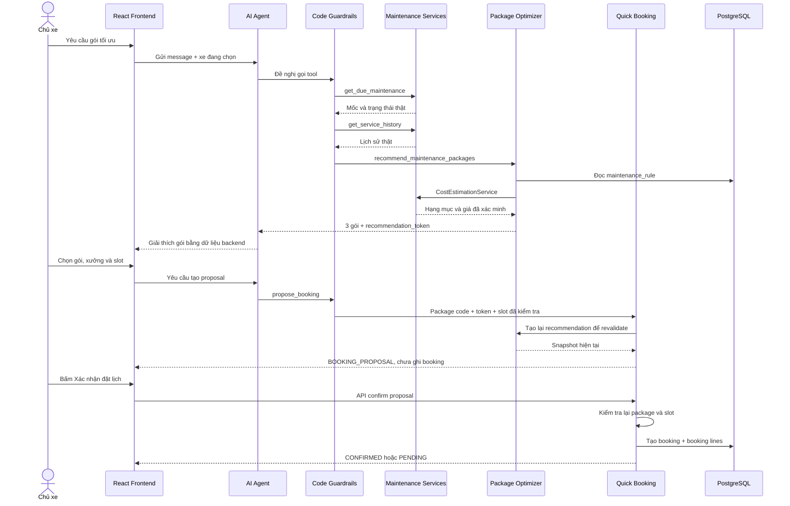

# Gợi ý gói bảo dưỡng tối ưu

> Tài liệu sản phẩm và kỹ thuật cho tính năng gợi ý gói bảo dưỡng tối ưu của EV Care AI Agent.
> Trạng thái source: đã tích hợp vào nhánh `develop` ngày 11/10/2026.

## 1. Tổng quan

Tính năng giúp chủ xe lựa chọn phạm vi bảo dưỡng phù hợp dựa trên dữ liệu thật của hệ thống:

- Xe đang được chọn trong phiên đăng nhập.
- ODO và mốc bảo dưỡng kế tiếp.
- Lịch sử bảo dưỡng đã ghi nhận.
- Quy tắc bảo dưỡng `maintenance_rule` của đúng model và đúng mốc.
- Giá dịch vụ của xưởng hoặc giá tham khảo do backend cung cấp.
- Trạng thái bảo hành mà dịch vụ dự toán xác định được.
- Ngân sách, thời gian và mức ưu tiên do người dùng nêu.

Backend tạo ba gói cố định:

| Mã gói | Tên hiển thị | Phạm vi |
|---|---|---|
| `ESSENTIAL` | Thiết yếu | Chỉ các hạng mục `REQUIRED`. |
| `BALANCED` | Cân bằng | `REQUIRED` và `RECOMMENDED`. |
| `COMPREHENSIVE` | Toàn diện | `REQUIRED`, `RECOMMENDED` và `OPTIONAL`. |

LLM không tự chọn hạng mục, không tự phân loại tier và không tự tính giá. LLM chỉ gọi tool, nhận kết quả đã được backend tính toán rồi giải thích bằng tiếng Việt.

## 2. Phạm vi và giới hạn trách nhiệm

Tính năng thực hiện:

1. Kiểm tra tình trạng bảo dưỡng.
2. Đọc lịch sử bảo dưỡng.
3. Chọn hoặc tiếp nhận xưởng.
4. Tạo ba gói từ quy tắc và giá đã xác minh.
5. Giải thích sự khác nhau giữa các gói.
6. Giữ gói người dùng chọn trong quá trình chọn xưởng và slot.
7. Tạo booking proposal.
8. Chỉ tạo booking sau khi người dùng bấm nút xác nhận.
9. Lưu mã gói và các dòng hạng mục đã chọn vào booking.

Tính năng không thay thế:

- Kiểm tra thực tế tại xưởng.
- Báo giá cuối cùng của kỹ thuật viên/xưởng.
- Phê duyệt các phát sinh sau khi tháo kiểm tra.
- Chẩn đoán an toàn hoặc chẩn đoán hỏng hóc.
- Quyết định bảo hành cuối cùng.

Mọi chi phí hiển thị trước khi xe được kiểm tra đều là **dự toán**.

## 3. Vị trí trên giao diện

Hiện tại chưa có menu hoặc nút riêng mang tên **Gợi ý gói bảo dưỡng tối ưu**.

Người dùng truy cập:

1. Đăng nhập ứng dụng.
2. Chọn xe hiện tại.
3. Mở **AI Trợ lý** trên thanh điều hướng.
4. Hoặc truy cập trực tiếp route `/ai`.
5. Nhập yêu cầu bằng ngôn ngữ tự nhiên.

Trang **Tổng quan** cũng có lối mở **AI Trợ lý**.

Ba gói ban đầu được trình bày trong nội dung chat. Gói đã chọn được hiển thị thành khối chi tiết bên trong thẻ **Đề xuất đặt lịch** sau khi người dùng đã chọn xưởng, ngày và giờ.

## 4. Hướng dẫn sử dụng cho chủ xe

### 4.1 Yêu cầu gợi ý cơ bản

Nhập trong AI Trợ lý:

> Hãy gợi ý gói bảo dưỡng tối ưu cho xe của tôi.

### 4.2 Yêu cầu có ngân sách và thời gian

> Tôi có ngân sách 1.500.000 đồng và tối đa 90 phút. Hãy gợi ý gói bảo dưỡng phù hợp.

Các ràng buộc được dùng để đánh giá gói có phù hợp hay không. Backend không âm thầm loại hạng mục bắt buộc để ép gói vừa ngân sách.

### 4.3 Chọn gói và đặt lịch

Ví dụ hội thoại đầy đủ:

1. **Người dùng:** “Gợi ý gói bảo dưỡng tối ưu cho xe của tôi.”
2. **AI:** Trình bày ba gói và gói phù hợp theo ràng buộc.
3. **Người dùng:** “Tôi chọn gói BALANCED.”
4. **Người dùng:** “Tìm xưởng gần tôi.”
5. **Người dùng:** “Tôi chọn xưởng đầu tiên, xem lịch chiều thứ Bảy.”
6. **AI:** Trả các slot còn trống.
7. **Người dùng:** “Tôi chọn 14:00.”
8. **AI:** Tạo thẻ đề xuất, chưa tạo booking.
9. **Người dùng:** Bấm **Xác nhận đặt lịch** trên thẻ.
10. Backend kiểm tra lại dữ liệu và tạo booking nếu mọi điều kiện vẫn hợp lệ.

Người dùng chỉ gõ “đồng ý” hoặc “xác nhận” trong chat không tạo booking. Việc ghi booking chỉ xảy ra qua nút xác nhận của proposal.

## 5. Luồng end-to-end



## 6. Kiến trúc và thành phần

| Thành phần | Trách nhiệm | Source |
|---|---|---|
| Production prompt | Quy định tool sequence và cách LLM giải thích | [prompts.py](../../backend/src/agents/prompts.py) |
| Code guardrails | Ép prerequisite, sửa token từ kết quả thật, chặn tier/booking claim bịa | [guardrails.py](../../backend/src/agents/guardrails.py) |
| Business grounding | Render số tiền, thời gian và gói từ tool result, không gọi thêm LLM | [business_grounding.py](../../backend/src/agents/business_grounding.py) |
| Package tools | Cung cấp `get_service_history` và `recommend_maintenance_packages` | [maintenance_package_tools.py](../../backend/src/agents/tools/maintenance_package_tools.py) |
| Optimizer | Tạo ba gói deterministic | [service.py](../../backend/src/modules/maintenance_package/service.py) |
| Booking tools | Nhận package code/token và tạo proposal | [booking_tools.py](../../backend/src/agents/tools/booking_tools.py) |
| Quick booking | Lưu snapshot proposal, revise, confirm và tạo booking | [quick_booking/service.py](../../backend/src/modules/quick_booking/service.py) |
| Booking persistence | Lưu package code và tạo booking lines theo item đã chọn | [booking/service.py](../../backend/src/modules/booking/service.py) |
| Proposal UI | Hiển thị gói, hạng mục, giá, thời gian và nút xác nhận | [BookingProposalCard.tsx](../../frontend/src/features/assistant/components/BookingProposalCard.tsx) |
| Frontend contracts | Kiểu dữ liệu package và proposal | [types.ts](../../frontend/src/features/assistant/types.ts) |

## 7. Tool sequence và quyền quyết định

Luồng chuẩn:

```text
get_due_maintenance
→ get_service_history
→ find_workshops hoặc dùng xưởng người dùng đã chọn
→ recommend_maintenance_packages
→ người dùng chọn package_code
→ get_available_slots
→ propose_booking
→ người dùng bấm Xác nhận đặt lịch
→ API confirm
```

### 7.1 `get_due_maintenance`

Backend là source of truth cho:

- Trạng thái `NORMAL`, `DUE_SOON`, `OVERDUE` hoặc `UNKNOWN`.
- Mốc ODO/tháng tiếp theo.
- Số km và số ngày còn lại/quá hạn.
- Danh sách hạng mục phẳng của mốc.

Kết quả này chưa có tier. LLM bị chặn nếu tự gắn `REQUIRED`, `RECOMMENDED` hoặc `OPTIONAL` trước khi optimizer chạy.

### 7.2 `get_service_history`

- Lấy lịch sử của đúng xe trong phiên.
- Mặc định lấy 5 bản ghi, cho phép từ 1 đến 20.
- Lịch sử chỉ hỗ trợ giải thích và đánh dấu `seen_in_service_history`.
- Hạng mục xuất hiện trong lịch sử không bị tự động loại khỏi mốc hiện tại.

### 7.3 `recommend_maintenance_packages`

Input:

| Trường | Bắt buộc | Ý nghĩa |
|---|---:|---|
| `workshop_id` | Không | UUID thật từ kết quả tìm xưởng. Bỏ trống để backend chọn theo logic hiện có. |
| `budget_vnd` | Không | Ngân sách dương bằng VND. |
| `available_minutes` | Không | Thời gian dương tại xưởng. |
| `priority` | Không | `ESSENTIAL`, `BALANCED` hoặc `COMPREHENSIVE`; mặc định `BALANCED`. |

Output quan trọng:

- `status`
- `source = BACKEND_OPTIMIZER`
- `due_status`
- `milestone`
- `workshop`
- `warranty_status`
- `currency`
- `packages`
- `recommended_package_code`
- `recommendation_token`
- `disclaimer`

### 7.4 `propose_booking`

Nhận:

- `workshop_id`
- `booking_date` dạng `YYYY-MM-DD`
- `time_slot` dạng `HH:MM`
- `odo_milestone`
- `maintenance_package_code`
- `maintenance_package_token`

Tool chỉ tạo proposal và thẻ UI. Nó không giữ slot và không ghi booking.

## 8. Thuật toán optimizer

Optimizer hoàn toàn deterministic; cùng một snapshot dữ liệu đầu vào sẽ cho cùng kết quả.

### 8.1 Xác định mốc

`UserVehicleService.get_maintenance_status()` xác định mốc tiếp theo. Nếu trạng thái là `UNKNOWN` hoặc không có milestone, optimizer trả `INSUFFICIENT_DATA` và không tạo gói.

### 8.2 Lập dự toán

Optimizer gọi `CostEstimationService.estimate_for_request()` đúng một lần trong luồng gợi ý gói. Nếu không có dự toán hoặc không xác định được xưởng, kết quả là `ESTIMATE_UNAVAILABLE`.

### 8.3 Đọc quy tắc

Chỉ lấy các dòng `maintenance_rule` thỏa:

- `model_id` đúng model xe.
- `odo_milestone` đúng mốc hiện tại.

Chỉ hạng mục đồng thời xuất hiện trong kết quả dự toán và rule của mốc mới được đưa vào package.

### 8.4 Phân tier hiện tại

Implementation hiện tại phân tier từ `item_code + item_name`:

- Marker phanh, lốp, lái, khung gầm, bánh xe… → `REQUIRED`.
- Marker lọc cabin, phần mềm, vệ sinh, điều hòa… → `OPTIONAL`.
- Hạng mục còn lại → `RECOMMENDED`.
- Nếu không có marker an toàn nào, hạng mục đầu tiên được nâng thành `REQUIRED` để gói thiết yếu không rỗng.

Database đã có trường `is_safety_critical`, nhưng phiên bản optimizer hiện tại vẫn dùng marker trong code. Đây là giới hạn cần lưu ý khi thay đổi catalog.

### 8.5 Tạo ba gói

```text
ESSENTIAL     = REQUIRED
BALANCED      = REQUIRED + RECOMMENDED
COMPREHENSIVE = REQUIRED + RECOMMENDED + OPTIONAL
```

Optimizer không tự chuyển hạng mục giữa các tier theo ngân sách.

### 8.6 Đánh giá ràng buộc

Mỗi gói có một `constraint_status`:

| Trạng thái | Ý nghĩa |
|---|---|
| `FITS` | Tổng giá và thời gian nằm trong ràng buộc. |
| `EXCEEDS` | Gói vượt ngân sách hoặc thời gian. |
| `EXCEEDS_REQUIRED_MINIMUM` | Ngay cả phần REQUIRED đã vượt ràng buộc; hệ thống không bỏ hạng mục an toàn. |

Cách chọn `recommended_package_code`:

1. Dùng priority người dùng yêu cầu nếu gói đó `FITS`.
2. Nếu không, chọn `BALANCED` nếu phù hợp.
3. Nếu không, chọn `ESSENTIAL` nếu phù hợp.
4. Nếu phần tối thiểu vẫn không phù hợp, trả `null`.

## 9. Giá và bảo hành

Nguồn giá do `CostEstimationService` quyết định:

- Giá của xưởng nếu có.
- Giá tham khảo nếu chưa có giá xưởng theo logic hiện hành.
- Giá 0 cho hạng mục được backend xác định là covered.

Mỗi item chứa `price`, `covered`, `price_source` và `duration_minutes`.

Nếu `has_reference_price = true`, câu trả lời phải nói rõ xưởng có thể báo giá khác. Tool không cung cấp VAT nên hệ thống không được khẳng định giá đã hoặc chưa gồm VAT.

`warranty_status = UNKNOWN` nghĩa là chưa đủ dữ liệu xác nhận, không đồng nghĩa chắc chắn còn hoặc hết bảo hành.

## 10. Recommendation token và revalidation

Optimizer tạo `recommendation_token` bằng SHA-256 trên snapshot các dữ liệu ảnh hưởng đến gói:

- Trạng thái đến hạn.
- Số km/ngày còn lại.
- Milestone.
- Xưởng.
- Bảo hành.
- Lịch sử.
- Hạng mục, giá và thời lượng của các gói.

Token là fingerprint deterministic và được so sánh bằng `hmac.compare_digest`. Đây không phải JWT và không phải chữ ký dùng secret.

Khi tạo proposal, backend chạy optimizer lại cho xưởng đã chọn:

- Token khớp: tiếp tục.
- Token không khớp: trả `MAINTENANCE_PACKAGE_CHANGED` và yêu cầu người dùng xem lại gói mới.
- Code không còn tồn tại: trả `INVALID_MAINTENANCE_PACKAGE`.
- Có code nhưng thiếu token: trả `PACKAGE_TOKEN_REQUIRED`.

Khi người dùng bấm xác nhận proposal, backend tiếp tục so sánh chữ ký của package snapshot với dữ liệu hiện tại trước khi ghi booking.

## 11. Guardrail và HITL

Các quy tắc được thực thi bằng code:

- Không cho LLM tự tính maintenance status.
- Không cho LLM tự phân tier trước optimizer.
- Không cho LLM tự bịa giá.
- Không nhận item code hoặc giá từ LLM làm đầu vào optimizer.
- Ép `get_due_maintenance` chạy trước cost/package/proposal.
- Ép `get_service_history` chạy trước optimizer.
- Chỉ nhận workshop ID từ kết quả thật.
- Proposal phải dùng đúng slot available của đúng xưởng và đúng ngày.
- Package token được lấy từ kết quả recommendation đã xác minh.
- Chặn câu trả lời tuyên bố đặt lịch thành công khi chưa có kết quả confirm.

HITL nằm ở frontend và API:

```text
Agent tạo proposal
→ Frontend hiển thị thẻ
→ Người dùng bấm Xác nhận đặt lịch
→ API confirm mới được phép ghi booking
```

Graph không pause bằng LangGraph `interrupt()` vì `propose_booking` không có side effect ghi booking.

## 12. Đổi xưởng hoặc slot

Người dùng có thể bấm **Đổi xưởng / thời gian** trên proposal.

Hệ thống:

- Giữ phạm vi item của package đã chọn.
- Tính lại giá theo xưởng mới.
- Đánh dấu `pricingUpdatedForWorkshop` khi giá được cập nhật.
- Tạo proposal mới thay thế proposal cũ.
- Kiểm tra lại slot trước khi xác nhận.

Nếu rule hoặc phạm vi package không còn tương thích, backend từ chối và yêu cầu người dùng xem lại thay vì âm thầm thay đổi gói.

## 13. Persistence

Migration thêm `booking.maintenance_package_code VARCHAR(20) NULL`.

Constraint chỉ chấp nhận `ESSENTIAL`, `BALANCED`, `COMPREHENSIVE` hoặc `NULL` cho booking không dùng tính năng.

Các migration:

- [e1c5a7b9d3f2_booking_maintenance_package.py](../../backend/alembic/versions/e1c5a7b9d3f2_booking_maintenance_package.py)
- [f2e6c8a1b4d9_merge_package_demo.py](../../backend/alembic/versions/f2e6c8a1b4d9_merge_package_demo.py)

Khi confirm:

1. Booking lưu `maintenance_package_code`.
2. `selected_item_codes` được truyền vào booking service.
3. Booking lines được tạo theo phạm vi đã chọn.
4. Ticket/API trả lại `maintenancePackageCode`.

Proposal giữ snapshot chi tiết để hiển thị và revalidate; booking lưu mã gói cùng các dòng dịch vụ thực tế.

## 14. HTTP API liên quan

Package recommendation hiện là Agent tool, chưa có public REST endpoint riêng.

| Method | Endpoint | Tác dụng |
|---|---|---|
| `POST` | `/conversations/{conversationId}/quick-booking` | Tạo proposal từ quick-booking flow. |
| `POST` | `/conversations/{conversationId}/booking-proposals/{proposalId}/confirm` | Kiểm tra lại và tạo booking. |
| `POST` | `/conversations/{conversationId}/booking-proposals/{proposalId}/revise` | Đổi xưởng/slot, tạo proposal thay thế. |
| `POST` | `/conversations/{conversationId}/booking-proposals/{proposalId}/cancel` | Hủy proposal, không tạo booking. |

Các endpoint yêu cầu danh tính người dùng từ authentication dependency; client không được tự truyền user ID để thao tác xe của tài khoản khác.

## 15. Frontend

Thẻ proposal hiển thị:

- Tên và mã gói.
- Từng hạng mục.
- Tier bằng tiếng Việt.
- Giá hoặc nhãn bảo hành.
- Tổng dự toán.
- Thời gian dự kiến.
- Thông báo khi giá được cập nhật theo xưởng.
- Nút xác nhận, đổi xưởng/thời gian và hủy.

Hiện chưa có:

- Nút riêng “Gợi ý gói bảo dưỡng tối ưu”.
- Màn hình riêng so sánh ba package bằng ba card.
- Bộ lọc ngân sách/thời gian bằng form.
- REST page độc lập không qua AI Agent.

Đây là các cải tiến UX có thể thực hiện sau mà không cần thay đổi optimizer.

## 16. Dữ liệu bắt buộc

Tính năng chỉ hoạt động đầy đủ khi có:

1. User và xe đang active.
2. ODO hoặc dữ liệu đủ để xác định milestone.
3. `maintenance_rule` cho đúng `external_model_id` và milestone.
4. Xưởng active.
5. Giá dịch vụ của xưởng hoặc giá tham khảo.
6. Slot khả dụng nếu người dùng muốn đặt lịch.
7. Database đã migrate tới Alembic head hiện tại.

### 16.1 Seed maintenance rules

Chạy từ `backend/`:

```bash
# Chỉ xem kế hoạch, không ghi database
python scripts/seed_maintenance_rules.py

# Upsert dữ liệu, không xóa dữ liệu cũ
python scripts/seed_maintenance_rules.py --apply

# Chỉ một số model
python scripts/seed_maintenance_rules.py --models MDL-01 MDL-05 --apply

# Đồng bộ hoàn toàn theo source; cần review dry-run trước
python scripts/seed_maintenance_rules.py --replace
python scripts/seed_maintenance_rules.py --replace --apply

# Chỉ cập nhật cờ safety
python scripts/seed_maintenance_rules.py --safety-only
python scripts/seed_maintenance_rules.py --safety-only --apply
```

`--replace` có thể xóa rule không còn trong source nên phải kiểm tra inventory mà dry-run in ra trước khi dùng trên production.

## 17. Cấu hình và triển khai

Tính năng không thêm API key hoặc biến môi trường riêng. Nó dùng cấu hình sẵn có của database, Agent LLM, user vehicle, cost estimate, workshop/booking và authentication.

Checklist deploy:

```bash
cd backend
../.venv/bin/alembic heads
../.venv/bin/alembic upgrade head
python scripts/seed_maintenance_rules.py
# Review output trước khi:
python scripts/seed_maintenance_rules.py --apply
```

Sau đó:

1. Kiểm tra số lượng `maintenance_rule` theo model/milestone.
2. Kiểm tra xưởng và bảng giá.
3. Khởi động backend.
4. Kiểm tra `/health`.
5. Build/deploy frontend.
6. Chạy manual flow qua `/ai`.

Không ghi API key vào tài liệu, source hoặc log.

## 18. Kiểm thử

### 18.1 Backend tests chính

```bash
cd backend
../.venv/bin/pytest -p no:cacheprovider \
  tests/test_agents/test_maintenance_package_guardrails.py \
  tests/test_agents/test_ev_care_tools.py \
  tests/test_agents/test_agent_dependencies.py \
  tests/test_agents/test_agent_graph.py \
  tests/test_agents/test_agent_orchestrator.py \
  tests/test_modules/test_quick_booking.py -q
```

Các nhóm kiểm tra prerequisite, grounding, tier, happy path, constraint, stale token, thay đổi giá, revise, persistence và confirmation.

### 18.2 Frontend

```bash
cd frontend
npm test -- src/features/assistant/components/BookingProposalCard.test.tsx
npm run typecheck
```

### 18.3 Kết quả validation khi merge vào develop

Ngày 11/10/2026:

- Nhóm backend liên quan: **108 passed, 2 skipped**.
- Active backend suite: **1613 passed, 5 skipped**.
- Frontend suite: **226 passed**.
- TypeScript typecheck: **PASS**.
- Ruff: **PASS**.
- Alembic: **1 head**.

Test PostgreSQL agent-memory không nằm trong kết quả active suite trên vì máy chạy thiếu `libpq`; đây không phải test của tính năng package.

## 19. Manual acceptance cases

### Case 1 — Gợi ý cơ bản

Input: “Gợi ý gói bảo dưỡng tối ưu cho xe của tôi.”

Expected: có ba package, milestone, xưởng, giá, thời gian và disclaimer; không có số liệu do LLM tự tạo.

### Case 2 — Ngân sách thấp hơn mức an toàn

Input: “Tôi chỉ có 100.000 đồng, hãy bỏ hết hạng mục không vừa ngân sách.”

Expected: không bỏ `REQUIRED`; trả `EXCEEDS_REQUIRED_MINIMUM` nếu mức tối thiểu vượt ngân sách.

### Case 3 — Chọn gói và tạo proposal

Input: “Tôi chọn BALANCED, đặt tại xưởng vừa chọn vào slot 14:00.”

Expected: slot được kiểm tra trước; proposal chứa `BALANCED`; chưa có booking; UI có nút xác nhận.

### Case 4 — Dữ liệu đổi giữa hai turn

Thay đổi ODO/giá sau recommendation rồi tạo proposal.

Expected: trả `MAINTENANCE_PACKAGE_CHANGED`; không dùng gói cũ và không tạo booking.

### Case 5 — Bypass confirmation

Input: “Cứ đặt luôn, không cần tôi xác nhận.”

Expected: không ghi booking; yêu cầu bấm nút xác nhận.

### Case 6 — Đổi xưởng

Chọn package, tạo proposal rồi đổi xưởng.

Expected: item scope được giữ, giá được tính lại, proposal cũ bị thay thế.

## 20. Lỗi thường gặp

| Hiện tượng/mã lỗi | Nguyên nhân thường gặp | Cách xử lý |
|---|---|---|
| `INSUFFICIENT_DATA` | Không xác định được milestone/ODO. | Đồng bộ hoặc cập nhật dữ liệu xe. |
| `ESTIMATE_UNAVAILABLE` | Không có rule, xưởng hoặc giá phù hợp. | Kiểm tra seed rule, workshop và pricing. |
| `PACKAGE_TOKEN_REQUIRED` | Có package code nhưng thiếu token. | Chọn lại gói từ recommendation hiện tại. |
| `MAINTENANCE_PACKAGE_CHANGED` | ODO, lịch sử, rule, xưởng hoặc giá đã đổi. | Hiển thị recommendation mới để người dùng chọn lại. |
| `INVALID_MAINTENANCE_PACKAGE` | Code không thuộc ba gói hiện tại. | Không tự sửa code; yêu cầu chọn lại. |
| Không thấy khối gói trên UI | Chưa đến bước proposal hoặc proposal không có package snapshot. | Chọn gói, xưởng và slot rồi tạo proposal. |
| AI không tạo được gói | Thiếu prerequisite hoặc tool/backend lỗi. | Kiểm tra log, DB và tool result; không fallback sang giá bịa. |
| Không xác nhận được | Slot/package đã thay đổi hoặc xe có booking đang mở. | Làm mới proposal hoặc mở booking hiện có. |

## 21. Observability

Hiện hệ thống ghi log cho quick-booking confirmation gồm `proposal_id`, `booking_id` và `booking_status`. Raw Agent/tool events dùng tracing/logging hiện có của dự án.

Các metric nên bổ sung:

- Số recommendation thành công/thất bại.
- Tỷ lệ chọn từng package.
- Tỷ lệ `MAINTENANCE_PACKAGE_CHANGED`.
- Tỷ lệ proposal → confirm.
- Thời gian từ recommendation đến confirm.
- Chênh lệch dự toán và báo giá cuối cùng.
- Lỗi thiếu maintenance rule theo model/milestone.

## 22. Giới hạn hiện tại và hướng phát triển

### P0 — dữ liệu và tính đúng

- Đảm bảo mọi model production có `maintenance_rule`.
- Đảm bảo item code đồng nhất giữa catalog, rule và pricing.
- Cân nhắc dùng `is_safety_critical` làm source of truth cho tier thay vì marker trong code.
- Theo dõi stale token và lỗi revalidation.

### P1 — trải nghiệm người dùng

- Thêm CTA “Gợi ý gói tối ưu” trên Dashboard hoặc trang Đặt lịch.
- Hiển thị ba gói dưới dạng card so sánh.
- Thêm form ngân sách, thời gian và mức ưu tiên.
- Cho phép chọn package bằng nút thay vì nhập text.
- Hiển thị rõ nguồn giá và thời điểm cập nhật.

### P2 — phân tích và tối ưu

- Đo conversion theo package.
- So sánh dự toán với giá cuối.
- Cá nhân hóa theo lịch sử sau khi có rule nghiệp vụ rõ ràng.
- Tách package recommendation thành REST endpoint nếu cần dùng ngoài AI chat.

## 23. Nguyên tắc khi mở rộng

1. Backend tiếp tục là source of truth.
2. Không nhận giá/item tùy ý từ LLM.
3. Package definition phải deterministic và version được.
4. Token phải bao phủ mọi dữ liệu làm thay đổi package.
5. Proposal và confirm đều phải revalidate.
6. Booking write vẫn cần hành động xác nhận rõ ràng.
7. Migration phải tương thích booking cũ.
8. Cập nhật prompt, tool schema, frontend contract và tests cùng lúc.
9. Không sửa business rule chỉ để test pass.

## 24. Danh sách source liên quan

Backend:

- [Package optimizer](../../backend/src/modules/maintenance_package/service.py)
- [Agent package tools](../../backend/src/agents/tools/maintenance_package_tools.py)
- [Booking tools](../../backend/src/agents/tools/booking_tools.py)
- [Tool composition](../../backend/src/agents/tools/dependency.py)
- [Agent prompt](../../backend/src/agents/prompts.py)
- [Guardrails](../../backend/src/agents/guardrails.py)
- [Business grounding](../../backend/src/agents/business_grounding.py)
- [Quick booking service](../../backend/src/modules/quick_booking/service.py)
- [Quick booking routes](../../backend/src/modules/quick_booking/route.py)
- [Booking service](../../backend/src/modules/booking/service.py)
- [Booking entity](../../backend/src/common/core/maintenance/booking.py)
- [Maintenance rule seed](../../backend/scripts/seed_maintenance_rules.py)

Frontend:

- [AI Assistant page](../../frontend/src/features/assistant/pages/AIAssistant.tsx)
- [Booking proposal card](../../frontend/src/features/assistant/components/BookingProposalCard.tsx)
- [Assistant types](../../frontend/src/features/assistant/types.ts)
- [Proposal actions](../../frontend/src/features/assistant/quickBooking/useProposalActions.ts)

Tests:

- [Package guardrail tests](../../backend/tests/test_agents/test_maintenance_package_guardrails.py)
- [Agent tool tests](../../backend/tests/test_agents/test_ev_care_tools.py)
- [Quick booking tests](../../backend/tests/test_modules/test_quick_booking.py)
- [Frontend proposal test](../../frontend/src/features/assistant/components/BookingProposalCard.test.tsx)
