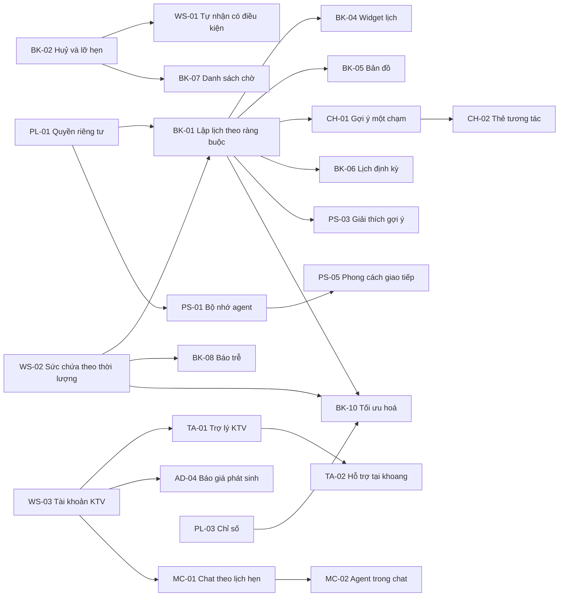

# Đặc tả Phase 2 — EV Care sau MVP

> Thư mục này chứa đặc tả cho các tính năng trong [PRD bổ sung Phase 2](../../product/PRD_EV_Care_Phase2.md).
>
> **Quan hệ với spec MVP:** spec trong `docs/specs/sprint-*`, `ai-agent`, `entity`, `platform` vẫn là chuẩn cho hành vi MVP. Spec Phase 2 chỉ mô tả phần **mới hoặc thay đổi**. Mọi quy tắc MVP không được nhắc lại ở đây vẫn giữ nguyên. Khi MVP thay đổi logic, tài liệu hoặc code, PO rà soát và cập nhật spec Phase 2 tương ứng.
>
> **Môi trường:** Phase 2 được xây song song với Phase 1 trên cùng nhánh, dùng hạ tầng riêng (Supabase project riêng, cấu hình riêng). Không spec nào trong thư mục này được yêu cầu ghi vào dữ liệu Phase 1.

---

## 1. Cấu trúc thư mục

```text
docs/specs/phase2/
├── README.md                  ← tài liệu này: quy ước, mục lục, tham số, thuật ngữ chung
└── feature-functional/        ← Functional Specification (FF) cho 33 tính năng
    ├── bk-01-phase2-spec.ff.md
    ├── ...
    └── pl-03-phase2-spec.ff.md
```

Thư mục `api/`, `entity/`, `frontend/`, `agent/` sẽ được thêm khi viết đặc tả kỹ thuật cho từng tính năng, theo template trong [docs/specs/templates](../templates).

## 2. Quy ước

| Mục | Quy ước | Ví dụ |
| --- | --- | --- |
| Tên file | `<mã tính năng>-phase2-spec.<loại>.md`, chữ thường | `bk-01-phase2-spec.ff.md` |
| Feature ID | `FEAT-P2-<mã>` | `FEAT-P2-BK01` |
| Mã trong spec | `<loại>-<mã tính năng>-<số>` | `UC-BK01-01`, `BR-BK01-03`, `AF-BK01-02`, `EF-BK01-01`, `EDGE-BK01-04`, `AC-BK01-05`, `SCR-BK01-01`, `Q-BK01-02` |
| Quy tắc từ PRD | Giữ nguyên mã `BR-<mã>-xx` của PRD; spec có thể thêm quy tắc mới, đánh số tiếp | PRD có BR-BK01-01…10, spec thêm BR-BK01-11 |
| Trạng thái tài liệu | `Draft` → `Review` → `Approved` | Toàn bộ đang `Draft` |
| Quy tắc MVP được tham chiếu | Ghi mã gốc kèm spec gốc | us-029 BR-013 |

**Cấu trúc mỗi FF** theo [template FF](../templates/uk-xxx-sprint-x-spec.ff.md). Một số mục dùng chung được gom về README này để tránh lặp:
- Stakeholder và người duyệt (mục 6).
- Thuật ngữ chung (mục 7).
- Tham số cấu hình (mục 5).

Spec chỉ ghi thuật ngữ riêng của tính năng đó.

## 3. Mục lục

| Giai đoạn | Mã | Tính năng | Loại | MoSCoW | Spec |
| --- | --- | --- | --- | --- | --- |
| P2-A | BK-01 | Tự động lập lịch theo ràng buộc của chủ xe | Chức năng | Must | [bk-01](feature-functional/bk-01-phase2-spec.ff.md) |
| P2-A | BK-02 | Chính sách huỷ lịch và lỡ hẹn | Cải tiến MVP | Must | [bk-02](feature-functional/bk-02-phase2-spec.ff.md) |
| P2-A | BK-03 | Bảo dưỡng sớm hoặc trễ so với mốc | Cải tiến MVP | Should | [bk-03](feature-functional/bk-03-phase2-spec.ff.md) |
| P2-A | BK-04 | Widget lịch | Chức năng | Should | [bk-04](feature-functional/bk-04-phase2-spec.ff.md) |
| P2-A | BK-05 | Bản đồ xưởng (Google Maps) | Chức năng | Should | [bk-05](feature-functional/bk-05-phase2-spec.ff.md) |
| P2-A | HS-01 | Tra cứu lịch sử bảo dưỡng phía chủ xe | Chức năng | Must | [hs-01](feature-functional/hs-01-phase2-spec.ff.md) |
| P2-A | PS-01 | Bộ nhớ ngắn hạn và dài hạn của agent | Cải tiến MVP | Should | [ps-01](feature-functional/ps-01-phase2-spec.ff.md) |
| P2-A | CH-01 | Gợi ý một chạm | Chức năng | Must | [ch-01](feature-functional/ch-01-phase2-spec.ff.md) |
| P2-A | CH-02 | Thẻ tương tác trong chat | Cải tiến MVP | Should | [ch-02](feature-functional/ch-02-phase2-spec.ff.md) |
| P2-A | AD-01 | Giá bảo dưỡng theo mốc, tách phần bảo hành | Cải tiến MVP | Should | [ad-01](feature-functional/ad-01-phase2-spec.ff.md) |
| P2-A | WS-01 | Tự nhận lịch hẹn có điều kiện | Cải tiến MVP | Must | [ws-01](feature-functional/ws-01-phase2-spec.ff.md) |
| P2-A | WS-02 | Sức chứa theo thời lượng và hạn phản hồi | Cải tiến MVP | Should | [ws-02](feature-functional/ws-02-phase2-spec.ff.md) |
| P2-A | PL-01 | Quyền riêng tư và sự đồng ý | Chức năng | Must | [pl-01](feature-functional/pl-01-phase2-spec.ff.md) |
| P2-A | PL-03 | Chỉ số đo hiệu quả | Phi chức năng | Must | [pl-03](feature-functional/pl-03-phase2-spec.ff.md) |
| P2-B | BK-06 | Lịch bảo dưỡng định kỳ tại xưởng quen | Chức năng | Should | [bk-06](feature-functional/bk-06-phase2-spec.ff.md) |
| P2-B | BK-07 | Danh sách chờ | Chức năng | Could | [bk-07](feature-functional/bk-07-phase2-spec.ff.md) |
| P2-B | BK-08 | Báo trễ chủ động hai chiều | Chức năng | Could | [bk-08](feature-functional/bk-08-phase2-spec.ff.md) |
| P2-B | HS-02 | Gộp việc vào một lần đến xưởng | Chức năng | Could | [hs-02](feature-functional/hs-02-phase2-spec.ff.md) |
| P2-B | PS-02 | Cá nhân hoá theo phản hồi dịch vụ | Chức năng | Should | [ps-02](feature-functional/ps-02-phase2-spec.ff.md) |
| P2-B | PS-03 | Giải thích và phản hồi gợi ý | Cải tiến MVP | Should | [ps-03](feature-functional/ps-03-phase2-spec.ff.md) |
| P2-B | AD-02 | Tư vấn phụ tùng và báo giá sửa chữa | Chức năng | Should | [ad-02](feature-functional/ad-02-phase2-spec.ff.md) |
| P2-B | AD-03 | Tư vấn bảo hành và gói bảo hành | Chức năng | Should | [ad-03](feature-functional/ad-03-phase2-spec.ff.md) |
| P2-B | AD-04 | Báo giá phát sinh khi thay phụ tùng | Chức năng | Should | [ad-04](feature-functional/ad-04-phase2-spec.ff.md) |
| P2-B | WS-03 | Tài khoản kỹ thuật viên và tự phân công | Chức năng | Must | [ws-03](feature-functional/ws-03-phase2-spec.ff.md) |
| P2-B | TA-01 | Trợ lý tra cứu và nhắc việc cho KTV | Chức năng | Should | [ta-01](feature-functional/ta-01-phase2-spec.ff.md) |
| P2-B | PL-02 | Chuyển sang người thật | Chức năng | Should | [pl-02](feature-functional/pl-02-phase2-spec.ff.md) |
| P2-C | BK-09 | Chọn xưởng theo phụ tùng sẵn có | Chức năng | Could | [bk-09](feature-functional/bk-09-phase2-spec.ff.md) |
| P2-C | BK-10 | Tối ưu hoá lập lịch | Phi chức năng | Could | [bk-10](feature-functional/bk-10-phase2-spec.ff.md) |
| P2-C | PS-04 | Gợi ý từ chủ xe có đặc điểm tương đồng | Chức năng | Could | [ps-04](feature-functional/ps-04-phase2-spec.ff.md) |
| P2-C | PS-05 | Agent trả lời theo phong cách giao tiếp | Chức năng | Could | [ps-05](feature-functional/ps-05-phase2-spec.ff.md) |
| P2-C | TA-02 | Hỗ trợ tại khoang làm việc | Chức năng | Could | [ta-02](feature-functional/ta-02-phase2-spec.ff.md) |
| P2-C | MC-01 | Chat theo từng lịch hẹn giữa xưởng và chủ xe | Chức năng | Could | [mc-01](feature-functional/mc-01-phase2-spec.ff.md) |
| P2-C | MC-02 | Agent cùng tham gia luồng chat | Chức năng | Could | [mc-02](feature-functional/mc-02-phase2-spec.ff.md) |

## 4. Phụ thuộc giữa các tính năng



## 5. Tham số cấu hình dùng chung

Mọi ngưỡng nghiệp vụ là tham số cấu hình, không viết cứng trong code. Giá trị dưới đây là **đề xuất**, chờ chốt theo câu hỏi mở của PRD (cột "Chốt ở").

| Tham số | Mặc định đề xuất | Ý nghĩa | Spec | Chốt ở |
| --- | --- | --- | --- | --- |
| `PROACTIVE_HOLD_HOURS` | 24 | Thời gian giữ chỗ cho lịch hệ thống tự đề xuất | BK-01, BK-06 | P2Q-03 |
| `SCHEDULER_MAX_OPTIONS` | 3 | Số phương án tối đa trả về | BK-01 | P2Q-02 |
| `SCHEDULER_WINDOW_DAYS` | 14 | Cửa sổ tìm kiếm mặc định | BK-01 | P2Q-02 |
| `SCHEDULER_DEFAULT_RADIUS_KM` | 10 | Bán kính mặc định khi chủ xe chưa khai | BK-01 | P2Q-02 |
| `AUTO_BOOK_FREE_CANCEL_HOURS` | 2 | Khoảng huỷ miễn tính điểm sau khi hệ thống tự đặt | BK-01, BK-02 | P2Q-04 |
| `LATE_CANCEL_HOURS` | 24 | Mốc phân biệt huỷ sớm và huỷ muộn | BK-02 | P2Q-04 |
| `NO_SHOW_GRACE_MIN` | 30 | Thời gian ân hạn trước khi coi là lỡ hẹn | BK-02 | P2Q-04 |
| `NO_SHOW_AUTO_MARK_MIN` | 90 | Hệ thống tự đánh dấu lỡ hẹn nếu xưởng không thao tác | BK-02 | P2Q-04 |
| `RELIABILITY_WINDOW_DAYS` | 90 | Cửa sổ đếm điểm tin cậy | BK-02 | P2Q-04 |
| `LATE_CANCEL_WEIGHT` | 0,5 | Điểm cho một lần huỷ muộn | BK-02 | P2Q-04 |
| `NO_SHOW_APPEAL_HOURS` | 72 | Thời hạn khiếu nại lỡ hẹn | BK-02 | P2Q-04 |
| `WS_LATE_MIN` | 15 | Xưởng trễ quá mức này thì không tính điểm chủ xe | BK-02 | P2Q-04 |
| `EARLY_SERVICE_DAYS` / `EARLY_SERVICE_KM` | 30 / 1.000 | Ngưỡng bảo dưỡng sớm bình thường | BK-03 | P2Q-09 |
| `SERIES_LEAD_DAYS` | 14 | Lịch định kỳ tạo lịch trước ngày đến hạn | BK-06 | P2Q-03 |
| `WAITLIST_OFFER_MIN` | 15 | Thời gian giữ lời mời từ danh sách chờ | BK-07 | — |
| `WAITLIST_MAX` | 3 | Số khung chờ tối đa của một chủ xe | BK-07 | — |
| `WAITLIST_MIN_LEAD_MIN` | 60 | Không mời nếu còn ít hơn mức này tới giờ hẹn | BK-07 | — |
| `DELAY_NOTIFY_MIN` | 15 | Lệch giờ tối thiểu để báo trễ | BK-08 | — |
| `DELAY_MAX_REPORTS` | 2 | Số lần báo trễ tối đa mỗi phía mỗi lịch | BK-08 | — |
| `STOCK_STALE_DAYS` | 7 | Tồn kho quá hạn cập nhật thì thành "Chưa rõ" | BK-09 | P2Q-08 |
| `OPT_MIN_GAIN` | 10% | Mức cải thiện tối thiểu để bật bộ tối ưu | BK-10 | P2Q-10 |
| `OPT_MIN_DATA_WEEKS` | 8 | Số tuần dữ liệu thật tối thiểu trước khi làm BK-10 | BK-10 | P2Q-10 |
| `SHARE_LINK_DAYS` | 7 | Hạn link chia sẻ lịch sử xe | HS-01 | — |
| `MERGE_WINDOW_DAYS` | 60 | Cửa sổ gợi ý gộp việc | HS-02 | — |
| `MEMORY_TTL_DAYS` | 365 | Hạn của một mục nhớ dài hạn | PS-01 | P2Q-11 |
| `MEMORY_INFER_MIN_REPEAT` | 2 | Số lần lặp tối thiểu để dùng mục nhớ suy ra | PS-01 | — |
| `MIN_REVIEWS` | 5 | Số đánh giá tối thiểu để tính điểm xưởng | PS-02 | — |
| `LOW_RATING_MAX` | 2 | Điểm từ mức này trở xuống là "không hài lòng" | PS-02, PL-02 | — |
| `MIN_COHORT` | 30 | Kích thước nhóm tối thiểu cho gợi ý tương đồng | PS-04 | — |
| `CHIP_MIN` / `CHIP_MAX` | 3 / 5 | Số gợi ý một chạm mỗi lần | CH-01 | — |
| `PRICE_STALE_DAYS` | 90 | Bảng giá cũ hơn mức này thì cảnh báo | AD-01, AD-02 | — |
| `AUTO_APPROVE_EXTRA_VND` | tắt | Xưởng tự duyệt phát sinh dưới mức này | AD-04 | P2Q-13 |
| `EXTRA_CONSENT_PCT` | 10% | Phát sinh vượt mức này bắt buộc chủ xe đồng ý | AD-04 | P2Q-13 |
| `EXTRA_TIMEOUT_MIN` | 30 | Chủ xe không phản hồi phát sinh thì xưởng gọi | AD-04 | P2Q-13 |
| `SLOT_UNIT_MIN` | 30 | Đơn vị khung khi tính theo thời lượng | WS-02 | — |
| `LEGACY_BOOKING_MIN` | 60 | Thời lượng mặc định cho lịch không rõ hạng mục | WS-02 | — |
| `WS_CONFIRM_REMIND_PCT` | 50% | Nhắc xưởng duyệt khi đã qua phần trăm hạn chót này | WS-02 | — |
| `TA_ARRIVAL_REMIND_MIN` | 15 | Nhắc KTV trước giờ xe đến | TA-01 | — |
| `THREAD_CLOSE_DAYS` | 7 | Đóng luồng chat sau khi lịch kết thúc | MC-01 | — |
| `WS_REPLY_SLA_MIN` | 60 | Thời gian phản hồi xưởng cam kết trong giờ làm | MC-01 | — |
| `HANDOFF_NO_SOURCE_RETRY` | 2 | Số lần không có nguồn trước khi chuyển người | PL-02 | — |
| `DELETE_SLA_HOURS` | 24 | Thời hạn xoá dữ liệu theo yêu cầu | PL-01 | P2Q-11 |

## 6. Stakeholder và người duyệt (chung)

| Stakeholder | Vai trò |
| --- | --- |
| Lê Đức Tùng | Product Owner, duyệt nghiệp vụ |
| Mai Văn Trung | Project Manager, duyệt phạm vi và lịch |
| Nguyễn Lê Phước Tiến · Đinh Kim Thái · Lê Đức Tùng | Tech Lead, duyệt khả thi kỹ thuật |
| Phạm Văn Ngoan | Mentor |
| Team Data (Phase 2) | Chủ dữ liệu chỉ số, dữ liệu lập lịch, nhóm chủ xe tương đồng |
| Chủ xưởng thử nghiệm | Xác nhận luật xưởng, thời lượng, bảng giá |

Mỗi spec có mục **Approval** riêng để ghi trạng thái duyệt của tính năng đó.

## 7. Thuật ngữ chung

| Term | Tên tiếng Việt | Định nghĩa |
| --- | --- | --- |
| Hard constraint | Ràng buộc cứng | Điều kiện bắt buộc; lịch vi phạm thì không được đề xuất |
| Soft constraint / Preference | Ràng buộc mềm / sở thích | Điều kiện nên thoả; vi phạm thì bị trừ điểm, không bị loại |
| Scheduler | Bộ lập lịch | Service backend tìm, xếp hạng, giữ lịch hợp lệ (BK-01); sau này tối ưu (BK-10) |
| Proactive hold | Giữ chỗ chủ động | Hệ thống tự giữ một chỗ trước khi chủ xe yêu cầu, chờ xác nhận một chạm |
| Option | Phương án | Một bộ (xưởng, ngày, giờ) hợp lệ do bộ lập lịch trả về, kèm lý do |
| Capacity service | Service sức chứa | Booking & Capacity Service hiện có của MVP (us-029 BR-011), nơi duy nhất kiểm tra và giữ chỗ |
| Reliability score | Điểm tin cậy | Tổng điểm huỷ muộn và lỡ hẹn trong cửa sổ đếm (BK-02) |
| Standard duration | Thời lượng chuẩn | Thời gian dự kiến của một hạng mục (WS-02) |
| Bay | Khoang | Vị trí làm việc; một xe chiếm một khoang trong thời gian làm |
| Technician (KTV) | Kỹ thuật viên | Vai trò mới Phase 2 (WS-03). **Khác** "Kỹ thuật viên" trên giao diện MVP (là chủ xưởng) |
| Chip | Gợi ý một chạm | Nút gửi một ý định đã định nghĩa sẵn (CH-01) |
| Card | Thẻ tương tác | Khối thông tin có nút trong chat (CH-02) |
| Extra quote | Báo giá phát sinh | Báo giá cho hạng mục phát hiện thêm khi xe đang làm (AD-04) |
| Handoff | Chuyển người thật | Chuyển yêu cầu từ agent sang chủ xưởng kèm tóm tắt (PL-02) |
| Consent | Sự đồng ý | Lựa chọn bật/tắt của chủ xe cho từng loại dùng dữ liệu (PL-01) |

**Quy tắc dùng từ:**
- Dùng "lịch hẹn" cho `booking` và "phương án" cho kết quả chưa giữ chỗ. Không gọi phương án là "lịch hẹn".
- Dùng "Kỹ thuật viên (KTV)" chỉ cho vai trò mới WS-03. Khi nói về người quản lý xưởng, luôn dùng "chủ xưởng".
- Dùng "ước tính" cho mọi con số chưa được xưởng duyệt.

## 8. Trạng thái lịch hẹn (nhắc lại từ MVP)

Phase 2 **không thêm** trạng thái mới cho `booking`: `pending`, `confirmed`, `checked_in`, `in_progress`, `completed`, `cancelled`. Các khái niệm mới (giữ chỗ chủ động, lỡ hẹn, báo trễ, phát sinh) được ghi bằng thuộc tính hoặc thực thể riêng, mô tả trong từng spec.
