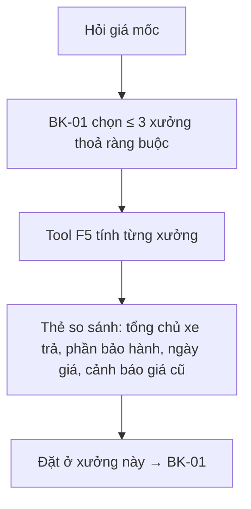

# Functional Specification — Giá bảo dưỡng theo mốc, tách phần bảo hành

> Đặc tả nghiệp vụ cho **AD-01** trong [PRD Phase 2](../../../product/PRD_EV_Care_Phase2.md).
>
> **Quan hệ tài liệu:** mở rộng dự toán F5 ([us-045](../../sprint-2/feature-functional/us-045-sprint-2-spec.ff.md), [AI-003](../../ai-agent/ai-003-sprint-2-spec.agent.md)). Mọi quy tắc F5 giữ nguyên:
> - tool tính, LLM không cộng hay sửa số;
> - tách hạng mục trong bảo hành / tính phí;
> - xưởng thiếu giá thì dùng giá tham khảo;
> - nhãn "Chi phí ước tính".
>
> Quy ước: [README Phase 2](../README.md).
>
> **Đặc tả kỹ thuật:** [API Spec](ad-01-phase2-spec.api.md) · [Entity Spec](ad-01-phase2-spec.entity.md) · [Frontend Spec](ad-01-phase2-spec.fe.md)

---

# 1. Document Information

| Field | Value |
|---|---|
| Feature ID | `FEAT-P2-AD01` |
| Feature Name | Giá bảo dưỡng theo mốc, tách phần bảo hành |
| PRD Feature | AD-01 (P2-A, Should, Cải tiến MVP) |
| Document Version / Status | `v0.2` / `Draft` |
| Created / Updated | `2026-10-09` / `2026-10-12` |
| Related Technical Spec | [API Spec](ad-01-phase2-spec.api.md) · [Entity Spec](ad-01-phase2-spec.entity.md) · [Frontend Spec](ad-01-phase2-spec.fe.md) |

---

# 2. Feature Overview

## 2.1 Feature Description

Dự toán mốc bảo dưỡng được mở rộng theo ba hướng:
- **So sánh** giữa tối đa 3 xưởng thoả ràng buộc của chủ xe (BK-01).
- Hiển thị **ngày cập nhật bảng giá** của từng xưởng, cảnh báo khi giá cũ.
- Tách rõ **phần bảo hành chi trả** và **phần chủ xe trả** ở cả mức tổng.

## 2.2 Business Objective

Chủ xe tự trả lời "mốc này hết bao nhiêu, ở đâu rẻ hơn, hãng trả phần nào" mà không cần gọi xưởng (PP2-06, PP2-09).

## 2.3 User Objective

So sánh giá minh bạch trước khi chọn xưởng.

## 2.4 Business Value

Giảm câu hỏi giá tới xưởng (M-08).

---

# 3. Scope

## 3.1 In Scope

- Dự toán so sánh 2–3 xưởng.
- Ngày cập nhật giá; cảnh báo `PRICE_STALE_DAYS`.
- Tổng phần bảo hành / tổng chủ xe trả.
- Chip "Đặt ở xưởng này" trên từng cột.

## 3.2 Out of Scope

- Giá sửa chữa ngoài mốc (AD-02).
- Khuyến mãi, giảm giá.

---

# 4. Actors

| Actor | Type | Responsibility |
|---|---|---|
| Chủ xe | User | Hỏi giá, so sánh, đặt |
| Tool dự toán (F5) | System | Tính từng xưởng |
| Bộ lập lịch | System | Chọn xưởng ứng viên |

---

# 5. User Story

- `US-P2-AD01-01`: As a chủ xe, I want so sánh giá mốc ở các xưởng gần, so that tôi chọn nơi hợp lý.
- `US-P2-AD01-02`: As a chủ xe, I want biết phần nào hãng trả, so that tôi không bất ngờ.

---

# 6. Use Case

| UC | Tên | Trigger | Postcondition |
|---|---|---|---|
| `UC-AD01-01` | So sánh giá | Chip "So sánh xưởng" / câu hỏi giá | Thẻ so sánh 2–3 xưởng |
| `UC-AD01-02` | Đặt từ so sánh | Bấm "Đặt ở xưởng này" | BK-01 với xưởng = X |

---

# 7. User Flow

# 8. Screen / UI Flow

| Screen ID | Name | Purpose |
|---|---|---|
| `SCR-AD01-01` | Thẻ so sánh dự toán | Cột mỗi xưởng: tổng ước tính chủ xe trả (mono), phần bảo hành, cập nhật giá ngày, nhãn "giá tham khảo" nếu thiếu, nút Đặt |

# 9. Main Flow

1. Chủ xe hỏi "Mốc 24.000 km hết bao nhiêu?".
2. Thẻ so sánh 3 xưởng: Cầu Giấy 1,45 tr, Mỹ Đình 1,30 tr, Long Biên 1,52 tr (giá cập nhật > 90 ngày, có cảnh báo).
3. Phần kiểm tra pin ghi "bảo hành chi trả" ở cả ba xưởng.
4. Chủ xe bấm "Đặt ở Mỹ Đình".

# 10. Alternative Flow

- **AF-AD01-01:** Chỉ một xưởng thoả ràng buộc → dự toán một xưởng như F5.

# 11. Exception Flow

| ID | Condition | Behavior |
|---|---|---|
| `EF-AD01-01` | Xưởng thiếu giá một số hạng mục | Giá tham khảo + nhãn (F5 EDGE-004) |
| `EF-AD01-02` | Không xác định được bảo hành | Ghi "chưa xác định bảo hành", không tự giả định miễn phí |

---

# 12. Business Rules

- **BR-AD01-01 (PRD):** So sánh tối đa 3 xưởng thoả ràng buộc chủ xe. **Medium.**
- **BR-AD01-02 (PRD):** Ghi ngày cập nhật bảng giá; cũ hơn `PRICE_STALE_DAYS` thì cảnh báo. **Medium.**
- **BR-AD01-03 (PRD):** Giữ quy tắc F5: LLM không tự tính; nhãn "ước tính". **High.**
- **BR-AD01-04:** Thứ tự cột theo thứ hạng BK-01, không theo giá, để không đẩy chủ xe vào xưởng rẻ nhưng xa. Giá thấp nhất có nhãn "Thấp nhất". **Low.**

# 13. State / Status

Không áp dụng.

# 14. Data Requirements

`service_price` (kèm thời điểm cập nhật), `maintenance_rule`, trạng thái bảo hành (F1/AD-03).

# 15. Business Error & Edge Cases

| Case ID | Scenario | Expected Behavior |
|---|---|---|
| `EDGE-AD01-01` | Hai xưởng cùng giá | Giữ thứ tự BK-01 |

# 16. Permissions & Access

Mọi chủ xe đã đăng nhập; giá xưởng là dữ liệu công khai trong mạng lưới.

# 17. Acceptance Criteria

- **AC-AD01-01:** Tổng dự toán từng xưởng khớp tool (giữ AC-F5-01).
- **AC-AD01-02:** Xưởng có giá cũ hơn `PRICE_STALE_DAYS` hiển thị cảnh báo.
- **AC-AD01-03:** Tổng phần bảo hành + tổng chủ xe trả = tổng giá trị hạng mục.

# 18. Non-functional Expectations

Thẻ so sánh trả ≤ 3 s (p90).

# 19. Dependencies

F5, BK-01, CH-02, AD-03.

# 20. Assumptions

Xưởng cập nhật `service_price` định kỳ.

# 21. Business Constraints

Không xếp hạng xưởng chỉ theo giá.

# 22. Terminology

| Term | Vietnamese |
|---|---|
| Price freshness | Ngày cập nhật giá |

# 23. Partner Notes

—

# 24. Open Questions

| ID | Question | Proposal |
|---|---|---|
| `Q-AD01-01` | `PRICE_STALE_DAYS`? | 90 |

# 25. Traceability

PRD Phase 2 AD-01, PP2-06, M-08 · BR-AD01-01…04 · AC-AD01-01…03 · us-045.

# 26. Related Documents

[PRD Phase 2](../../../product/PRD_EV_Care_Phase2.md) · [us-045 FF](../../sprint-2/feature-functional/us-045-sprint-2-spec.ff.md) · [API Spec](ad-01-phase2-spec.api.md) · [Entity Spec](ad-01-phase2-spec.entity.md) · [Frontend Spec](ad-01-phase2-spec.fe.md)

# 27. Change Log

| Version | Date | Change |
|---|---|---|
| `v0.1` | `2026-10-09` | Bản nháp đầu |
| `v0.2` | `2026-10-12` | Liên kết đặc tả API, Entity, Frontend |

# 28. Approval

| Role | Status |
|---|---|
| Product Owner | Pending |
| Technical Owner | Pending |
