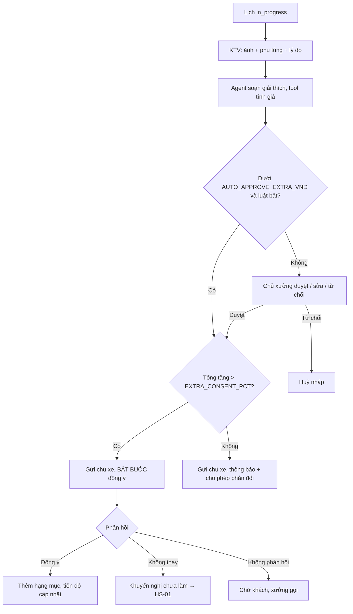
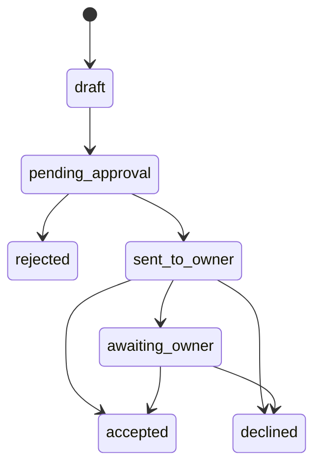

# Functional Specification — Báo giá phát sinh khi thay phụ tùng

> Đặc tả nghiệp vụ cho **AD-04** trong [PRD Phase 2](../../../product/PRD_EV_Care_Phase2.md).
>
> **PO chốt 2026-10-12:** phát sinh xây trên `booking_line` (dòng `EXTRA` của [Báo giá hai tầng](../../../designs/bao-gia-hai-tang.md)) + bảng nhóm `extra_quote`, **không** dùng `quote` loại `extra`. Phần "F5b" dưới đây chỉ còn nghĩa là cách duyệt tương tự (chủ xưởng duyệt / sửa / từ chối), không phải bảng `quote`.
>
> **Quan hệ tài liệu:** tái dùng luồng duyệt báo giá F5b ([us-049](../../sprint-3/feature-functional/us-049-sprint-3-spec.ff.md), [AI-005](../../ai-agent/ai-005-sprint-3-spec.agent.md)): `quote` + `quote_item`, chủ xưởng duyệt / sửa / từ chối. Gắn với tiến độ ([us-057](../../sprint-4/feature-functional/us-057-sprint-4-spec.ff.md)). KTV tạo nháp cần [WS-03](../workshop-operations/ws-03-phase2-spec.ff.md); trước khi có WS-03, chủ xưởng tạo nháp.
>
> Quy ước: [README Phase 2](../README.md).
>
> **Đặc tả kỹ thuật:** [API Spec](ad-04-phase2-spec.api.md) · [Entity Spec](ad-04-phase2-spec.entity.md) · [Frontend Spec](ad-04-phase2-spec.fe.md)

---

# 1. Document Information

| Field | Value |
|---|---|
| Feature ID | `FEAT-P2-AD04` |
| Feature Name | Báo giá phát sinh khi thay phụ tùng |
| PRD Feature | AD-04 (P2-B, Should, Chức năng) |
| Document Version / Status | `v0.3` / `Draft` |
| Created / Updated | `2026-10-09` / `2026-10-12` |
| Related Technical Spec | [API Spec](ad-04-phase2-spec.api.md) · [Entity Spec](ad-04-phase2-spec.entity.md) · [Frontend Spec](ad-04-phase2-spec.fe.md) |

---

# 2. Feature Overview

## 2.1 Feature Description

Khi xe đang làm (`in_progress`) mà phát hiện cần thay thêm, luồng chạy như sau:
1. KTV chụp ảnh, chọn phụ tùng, ghi lý do ngắn.
2. Agent soạn **báo giá phát sinh** với lời giải thích dễ hiểu.
3. Chủ xưởng duyệt hoặc sửa.
4. Chủ xe nhận ảnh và giá trên app, chọn **Đồng ý thay**, **Không thay lần này**, hoặc **Gọi cho xưởng**.

Phát sinh vượt ngưỡng thì bắt buộc chủ xe đồng ý mới được làm.

## 2.2 Business Objective

Bỏ việc gọi điện chờ khách đồng ý; minh bạch chi phí phát sinh (PP2-06, PP2-13).

## 2.3 User Objective

- Chủ xe: thấy rõ vì sao phải thay, bao nhiêu tiền, quyết định ngay trên điện thoại.
- Xưởng: không phải giải thích qua điện thoại.

## 2.4 Business Value

Giảm thời gian xe chờ khách đồng ý (T₅); giảm tranh chấp chi phí.

---

# 3. Scope

## 3.1 In Scope

- Tạo nháp phát sinh (KTV hoặc chủ xưởng), có ảnh.
- Agent viết giải thích.
- Duyệt của xưởng; luật tự duyệt dưới ngưỡng (tuỳ chọn).
- Đồng ý của chủ xe; ngưỡng bắt buộc đồng ý; hết thời gian phản hồi.
- Ghi khuyến nghị chưa làm vào lịch sử (HS-01).

## 3.2 Out of Scope

- Thanh toán.
- Phát sinh sau khi lịch đã `completed`.

---

# 4. Actors

| Actor | Type | Responsibility |
|---|---|---|
| KTV / Chủ xưởng | User | Tạo nháp |
| AI Agent | System | Viết giải thích |
| Chủ xưởng | User | Duyệt |
| Chủ xe | User | Đồng ý / không |

---

# 5. User Story

- `US-P2-AD04-01`: As a chủ xe, I want thấy ảnh và giá của hạng mục phát sinh, so that tôi quyết định ngay.
- `US-P2-AD04-02`: As a KTV, I want gửi phát sinh bằng ảnh và vài chạm, so that tôi không phải gọi khách.
- `US-P2-AD04-03`: As a chủ xưởng, I want duyệt phát sinh trước khi gửi khách, so that giá luôn đúng.

---

# 6. Use Case

| UC | Tên | Trigger | Postcondition |
|---|---|---|---|
| `UC-AD04-01` | Tạo nháp | KTV bấm "Phát sinh" trên lịch `in_progress` | `extra_quote` + dòng `booking_line` `EXTRA`, trạng thái nháp |
| `UC-AD04-02` | Duyệt | Chủ xưởng duyệt / sửa / từ chối | Gửi chủ xe hoặc huỷ |
| `UC-AD04-03` | Chủ xe phản hồi | Bấm trên thẻ | Đồng ý → làm; Không thay → khuyến nghị chưa làm |
| `UC-AD04-04` | Hết thời gian | Quá `EXTRA_TIMEOUT_MIN` | Nhãn "chờ khách", xưởng gọi điện |

---

# 7. User Flow

---

# 8. Screen / UI Flow

| Screen ID | Name | Purpose |
|---|---|---|
| `SCR-AD04-01` | Tạo phát sinh (KTV, mobile) | Chụp ảnh (≥ 1), chọn phụ tùng từ danh mục, mức khẩn (an toàn / nên làm / có thể để sau), lý do ngắn |
| `SCR-AD04-02` | Duyệt phát sinh (chủ xưởng) | Như màn duyệt F5b, thêm ảnh và lời giải thích của agent |
| `SCR-AD04-03` | Thẻ phát sinh (chủ xe) | Ảnh, giải thích, giá, tổng cũ → tổng mới, mức khẩn, 3 nút |

---

# 9. Main Flow

1. Lịch đang làm. KTV thấy lốp sau trái phồng hông, chụp 2 ảnh, chọn "Lốp 235/55R19", mức "An toàn".
2. Agent viết: "Lốp sau trái bị phồng hông, có nguy cơ nổ lốp khi chạy nhanh. Đề xuất thay 1 lốp."
3. Tool tính 2,4 tr + cân bằng động 100k. Chủ xưởng duyệt.
4. Tổng tăng từ 1,4 tr lên 3,9 tr (> 10%), nên bắt buộc đồng ý.
5. Chủ xe xem ảnh, bấm "Đồng ý thay". Hạng mục được thêm vào lịch và tiến độ cập nhật.

---

# 10. Alternative Flow

| ID | Condition | Flow |
|---|---|---|
| `AF-AD04-01` | Chủ xe "Không thay lần này" | Ghi khuyến nghị chưa làm; nếu mức "An toàn" thì hiện cảnh báo không nên lái xe và yêu cầu xác nhận lần hai |
| `AF-AD04-02` | Phát sinh nhỏ dưới cả hai ngưỡng | Tự duyệt (nếu bật), thông báo chủ xe, cho phép phản đối trong `EXTRA_TIMEOUT_MIN` |
| `AF-AD04-03` | Chủ xe "Gọi cho xưởng" | Hiện số hotline xưởng dạng chữ; nhãn "khách muốn gọi" trên Board |

---

# 11. Exception Flow

| ID | Condition | Behavior |
|---|---|---|
| `EF-AD04-01` | Không có ảnh | Không cho gửi |
| `EF-AD04-02` | Chủ xe không phản hồi | `EXTRA_TIMEOUT_MIN` → "chờ khách"; xưởng không làm hạng mục bắt buộc đồng ý |
| `EF-AD04-03` | Lịch đã `completed` | Không tạo phát sinh; dùng lịch mới |

---

# 12. Business Rules

- **BR-AD04-01 (PRD, PO chốt 2026-10-12):** Phát sinh là nhóm dòng `booking_line` `EXTRA` (`extra_quote`) gắn lịch `in_progress`; chủ xưởng duyệt như F5b. **High.**
- **BR-AD04-02 (PRD):** Nháp có ≥ 1 ảnh, phụ tùng, lý do; agent viết giải thích từ lý do + tài liệu. **High.**
- **BR-AD04-03 (PRD):** Chủ xưởng duyệt / sửa trước khi gửi; tự duyệt dưới `AUTO_APPROVE_EXTRA_VND` nếu bật. **High.**
- **BR-AD04-04 (PRD):** Tổng tăng > `EXTRA_CONSENT_PCT` so với báo giá/dự toán ban đầu thì bắt buộc chủ xe đồng ý. **High.**
- **BR-AD04-05 (PRD):** Ba lựa chọn; hết `EXTRA_TIMEOUT_MIN` thì "chờ khách". **High.**
- **BR-AD04-06 (PRD):** "Không thay lần này" ghi khuyến nghị chưa làm vào HS-01, nhắc lần sau. **Medium.**
- **BR-AD04-07:** Giá trên thẻ phát sinh là giá xưởng đã duyệt, không gắn nhãn "ước tính". **High.**
- **BR-AD04-08:** Mọi bước có lưu vết: người tạo, người duyệt, thời điểm, phản hồi chủ xe. **High.**

---

# 13. State / Status

| State | Meaning |
|---|---|
| `draft` | KTV vừa tạo |
| `pending_approval` | Chờ chủ xưởng (tái dùng F5b) |
| `sent_to_owner` | Đã gửi chủ xe |
| `accepted` | Chủ xe đồng ý |
| `declined` | Chủ xe không thay |
| `awaiting_owner` | Hết thời gian, chờ khách |
| `rejected` | Chủ xưởng từ chối nháp |

---

# 14. Data Requirements

| Entity | Purpose | R/W |
|---|---|---|
| `extra_quote` (mới) | Một lần báo phát sinh: lịch, mức khẩn, giải thích, hạn | R/W |
| `booking_line` (có sẵn, `kind = EXTRA`) + `booking_line_photo` | Dòng phụ tùng, công; ảnh | R/W |
| Ảnh | Bằng chứng | W (Storage Phase 2) |
| `deferred_recommendation` (mới, hoặc dòng HS-01) | Khuyến nghị chưa làm | W |

# 15. Business Error & Edge Cases

| Case ID | Scenario | Expected Behavior |
|---|---|---|
| `EDGE-AD04-01` | Nhiều phát sinh trên một lịch | Mỗi phát sinh một `extra_quote`; ngưỡng tính trên tổng cộng dồn |
| `EDGE-AD04-02` | Chủ xe đồng ý sau khi xưởng đã gọi và làm theo lời nói | Xưởng ghi "đồng ý qua điện thoại" kèm người ghi; vẫn lưu vết |

# 16. Permissions & Access

| Role | Create | Approve | Respond |
|---|---:|---:|---:|
| KTV | ✅ | ❌ | ❌ |
| Chủ xưởng | ✅ | ✅ | ❌ |
| Chủ xe | ❌ | ❌ | ✅ |

# 17. Acceptance Criteria

- **AC-AD04-01:** Không phát sinh nào vượt ngưỡng chuyển sang `accepted` khi chưa có đồng ý của chủ xe (hoặc ghi nhận đồng ý qua điện thoại có người ghi).
- **AC-AD04-02:** Mọi báo giá phát sinh có ≥ 1 ảnh và người duyệt (trừ khi tự duyệt theo luật, có ghi "tự duyệt").
- **AC-AD04-03:** "Không thay lần này" xuất hiện trong HS-01 như khuyến nghị chưa làm.

# 18. Non-functional Expectations

Thẻ phát sinh tới chủ xe ≤ 1 phút sau khi duyệt.

# 19. Dependencies

F5b, us-057, WS-03, HS-01, CH-02.

# 20. Assumptions

Báo giá phát sinh qua điện thoại làm xe chờ lâu (H2-12).

# 21. Business Constraints

Không làm hạng mục bắt buộc đồng ý khi chưa có đồng ý.

# 22. Terminology

| Term | Vietnamese |
|---|---|
| Extra quote | Báo giá phát sinh |
| Urgency | Mức khẩn |
| Consent threshold | Ngưỡng bắt buộc đồng ý |

# 23. Partner Notes

—

# 24. Open Questions

| ID | Question | Proposal |
|---|---|---|
| `Q-AD04-01` | Ngưỡng `EXTRA_CONSENT_PCT` và tự duyệt (P2Q-13)? | 10%; tự duyệt mặc định tắt |
| `Q-AD04-02` | Trước WS-03, ai tạo nháp? | Chủ xưởng |

# 25. Traceability

PRD Phase 2 AD-04, PP2-06, PP2-13 · BR-AD04-01…08 · AC-AD04-01…03 · us-049, us-057.

# 26. Related Documents

[PRD Phase 2](../../../product/PRD_EV_Care_Phase2.md) · [us-049 FF](../../sprint-3/feature-functional/us-049-sprint-3-spec.ff.md) · [HS-01](../service-history/hs-01-phase2-spec.ff.md) · [API Spec](ad-04-phase2-spec.api.md) · [Entity Spec](ad-04-phase2-spec.entity.md) · [Frontend Spec](ad-04-phase2-spec.fe.md)

# 27. Change Log

| Version | Date | Change |
|---|---|---|
| `v0.1` | `2026-10-09` | Bản nháp đầu |
| `v0.2` | `2026-10-12` | Liên kết đặc tả API, Entity, Frontend |
| `v0.3` | `2026-10-12` | PO chốt: phát sinh xây trên `booking_line` + `extra_quote`, không dùng `quote` loại `extra` |

# 28. Approval

| Role | Status |
|---|---|
| Product Owner | Pending |
| Technical Owner | Pending |
