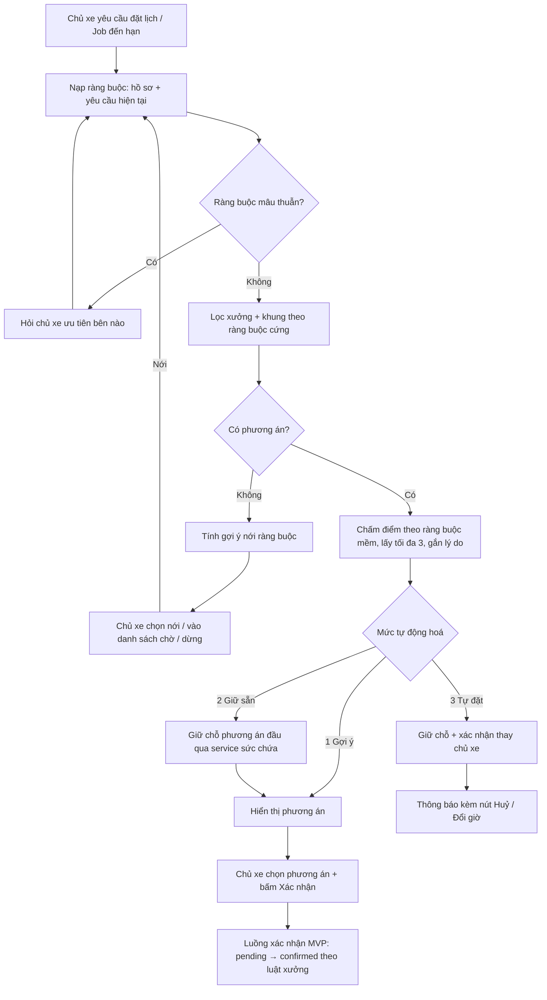
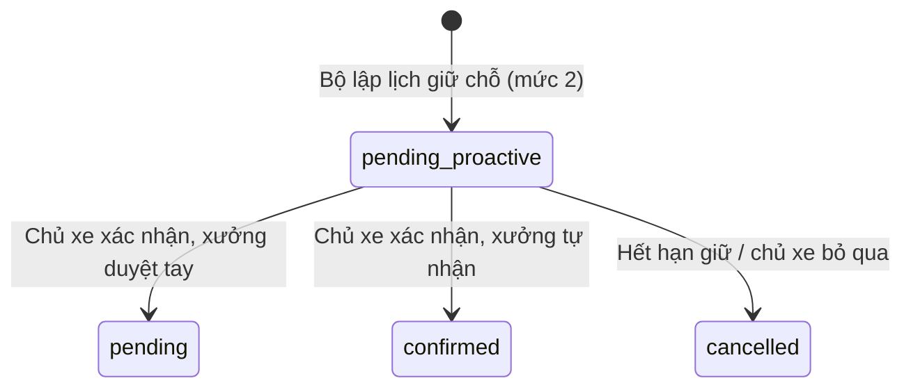

# Functional Specification — Tự động lập lịch theo ràng buộc của chủ xe

> Đặc tả nghiệp vụ cho **BK-01** trong [PRD Phase 2](../../../product/PRD_EV_Care_Phase2.md#bk-01--tự-động-lập-lịch-theo-ràng-buộc-của-chủ-xe).
>
> **Quan hệ tài liệu:** mở rộng [us-029 FF](../../sprint-3/feature-functional/us-029-sprint-3-spec.ff.md) (sức chứa, giữ chỗ, đề xuất khi hết chỗ), [us-061 FF](../../sprint-4/feature-functional/us-061-sprint-4-spec.ff.md) (đề xuất nhanh, lý do, xếp theo khoảng cách) và [us-053 FF](../../sprint-3/feature-functional/us-053-sprint-3-spec.ff.md) (đổi lịch). Các quy tắc gốc ở đó giữ nguyên, trừ phần ghi rõ là thay đổi ở mục 23.
>
> **Phạm vi tầng:** BK-01 chỉ yêu cầu **tìm được lịch hợp lệ và xếp hạng hợp lý**. Chọn lịch **tốt nhất** theo mục tiêu thời gian thuộc [BK-10](bk-10-phase2-spec.ff.md).
>
> Quy ước mã, tham số cấu hình và thuật ngữ chung: [README Phase 2](../README.md).
>
> **Đặc tả kỹ thuật:** [API Spec](bk-01-phase2-spec.api.md) · [Entity Spec](bk-01-phase2-spec.entity.md) · [Frontend Spec](bk-01-phase2-spec.fe.md)

---

# 1. Document Information

| Field | Value |
|---|---|
| Feature ID | `FEAT-P2-BK01` |
| Feature Name | Tự động lập lịch theo ràng buộc của chủ xe |
| PRD Feature | BK-01 (P2-A, Must, Chức năng) |
| Document Version | `v0.2` |
| Status | `Draft` |
| Business Owner | Lê Đức Tùng (PO) |
| Author | Team 4 người |
| Created Date | `2026-10-09` |
| Updated Date | `2026-10-12` |
| Related Spec | BK-04, BK-05, BK-06, BK-10, CH-01, WS-01, WS-02, PL-01, PS-01, PS-03 |
| Related Frontend / API / Entity Spec | [API Spec](bk-01-phase2-spec.api.md) · [Entity Spec](bk-01-phase2-spec.entity.md) · [Frontend Spec](bk-01-phase2-spec.fe.md) |

---

# 2. Feature Overview

## 2.1 Feature Description

Chủ xe khai một lần các **ràng buộc** của mình: khung giờ rảnh, khu vực hoặc bán kính, xưởng yêu thích, giờ hay chọn. Khi xe cần bảo dưỡng, hoặc khi chủ xe yêu cầu, **bộ lập lịch** kết hợp các ràng buộc này với yếu tố của xưởng (giờ mở cửa, sức chứa, luật tự nhận, phụ tùng) để tìm 1–3 phương án hợp lệ, xếp hạng có lý do, rồi giữ chỗ phương án tốt nhất theo mức tự động hoá chủ xe đã chọn.

Nếu xưởng yêu thích còn chỗ thì xếp luôn. Nếu kín thì tìm giờ khác ở xưởng đó, hoặc xưởng khác vẫn thoả mọi ràng buộc cứng. Nếu không có phương án nào thì nói rõ lý do và gợi ý nới ràng buộc.

Một bộ lập lịch dùng chung cho: chat và gợi ý một chạm (CH-01), màn Đặt lịch, widget lịch (BK-04), bản đồ (BK-05), lịch định kỳ (BK-06), đổi lịch, và xử lý khi xưởng báo bận.

## 2.2 Business Objective

- Giảm việc chủ xe phải tự dò xưởng và giờ (PP2-01).
- Giảm cuộc gọi thoả thuận lịch giữa khách và xưởng khi xưởng quen kín (PP2-09).
- Tận dụng chỗ trống của các xưởng khác trong khu vực.

## 2.3 User Objective

Chủ xe có một lịch hẹn đúng giờ rảnh, đúng khu vực, ưu tiên xưởng mình thích, chỉ bằng một chạm xác nhận.

## 2.4 Business Value

- Chỉ số: M-01 (thời gian từ ý định đến xác nhận, mục tiêu < 60 giây), M-03 (≥ 95% yêu cầu có phương án hoặc lý do rõ) — PRD §12.
- Là nền cho BK-06, BK-10 và toàn bộ trải nghiệm đặt lịch một chạm.

---

# 3. Scope

## 3.1 In Scope

- Hồ sơ **Thói quen đặt lịch** của chủ xe: tạo, xem, sửa ràng buộc cứng và mềm.
- Bộ lập lịch: lọc theo ràng buộc cứng, chấm điểm theo luật, trả tối đa `SCHEDULER_MAX_OPTIONS` phương án có lý do.
- Ba mức tự động hoá: Gợi ý, Giữ chỗ sẵn (mặc định), Tự đặt.
- Giữ chỗ chủ động với thời hạn `PROACTIVE_HOLD_HOURS`.
- Đổi lịch sang xưởng khác trong một thao tác.
- Gợi ý nới ràng buộc khi không có phương án.
- Tìm phương án thay thế khi xưởng báo không phục vụ được một lịch đã xác nhận.
- Phát hiện ràng buộc mâu thuẫn.

## 3.2 Out of Scope

- Tối ưu hoá theo mục tiêu thời gian (BK-10).
- Phụ tùng như ràng buộc (chỉ khi có BK-09).
- Đọc lịch Google Calendar (cơ chế đồng bộ thuộc BK-04 và PL-01; BK-01 chỉ dùng kết quả bận/rảnh).
- Nhiều xe trên một tài khoản.
- Đặt cọc, thanh toán.

---

# 4. Actors & Stakeholders

## 4.1 Actors

| Actor | Type | Responsibility |
|---|---|---|
| Chủ xe | User | Khai ràng buộc, chọn mức tự động hoá, xác nhận phương án |
| Chủ xưởng | User | Báo không phục vụ được một lịch; luật tự nhận (WS-01) |
| Bộ lập lịch | System | Lọc, chấm điểm, trả phương án, gọi giữ chỗ |
| Service sức chứa | System | Kiểm tra và giữ chỗ nguyên tử (us-029 BR-011) |
| AI Agent | System | Thu thập ràng buộc bằng hội thoại, hiển thị phương án; không tự chọn |
| Job đến hạn | System | Kích hoạt lập lịch chủ động khi xe `DUE_SOON` (mức 2, 3) |

## 4.2 Stakeholders

Xem [README §6](../README.md#6-stakeholder-và-người-duyệt-chung).

---

# 5. User Story

## US-P2-BK01-01

**As a** chủ xe
**I want to** khai một lần giờ rảnh, khu vực và xưởng mình thích
**So that** mỗi lần đến hạn, hệ thống tự tìm lịch phù hợp mà tôi không phải dò lại.

### Additional User Stories

- `US-P2-BK01-02`: As a chủ xe, I want hệ thống tự tìm xưởng khác gần đó khi xưởng quen kín lịch, so that tôi vẫn bảo dưỡng đúng hạn.
- `US-P2-BK01-03`: As a chủ xe, I want biết vì sao một phương án được gợi ý, so that tôi tin và chọn nhanh.
- `US-P2-BK01-04`: As a chủ xe, I want chọn mức tự động (chỉ gợi ý / giữ sẵn / tự đặt), so that tôi kiểm soát được hệ thống làm gì thay mình.
- `US-P2-BK01-05`: As a chủ xe, I want đổi lịch sang xưởng khác trong một thao tác, so that tôi không mất chỗ cũ trước khi có chỗ mới.
- `US-P2-BK01-06`: As a chủ xưởng, I want khi tôi báo không phục vụ được một lịch, hệ thống tự tìm phương án cho khách, so that tôi không phải gọi điện thoả thuận.

---

# 6. Use Case

## UC-BK01-01 — Khai và sửa thói quen đặt lịch

| Mục | Nội dung |
|---|---|
| Primary Actor | Chủ xe |
| Supporting | AI Agent, PS-01, PL-01 |
| Trigger | Chủ xe mở Cài đặt → Thói quen đặt lịch, hoặc trả lời câu hỏi của agent trong luồng đặt lịch |
| Preconditions | Chủ xe đã đăng nhập, xe đã xác thực |
| Postconditions | Hồ sơ thói quen đặt lịch được lưu; ràng buộc suy ra có nhãn "suy ra" |

## UC-BK01-02 — Yêu cầu đặt lịch theo ràng buộc

| Mục | Nội dung |
|---|---|
| Primary Actor | Chủ xe |
| Supporting | Bộ lập lịch, service sức chứa, AI Agent |
| Trigger | Chip "Tôi muốn đặt lịch bảo dưỡng", nút Đặt lịch, chạm một ngày trên widget, chọn xưởng trên bản đồ |
| Preconditions | Xe có mốc cần làm hoặc chủ xe chọn hạng mục |
| Postconditions | 1–3 phương án được hiển thị; phương án đầu được giữ chỗ nếu mức ≥ 2 |

## UC-BK01-03 — Lập lịch chủ động khi xe đến hạn

| Mục | Nội dung |
|---|---|
| Primary Actor | Job đến hạn |
| Trigger | Xe chuyển `DUE_SOON` và chưa có lịch mở cho mốc |
| Preconditions | Chủ xe chọn mức 2 hoặc 3; đã bật đồng ý tự động hoá (PL-01) |
| Postconditions | Mức 2: có lịch `pending` giữ chủ động chờ xác nhận. Mức 3: có lịch theo luật xưởng và thông báo |

## UC-BK01-04 — Đổi lịch sang xưởng khác

| Mục | Nội dung |
|---|---|
| Primary Actor | Chủ xe |
| Trigger | Chọn một phương án ở xưởng khác khi xe đã có lịch mở |
| Postconditions | Lịch mới được giữ, lịch cũ được huỷ trong cùng giao dịch; hoặc không có gì thay đổi nếu giữ chỗ mới thất bại |

## UC-BK01-05 — Tìm phương án khi xưởng báo bận

| Mục | Nội dung |
|---|---|
| Primary Actor | Chủ xưởng |
| Supporting | Bộ lập lịch |
| Trigger | Chủ xưởng bấm "Không phục vụ được" trên một lịch `confirmed` hoặc `pending`, chọn lý do |
| Postconditions | Phương án thay thế được giữ sẵn cho chủ xe; lịch cũ chuyển `cancelled` với lý do phía xưởng |

---

# 7. User Flow

## 7.1 Main User Flow



## 7.2 Flow Description

| Step | Actor | Action / Event | System Response | Result |
|---|---|---|---|---|
| 1 | Chủ xe / Job | Yêu cầu đặt lịch | Nạp hồ sơ thói quen + ràng buộc trong yêu cầu (yêu cầu hiện tại thắng hồ sơ) | Bộ ràng buộc hiệu lực |
| 2 | System | Kiểm tra mâu thuẫn | Nếu mâu thuẫn, hỏi chủ xe ưu tiên | Bộ ràng buộc nhất quán |
| 3 | System | Lọc theo ràng buộc cứng | Danh sách (xưởng, ngày, khung) hợp lệ, có chỗ | Ứng viên |
| 4 | System | Chấm điểm | Điểm khớp + lý do | Tối đa 3 phương án |
| 5 | System | Áp mức tự động hoá | Giữ chỗ nếu mức ≥ 2 | Lịch `pending` (giữ chủ động) hoặc chỉ phương án |
| 6 | Chủ xe | Chọn, bấm Xác nhận | Luồng xác nhận của MVP | Lịch hẹn theo luật xưởng |

---

# 8. Screen / UI Flow

## 8.1 Screen Flow

```text
[Chat / Màn Đặt lịch / Widget lịch / Bản đồ]
        |
        v
[SCR-BK01-02 Danh sách phương án] ---> [SCR-BK01-03 Gợi ý nới ràng buộc]
        |
        v
[Thẻ tóm tắt (MVP)] ---> [Vé lịch hẹn (MVP)]

[Cài đặt] ---> [SCR-BK01-01 Thói quen đặt lịch]
[Thông báo] ---> [SCR-BK01-04 Lịch giữ sẵn chờ xác nhận]
```

## 8.2 Screen List

| Screen ID | Screen Name | Purpose | Entry From | Exit To |
|---|---|---|---|---|
| `SCR-BK01-01` | Thói quen đặt lịch | Xem, sửa ràng buộc và mức tự động hoá | Cài đặt, link trong chat | Cài đặt |
| `SCR-BK01-02` | Danh sách phương án | Hiển thị 1–3 phương án có lý do | Chat, Đặt lịch, widget, bản đồ | Thẻ tóm tắt |
| `SCR-BK01-03` | Gợi ý nới ràng buộc | Khi không có phương án | SCR-BK01-02 | SCR-BK01-02, danh sách chờ |
| `SCR-BK01-04` | Lịch giữ sẵn | Xác nhận một chạm lịch hệ thống tự giữ | Thông báo, Trang chủ | Vé lịch hẹn |

## 8.3 Screen / UI Reference

### SCR-BK01-01 — Thói quen đặt lịch

**Main UI**
- Khung giờ rảnh: chọn theo ngày trong tuần × buổi (sáng / chiều / tối), hoặc khoảng giờ cụ thể.
- Địa điểm: Nhà, Chỗ làm (địa chỉ đã lưu), hoặc vị trí hiện tại; bán kính tối đa (km).
- Xưởng yêu thích (chọn từ danh sách hoặc bản đồ).
- Giờ hay chọn, đánh giá tối thiểu (tuỳ chọn).
- Mức tự động hoá: Gợi ý / Giữ chỗ sẵn / Tự đặt, mỗi mức có một câu giải thích.
- Mục có nhãn **"Hệ thống suy ra"** kèm nút Xác nhận / Xoá.

**Business Meaning:** đây là toàn bộ "luật" của chủ xe mà bộ lập lịch được phép dùng.

### SCR-BK01-02 — Danh sách phương án

**Main UI:** tối đa 3 thẻ phương án. Mỗi thẻ có: tên xưởng, ngày giờ, khoảng cách và thời gian di chuyển (nếu có BK-05), số chỗ còn, tối đa 3 lý do, nhãn "Đã giữ chỗ đến HH:mm" ở phương án đang giữ. Nút "Chọn".

**System Behavior:** chủ xe chọn phương án khác phương án đang giữ thì hệ thống giữ chỗ phương án mới trước, rồi trả chỗ phương án cũ.

### SCR-BK01-03 — Gợi ý nới ràng buộc

**Main UI:** câu giải thích ngắn vì sao không có phương án ("Không xưởng nào trong 5 km còn chỗ sáng thứ Bảy trong 14 ngày tới"). Tối đa 3 nút nới cụ thể, mỗi nút ghi số phương án sẽ có ("Mở rộng lên 8 km · 2 phương án"). Nút "Vào danh sách chờ" (khi có BK-07).

### SCR-BK01-04 — Lịch giữ sẵn

**Main UI:** thẻ lịch đang giữ, đếm ngược thời hạn giữ, nút "Xác nhận", "Xem phương án khác", "Bỏ qua lần này".

---

# 9. Main Flow

## 9.1 Happy Path — xưởng yêu thích còn chỗ

1. Xe VF 8 còn 600 km tới mốc 24.000 km. Hồ sơ thói quen của chủ xe: rảnh sáng thứ Bảy, bán kính 5 km, xưởng yêu thích Cầu Giấy, mức 2.
2. Job đến hạn gọi bộ lập lịch.
3. Bộ lập lịch tìm được 08:00 thứ Bảy ở Cầu Giấy, kèm 2 phương án dự phòng.
4. Hệ thống giữ chỗ 08:00 thứ Bảy trong `PROACTIVE_HOLD_HOURS` và gửi thông báo.
5. Chủ xe mở thông báo, thấy SCR-BK01-04, bấm "Xác nhận".
6. Luồng xác nhận MVP chạy; xưởng tự nhận (WS-01); chủ xe nhận vé.

---

# 10. Alternative Flow

## AF-BK01-01 — Xưởng yêu thích kín đúng giờ, còn giờ khác trong khung rảnh

**Flow:** bộ lập lịch xếp phương án "cùng xưởng, giờ khác" lên đầu, lý do "Đúng xưởng bạn thích · 11:00 cùng ngày".
**Expected Result:** chủ xe vẫn ở xưởng quen.

## AF-BK01-02 — Xưởng yêu thích kín cả khung rảnh

**Flow:** lọc các xưởng khác thoả ràng buộc cứng; xếp hạng theo điểm khớp; câu dẫn "Xưởng Cầu Giấy đã kín sáng thứ Bảy 10/10".
**Expected Result:** 1–3 phương án ở xưởng khác.

## AF-BK01-03 — Chủ xe chưa có hồ sơ thói quen

**Flow:** agent hỏi lần lượt bằng gợi ý một chạm (CH-01): ở đâu → khi nào rảnh. Trả lời được lưu vào hồ sơ với nhãn "chủ xe khai".
**Expected Result:** như happy path; lần sau không hỏi lại.

## AF-BK01-04 — Không có phương án

**Flow:** bộ lập lịch thử từng cách nới một ràng buộc cứng (bán kính +50%, thêm buổi kế cận, mở rộng cửa sổ thêm 7 ngày). Chỉ giữ các cách cho ra ≥ 1 phương án và không vượt hạn chót của mốc. Hiển thị SCR-BK01-03.
**Expected Result:** chủ xe chọn nới, vào danh sách chờ, hoặc dừng. **Không** tự nới.

## AF-BK01-05 — Xe đã có lịch mở

**Flow:** áp us-029 BR-013. Phương án hiển thị dưới dạng "Đổi sang…". Chọn phương án thì đi theo UC-BK01-04.

## AF-BK01-06 — Đổi sang xưởng khác

**Flow:**
1. Giữ chỗ phương án mới qua service sức chứa.
2. Thành công thì huỷ lịch cũ trong cùng giao dịch, lý do `rescheduled_to_other_workshop`.
3. Thất bại thì giữ nguyên lịch cũ và báo "Chỗ vừa hết, đây là phương án khác".

**Expected Result:** không có lúc nào chủ xe mất cả hai lịch. Huỷ lịch cũ trong trường hợp này không tính huỷ muộn (BK-02).

## AF-BK01-07 — Mức 3 Tự đặt

**Flow:** hệ thống giữ chỗ và xác nhận thay chủ xe. Lịch đi theo luật tự nhận của xưởng (WS-01). Thông báo có nút "Huỷ", "Đổi giờ".
**Expected Result:** huỷ trong `AUTO_BOOK_FREE_CANCEL_HOURS` không tính điểm.

## AF-BK01-08 — Xưởng báo không phục vụ được

**Flow:** chủ xưởng chọn lý do (thiếu KTV, thiếu phụ tùng, sự cố, nghỉ đột xuất). Bộ lập lịch chạy với ràng buộc của chủ xe, loại trừ xưởng và khung bị báo, rồi giữ chỗ phương án đầu. Chủ xe nhận thông báo kèm phương án đã giữ. Lịch cũ `cancelled`, lý do phía xưởng.
**Expected Result:** chủ xe không bị trừ điểm. Xưởng bị tính vào chỉ số tin cậy của xưởng (BK-02 BR-BK02-06).

---

# 11. Exception Flow

## EF-BK01-01 — Tranh chấp chỗ cuối

**Condition:** hai yêu cầu cùng muốn giữ chỗ cuối của một khung.
**System Behavior:** service sức chứa cho đúng một yêu cầu thành công. Yêu cầu còn lại được bộ lập lịch trả ngay phương án kế tiếp.
**User Experience:** người thua thấy "Khung này vừa hết, mình đã giữ phương án kế tiếp".

## EF-BK01-02 — Lịch giữ chủ động hết hạn

**Condition:** quá `PROACTIVE_HOLD_HOURS` chưa xác nhận.
**System Behavior:** trả chỗ, không tính huỷ. Trước khi hết hạn 2 giờ, nhắc một lần.
**User Experience:** thông báo "Lịch giữ sẵn đã hết hạn" kèm nút "Tìm lại".

## EF-BK01-03 — Ràng buộc mâu thuẫn

**Condition:** ví dụ xưởng yêu thích nghỉ vào toàn bộ khung rảnh.
**System Behavior:** không trả phương án rỗng mà hỏi ưu tiên: giữ xưởng hay giữ giờ.

## EF-BK01-04 — Không xác định được vị trí

**Condition:** tắt quyền vị trí, chưa lưu địa chỉ.
**System Behavior:** tái dùng us-061 AF-1501/1502; hỏi khu vực bằng gợi ý.

## EF-BK01-05 — Dữ liệu đến hạn `UNKNOWN`

**System Behavior:** tái dùng us-061 EF-1502. Chủ xe chọn hạng mục, bộ lập lịch không đặt hạn chót.

## EF-BK01-06 — Bộ lập lịch quá thời gian

**Condition:** vượt ngưỡng NFR (2 s p90).
**System Behavior:** trả phương án tốt nhất đã có tại thời điểm cắt (nếu ≥ 1). Nếu chưa có thì báo lỗi tạm thời và cho thử lại. Ghi log.

---

# 12. Business Rules

Các quy tắc BR-BK01-01…10 lấy từ PRD; 11 trở đi bổ sung ở spec.

## BR-BK01-01 — Ràng buộc cứng không được vi phạm
Không phương án nào vi phạm ràng buộc cứng. Chỉ nới khi chủ xe đồng ý rõ ràng. **Priority:** High.

## BR-BK01-02 — Thứ tự tìm kiếm
(1) Xưởng yêu thích, đúng giờ mong muốn → (2) xưởng yêu thích, giờ khác trong khung rảnh → (3) xưởng khác thoả ràng buộc cứng → (4) gợi ý nới hoặc danh sách chờ. **Priority:** High.

## BR-BK01-03 — Số phương án và lý do
Tối đa `SCHEDULER_MAX_OPTIONS`. Mỗi phương án có 1–3 lý do lấy từ yếu tố chấm điểm thật (tái dùng us-061 BR-1503). **Priority:** High.

## BR-BK01-04 — Chấm điểm theo luật
Điểm = tổng có trọng số của: đúng xưởng yêu thích; khoảng cách (càng gần càng cao); độ gần giờ hay chọn; đánh giá xưởng (khi có PS-02); chỉ số tin cậy của xưởng (BK-02). Trọng số là cấu hình. Hoà điểm thì ưu tiên khung sớm hơn, rồi xưởng gần hơn. **Priority:** High.

## BR-BK01-05 — Mức tự động hoá
Ba mức, mặc định mức 2. Mức 3 chỉ bật khi chủ xe chủ động chọn và đồng ý (PL-01). **Priority:** High.

## BR-BK01-06 — Giữ chỗ chủ động
Dùng trạng thái `pending` với `hold_expires_at = now + PROACTIVE_HOLD_HOURS` và cờ `proactive = true`. Lịch giữ chủ động **không** chạy hạn chót duyệt của xưởng (us-029 BR-015) cho tới khi chủ xe xác nhận. Hết hạn thì trả chỗ, không tính điểm. **Priority:** High.

## BR-BK01-07 — Một service sức chứa
Bộ lập lịch không tự đếm chỗ. Mọi kiểm tra và giữ chỗ đi qua service sức chứa. **Priority:** High.

## BR-BK01-08 — Một lịch mở mỗi xe
Giữ us-029 BR-013; khi xe đã có lịch mở, bộ lập lịch chỉ đề xuất đổi lịch. **Priority:** High.

## BR-BK01-09 — Đổi xưởng nguyên tử
Giữ chỗ mới trước, huỷ lịch cũ sau, trong một giao dịch. **Priority:** High.

## BR-BK01-10 — Lưu và minh bạch ràng buộc
Ràng buộc chủ xe khai được lưu. Ràng buộc suy ra phải hiện trên SCR-BK01-01 với nhãn "suy ra", và chỉ dùng khi chủ xe bật bộ nhớ (PS-01, PL-01). **Priority:** Medium.

## BR-BK01-11 — Ràng buộc trong yêu cầu thắng hồ sơ
Ràng buộc chủ xe nêu trong yêu cầu hiện tại ("lần này chiều mai") được ưu tiên hơn hồ sơ, chỉ cho yêu cầu đó. Hồ sơ không đổi trừ khi chủ xe chọn "Lưu làm mặc định". **Priority:** Medium.

## BR-BK01-12 — Hạn chót của mốc là ràng buộc cứng
Với mốc chưa quá hạn, ngày hẹn không được sau ngày đến hạn dự kiến. Với mốc đã `OVERDUE`, hạn chót bỏ trống và bộ lập lịch ưu tiên khung sớm nhất (BK-03). **Priority:** High.

## BR-BK01-13 — Không đề xuất xưởng chủ xe đã loại
Xưởng chủ xe chấm ≤ `LOW_RATING_MAX` (PS-02) hoặc bấm "Không phù hợp: không thích xưởng này" (PS-03) bị loại khỏi phương án, trừ khi chủ xe chọn lại. **Priority:** Medium.

## BR-BK01-14 — Giới hạn giữ chủ động theo xưởng
Một xưởng không có quá 30% chỗ của một ngày ở trạng thái giữ chủ động (tham số hoá), để tránh khoá chỗ ảo. Vượt mức thì bộ lập lịch chỉ đưa phương án ở mức 1 cho xưởng đó. **Priority:** Medium.

## BR-BK01-15 — LLM không chọn phương án
Agent chỉ thu thập ràng buộc và hiển thị kết quả của bộ lập lịch; không tự thêm, bớt, sắp xếp lại phương án. **Priority:** High.

---

# 13. State / Status

Không thêm trạng thái mới cho `booking`. Lịch giữ chủ động là `pending` với cờ `proactive`.

| Thuộc tính | Ý nghĩa | Đặt khi | Bỏ khi |
|---|---|---|---|
| `proactive = true` | Lịch hệ thống tự giữ, chờ chủ xe xác nhận | Bộ lập lịch giữ chỗ ở mức 2 hoặc UC-BK01-05 | Chủ xe xác nhận (chuyển sang luồng xác nhận MVP) hoặc hết hạn (`cancelled`, lý do `proactive_hold_expired`) |



---

# 14. Data Requirements

## 14.1 Required Data

| Data | Type | Required | Description | Source |
|---|---|---:|---|---|
| Khung giờ rảnh | danh sách (thứ, giờ bắt đầu, giờ kết thúc) | Yes | Ràng buộc cứng | Chủ xe, chat, PS-01 |
| Điểm neo vị trí | toạ độ hoặc địa chỉ đã lưu | Yes | Tâm tìm kiếm | Chủ xe |
| Bán kính tối đa | số km | Yes | Ràng buộc cứng (mặc định `SCHEDULER_DEFAULT_RADIUS_KM`) | Chủ xe |
| Xưởng yêu thích | id xưởng | No | Ràng buộc mềm | Chủ xe, PS-01 |
| Giờ hay chọn | khoảng giờ | No | Ràng buộc mềm | PS-01 |
| Đánh giá tối thiểu | 1–5 | No | Ràng buộc mềm | Chủ xe |
| Mức tự động hoá | 1/2/3 | Yes | Mặc định 2 | Chủ xe |
| Nguồn của từng ràng buộc | khai / suy ra | Yes | Minh bạch | System |
| Hạn chót của mốc | ngày | No | Ràng buộc cứng | F3 |
| Phương án | (xưởng, ngày, khung, điểm, lý do) | — | Kết quả, có hạn | Bộ lập lịch |

## 14.2 Data Dependency

| Data / Entity | Why Needed | Read / Write | Owner |
|---|---|---|---|
| `owner_scheduling_profile` (mới) | Hồ sơ thói quen | Read/Write | Backend |
| `booking` | Giữ chỗ, đổi lịch | Write qua service sức chứa | Backend |
| `workshop`, giờ hoạt động, khoá chỗ | Lọc ứng viên | Read | Backend |
| Trạng thái đến hạn (F3) | Hạng mục, hạn chót | Read | Backend |
| `follow_up.rating` (PS-02), điểm tin cậy xưởng (BK-02) | Chấm điểm | Read | Backend |
| `user_consent` (PL-01) | Được dùng mức 3, ràng buộc suy ra, lịch bận | Read | Backend |
| Sự kiện PL-03 | Đo M-01, M-03 | Write | Backend |

---

# 15. Business Error & Edge Cases

| Case ID | Scenario | Expected Business Behavior | User Outcome |
|---|---|---|---|
| `EDGE-BK01-01` | Hai yêu cầu cùng chỗ cuối | Một thành công, một nhận phương án kế tiếp | Không ai thấy lỗi trống |
| `EDGE-BK01-02` | Xưởng yêu thích chuyển `inactive` | Bỏ khỏi ứng viên; thông báo chủ xe chọn xưởng mới | Hồ sơ đánh dấu cần cập nhật |
| `EDGE-BK01-03` | Khung rảnh rỗng (chủ xe xoá hết) | Coi như rảnh mọi giờ xưởng mở, có cảnh báo | — |
| `EDGE-BK01-04` | Bán kính quá nhỏ (< 1 km) | Chấp nhận; nếu không có phương án thì AF-BK01-04 | — |
| `EDGE-BK01-05` | Ngày rảnh rơi vào ngày nghỉ của mọi xưởng | EF-BK01-03 hoặc AF-BK01-04 | — |
| `EDGE-BK01-06` | Chủ xe bấm Chọn hai lần | Chống trùng bằng khoá theo phương án | Một lịch |
| `EDGE-BK01-07` | Phương án hiển thị đã cũ (> 5 phút) | Kiểm tra lại khi chọn; hết chỗ thì trả phương án mới | — |
| `EDGE-BK01-08` | Mức 3, chủ xe đang ở bậc tin cậy ≥ 3 (BK-02) | Hạ xuống mức 2 cho lần đó, ghi lý do | Thông báo giải thích |
| `EDGE-BK01-09` | Giờ địa phương và UTC lệch ngày | Mọi tính toán ở Asia/Ho_Chi_Minh, lưu UTC | — |
| `EDGE-BK01-10` | Xưởng báo bận khi chỉ còn < 2 giờ tới giờ hẹn | Vẫn chạy AF-BK01-08, ưu tiên khung cùng ngày; không có thì khung sớm nhất | — |

---

# 16. Permissions & Access

| Role / Actor | View | Create | Update | Delete | Notes |
|---|---:|---:|---:|---:|---|
| Chủ xe | ✅ | ✅ | ✅ | ✅ | Chỉ hồ sơ và lịch của mình |
| Chủ xưởng | ✅ | ❌ | ✅ | ❌ | Chỉ thấy lịch của xưởng mình; "Không phục vụ được" là một cập nhật |
| AI Agent | ✅ | ✅ | ❌ | ❌ | Tạo yêu cầu lập lịch thay chủ xe; không tạo booking khi chưa xác nhận (trừ mức 3 đã đồng ý) |
| Job đến hạn | ✅ | ✅ | ❌ | ❌ | Chỉ khi chủ xe ở mức 2/3 |

- Chủ xưởng không xem được hồ sơ thói quen của chủ xe, chỉ thấy lịch hẹn.
- Phương án không lộ thông tin lịch của chủ xe khác.

---

# 17. Acceptance Criteria

## AC-BK01-01 — Ưu tiên xưởng yêu thích
**Given** xưởng yêu thích còn chỗ trong khung rảnh **When** chủ xe yêu cầu đặt lịch **Then** phương án đầu tiên là xưởng yêu thích.

## AC-BK01-02 — Thay thế khi kín
**Given** xưởng yêu thích kín cả khung rảnh **When** yêu cầu đặt lịch **Then** trả 1–3 phương án ở xưởng khác, mọi phương án thoả ràng buộc cứng và có lý do.

## AC-BK01-03 — Không vi phạm ràng buộc cứng
**Given** bộ test sinh ngẫu nhiên ≥ 500 tổ hợp ràng buộc và dữ liệu xưởng **When** chạy bộ lập lịch **Then** 0 phương án vi phạm ràng buộc cứng.

## AC-BK01-04 — Không tự nới
**Given** không có phương án hợp lệ **When** yêu cầu đặt lịch **Then** hệ thống không giữ chỗ nào, hiển thị lựa chọn nới cụ thể kèm số phương án của mỗi lựa chọn.

## AC-BK01-05 — Đổi xưởng nguyên tử
**Given** xe có lịch mở và chỗ mới vừa hết **When** chủ xe chọn phương án ở xưởng khác **Then** lịch cũ giữ nguyên.

## AC-BK01-06 — Không đặt trùng
**Given** khung còn 1 chỗ **When** 20 yêu cầu từ bộ lập lịch cùng giữ **Then** đúng 1 thành công (giữ AC-F6-01).

## AC-BK01-07 — Hết hạn giữ chủ động
**Given** lịch giữ chủ động chưa xác nhận **When** quá `PROACTIVE_HOLD_HOURS` **Then** lịch `cancelled` lý do `proactive_hold_expired`, chỗ được trả, điểm tin cậy không đổi.

## AC-BK01-08 — Xưởng báo bận
**Given** lịch `confirmed` **When** chủ xưởng bấm "Không phục vụ được" **Then** chủ xe nhận thông báo có ít nhất một phương án đã giữ, hoặc lý do không có; điểm của chủ xe không đổi.

## AC-BK01-09 — Hiệu năng
**Given** bán kính 10 km, cửa sổ 14 ngày, dữ liệu 20 xưởng **When** gọi bộ lập lịch **Then** trả kết quả ≤ 2 s (p90).

## AC-BK01-10 — Ràng buộc yêu cầu thắng hồ sơ
**Given** hồ sơ "sáng thứ Bảy" **When** chủ xe nói "lần này chiều mai" **Then** phương án nằm trong chiều mai và hồ sơ không đổi.

---

# 18. Non-functional Expectations

| Requirement | Expected Behavior |
|---|---|
| Response Experience | Phương án hiện ≤ 2 s (p90); có trạng thái "đang tìm" |
| Correctness | Không đặt trùng; đổi xưởng nguyên tử (NFR-01, NFR-02) |
| Duplicate Handling | Chọn phương án nhiều lần chỉ tạo một lịch |
| Explainability | Mọi lý do truy được về yếu tố chấm điểm |
| Observability | Mỗi lần chạy ghi ràng buộc (ẩn danh), số ứng viên, số bị loại theo từng ràng buộc, thời gian chạy (NFR-09) |

---

# 19. Dependencies

| Dependency | Purpose | Owner | Required | Related Document |
|---|---|---|---:|---|
| Service sức chứa MVP | Giữ chỗ nguyên tử | Backend | Yes | us-029 |
| WS-02 | Sức chứa theo thời lượng (khi bật) | Backend | No | [ws-02](../workshop-operations/ws-02-phase2-spec.ff.md) |
| WS-01 | Luật tự nhận sau xác nhận | Backend | No | [ws-01](../workshop-operations/ws-01-phase2-spec.ff.md) |
| PL-01 | Đồng ý mức 3, ràng buộc suy ra, lịch bận | Backend | Yes | [pl-01](../platform/pl-01-phase2-spec.ff.md) |
| CH-01 | Thu thập ràng buộc bằng gợi ý | Frontend, AI | No | [ch-01](../chat-experience/ch-01-phase2-spec.ff.md) |
| BK-05 | Khoảng cách, thời gian di chuyển | Backend | No | [bk-05](bk-05-phase2-spec.ff.md) |

---

# 20. Assumptions

- Chủ xe sẵn sàng khai ràng buộc một lần (H2-01).
- Phần lớn chủ xe chấp nhận xưởng khác gần đó khi xưởng quen kín (H2-02).
- Toạ độ xưởng có sẵn cho các xưởng thử nghiệm.

---

# 21. Business Constraints

- Không tạo lịch khi chưa có xác nhận của chủ xe, trừ mức 3 đã đồng ý (nguyên tắc "Confirm before side effect" của MVP).
- Không vượt sức chứa trong mọi trường hợp.
- Dữ liệu Phase 2 nằm trên hạ tầng Phase 2.

---

# 22. Terminology / Glossary

| Term ID | Term | Vietnamese Name | Definition |
|---|---|---|---|
| `TERM-BK01-01` | Scheduling profile | Thói quen đặt lịch | Tập ràng buộc đã lưu của một chủ xe |
| `TERM-BK01-02` | Automation level | Mức tự động hoá | 1 Gợi ý, 2 Giữ chỗ sẵn, 3 Tự đặt |
| `TERM-BK01-03` | Relaxation | Nới ràng buộc | Thay một ràng buộc cứng để có phương án, chỉ khi chủ xe đồng ý |

Thuật ngữ chung: [README §7](../README.md#7-thuật-ngữ-chung).

---

# 23. Partner / Stakeholder Notes

## 23.1 Thay đổi so với spec MVP

| Spec MVP | Thay đổi |
|---|---|
| us-053 Q-1201: đổi xưởng phải huỷ rồi đặt mới | Đổi xưởng trong một thao tác (BR-BK01-09) |
| us-029: hết chỗ đưa 2–3 phương án | Giữ nguyên; thêm ràng buộc của chủ xe và luật chấm điểm |
| us-061 BR-1506: xếp theo khoảng cách | Khoảng cách là một yếu tố trong điểm khớp (BR-BK01-04) |
| us-029 BR-015: hạn chót duyệt của xưởng | Không chạy cho lịch giữ chủ động khi chủ xe chưa xác nhận (BR-BK01-06) |

## 23.2 Pending Confirmation

- Trọng số chấm điểm mặc định (Q-BK01-01).
- Tỉ lệ tối đa giữ chủ động mỗi xưởng (Q-BK01-03).

---

# 24. Open Questions

| ID | Question | Owner | Status | Decision / Due Date |
|---|---|---|---|---|
| `Q-BK01-01` | Trọng số mặc định cho các yếu tố chấm điểm? | PO + Tech Lead | Open | Đề xuất: yêu thích 40, khoảng cách 25, giờ quen 20, đánh giá 10, tin cậy xưởng 5 |
| `Q-BK01-02` | Xưởng yêu thích kín thì ưu tiên đổi giờ cùng xưởng hay đổi xưởng cùng giờ? (P2Q-02) | PO | Open | Đề xuất: đổi giờ cùng xưởng |
| `Q-BK01-03` | Tỉ lệ tối đa chỗ giữ chủ động mỗi xưởng mỗi ngày? | PO | Open | Đề xuất 30% |
| `Q-BK01-04` | Thời hạn giữ chủ động (P2Q-03)? | PO | Open | Đề xuất 24 giờ |

---

# 25. Traceability

| Item | Reference |
|---|---|
| PRD | PRD Phase 2 — BK-01, PP2-01, G2-1, G2-2, M-01, M-03, NFR-01…03 |
| Use Case | UC-BK01-01…05 |
| Business Rules | BR-BK01-01…15 |
| Acceptance Criteria | AC-BK01-01…10 |
| Spec MVP | us-029, us-053, us-061, AI-004 |

---

# 26. Related Documents

- [PRD Phase 2](../../../product/PRD_EV_Care_Phase2.md) — mục 7.1 và mục 8 (bài toán lập lịch)
- [README Phase 2](../README.md)
- [us-029 FF](../../sprint-3/feature-functional/us-029-sprint-3-spec.ff.md), [us-061 FF](../../sprint-4/feature-functional/us-061-sprint-4-spec.ff.md), [us-053 FF](../../sprint-3/feature-functional/us-053-sprint-3-spec.ff.md)
- Đặc tả kỹ thuật: [API Spec](bk-01-phase2-spec.api.md) · [Entity Spec](bk-01-phase2-spec.entity.md) · [Frontend Spec](bk-01-phase2-spec.fe.md)

---

# 27. Change Log

| Version | Date | Author | Change |
|---|---|---|---|
| `v0.1` | `2026-10-09` | Team 4 người | Bản nháp đầu từ PRD Phase 2 v0.1 |
| `v0.2` | `2026-10-12` | Team 4 người | Liên kết đặc tả API, Entity, Frontend |

---

# 28. Approval

| Role | Name | Status | Date |
|---|---|---|---|
| Product Owner | Lê Đức Tùng | Pending | |
| Technical Owner | Tech Lead | Pending | |
