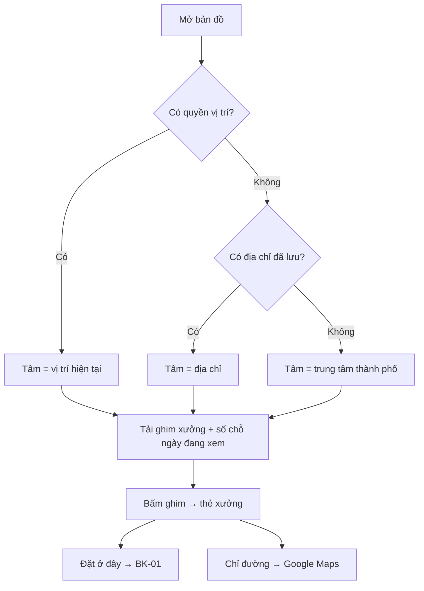

# Functional Specification — Bản đồ xưởng (Google Maps)

> Đặc tả nghiệp vụ cho **BK-05** trong [PRD Phase 2](../../../product/PRD_EV_Care_Phase2.md).
>
> **Quan hệ tài liệu:** dùng toạ độ xưởng (`workshop.latitude/longitude`) và API tìm xưởng gần của [us-029](../../sprint-3/feature-functional/us-029-sprint-3-spec.ff.md). Chọn xưởng trên bản đồ trả về luồng [BK-01](bk-01-phase2-spec.ff.md). Vị trí chủ xe cần đồng ý ([PL-01](../platform/pl-01-phase2-spec.ff.md)).
>
> Quy ước: [README Phase 2](../README.md).
>
> **Đặc tả kỹ thuật:** [API Spec](bk-05-phase2-spec.api.md) · [Entity Spec](bk-05-phase2-spec.entity.md) · [Frontend Spec](bk-05-phase2-spec.fe.md)

---

# 1. Document Information

| Field | Value |
|---|---|
| Feature ID | `FEAT-P2-BK05` |
| Feature Name | Bản đồ xưởng (Google Maps) |
| PRD Feature | BK-05 (P2-A, Should, Chức năng) |
| Document Version / Status | `v0.2` / `Draft` |
| Created / Updated | `2026-10-09` / `2026-10-12` |
| Related Technical Spec | [API Spec](bk-05-phase2-spec.api.md) · [Entity Spec](bk-05-phase2-spec.entity.md) · [Frontend Spec](bk-05-phase2-spec.fe.md) |

---

# 2. Feature Overview

## 2.1 Feature Description

Bản đồ Google Maps hiển thị vị trí chủ xe và các xưởng trong mạng lưới. Mỗi ghim xưởng ghi **số chỗ trống** của ngày đang xem. Có bộ lọc, thời gian di chuyển theo giao thông, nút **Chỉ đường** mở Google Maps, và nút **Đặt ở đây** đưa vào luồng BK-01. Bản đồ dùng chung cho màn Đặt lịch và chip "Chọn trên bản đồ" trong chat (CH-01).

## 2.2 Business Objective

Giúp chủ xe hình dung xa gần và chọn xưởng nhanh (PP2-01). Giảm câu hỏi "xưởng ở đâu, đi mất bao lâu".

## 2.3 User Objective

Thấy ngay xưởng nào gần, còn chỗ, mất bao lâu để tới.

## 2.4 Business Value

Tăng tỉ lệ chọn xưởng khác khi xưởng quen kín, giúp phân bố tải giữa các xưởng.

---

# 3. Scope

## 3.1 In Scope

- Bản đồ với vị trí chủ xe (hoặc địa chỉ đã lưu) và ghim xưởng.
- Số chỗ trống theo ngày; chọn ngày.
- Bộ lọc: còn chỗ, đang mở cửa, đánh giá tối thiểu, có phụ tùng (khi có BK-09).
- Thẻ xưởng: tên, địa chỉ, giờ mở cửa, đánh giá, khoảng cách, thời gian di chuyển, số chỗ.
- Nút Chỉ đường (mở Google Maps bên ngoài), nút Đặt ở đây.
- Dự phòng dạng danh sách khi bản đồ lỗi.

## 3.2 Out of Scope

- Dẫn đường trong app.
- Hiển thị xưởng ngoài mạng lưới hãng.
- Bản đồ trên Workshop Portal.

---

# 4. Actors

| Actor | Type | Responsibility |
|---|---|---|
| Chủ xe | User | Xem, lọc, chọn xưởng |
| Google Maps Platform | Partner | Bản đồ, tuyến đường |
| Service sức chứa | System | Số chỗ trống |
| Bộ lập lịch | System | Nhận "xưởng = X" từ bản đồ |

---

# 5. User Story

- `US-P2-BK05-01`: As a chủ xe, I want thấy các xưởng trên bản đồ kèm số chỗ trống, so that tôi chọn nhanh xưởng gần còn chỗ.
- `US-P2-BK05-02`: As a chủ xe, I want biết mất bao lâu để tới xưởng, so that tôi chọn giờ hợp lý.
- `US-P2-BK05-03`: As a chủ xe, I want bấm Chỉ đường, so that tôi đi tới xưởng bằng Google Maps.

---

# 6. Use Case

| UC | Tên | Trigger | Postcondition |
|---|---|---|---|
| `UC-BK05-01` | Mở bản đồ | Màn Đặt lịch → tab Bản đồ, hoặc chip "Chọn trên bản đồ" | Bản đồ quanh điểm neo |
| `UC-BK05-02` | Lọc | Bật bộ lọc | Ghim cập nhật |
| `UC-BK05-03` | Chọn xưởng | Bấm ghim → "Đặt ở đây" | BK-01 với ràng buộc xưởng = X |
| `UC-BK05-04` | Chỉ đường | Bấm "Chỉ đường" | Mở Google Maps ngoài app |

---

# 7. User Flow

---

# 8. Screen / UI Flow

| Screen ID | Name | Purpose |
|---|---|---|
| `SCR-BK05-01` | Bản đồ xưởng | Bản đồ, ghim, bộ lọc, chọn ngày |
| `SCR-BK05-02` | Thẻ xưởng | Chi tiết và hành động |
| `SCR-BK05-03` | Danh sách xưởng (dự phòng) | Khi bản đồ lỗi |

**SCR-BK05-01:**
- Ghim màu chính ghi số chỗ còn. Ghim hết chỗ màu xám ghi 0.
- Chấm "Bạn" ở vị trí chủ xe.
- Thanh lọc dạng chip; bộ chọn ngày (mặc định hôm nay).
- Nút chuyển sang dạng danh sách.

**SCR-BK05-02:**
- Tên, địa chỉ, giờ mở cửa hôm nay, đánh giá (khi đủ `MIN_REVIEWS`).
- Khoảng cách và thời gian di chuyển, số chỗ còn.
- Nút "Đặt ở đây", "Chỉ đường".

---

# 9. Main Flow

1. Chủ xe bấm chip "Chọn trên bản đồ".
2. Bản đồ mở quanh vị trí hiện tại, 3 ghim xưởng ghi 3, 5, 0 chỗ.
3. Chủ xe bấm ghim Mỹ Đình, thấy "3,4 km · 12 phút · còn 5 chỗ".
4. Chủ xe bấm "Đặt ở đây". BK-01 chạy với xưởng = Mỹ Đình và trả các khung trong khung rảnh.

---

# 10. Alternative Flow

- **AF-BK05-01 — Bật lọc "Còn chỗ":** ẩn ghim 0 chỗ.
- **AF-BK05-02 — Chọn ngày khác:** cập nhật số chỗ trên mọi ghim.
- **AF-BK05-03 — Xưởng hết chỗ cả ngày:** "Đặt ở đây" vẫn bấm được; BK-01 tìm ngày gần nhất tại xưởng đó.

---

# 11. Exception Flow

| ID | Condition | Behavior | User Experience |
|---|---|---|---|
| `EF-BK05-01` | Google Maps lỗi / hết hạn mức | Chuyển SCR-BK05-03, khoảng cách tính theo đường chim bay | "Bản đồ tạm thời không tải được" |
| `EF-BK05-02` | API tuyến đường lỗi | Ẩn thời gian di chuyển, giữ khoảng cách chim bay | — |
| `EF-BK05-03` | Xưởng thiếu toạ độ | Không có ghim, vẫn có trong danh sách | — |

---

# 12. Business Rules

- **BR-BK05-01 (PRD):** Ghim ghi số chỗ còn trong ngày đang xem; hết chỗ thì xám nhưng vẫn bấm được. **High.**
- **BR-BK05-02 (PRD):** Bộ lọc: còn chỗ, đang mở cửa, đánh giá tối thiểu, có phụ tùng (BK-09). **Medium.**
- **BR-BK05-03 (PRD):** Thời gian di chuyển theo giao thông, lưu đệm theo (ô lưới khu vực, xưởng, khung giờ) tối đa 30 phút. **Medium.**
- **BR-BK05-04 (PRD):** "Chỉ đường" mở Google Maps ngoài app. **Low.**
- **BR-BK05-05 (PRD):** Thứ tự điểm neo: vị trí hiện tại → địa chỉ đã lưu → trung tâm thành phố. **Medium.**
- **BR-BK05-06 (PRD):** "Đặt ở đây" gọi BK-01 với ràng buộc xưởng = X; các ràng buộc khác của chủ xe giữ nguyên. **High.**
- **BR-BK05-07:** Không gửi toạ độ chính xác của chủ xe tới API ngoài khi chỉ cần ô lưới khu vực (làm tròn ~500 m cho tính tuyến đường dùng đệm). **Medium.**

---

# 13. State / Status

Không áp dụng.

---

# 14. Data Requirements

| Data | Required | Source |
|---|---:|---|
| Toạ độ, địa chỉ, giờ mở cửa xưởng | Yes | `workshop`, `workshop_operating_hour` |
| Số chỗ còn theo ngày | Yes | Service sức chứa |
| Điểm neo chủ xe | Yes | Thiết bị / hồ sơ |
| Thời gian di chuyển | No | Google Routes |
| Đánh giá xưởng | No | PS-02 |

---

# 15. Business Error & Edge Cases

| Case ID | Scenario | Expected Behavior |
|---|---|---|
| `EDGE-BK05-01` | Nhiều xưởng chồng ghim | Gom cụm, phóng to khi bấm |
| `EDGE-BK05-02` | Chủ xe ở ngoài khu vực có xưởng | Hiện xưởng gần nhất kèm khoảng cách |
| `EDGE-BK05-03` | Số chỗ thay đổi khi đang xem | Kiểm tra lại ở bước BK-01 |

---

# 16. Permissions & Access

Mọi chủ xe đã đăng nhập xem được bản đồ mạng lưới xưởng. Vị trí chủ xe không lưu lại nếu chủ xe chưa đồng ý (PL-01).

---

# 17. Acceptance Criteria

- **AC-BK05-01:** *Given* API bản đồ lỗi *Then* chủ xe vẫn đặt được lịch bằng danh sách.
- **AC-BK05-02:** *Given* ngân sách tháng đã chốt *When* chi phí API đạt 80% *Then* gửi cảnh báo cho người vận hành.
- **AC-BK05-03:** *Given* chọn xưởng trên bản đồ *Then* phương án BK-01 trả về đều thuộc xưởng đó.
- **AC-BK05-04:** Số chỗ trên ghim khớp service sức chứa tại thời điểm tải.

---

# 18. Non-functional Expectations

Bản đồ hiển thị ghim ≤ 2 s (p90) trên 4G. Chi phí API có giới hạn theo người dùng (NFR-07).

# 19. Dependencies

Google Maps Platform (bản đồ, tuyến đường); ngân sách P2Q-07; BK-01; PL-01.

# 20. Assumptions

Xưởng thử nghiệm có toạ độ chính xác.

# 21. Business Constraints

Không dẫn đường trong app; không hiển thị xưởng ngoài mạng lưới.

# 22. Terminology

| Term | Vietnamese | Definition |
|---|---|---|
| Anchor point | Điểm neo | Vị trí dùng làm tâm tìm kiếm |
| Travel time | Thời gian di chuyển | Theo giao thông tại thời điểm xem |

# 23. Partner Notes

Google Maps Platform tính phí theo lượt tải bản đồ và lượt gọi tuyến đường. Cần API key giới hạn theo domain.

# 24. Open Questions

| ID | Question | Proposal |
|---|---|---|
| `Q-BK05-01` | Ngân sách tháng (P2Q-07)? | Chờ PM |
| `Q-BK05-02` | Có dùng Places Autocomplete để nhập địa chỉ nhà/chỗ làm không? | Có, chỉ ở màn Thói quen đặt lịch |

# 25. Traceability

PRD Phase 2 BK-05, PP2-01, NFR-07, NFR-08 · BR-BK05-01…07 · AC-BK05-01…04.

# 26. Related Documents

[PRD Phase 2](../../../product/PRD_EV_Care_Phase2.md) · [BK-01](bk-01-phase2-spec.ff.md) · [CH-01](../chat-experience/ch-01-phase2-spec.ff.md) · [API Spec](bk-05-phase2-spec.api.md) · [Entity Spec](bk-05-phase2-spec.entity.md) · [Frontend Spec](bk-05-phase2-spec.fe.md)

# 27. Change Log

| Version | Date | Change |
|---|---|---|
| `v0.1` | `2026-10-09` | Bản nháp đầu |
| `v0.2` | `2026-10-12` | Liên kết đặc tả API, Entity, Frontend |

# 28. Approval

| Role | Status |
|---|---|
| Product Owner | Pending |
| Technical Owner | Pending |
