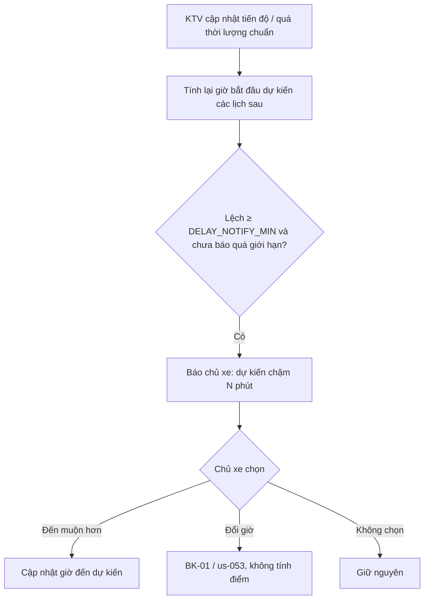

# Functional Specification — Báo trễ chủ động hai chiều

> Đặc tả nghiệp vụ cho **BK-08** trong [PRD Phase 2](../../../product/PRD_EV_Care_Phase2.md).
>
> **Quan hệ tài liệu:** ước tính giờ bắt đầu từ tiến độ 6 bước ([us-057](../../sprint-4/feature-functional/us-057-sprint-4-spec.ff.md)) và thời lượng chuẩn ([WS-02](../workshop-operations/ws-02-phase2-spec.ff.md)). Báo trễ hợp lệ thì không tính lỡ hẹn ([BK-02](bk-02-phase2-spec.ff.md)).
>
> Quy ước: [README Phase 2](../README.md).
>
> **Đặc tả kỹ thuật:** [API Spec](bk-08-phase2-spec.api.md) · [Entity Spec](bk-08-phase2-spec.entity.md) · [Frontend Spec](bk-08-phase2-spec.fe.md)

---

# 1. Document Information

| Field | Value |
|---|---|
| Feature ID | `FEAT-P2-BK08` |
| Feature Name | Báo trễ chủ động hai chiều |
| PRD Feature | BK-08 (P2-B, Could, Chức năng) |
| Document Version / Status | `v0.2` / `Draft` |
| Created / Updated | `2026-10-09` / `2026-10-12` |
| Related Technical Spec | [API Spec](bk-08-phase2-spec.api.md) · [Entity Spec](bk-08-phase2-spec.entity.md) · [Frontend Spec](bk-08-phase2-spec.fe.md) |

---

# 2. Feature Overview

## 2.1 Feature Description

Hai chiều báo trễ:
- **Xưởng → chủ xe.** Hệ thống ước tính giờ bắt đầu thực tế cho từng lịch trong ngày. Nếu lệch ≥ `DELAY_NOTIFY_MIN`, chủ xe nhận báo trễ kèm lựa chọn "Đến muộn hơn" hoặc "Đổi giờ".
- **Chủ xe → xưởng.** Chủ xe bấm "Tôi đến trễ" và chọn 10, 20 hoặc 30 phút. Xưởng thấy giờ đến mới.

## 2.2 Business Objective

Giảm thời gian khách phải chờ tại xưởng (PP2-07) và giảm lỡ hẹn do kẹt xe.

## 2.3 User Objective

- Chủ xe không phải ngồi chờ khi xưởng chậm.
- Xưởng biết trước khách tới muộn.

## 2.4 Business Value

Giảm T₄ (thời gian chờ). Dữ liệu giờ đến thực tế là đầu vào cho BK-10.

---

# 3. Scope

## 3.1 In Scope

- Ước tính giờ bắt đầu thực tế cho các lịch còn lại trong ngày.
- Báo trễ phía xưởng, kèm lựa chọn.
- Báo trễ phía chủ xe; cập nhật Workshop Board.
- Giới hạn số lần báo.

## 3.2 Out of Scope

- Theo dõi vị trí chủ xe theo thời gian thực.
- Tự đổi giờ khi chủ xe chưa đồng ý.

---

# 4. Actors

| Actor | Type | Responsibility |
|---|---|---|
| Chủ xe | User | Báo trễ, chọn đến muộn hơn / đổi giờ |
| Chủ xưởng / KTV | User | Cập nhật tiến độ (đầu vào ước tính) |
| Bộ ước tính trễ | System | Tính giờ bắt đầu dự kiến |

---

# 5. User Story

- `US-P2-BK08-01`: As a chủ xe, I want được báo khi xưởng chậm, so that tôi đến muộn hơn thay vì ngồi chờ.
- `US-P2-BK08-02`: As a chủ xe kẹt xe, I want báo trễ một chạm, so that tôi không bị tính lỡ hẹn.
- `US-P2-BK08-03`: As a chủ xưởng, I want biết khách đến muộn, so that tôi xếp xe khác vào trước.

---

# 6. Use Case

| UC | Tên | Trigger | Postcondition |
|---|---|---|---|
| `UC-BK08-01` | Xưởng trễ | Ước tính lệch ≥ `DELAY_NOTIFY_MIN` cho một lịch chưa check-in | Chủ xe nhận báo trễ |
| `UC-BK08-02` | Chủ xe chọn đến muộn hơn | Bấm "Đến muộn hơn" | Giờ đến dự kiến mới hiển thị cho xưởng |
| `UC-BK08-03` | Chủ xe chọn đổi giờ | Bấm "Đổi giờ" | Luồng BK-01 / us-053; không tính điểm |
| `UC-BK08-04` | Chủ xe báo trễ | Bấm "Tôi đến trễ" (trước giờ hẹn hoặc trong ân hạn) | Giờ đến mới; ân hạn BK-02 tính từ giờ mới |

---

# 7. User Flow

---

# 8. Screen / UI Flow

| Screen ID | Name | Purpose |
|---|---|---|
| `SCR-BK08-01` | Thông báo xưởng trễ | "Xe trước làm lâu hơn dự kiến, dự kiến bắt đầu 10:20 (chậm 20 phút)" + 2 nút |
| `SCR-BK08-02` | Nút "Tôi đến trễ" trên vé | Chọn 10 / 20 / 30 phút |
| `SCR-BK08-03` | Nhãn trên Workshop Board | "Khách báo trễ 20' · dự kiến 09:50" |

---

# 9. Main Flow

1. Lịch 09:30. Xe trước dự kiến xong 09:30, nhưng lúc 09:05 KTV cập nhật phát sinh thêm 25 phút.
2. Bộ ước tính tính giờ bắt đầu mới là 09:55 (lệch 25 phút).
3. Chủ xe nhận thông báo và chọn "Đến muộn hơn".
4. Board hiển thị khách đến dự kiến 09:55.

---

# 10. Alternative Flow

- **AF-BK08-01:** Chủ xe báo trễ 30 phút rồi vẫn chưa tới. Hệ thống gợi ý đổi giờ. Quá giờ mới + ân hạn thì xử lý lỡ hẹn theo BK-02.
- **AF-BK08-02:** Xưởng xong sớm. Không báo; tuỳ chọn báo "Bạn có thể đến sớm hơn" nếu chủ xe bật.

---

# 11. Exception Flow

| ID | Condition | Behavior |
|---|---|---|
| `EF-BK08-01` | Không có dữ liệu tiến độ | Không ước tính; không báo |
| `EF-BK08-02` | Đã báo đủ `DELAY_MAX_REPORTS` lần | Không báo thêm; xưởng liên hệ trực tiếp nếu cần |

---

# 12. Business Rules

- **BR-BK08-01 (PRD):** Ước tính từ tiến độ các xe trước và thời lượng chuẩn. Lệch ≥ `DELAY_NOTIFY_MIN` thì báo kèm 2 lựa chọn. **Medium.**
- **BR-BK08-02 (PRD):** Chủ xe báo trễ 10/20/30 phút; BK-02 không tính lỡ hẹn trong khoảng đã báo. **High.**
- **BR-BK08-03 (PRD):** Tối đa `DELAY_MAX_REPORTS` lần báo mỗi phía mỗi lịch. **Medium.**
- **BR-BK08-04:** Đổi giờ do xưởng trễ không tính điểm tin cậy cho chủ xe. **High.**
- **BR-BK08-05:** Báo trễ của chủ xe chỉ nhận trước giờ hẹn + `NO_SHOW_GRACE_MIN`. **Medium.**

---

# 13. State / Status

Thuộc tính trên `booking`: `expected_start_at` (ước tính), `owner_eta_at` (giờ đến chủ xe báo), số lần báo mỗi phía.

---

# 14. Data Requirements

| Data | Source |
|---|---|
| Tiến độ 6 bước, giờ bắt đầu/kết thúc từng bước | us-057 |
| Thời lượng chuẩn | WS-02 |
| Phân công KTV/khoang | WS-03 (khi có) |

---

# 15. Business Error & Edge Cases

| Case ID | Scenario | Expected Behavior |
|---|---|---|
| `EDGE-BK08-01` | Ước tính dao động liên tục | Chỉ báo lại khi lệch thêm ≥ `DELAY_NOTIFY_MIN` so với lần báo trước |
| `EDGE-BK08-02` | Chủ xe báo trễ làm chồng lên lịch sau | Xưởng thấy cảnh báo chồng lịch trên Board |

---

# 16. Permissions & Access

Chủ xe báo trễ lịch của mình. Chủ xưởng/KTV thấy báo trễ của lịch thuộc xưởng.

---

# 17. Acceptance Criteria

- **AC-BK08-01:** Chủ xe đã báo trễ trong giới hạn thì không bị ghi lỡ hẹn.
- **AC-BK08-02:** Chủ xe nhận không quá `DELAY_MAX_REPORTS` báo trễ cho một lịch.
- **AC-BK08-03:** Đổi giờ từ thông báo xưởng trễ không tạo sự kiện tin cậy.

---

# 18. Non-functional Expectations

Báo trễ gửi ≤ 2 phút sau khi ước tính đổi.

# 19. Dependencies

us-057, WS-02, BK-02, BK-01.

# 20. Assumptions

KTV cập nhật tiến độ đúng lúc.

# 21. Business Constraints

Không theo dõi vị trí chủ xe.

# 22. Terminology

| Term | Vietnamese |
|---|---|
| Expected start | Giờ bắt đầu dự kiến |
| ETA | Giờ đến dự kiến |

# 23. Partner Notes

—

# 24. Open Questions

| ID | Question | Proposal |
|---|---|---|
| `Q-BK08-01` | Có báo "đến sớm hơn" không? | Tuỳ chọn, mặc định tắt |

# 25. Traceability

PRD Phase 2 BK-08, PP2-07 · BR-BK08-01…05 · AC-BK08-01…03.

# 26. Related Documents

[PRD Phase 2](../../../product/PRD_EV_Care_Phase2.md) · [WS-02](../workshop-operations/ws-02-phase2-spec.ff.md) · [BK-02](bk-02-phase2-spec.ff.md) · [API Spec](bk-08-phase2-spec.api.md) · [Entity Spec](bk-08-phase2-spec.entity.md) · [Frontend Spec](bk-08-phase2-spec.fe.md)

# 27. Change Log

| Version | Date | Change |
|---|---|---|
| `v0.1` | `2026-10-09` | Bản nháp đầu |
| `v0.2` | `2026-10-12` | Liên kết đặc tả API, Entity, Frontend |

# 28. Approval

| Role | Status |
|---|---|
| Product Owner | Pending |
| Technical Owner | Pending |
