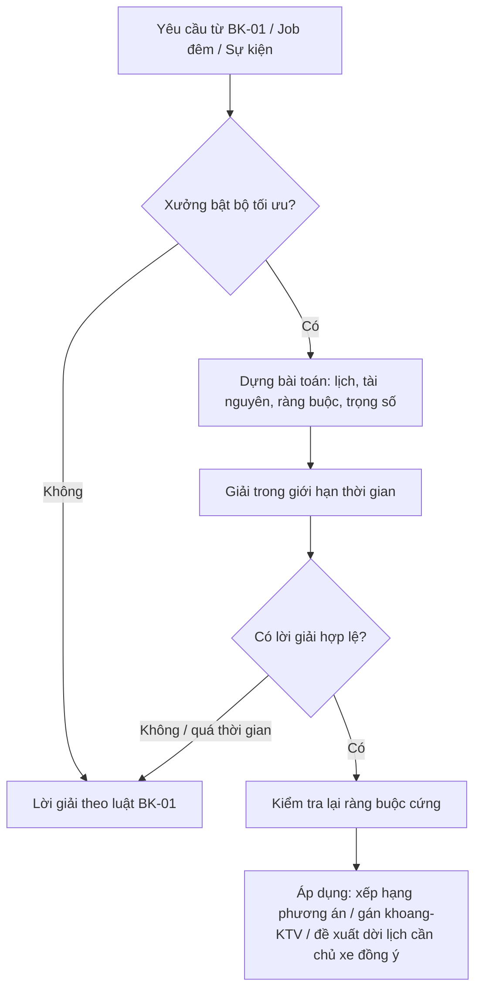

# Functional Specification — Tối ưu hoá lập lịch

> Đặc tả nghiệp vụ cho **BK-10** trong [PRD Phase 2](../../../product/PRD_EV_Care_Phase2.md) — mục 7.1 và **mục 8 (Bài toán lập lịch)**.
>
> **Loại: Phi chức năng.** BK-10 không thêm chức năng mới cho người dùng. Nó nâng **chất lượng lời giải** của bộ lập lịch [BK-01](bk-01-phase2-spec.ff.md). Mọi ràng buộc cứng và quy tắc giữ chỗ của BK-01 giữ nguyên.
>
> Đặc tả kỹ thuật (mô hình toán chi tiết, solver) sẽ đặt ở `docs/architecture/`.
>
> Quy ước: [README Phase 2](../README.md).
>
> **Đặc tả kỹ thuật:** [API Spec](bk-10-phase2-spec.api.md) · [Entity Spec](bk-10-phase2-spec.entity.md) · [Frontend Spec](bk-10-phase2-spec.fe.md)

---

# 1. Document Information

| Field | Value |
|---|---|
| Feature ID | `FEAT-P2-BK10` |
| Feature Name | Tối ưu hoá lập lịch |
| PRD Feature | BK-10 (P2-C, Could, **Phi chức năng**) |
| Document Version / Status | `v0.2` / `Draft` |
| Created / Updated | `2026-10-09` / `2026-10-12` |
| Data Owner | Team Data (Phase 2) |
| Related Technical Spec | [API Spec](bk-10-phase2-spec.api.md) · [Entity Spec](bk-10-phase2-spec.entity.md) · [Frontend Spec](bk-10-phase2-spec.fe.md) |

---

# 2. Feature Overview

## 2.1 Feature Description

Bộ lập lịch BK-01 dùng luật chấm điểm để chọn 1–3 phương án hợp lệ. BK-10 thay phần **xếp hạng và gán** bằng một bộ tối ưu, chọn lịch tốt nhất cho cả chủ xe và xưởng theo **năm mục tiêu thời gian**:

| Ký hiệu | Mục tiêu |
|---|---|
| T₁ | Thời gian đặt lịch ngắn |
| T₂ | Thời gian xử lý bảo dưỡng ngắn |
| T₃ | Thời gian nghỉ của xưởng ít |
| T₄ | Thời gian chờ bảo dưỡng ngắn |
| T₅ | Thời gian giao nhận xe ngắn |

Kèm theo đó là phạt khi vi phạm sở thích của chủ xe.

Bộ tối ưu chạy hai kiểu:
- **Theo lô:** mỗi đêm, gán khoang và KTV cho ngày mai, sắp xếp các lịch đang giữ chỗ.
- **Theo sự kiện:** khi có huỷ, trễ, khách vãng lai, KTV nghỉ.

## 2.2 Business Objective

Giảm thời gian chờ và giao nhận xe của khách; giảm giờ nghỉ của KTV và khoang (PP2-07, PP2-11, G2-5).

## 2.3 User Objective

- Chủ xe: đến là được làm, lấy xe sớm.
- Xưởng: thợ có việc đều, ít giờ trống xen kẽ.

## 2.4 Business Value

Chỉ số M-09, M-10. Bật cho từng xưởng chỉ khi chứng minh được lợi ích so với lời giải theo luật (A/B).

---

# 3. Scope

## 3.1 In Scope

- Mô hình hoá bài toán: biến quyết định, ràng buộc cứng/mềm, hàm mục tiêu (mục 12, 14).
- Bộ tối ưu theo lô và theo sự kiện.
- Trọng số mục tiêu: mặc định toàn hệ thống, xưởng chỉnh trong giới hạn.
- Bật/tắt theo xưởng; chế độ thử nghiệm A/B.
- Báo cáo so sánh với lời giải theo luật.

## 3.2 Out of Scope

- Dời lịch `confirmed` khi chủ xe chưa đồng ý.
- Định giá động.
- Dự báo nhu cầu dài hạn.

---

# 4. Actors

| Actor | Type | Responsibility |
|---|---|---|
| Bộ tối ưu | System | Giải bài toán |
| Bộ lập lịch BK-01 | System | Gọi bộ tối ưu thay phần chấm điểm khi xưởng bật |
| Chủ xưởng | User | Chỉnh trọng số trong giới hạn, bật/tắt |
| Người vận hành | User | Đặt trọng số mặc định, ngưỡng bật |
| Team Data | Stakeholder | Chuẩn bị dữ liệu, đánh giá A/B |

---

# 5. User Story

- `US-P2-BK10-01`: As a chủ xưởng, I want lịch được sắp sao cho thợ ít ngồi chơi mà khách không phải chờ lâu, so that xưởng chạy hiệu quả.
- `US-P2-BK10-02`: As a chủ xe, I want đến đúng giờ là được làm ngay, so that tôi lấy xe sớm.
- `US-P2-BK10-03`: As a PO, I want chỉ bật bộ tối ưu khi nó tốt hơn luật đơn giản, so that không thêm phức tạp vô ích.

---

# 6. Use Case

| UC | Tên | Trigger | Postcondition |
|---|---|---|---|
| `UC-BK10-01` | Tối ưu theo lô | Job đêm cho ngày mai | Gán khoang/KTV; thứ tự lịch giữ chỗ được sắp lại |
| `UC-BK10-02` | Tối ưu theo sự kiện | Huỷ, trễ, vãng lai, KTV nghỉ | Gán lại trong ngày, ≤ 3 s |
| `UC-BK10-03` | Xếp hạng phương án | BK-01 gọi khi xưởng bật | Phương án được xếp theo hàm mục tiêu |
| `UC-BK10-04` | Đánh giá A/B | Chu kỳ thử nghiệm | Báo cáo so sánh M-09, M-10 |

---

# 7. User Flow

---

# 8. Screen / UI Flow

| Screen ID | Name | Purpose |
|---|---|---|
| `SCR-BK10-01` | Cài đặt tối ưu (Workshop Portal) | Bật/tắt; thanh trượt ưu tiên "Khách chờ ít" ↔ "Thợ ít rảnh" trong giới hạn |
| `SCR-BK10-02` | Báo cáo hiệu quả | T₃, T₄, T₅ theo tuần, so với trước khi bật |
| `SCR-BK10-03` | Đề xuất dời lịch (chủ xe) | "Đến 09:00 thay vì 09:30 để lấy xe sớm hơn 40 phút?" — Đồng ý / Giữ nguyên |

---

# 9. Main Flow

1. 22:00 job đêm chạy cho ngày mai ở Xưởng Cầu Giấy (đã bật).
2. Dựng bài toán: 18 lịch, 4 KTV, 3 khoang, thời lượng chuẩn từ WS-02.
3. Bộ tối ưu gán khoang và KTV sao cho tổng hàm mục tiêu nhỏ nhất.
4. Kết quả qua kiểm tra ràng buộc cứng và được áp dụng.
5. Với 2 lịch `confirmed` có thể dời để giảm chờ, hệ thống gửi SCR-BK10-03 cho chủ xe. Chỉ dời khi chủ xe đồng ý.

---

# 10. Alternative Flow

- **AF-BK10-01:** Không có lời giải trong giới hạn thời gian → dùng lời giải theo luật, ghi log.
- **AF-BK10-02:** Chủ xe từ chối dời lịch → giữ nguyên, giải lại phần còn lại.

---

# 11. Exception Flow

| ID | Condition | Behavior |
|---|---|---|
| `EF-BK10-01` | Lời giải vi phạm ràng buộc cứng (lỗi mô hình) | Loại bỏ, dùng luật, cảnh báo đội kỹ thuật |
| `EF-BK10-02` | Thiếu dữ liệu thời lượng | Dùng thời lượng chuẩn mặc định; giảm độ tin cậy |
| `EF-BK10-03` | Hiệu quả thấp hơn `OPT_MIN_GAIN` trong A/B | Tự tắt cho xưởng đó, báo PO |

---

# 12. Business Rules

## BR-BK10-01 — Chỉ thay xếp hạng và gán (PRD)
Ràng buộc cứng và giữ chỗ của BK-01 giữ nguyên. **High.**

## BR-BK10-02 — Không tự dời lịch đã xác nhận (PRD)
Bộ tối ưu chỉ được tự do với lịch đang giữ chỗ và với phân công nội bộ (khoang, KTV). Dời giờ của lịch `confirmed` cần chủ xe đồng ý. **High.**

## BR-BK10-03 — Trọng số (PRD)
Mặc định toàn hệ thống; xưởng chỉnh trong giới hạn ±50% của mặc định. **Medium.**

## BR-BK10-04 — Bật theo xưởng, đo A/B (PRD)
Chỉ bật khi đạt `OPT_MIN_GAIN` trên dữ liệu thử và có ≥ `OPT_MIN_DATA_WEEKS` tuần dữ liệu thật. **High.**

## BR-BK10-05 — Ràng buộc cứng của mô hình
Theo PRD §8.1:
1. Mỗi lịch xếp đúng một lần.
2. Thời điểm thuộc khung rảnh của chủ xe, trước hạn chót.
3. Xưởng trong khu vực chấp nhận.
4. Mỗi khoang/KTV tối đa một xe tại một thời điểm; không vượt sức chứa sau khi trừ dự phòng và khoá.
5. Trong giờ hoạt động và giờ làm của KTV.
6. KTV đủ kỹ năng.
7. Phụ tùng có trước giờ bắt đầu (khi là ràng buộc cứng).
8. Lịch `confirmed` không dời khi chưa đồng ý.

**High.**

## BR-BK10-06 — Hàm mục tiêu
`min w₁·T₁ + w₂·T₂ + w₃·T₃ + w₄·T₄ + w₅·T₅ + w₆·Phạt_sở_thích`, với *x(b, w, k, t)* ∈ {0, 1}. Định nghĩa từng T theo mục 22. **High.**

## BR-BK10-07 — Giới hạn thời gian và dự phòng
Theo lô ≤ 30 s mỗi xưởng mỗi ngày; theo sự kiện ≤ 3 s. Quá hạn thì dùng lời giải theo luật. **High.**

## BR-BK10-08 — Giải thích được
Mọi thay đổi gán hoặc đề xuất dời lịch có lý do ngắn bằng ngôn ngữ người dùng ("giảm 40 phút chờ"). **Medium.**

---

# 13. State / Status

Trạng thái bộ tối ưu theo xưởng: `off` → `shadow` (chạy song song, không áp dụng, chỉ ghi kết quả để so sánh) → `on`. Tự về `off` khi EF-BK10-03.

---

# 14. Data Requirements

| Data | Purpose | Source | Owner |
|---|---|---|---|
| Lịch hẹn, ràng buộc chủ xe | Đối tượng xếp | BK-01 | Backend |
| KTV, kỹ năng, giờ làm, khoang | Tài nguyên | WS-03 | Backend |
| Thời lượng chuẩn và thực tế | d(b), T₂ | WS-02, us-057 | Team Data |
| Giờ khách thực tới | T₄, T₅ | Check-in us-037 | Team Data |
| Tỉ lệ lỡ hẹn theo khung | Dự phòng | BK-02 | Team Data |
| Kết quả A/B | Quyết định bật | PL-03 | Team Data |

---

# 15. Business Error & Edge Cases

| Case ID | Scenario | Expected Behavior |
|---|---|---|
| `EDGE-BK10-01` | Xưởng chỉ có 1 KTV | Bài toán tầm thường; vẫn chạy, lợi ích thấp → có thể không bật |
| `EDGE-BK10-02` | Ngày lễ, giờ mở cửa đặc biệt | Dùng giờ hoạt động của ngày đó |
| `EDGE-BK10-03` | Trọng số xưởng làm T₄ tăng quá ngưỡng chấp nhận | Giới hạn trọng số (BR-BK10-03) ngăn trường hợp cực đoan |

---

# 16. Permissions & Access

| Role | Access |
|---|---|
| Chủ xưởng | Bật/tắt, chỉnh trọng số xưởng mình, xem báo cáo |
| Người vận hành | Trọng số mặc định, ngưỡng |
| Team Data | Dữ liệu ẩn danh để đánh giá |

---

# 17. Acceptance Criteria

- **AC-BK10-01:** Lời giải của bộ tối ưu không vi phạm ràng buộc cứng nào (kiểm tra tự động mọi lần chạy).
- **AC-BK10-02:** Trên dữ liệu thử, tổng hàm mục tiêu tốt hơn lời giải theo luật ít nhất `OPT_MIN_GAIN`; không đạt thì không chuyển sang `on`.
- **AC-BK10-03:** Theo lô ≤ 30 s, theo sự kiện ≤ 3 s; quá hạn thì dùng lời giải theo luật.
- **AC-BK10-04:** Không lịch `confirmed` nào bị đổi giờ khi chủ xe chưa đồng ý.

---

# 18. Non-functional Expectations

| Requirement | Expected Behavior |
|---|---|
| Correctness | 0 vi phạm ràng buộc cứng |
| Performance | NFR-04 |
| Quality | NFR-05 |
| Observability | Lưu đầu vào ẩn danh, lời giải, giá trị từng T, thời gian giải |

---

# 19. Dependencies

BK-01, WS-02, WS-03, us-057, BK-02, PL-03, thư viện solver (đề xuất OR-Tools CP-SAT), workspace của Team Data.

# 20. Assumptions

- Thời lượng chuẩn đủ ổn định.
- Có ≥ 8 tuần dữ liệu thật trước khi làm.

# 21. Business Constraints

Không dời lịch đã xác nhận khi chưa có đồng ý; không vượt sức chứa.

# 22. Terminology — định nghĩa mục tiêu

| Ký hiệu | Mục tiêu | Định nghĩa đề xuất | Có lợi cho |
|---|---|---|---|
| T₁ | Thời gian đặt lịch | Từ lúc chủ xe yêu cầu đến khi có lịch được xác nhận | Chủ xe |
| T₂ | Thời gian xử lý | Thời gian KTV thực làm trên xe | Cả hai |
| T₃ | Thời gian nghỉ của xưởng | Tổng thời gian khoang/KTV trống trong giờ hoạt động | Xưởng |
| T₄ | Thời gian chờ bảo dưỡng | Từ check-in đến lúc KTV bắt đầu | Chủ xe |
| T₅ | Thời gian giao nhận xe | Từ check-in đến bàn giao | Chủ xe |

**Đánh đổi:** T₃ xung đột với T₄, T₅; T₁ xung đột với sở thích.

# 23. Partner Notes

Cần Team Data xác nhận định nghĩa đo và dữ liệu baseline từ P2-A.

# 24. Open Questions

| ID | Question | Proposal |
|---|---|---|
| `Q-BK10-01` | Định nghĩa chính xác T₁ (có tính khoảng chờ đến ngày hẹn?) — P2Q-10 | Chưa tính; đo riêng "lead time" |
| `Q-BK10-02` | Trọng số mặc định? | Đặt sau baseline M-09, M-10 |
| `Q-BK10-03` | T₃ có tính chỗ dự phòng cho vãng lai không? | Không tính chỗ dự phòng là "nghỉ" |
| `Q-BK10-04` | Solver: OR-Tools CP-SAT hay heuristic tự viết? | CP-SAT; quyết định trong tài liệu kiến trúc |

# 25. Traceability

PRD Phase 2 BK-10, §8, PP2-07, PP2-11, G2-5, M-09, M-10, NFR-04, NFR-05 · BR-BK10-01…08 · AC-BK10-01…04.

# 26. Related Documents

[PRD Phase 2 §8](../../../product/PRD_EV_Care_Phase2.md#8-bài-toán-lập-lịch) · [BK-01](bk-01-phase2-spec.ff.md) · [WS-02](../workshop-operations/ws-02-phase2-spec.ff.md) · [WS-03](../workshop-operations/ws-03-phase2-spec.ff.md) · [API Spec](bk-10-phase2-spec.api.md) · [Entity Spec](bk-10-phase2-spec.entity.md) · [Frontend Spec](bk-10-phase2-spec.fe.md)

# 27. Change Log

| Version | Date | Change |
|---|---|---|
| `v0.1` | `2026-10-09` | Bản nháp đầu |
| `v0.2` | `2026-10-12` | Liên kết đặc tả API, Entity, Frontend |

# 28. Approval

| Role | Status |
|---|---|
| Product Owner | Pending |
| Technical Owner | Pending |
| Team Data | Pending |
