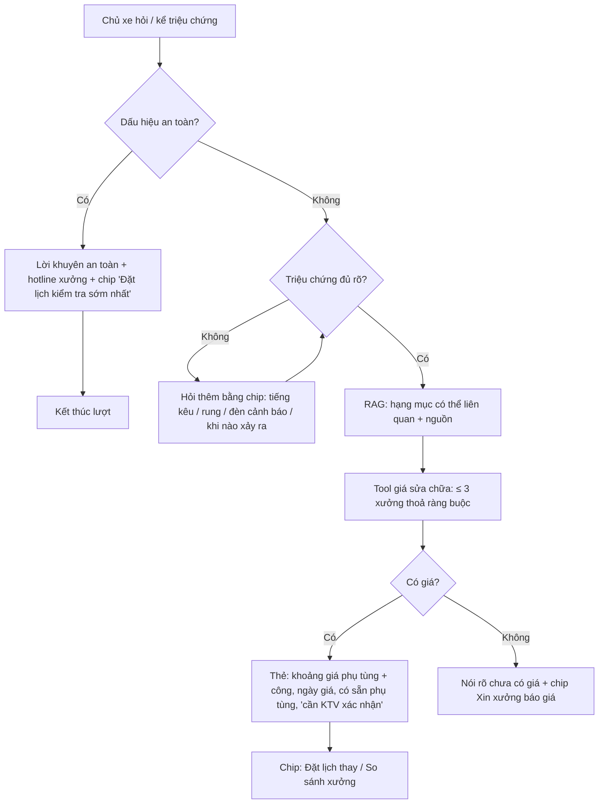

# Functional Specification — Tư vấn phụ tùng và báo giá sửa chữa

> Đặc tả nghiệp vụ cho **AD-02** trong [PRD Phase 2](../../../product/PRD_EV_Care_Phase2.md).
>
> **Quan hệ tài liệu:** dùng RAG có trích nguồn (F4, [AI-002](../../ai-agent/ai-002-sprint-2-spec.agent.md)), tool giá (F5) và báo giá HITL (F5b, [us-049](../../sprint-3/feature-functional/us-049-sprint-3-spec.ff.md)). Cách xử lý dấu hiệu an toàn theo F9. Nguyên tắc "No source = no claim" và "Estimate label" của PRD MVP §7 giữ nguyên.
>
> Quy ước: [README Phase 2](../README.md).

---

# 1. Document Information

| Field | Value |
|---|---|
| Feature ID | `FEAT-P2-AD02` |
| Feature Name | Tư vấn phụ tùng và báo giá sửa chữa |
| PRD Feature | AD-02 (P2-B, Should, Chức năng) |
| Document Version / Status | `v0.1` / `Draft` |
| Created / Updated | `2026-10-09` |

---

# 2. Feature Overview

## 2.1 Feature Description

Chủ xe kể triệu chứng ("phanh kêu khi dừng") hoặc hỏi thẳng tên phụ tùng. Agent làm các bước sau:
1. Nêu các **hạng mục sửa chữa có thể liên quan**, theo tài liệu hãng, có trích nguồn.
2. Đưa **khoảng giá** phụ tùng + tiền công theo **bảng giá sửa chữa** của các xưởng gần, kèm ngày cập nhật.
3. Cho biết xưởng nào có sẵn phụ tùng (khi có BK-09).
4. Cho đặt lịch ngay.

Agent **không chẩn đoán chắc chắn**. Mọi tư vấn nhắc "cần KTV kiểm tra để xác nhận". Với triệu chứng có dấu hiệu nguy hiểm, **lời khuyên an toàn đứng trước** mọi thông tin giá.

## 2.2 Business Objective

Giảm cuộc gọi hỏi giá sửa chữa tới xưởng (PP2-06, PP2-09). Khách đến đã biết khoảng giá.

## 2.3 User Objective

Biết trước khả năng phải thay gì, khoảng bao nhiêu, ở đâu.

## 2.4 Business Value

M-08. Triệu chứng chủ xe kể được chuyển cho KTV (TA-01), giảm thời gian chẩn đoán.

---

# 3. Scope

## 3.1 In Scope

- Hiểu triệu chứng, hỏi thêm bằng chip.
- Hạng mục có thể liên quan + trích nguồn.
- Bảng giá sửa chữa của xưởng (dữ liệu mới) và khoảng giá.
- Lời khuyên an toàn ưu tiên.
- Lưu triệu chứng vào lịch hẹn nếu đặt.
- Xin xưởng báo giá (F5b) khi thiếu giá.

## 3.2 Out of Scope

- Chẩn đoán qua ảnh, mã lỗi OBD.
- Tư vấn mua phụ tùng ngoài.
- Cam kết giá cuối.

---

# 4. Actors

| Actor | Type | Responsibility |
|---|---|---|
| Chủ xe | User | Kể triệu chứng, hỏi giá |
| AI Agent | System | RAG, gọi tool giá, an toàn |
| Chủ xưởng | User | Nhập bảng giá sửa chữa; báo giá khi được xin (F5b) |

---

# 5. User Story

- `US-P2-AD02-01`: As a chủ xe, I want biết thay má phanh hết khoảng bao nhiêu ở các xưởng gần, so that tôi chuẩn bị chi phí.
- `US-P2-AD02-02`: As a chủ xe thấy xe có dấu hiệu lạ, I want được khuyên an toàn trước, so that tôi không lái xe nguy hiểm.
- `US-P2-AD02-03`: As a chủ xưởng, I want khách tự tra giá sửa chữa phổ biến, so that tôi bớt nghe điện thoại.

---

# 6. Use Case

| UC | Tên | Trigger | Postcondition |
|---|---|---|---|
| `UC-AD02-01` | Hỏi giá phụ tùng cụ thể | "Thay má phanh trước hết bao nhiêu?" | Khoảng giá ≤ 3 xưởng + nguồn + chip đặt lịch |
| `UC-AD02-02` | Kể triệu chứng | "Phanh trước kêu khi dừng" | Hạng mục có thể liên quan + khoảng giá |
| `UC-AD02-03` | Triệu chứng an toàn | "Có mùi khét khi sạc" | Lời khuyên an toàn + hotline + chip đặt lịch sớm nhất; không báo giá ở lượt này |
| `UC-AD02-04` | Thiếu giá | Xưởng chưa nhập giá | Chip "Xin xưởng báo giá" → F5b |
| `UC-AD02-05` | Nhập bảng giá sửa chữa | Chủ xưởng | Bảng giá có ngày cập nhật |

---

# 7. User Flow

---

# 8. Screen / UI Flow

| Screen ID | Name | Purpose |
|---|---|---|
| `SCR-AD02-01` | Thẻ tư vấn sửa chữa (chat) | Hạng mục có thể liên quan, trích nguồn, khoảng giá từng xưởng, nhãn ước tính, câu "cần KTV kiểm tra" |
| `SCR-AD02-02` | Thẻ an toàn | Màu cảnh báo, hướng dẫn ngắn, hotline (hiển thị dạng chữ chọn được), chip đặt lịch sớm nhất |
| `SCR-AD02-03` | Bảng giá sửa chữa (Workshop Portal) | Mã phụ tùng, giá phụ tùng, tiền công, thời lượng, ngày cập nhật; nhập tay / tải CSV |

---

# 9. Main Flow

1. Chủ xe hỏi "Phanh trước kêu khi dừng, thay má phanh VF 8 hết bao nhiêu?".
2. Không có dấu hiệu an toàn khẩn cấp.
3. RAG trả hạng mục "Má phanh trước", nguồn là sổ tay bảo dưỡng.
4. Tool giá: Cầu Giấy 1,1–1,3 tr + công 250k (cập nhật 01/10); Mỹ Đình 1,15–1,35 tr + 230k.
5. Thẻ có nhãn "ước tính", "Cần KTV kiểm tra để xác nhận", kèm chip "Đặt lịch thay má phanh".

---

# 10. Alternative Flow

- **AF-AD02-01 — Triệu chứng mơ hồ:** hỏi thêm tối đa 2 lượt bằng chip; vẫn mơ hồ thì gợi ý "Kiểm tra tổng quát".
- **AF-AD02-02 — Đặt lịch từ tư vấn:** triệu chứng và hạng mục có thể liên quan được gắn vào lịch hẹn; KTV thấy qua TA-01.

---

# 11. Exception Flow

| ID | Condition | Behavior |
|---|---|---|
| `EF-AD02-01` | Không có nguồn tài liệu cho triệu chứng | Không nêu hạng mục; gợi ý kiểm tra tại xưởng |
| `EF-AD02-02` | Hỏi về phụ tùng không chính hãng | Không tư vấn mua ngoài; nêu điều khoản bảo hành nếu tài liệu có |
| `EF-AD02-03` | Giá cũ hơn `PRICE_STALE_DAYS` | Hiện kèm cảnh báo |
| `EF-AD02-04` | Câu hỏi ngoài phạm vi (va chạm, độ xe) | Giữ quy tắc F4: nói rõ ngoài phạm vi, gợi ý liên hệ xưởng |

---

# 12. Business Rules

- **BR-AD02-01 (PRD):** Chỉ nêu hạng mục **có thể liên quan**, kèm nguồn; luôn có câu "cần KTV kiểm tra để xác nhận". **High.**
- **BR-AD02-02 (PRD):** Giá lấy từ bảng giá sửa chữa của xưởng. Thiếu giá thì nói rõ và đề nghị F5b. **High.**
- **BR-AD02-03 (PRD):** Luôn là khoảng giá + ngày cập nhật; giá chính thức chỉ có qua F5b hoặc khi nhận xe. **High.**
- **BR-AD02-04 (PRD):** Dấu hiệu an toàn (phanh mất tác dụng, cảnh báo pin cao áp, khói, mùi khét, rò rỉ) thì lời khuyên an toàn trước, không báo giá trong lượt đó. **High.**
- **BR-AD02-05 (PRD):** Triệu chứng được gắn vào lịch hẹn khi đặt. **Medium.**
- **BR-AD02-06:** Danh sách từ khoá và mẫu dấu hiệu an toàn được quản lý cấu hình, có bộ eval riêng. **High.**
- **BR-AD02-07:** Khoảng giá = giá thấp nhất–cao nhất của phụ tùng tương thích ở xưởng đó; không cộng tiền công vào khoảng mà hiển thị riêng. **Medium.**

---

# 13. State / Status

Bảng giá sửa chữa: mỗi dòng có `updated_at`; không có vòng đời.

# 14. Data Requirements

| Entity | Purpose | R/W |
|---|---|---|
| `repair_price` (mới) | Xưởng, model, mã phụ tùng, giá phụ tùng min–max, tiền công, thời lượng, `updated_at` | R/W |
| `official_document` / `document_chunk` | Nguồn hạng mục | R |
| `booking.reported_symptom` (mới) | Triệu chứng gắn lịch | W |
| `workshop_part_stock` (BK-09) | Có sẵn phụ tùng | R |

# 15. Business Error & Edge Cases

| Case ID | Scenario | Expected Behavior |
|---|---|---|
| `EDGE-AD02-01` | Nhiều hạng mục có thể liên quan | Tối đa 3, xếp theo mức liên quan của nguồn |
| `EDGE-AD02-02` | Chủ xe hỏi giá cho model khác xe của mình | Trả lời theo model được hỏi, ghi rõ |

# 16. Permissions & Access

| Role | Access |
|---|---|
| Chủ xe | Xem khoảng giá |
| Chủ xưởng | Sửa bảng giá xưởng mình |

# 17. Acceptance Criteria

- **AC-AD02-01:** 100% câu trả lời có triệu chứng an toàn đưa lời khuyên an toàn trước giá (bộ eval ≥ 20 câu).
- **AC-AD02-02:** Không câu trả lời nào nêu một con số giá duy nhất như giá cuối.
- **AC-AD02-03:** Mọi hạng mục được nêu có ít nhất 1 trích nguồn hợp lệ.
- **AC-AD02-04:** Đặt lịch từ tư vấn thì lịch hẹn có `reported_symptom`.

# 18. Non-functional Expectations

Theo NFR chat MVP (token đầu ≤ 1,5 s p50).

# 19. Dependencies

F4, F5, F5b, BK-01, BK-09, TA-01, bảng giá sửa chữa từ xưởng.

# 20. Assumptions

Xưởng sẵn sàng nhập giá cho các hạng mục sửa chữa phổ biến (H2-07).

# 21. Business Constraints

Không chẩn đoán chắc chắn; không cam kết giá.

# 22. Terminology

| Term | Vietnamese |
|---|---|
| Repair price list | Bảng giá sửa chữa |
| Possible related item | Hạng mục có thể liên quan |
| Safety signal | Dấu hiệu an toàn |

# 23. Partner Notes

Cần xưởng thử nghiệm cung cấp bảng giá 20 hạng mục sửa chữa phổ biến nhất.

# 24. Open Questions

| ID | Question | Proposal |
|---|---|---|
| `Q-AD02-01` | Danh sách dấu hiệu an toàn chuẩn? | Lấy từ tài liệu hãng + F9 |
| `Q-AD02-02` | Số hạng mục tối thiểu xưởng phải nhập giá? | 20 hạng mục phổ biến |

# 25. Traceability

PRD Phase 2 AD-02, PP2-06, PP2-09, M-08 · BR-AD02-01…07 · AC-AD02-01…04.

# 26. Related Documents

[PRD Phase 2](../../../product/PRD_EV_Care_Phase2.md) · [AD-04](ad-04-phase2-spec.ff.md) · [BK-09](bk-09-phase2-spec.ff.md) · [us-049 FF](../../sprint-3/feature-functional/us-049-sprint-3-spec.ff.md)

# 27. Change Log

| Version | Date | Change |
|---|---|---|
| `v0.1` | `2026-10-09` | Bản nháp đầu |

# 28. Approval

| Role | Status |
|---|---|
| Product Owner | Pending |
| Technical Owner | Pending |
