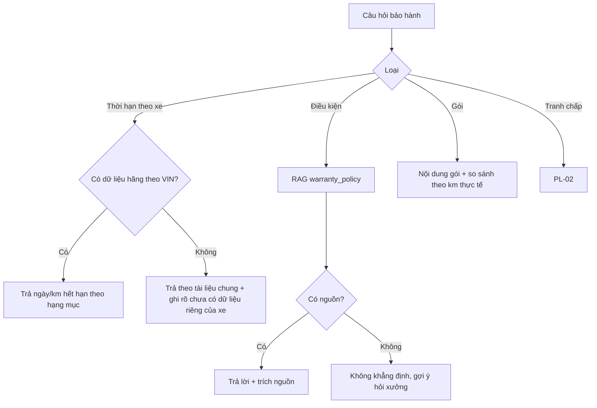

# Functional Specification — Tư vấn bảo hành và gói bảo hành

> Đặc tả nghiệp vụ cho **AD-03** trong [PRD Phase 2](../../../product/PRD_EV_Care_Phase2.md).
>
> **Quan hệ tài liệu:** dùng RAG `warranty_policy` (F4, [AI-002](../../ai-agent/ai-002-sprint-2-spec.agent.md)) và thông tin bảo hành hãng trả về khi xác thực xe (F1). Giữ PQ-07: không tự nêu ân hạn hay ngưỡng mất bảo hành nếu tài liệu không ghi. Tranh chấp được chuyển người thật ([PL-02](pl-02-phase2-spec.ff.md)).
>
> Quy ước: [README Phase 2](../README.md).

---

# 1. Document Information

| Field | Value |
|---|---|
| Feature ID | `FEAT-P2-AD03` |
| Feature Name | Tư vấn bảo hành và gói bảo hành |
| PRD Feature | AD-03 (P2-B, Should, Chức năng) |
| Document Version / Status | `v0.1` / `Draft` |
| Created / Updated | `2026-10-09` |

---

# 2. Feature Overview

## 2.1 Feature Description

Agent trả lời bốn loại câu hỏi bảo hành:

| Câu hỏi | Nguồn trả lời |
|---|---|
| "Xe tôi còn bảo hành X không, đến khi nào?" | **Dữ liệu hãng theo VIN** |
| "Điều gì làm mất bảo hành?", "Quy trình yêu cầu bảo hành?" | **Tài liệu chính sách**, có trích nguồn |
| "Gói bảo dưỡng / bảo hành mở rộng gồm gì, có lợi không?" | Danh mục gói của hãng/xưởng + phép tính so sánh minh bạch theo km thực tế |
| Tranh chấp ("xưởng từ chối bảo hành của tôi") | Chuyển người thật kèm tóm tắt |

## 2.2 Business Objective

Câu "xe tôi còn bảo hành không" là câu hỏi lặp lại nhiều nhất ở quầy. Agent trả lời thay, có nguồn (PP2-06, PP2-09, PP-04).

## 2.3 User Objective

Biết chắc quyền lợi bảo hành của xe mình.

## 2.4 Business Value

M-08; giảm tranh cãi tại xưởng do hiểu sai bảo hành.

---

# 3. Scope

## 3.1 In Scope

- Tra thời hạn bảo hành theo hạng mục theo VIN.
- Hỏi đáp điều kiện bảo hành có nguồn.
- Giới thiệu và so sánh gói (khi có danh mục).
- Chuyển người khi tranh chấp.

## 3.2 Out of Scope

- Quyết định bảo hành thay xưởng hoặc hãng.
- Bán gói, thanh toán.

---

# 4. Actors

| Actor | Type | Responsibility |
|---|---|---|
| Chủ xe | User | Hỏi |
| AI Agent | System | Tra dữ liệu, RAG |
| Hệ thống hãng | Partner | Bảo hành theo VIN (P2Q-05) |
| Chủ xưởng | User | Nhận chuyển tranh chấp |

---

# 5. User Story

- `US-P2-AD03-01`: As a chủ xe, I want biết pin xe tôi còn bảo hành đến khi nào, so that tôi yên tâm.
- `US-P2-AD03-02`: As a chủ xe, I want biết việc gì làm mất bảo hành, so that tôi tránh.
- `US-P2-AD03-03`: As a chủ xe, I want biết gói mở rộng có lợi với mức chạy của tôi không, so that tôi quyết định đúng.

---

# 6. Use Case

| UC | Tên | Trigger | Postcondition |
|---|---|---|---|
| `UC-AD03-01` | Thời hạn bảo hành theo xe | Hỏi về hạng mục cụ thể | Ngày/km hết hạn từ dữ liệu hãng + nguồn |
| `UC-AD03-02` | Điều kiện bảo hành | Hỏi chính sách | Câu trả lời có trích nguồn hoặc từ chối khẳng định |
| `UC-AD03-03` | Gói mở rộng | Hỏi gói | Nội dung gói + phép so sánh theo km/tháng |
| `UC-AD03-04` | Tranh chấp | Khiếu nại bị từ chối bảo hành | PL-02 chuyển xưởng |

---

# 7. User Flow

# 8. Screen / UI Flow

| Screen ID | Name | Purpose |
|---|---|---|
| `SCR-AD03-01` | Thẻ bảo hành của xe | Danh sách hạng mục: còn / hết bảo hành, hạn ngày/km, nguồn dữ liệu |
| `SCR-AD03-02` | Thẻ so sánh gói | Chi phí trả từng lần ước tính vs giá gói theo km/tháng hiện tại, ghi rõ giả định |

# 9. Main Flow

1. Chủ xe hỏi "Xe tôi còn bảo hành pin không?".
2. Dữ liệu hãng theo VIN cho biết pin cao áp còn bảo hành đến ngày D hoặc K km.
3. Agent trả lời kèm nguồn, rồi nhắc "Để giữ bảo hành, bảo dưỡng đúng mốc tại xưởng uỷ quyền" (trích chính sách).
4. Chip "Đặt lịch mốc 24.000 km".

# 10. Alternative Flow

- **AF-AD03-01:** Xe đã hết bảo hành hạng mục → nói rõ, không cảnh báo về mất bảo hành nữa (giữ quy tắc F7).

# 11. Exception Flow

| ID | Condition | Behavior |
|---|---|---|
| `EF-AD03-01` | Không có nguồn cho điều kiện được hỏi | Không khẳng định (PQ-07) |
| `EF-AD03-02` | Không có danh mục gói | Nói chưa có thông tin gói, gợi ý hỏi xưởng |

---

# 12. Business Rules

- **BR-AD03-01 (PRD):** Thời hạn theo hạng mục lấy từ dữ liệu hãng theo VIN; không tự tính từ tài liệu chung khi đã có dữ liệu theo xe. **High.**
- **BR-AD03-02 (PRD):** Điều kiện, quy trình bảo hành chỉ từ `warranty_policy`, có trích nguồn. **High.**
- **BR-AD03-03 (PRD):** Gói chỉ giới thiệu khi có trong danh mục; "có lợi không" là phép tính minh bạch, nêu giả định, không phải khuyến nghị bán hàng. **High.**
- **BR-AD03-04 (PRD):** Tranh chấp thì chuyển người, agent không phán xử. **High.**
- **BR-AD03-05:** Không đưa VIN vào prompt khi không cần; tra theo id xe nội bộ. **High.**

# 13. State / Status

Không áp dụng.

# 14. Data Requirements

| Data | Source |
|---|---|
| Bảo hành theo hạng mục theo VIN | Hãng (mock mở rộng — P2Q-05) |
| `warranty_policy` | Kho tài liệu RAG |
| Danh mục gói (tên, nội dung, giá, điều kiện) | Hãng / xưởng (mới) |
| Km/tháng | Từ ODO đồng bộ |

# 15. Business Error & Edge Cases

| Case ID | Scenario | Expected Behavior |
|---|---|---|
| `EDGE-AD03-01` | Dữ liệu hãng và tài liệu chung mâu thuẫn | Ưu tiên dữ liệu hãng theo xe; ghi chú |
| `EDGE-AD03-02` | Xe đổi chủ | Bảo hành theo xe, không theo chủ |

# 16. Permissions & Access

Chủ xe xem bảo hành xe của mình.

# 17. Acceptance Criteria

- **AC-AD03-01:** Thời hạn bảo hành trả lời khớp dữ liệu hãng (test với dữ liệu mock).
- **AC-AD03-02:** 100% câu khẳng định điều kiện bảo hành có trích nguồn.
- **AC-AD03-03:** Câu hỏi tranh chấp được chuyển người trong 100% ca eval.

# 18. Non-functional Expectations

NFR chat MVP.

# 19. Dependencies

F4, F1, P2Q-05, PL-02.

# 20. Assumptions

Hãng (mock) mở rộng được API bảo hành theo hạng mục.

# 21. Business Constraints

No-source-no-claim; không bán hàng.

# 22. Terminology

| Term | Vietnamese |
|---|---|
| Warranty coverage | Phạm vi bảo hành |
| Extended plan | Gói mở rộng |

# 23. Partner Notes

Cần hãng xác nhận nguồn dữ liệu bảo hành theo VIN (P2Q-05).

# 24. Open Questions

| ID | Question | Proposal |
|---|---|---|
| `Q-AD03-01` | Nguồn danh mục gói? | Hãng cung cấp; xưởng không tự tạo gói ở P2-B |

# 25. Traceability

PRD Phase 2 AD-03, PP2-06, PP-04, M-08 · BR-AD03-01…05 · AC-AD03-01…03.

# 26. Related Documents

[PRD Phase 2](../../../product/PRD_EV_Care_Phase2.md) · [PL-02](pl-02-phase2-spec.ff.md) · [AI-002](../../ai-agent/ai-002-sprint-2-spec.agent.md)

# 27. Change Log

| Version | Date | Change |
|---|---|---|
| `v0.1` | `2026-10-09` | Bản nháp đầu |

# 28. Approval

| Role | Status |
|---|---|
| Product Owner | Pending |
| Technical Owner | Pending |
