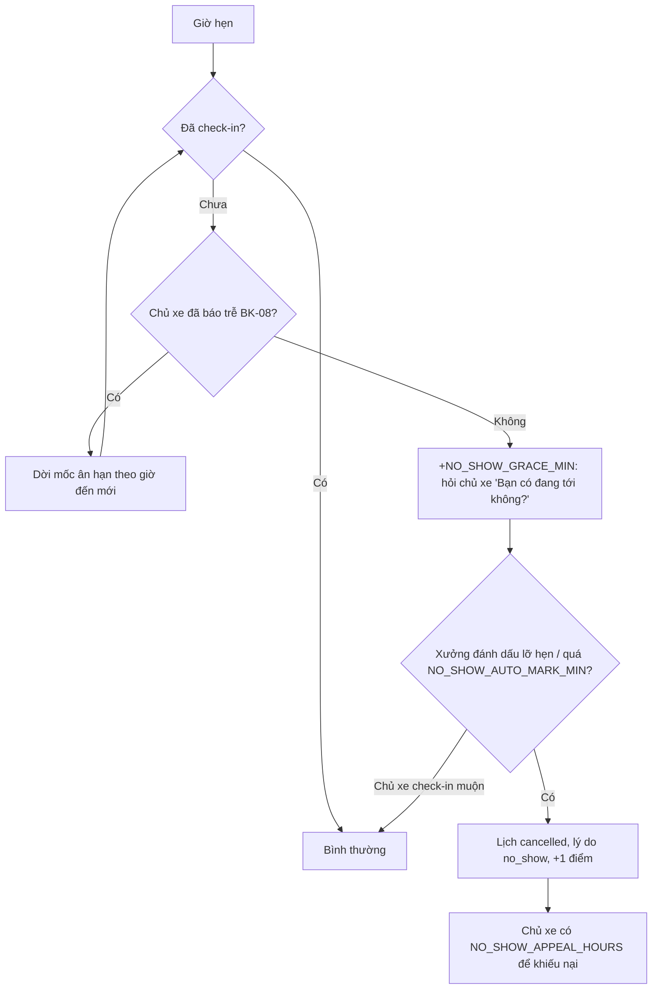

# Functional Specification — Chính sách huỷ lịch và lỡ hẹn

> Đặc tả nghiệp vụ cho **BK-02** trong [PRD Phase 2](../../../product/PRD_EV_Care_Phase2.md).
>
> **Quan hệ tài liệu:** mở rộng [us-053 FF](../../sprint-3/feature-functional/us-053-sprint-3-spec.ff.md) (huỷ, đổi lịch), [us-033 FF](../../sprint-3/feature-functional/us-033-sprint-3-spec.ff.md) (nhắc 24h, "xác nhận sẽ đến") và [us-037 FF](../../sprint-3/feature-functional/us-037-sprint-3-spec.ff.md) (check-in trên Workshop Board). Điểm vào huỷ vẫn là các endpoint MVP; spec này chỉ thêm **cách phân loại và tính điểm**.
>
> Quy ước mã, tham số, thuật ngữ: [README Phase 2](../README.md).

---

# 1. Document Information

| Field | Value |
|---|---|
| Feature ID | `FEAT-P2-BK02` |
| Feature Name | Chính sách huỷ lịch và lỡ hẹn |
| PRD Feature | BK-02 (P2-A, Must, Cải tiến MVP) |
| Document Version | `v0.1` |
| Status | `Draft` |
| Business Owner | Lê Đức Tùng (PO) |
| Created / Updated | `2026-10-09` |
| Related Spec | BK-01, BK-07, BK-08, WS-01 |

---

# 2. Feature Overview

## 2.1 Feature Description

Hệ thống phân loại mỗi lần huỷ thành **huỷ sớm** hoặc **huỷ muộn**, và ghi nhận **lỡ hẹn** khi chủ xe không đến mà không báo. Mỗi chủ xe có **điểm tin cậy** tính trong cửa sổ trượt. Điểm càng cao thì bậc xử lý càng chặt: nhắc nhẹ, bắt buộc xác nhận sẽ đến, giới hạn nơi và giờ được đặt. Không có phạt tiền. Xưởng huỷ sát giờ cũng bị tính vào chỉ số tin cậy của xưởng.

## 2.2 Business Objective

Giảm chỗ bị bỏ trống do huỷ muộn và lỡ hẹn (PP2-10, PP-07), nhưng không làm chủ xe thấy bị phạt vô lý.

## 2.3 User Objective

- Chủ xe hiểu rõ quy định, biết vì sao bị tính điểm, có đường khiếu nại.
- Chủ xưởng ít bị bỏ trống chỗ, không phải tự theo dõi khách hay lỡ hẹn.

## 2.4 Business Value

Chỉ số M-05 (tỉ lệ lỡ hẹn, huỷ muộn). Cấp chỗ trống cho danh sách chờ (BK-07, M-07). Cấp dữ liệu cho luật tự nhận (WS-01) và BK-10.

---

# 3. Scope

## 3.1 In Scope

- Phân loại huỷ sớm, huỷ muộn tại thời điểm huỷ.
- Ghi nhận lỡ hẹn: xưởng đánh dấu, hoặc hệ thống tự đánh dấu.
- Điểm tin cậy theo cửa sổ trượt; bậc xử lý; tự hạ bậc.
- Các trường hợp miễn tính.
- Khiếu nại lỡ hẹn và quyết định của chủ xưởng.
- Màn "Độ tin cậy đặt lịch" của chủ xe.
- Chỉ số tin cậy của xưởng.

## 3.2 Out of Scope

- Phạt tiền, đặt cọc.
- Chặn hẳn tài khoản.
- Chia sẻ điểm tin cậy cho bên ngoài EV Care.

---

# 4. Actors & Stakeholders

| Actor | Type | Responsibility |
|---|---|---|
| Chủ xe | User | Huỷ, báo trễ, khiếu nại, xem điểm |
| Chủ xưởng | User | Đánh dấu lỡ hẹn, quyết định khiếu nại, miễn tính |
| Hệ thống | System | Phân loại, tính điểm, tự đánh dấu, áp bậc, tự hạ bậc |
| Bộ lập lịch (BK-01) | System | Đọc bậc để giới hạn phương án |

Stakeholder chung: [README §6](../README.md#6-stakeholder-và-người-duyệt-chung).

---

# 5. User Story

- `US-P2-BK02-01`: As a chủ xưởng, I want khách huỷ muộn hoặc lỡ hẹn được ghi nhận tự động, so that tôi không phải tự theo dõi.
- `US-P2-BK02-02`: As a chủ xe, I want biết rõ khi nào huỷ thì bị tính, so that tôi chủ động huỷ sớm.
- `US-P2-BK02-03`: As a chủ xe, I want khiếu nại khi bị ghi lỡ hẹn sai, so that điểm của tôi công bằng.
- `US-P2-BK02-04`: As a chủ xe, I want xưởng huỷ sát giờ cũng bị tính, so that chính sách công bằng hai chiều.

---

# 6. Use Case

| UC | Tên | Actor | Trigger | Postcondition |
|---|---|---|---|---|
| `UC-BK02-01` | Phân loại khi huỷ | Chủ xe | Huỷ lịch `confirmed` hoặc `pending` qua điểm vào MVP | Lịch `cancelled`; nếu huỷ muộn thì có sự kiện tin cậy +`LATE_CANCEL_WEIGHT` |
| `UC-BK02-02` | Ghi nhận lỡ hẹn | Chủ xưởng / Hệ thống | Quá giờ hẹn + `NO_SHOW_GRACE_MIN` chưa check-in | Lịch `cancelled` lý do `no_show`; sự kiện +1 |
| `UC-BK02-03` | Khiếu nại lỡ hẹn | Chủ xe | Bấm "Khiếu nại" trong `NO_SHOW_APPEAL_HOURS` | Chủ xưởng chấp nhận (sự kiện miễn) hoặc từ chối |
| `UC-BK02-04` | Áp và hạ bậc | Hệ thống | Điểm thay đổi, hoặc job hằng ngày | Bậc mới, thông báo |
| `UC-BK02-05` | Xưởng huỷ sát giờ | Chủ xưởng | Huỷ lịch `confirmed` trong `LATE_CANCEL_HOURS` | Sự kiện tin cậy của xưởng; chủ xe được BK-01 AF-BK01-08 |

---

# 7. User Flow

| Step | Actor | Action | System Response | Result |
|---|---|---|---|---|
| 1 | Chủ xe | Bấm Huỷ | Tính `giờ hẹn − now`; so với `LATE_CANCEL_HOURS` | Huỷ sớm / huỷ muộn |
| 2 | System | Huỷ muộn | Ghi sự kiện, cập nhật điểm, mời danh sách chờ (BK-07) | Chủ xe thấy lý do |
| 3 | System | Quá ân hạn | Gửi câu hỏi; chờ xưởng hoặc tự đánh dấu | Lỡ hẹn |

---

# 8. Screen / UI Flow

| Screen ID | Screen Name | Purpose | Entry From |
|---|---|---|---|
| `SCR-BK02-01` | Hộp xác nhận huỷ (mở rộng us-033 SCR-702) | Nói rõ lần huỷ này có bị tính hay không **trước khi** chủ xe bấm | Vé, Lịch của tôi, chat |
| `SCR-BK02-02` | Độ tin cậy đặt lịch | Điểm hiện tại, bậc, danh sách sự kiện kèm lý do, nút khiếu nại | Lịch của tôi |
| `SCR-BK02-03` | Đánh dấu lỡ hẹn (Workshop Board) | Nút "Khách không đến" trên lịch quá giờ; hàng đợi khiếu nại | Workshop Board |

**SCR-BK02-01 — Main UI:**
- Huỷ sớm: dòng chữ "Huỷ trước 24 giờ không bị tính".
- Huỷ muộn: dòng chữ "Còn 2 giờ 30 phút tới giờ hẹn. Huỷ bây giờ được tính là huỷ muộn (0,5 điểm)", kèm gợi ý "Đổi giờ thay vì huỷ".

**SCR-BK02-02 — Main UI:**
- Thanh bậc gồm Bình thường, Nhắc nhẹ, Cần xác nhận, Giới hạn.
- Ngày điểm sớm nhất rơi khỏi cửa sổ.
- Danh sách sự kiện gồm ngày, loại, điểm, lịch hẹn, trạng thái khiếu nại.

---

# 9. Main Flow

1. Chủ xe có lịch 09:30 thứ Bảy. Lúc 07:00 cùng ngày, chủ xe bấm Huỷ.
2. Hộp xác nhận báo đây là huỷ muộn và gợi ý đổi giờ.
3. Chủ xe vẫn huỷ. Lịch chuyển `cancelled`, chỗ được trả ngay.
4. Hệ thống ghi sự kiện huỷ muộn (+0,5), mời người đầu danh sách chờ.
5. Điểm của chủ xe là 0,5, vẫn ở bậc Bình thường.

---

# 10. Alternative Flow

## AF-BK02-01 — Chủ xe check-in trong thời gian ân hạn
Không có sự kiện nào.

## AF-BK02-02 — Chủ xe trả lời "Đang tới"
Hệ thống thông báo cho xưởng. Thời gian ân hạn kéo thêm 15 phút, một lần.

## AF-BK02-03 — Khiếu nại được chấp nhận
Chủ xưởng chọn "Miễn". Hệ thống ghi sự kiện miễn để trừ lại điểm và hạ bậc nếu cần.

## AF-BK02-04 — Điểm rơi khỏi cửa sổ
Job hằng ngày tính lại điểm, tự hạ bậc, gửi thông báo "Bạn đã trở lại mức bình thường".

---

# 11. Exception Flow

| ID | Condition | System Behavior | User Experience |
|---|---|---|---|
| `EF-BK02-01` | Xưởng không thao tác sau ân hạn | Tự đánh dấu lỡ hẹn sau `NO_SHOW_AUTO_MARK_MIN` | Chủ xe nhận thông báo kèm nút khiếu nại |
| `EF-BK02-02` | Chủ xe check-in sau khi đã bị tự đánh dấu (xe tới muộn) | Chủ xưởng có thể khôi phục lịch; sự kiện lỡ hẹn chuyển "miễn" | — |
| `EF-BK02-03` | Đồng hồ thiết bị chủ xe lệch | Phân loại theo giờ máy chủ | — |
| `EF-BK02-04` | Khiếu nại quá hạn | Không nhận | Nút khiếu nại ẩn |

---

# 12. Business Rules

## BR-BK02-01 — Định nghĩa (PRD)
Huỷ trước giờ hẹn ≥ `LATE_CANCEL_HOURS` là huỷ sớm. Huỷ trong khoảng đó là huỷ muộn. Không check-in sau `NO_SHOW_GRACE_MIN` và không báo trễ là lỡ hẹn. Huỷ đúng tại mốc `LATE_CANCEL_HOURS` được tính là huỷ sớm. **Priority:** High.

## BR-BK02-02 — Đếm theo cửa sổ trượt (PRD)
Điểm = tổng điểm các sự kiện trong `RELIABILITY_WINDOW_DAYS` ngày gần nhất. Lỡ hẹn = 1; huỷ muộn = `LATE_CANCEL_WEIGHT`; sự kiện miễn = trừ đúng điểm của sự kiện gốc. **Priority:** High.

## BR-BK02-03 — Bậc xử lý (PRD)

| Điểm | Bậc | Xử lý |
|---|---|---|
| < 1 | Bình thường | — |
| 1 – < 2 | Nhắc nhẹ | Nhắc chính sách khi đặt lịch |
| 2 – < 3 | Cần xác nhận | Bắt buộc bấm "Xác nhận sẽ đến" (us-033). Chưa xác nhận trước giờ hẹn 12 giờ thì tự trả chỗ, không tính thêm điểm |
| ≥ 3 | Giới hạn | BK-01 chỉ đề xuất xưởng duyệt tay hoặc giờ thấp điểm; WS-01 chuyển duyệt tay kèm lý do |

**Priority:** High.

## BR-BK02-04 — Miễn tính (PRD)
Không tạo sự kiện khi:
- Xưởng huỷ hoặc đổi lịch.
- Xưởng trễ quá `WS_LATE_MIN`.
- Đổi xưởng do BK-01 (AF-BK01-06, AF-BK01-08).
- Chủ xe báo bất khả kháng và chủ xưởng chấp nhận.
- Huỷ trong `AUTO_BOOK_FREE_CANCEL_HOURS` sau khi hệ thống tự đặt.
- Lịch giữ chủ động hết hạn.

**Priority:** High.

## BR-BK02-05 — Ghi nhận lỡ hẹn (PRD)
Chủ xưởng đánh dấu, hoặc hệ thống tự đánh dấu sau `NO_SHOW_AUTO_MARK_MIN` phút. Lịch chuyển `cancelled` với `cancel_reason = no_show`. **Priority:** High.

## BR-BK02-06 — Công bằng hai chiều (PRD)
Xưởng huỷ lịch `confirmed` trong `LATE_CANCEL_HOURS` thì ghi sự kiện tin cậy của xưởng. Chỉ số này dùng trong chấm điểm BK-01. **Priority:** Medium.

## BR-BK02-07 — Minh bạch (PRD)
Hộp xác nhận huỷ nói trước lần huỷ có bị tính không. Chủ xe xem được mọi sự kiện và lý do. Thông báo trước khi áp bậc mới. **Priority:** High.

## BR-BK02-08 — Không phạt tiền (PRD). **Priority:** High.

## BR-BK02-09 — Khiếu nại
Chủ xe khiếu nại lỡ hẹn trong `NO_SHOW_APPEAL_HOURS`. Chủ xưởng quyết định. Không phản hồi trong 72 giờ thì tự chấp nhận khiếu nại. **Priority:** Medium.

## BR-BK02-10 — Mỗi lịch tối đa một sự kiện
Một lịch hẹn chỉ sinh tối đa một sự kiện tin cậy (huỷ muộn hoặc lỡ hẹn). **Priority:** High.

---

# 13. State / Status

Không thêm trạng thái `booking`. Thêm `cancel_reason` (giá trị mới: `no_show`, `late_cancel`, `early_cancel`, `workshop_cancel`, `proactive_hold_expired`, `rescheduled_to_other_workshop`) và thực thể sự kiện tin cậy:

| Trạng thái sự kiện | Meaning | Entry | Exit |
|---|---|---|---|
| `counted` | Đang tính điểm | Tạo sự kiện | Khiếu nại được chấp nhận → `waived`; quá cửa sổ → `expired` |
| `appealed` | Đang khiếu nại | Chủ xe khiếu nại | Chủ xưởng quyết định |
| `waived` | Đã miễn | Chấp nhận khiếu nại / miễn | — |
| `expired` | Rơi khỏi cửa sổ | Job hằng ngày | — |

---

# 14. Data Requirements

| Data | Type | Required | Description | Source |
|---|---|---:|---|---|
| Loại sự kiện | late_cancel / no_show / waiver | Yes | | System |
| Điểm | số thập phân | Yes | | System |
| Lịch hẹn liên quan | id | Yes | | `booking` |
| Lý do, người ghi | text, actor | Yes | | System / Chủ xưởng |
| Thời điểm | datetime | Yes | | System |
| Trạng thái khiếu nại | enum | No | | Chủ xe / Chủ xưởng |

| Data / Entity | Why Needed | Read / Write | Owner |
|---|---|---|---|
| `owner_reliability_event` (mới) | Sự kiện tin cậy chủ xe | Read/Write | Backend |
| `workshop_reliability_event` (mới) | Sự kiện tin cậy xưởng | Read/Write | Backend |
| `booking.cancel_reason` (mới) | Phân loại | Write | Backend |

---

# 15. Business Error & Edge Cases

| Case ID | Scenario | Expected Business Behavior | User Outcome |
|---|---|---|---|
| `EDGE-BK02-01` | Huỷ `pending` trong 10 phút giữ chỗ (us-029 BR-010) | Không tính | — |
| `EDGE-BK02-02` | Đổi giờ trong `LATE_CANCEL_HOURS` | Không phải huỷ, không tính; chỉ tính nếu sau đó huỷ hẳn | Gợi ý đổi giờ |
| `EDGE-BK02-03` | Hai lịch huỷ muộn trong cùng ngày (lịch cũ + lịch mới) | Mỗi lịch một sự kiện | — |
| `EDGE-BK02-04` | Lịch hẹn lúc 08:00, huỷ lúc 08:00 đúng giờ | Huỷ muộn | — |
| `EDGE-BK02-05` | Chủ xe ở bậc Giới hạn, không có xưởng duyệt tay trong khu vực | BK-01 chỉ đưa giờ thấp điểm; nếu không có thì AF-BK01-04 | Giải thích lý do |
| `EDGE-BK02-06` | Xưởng đánh dấu lỡ hẹn nhầm | Chủ xưởng hoàn tác trong 24 giờ | — |

---

# 16. Permissions & Access

| Role | View | Create | Update | Delete | Notes |
|---|---:|---:|---:|---:|---|
| Chủ xe | ✅ | ✅ khiếu nại | ❌ | ❌ | Chỉ điểm của mình |
| Chủ xưởng | ✅ | ✅ đánh dấu | ✅ quyết định khiếu nại | ❌ | Chỉ thấy sự kiện thuộc lịch của xưởng mình và **bậc** (không thấy điểm chi tiết) của khách |
| Hệ thống | ✅ | ✅ | ✅ | ❌ | — |

---

# 17. Acceptance Criteria

- **AC-BK02-01:** *Given* lịch 10:00 *When* huỷ lúc 10:00 ngày hôm trước *Then* phân loại huỷ sớm.
- **AC-BK02-02:** *Given* mọi trường hợp ở BR-BK02-04 *When* huỷ *Then* điểm không đổi.
- **AC-BK02-03:** *Given* một sự kiện bất kỳ *Then* có loại, điểm, thời điểm, lịch hẹn, lý do; chủ xe xem được trên SCR-BK02-02.
- **AC-BK02-04:** *Given* điểm 2,0 với một sự kiện sắp quá 90 ngày *When* job hằng ngày chạy sau mốc đó *Then* bậc tự hạ, không cần thao tác người.
- **AC-BK02-05:** *Given* hộp xác nhận huỷ *When* còn < `LATE_CANCEL_HOURS` *Then* hộp hiển thị rõ lần huỷ này bị tính và số điểm.
- **AC-BK02-06:** *Given* lỡ hẹn tự đánh dấu *When* chủ xe khiếu nại và xưởng không phản hồi 72 giờ *Then* khiếu nại được chấp nhận.

---

# 18. Non-functional Expectations

| Requirement | Expected Behavior |
|---|---|
| Timing | Câu hỏi "Bạn có đang tới không?" gửi trong 1 phút sau mốc ân hạn |
| Fairness | Mọi quyết định tính điểm có lý do đọc được |
| Audit | Sự kiện tin cậy không xoá cứng; chỉ đổi trạng thái |

---

# 19. Dependencies

| Dependency | Purpose | Required |
|---|---|---:|
| us-033 "xác nhận sẽ đến" | Bậc Cần xác nhận | Yes |
| us-037 check-in | Phát hiện lỡ hẹn | Yes |
| BK-07 | Lấp chỗ huỷ | No |
| BK-08 | Báo trễ hợp lệ | No |

---

# 20. Assumptions

- Huỷ muộn và lỡ hẹn chiếm tỉ lệ đáng kể chỗ trống (H2-09).
- Chủ xưởng thao tác check-in đúng lúc trên Workshop Board.

# 21. Business Constraints

- Không phạt tiền ở Phase 2.
- Chủ xưởng không thấy điểm chi tiết của khách, chỉ thấy bậc.

# 22. Terminology

| Term ID | Term | Vietnamese | Definition |
|---|---|---|---|
| `TERM-BK02-01` | Late cancel | Huỷ muộn | Huỷ trong `LATE_CANCEL_HOURS` trước giờ hẹn |
| `TERM-BK02-02` | No-show | Lỡ hẹn | Không đến, không báo, quá ân hạn |
| `TERM-BK02-03` | Tier | Bậc | Mức xử lý theo điểm tin cậy |
| `TERM-BK02-04` | Waiver | Miễn | Sự kiện trừ lại điểm của một sự kiện trước |

---

# 23. Partner / Stakeholder Notes

| Spec MVP | Thay đổi |
|---|---|
| us-053 out of scope "phí huỷ, phạt no-show, chấm điểm uy tín" | Làm phần chấm điểm, không làm phí |
| us-053 EDGE-1210 (pending quá 10' không huỷ được trong app) | Giữ nguyên; không thuộc BK-02 |

# 24. Open Questions

| ID | Question | Owner | Status | Proposal |
|---|---|---|---|---|
| `Q-BK02-01` | Các ngưỡng mặc định; cố định hay xưởng cấu hình (P2Q-04)? | PO | Open | Cố định toàn hệ thống ở P2-A |
| `Q-BK02-02` | Hệ thống có tự đánh dấu lỡ hẹn không, hay luôn chờ xưởng? | PO | Open | Có, sau `NO_SHOW_AUTO_MARK_MIN` |
| `Q-BK02-03` | Chủ xưởng có được thấy bậc của khách khi duyệt lịch không? | PO | Open | Có, chỉ bậc |

# 25. Traceability

PRD Phase 2 BK-02, PP2-10, G2-4, M-05 · BR-BK02-01…10 · AC-BK02-01…06 · us-033, us-037, us-053.

# 26. Related Documents

- [PRD Phase 2](../../../product/PRD_EV_Care_Phase2.md) · [README Phase 2](../README.md) · [us-053 FF](../../sprint-3/feature-functional/us-053-sprint-3-spec.ff.md)

# 27. Change Log

| Version | Date | Change |
|---|---|---|
| `v0.1` | `2026-10-09` | Bản nháp đầu |

# 28. Approval

| Role | Name | Status |
|---|---|---|
| Product Owner | Lê Đức Tùng | Pending |
| Technical Owner | Tech Lead | Pending |
