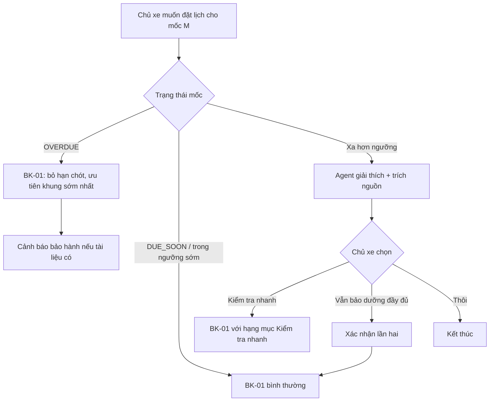

# Functional Specification — Bảo dưỡng sớm hoặc trễ so với mốc

> Đặc tả nghiệp vụ cho **BK-03** trong [PRD Phase 2](../../../product/PRD_EV_Care_Phase2.md).
>
> **Quan hệ tài liệu:** dựa trên [us-017 FF](../../sprint-2/feature-functional/us-017-sprint-2-spec.ff.md) (trạng thái đến hạn), [us-021 FF](../../sprint-2/feature-functional/us-021-sprint-2-spec.ff.md) (nhắc mốc), F4 RAG có nguồn. Nguyên tắc "no-source-no-claim" và PQ-07 (không tự nêu ân hạn) của PRD MVP giữ nguyên.
>
> Quy ước: [README Phase 2](../README.md).

---

# 1. Document Information

| Field | Value |
|---|---|
| Feature ID | `FEAT-P2-BK03` |
| Feature Name | Bảo dưỡng sớm hoặc trễ so với mốc |
| PRD Feature | BK-03 (P2-A, Should, Cải tiến MVP) |
| Document Version / Status | `v0.1` / `Draft` |
| Created / Updated | `2026-10-09` |
| Related Spec | BK-01 |

---

# 2. Feature Overview

## 2.1 Feature Description

Khi chủ xe muốn bảo dưỡng **trước** mốc, hệ thống phân loại mức sớm:
- **Trong ngưỡng:** cho đặt bình thường.
- **Quá sớm:** agent giải thích có thể chưa cần, gợi ý gói kiểm tra nhanh, chủ xe vẫn đặt được nếu muốn.

Sau khi làm, mốc kế tiếp luôn tính từ ngày và ODO thực tế.

Khi xe **quá hạn**, bộ lập lịch ưu tiên khung sớm nhất. Agent chỉ cảnh báo về bảo hành khi tài liệu hãng có nêu.

## 2.2 Business Objective

Giải đáp băn khoăn "làm sớm có sao không" mà không cần gọi xưởng (PP2-04). Giảm bảo dưỡng không cần thiết; tăng tỉ lệ làm đúng hạn.

## 2.3 User Objective

Chủ xe biết có nên làm sớm không, làm rồi thì mốc sau tính thế nào, trễ thì có rủi ro gì (nếu hãng có quy định).

## 2.4 Business Value

Tăng lòng tin vào thông tin của EV Care; giảm lịch hẹn sai mục đích.

---

# 3. Scope

## 3.1 In Scope

- Phân loại mức sớm khi đặt lịch.
- Luồng giải thích và gợi ý "Kiểm tra nhanh".
- Tính lại mốc kế tiếp sau bảo dưỡng sớm.
- Ưu tiên khung sớm nhất khi quá hạn.
- Cảnh báo bảo hành có nguồn.

## 3.2 Out of Scope

- Thay đổi công thức tính đến hạn của F3 (chỉ kiểm tra lại trường hợp sớm).
- Tự định nghĩa ân hạn hay ngưỡng mất bảo hành.

---

# 4. Actors

| Actor | Type | Responsibility |
|---|---|---|
| Chủ xe | User | Yêu cầu đặt sớm, quyết định |
| AI Agent | System | Giải thích, trích nguồn |
| Service đến hạn (F3) | System | Tính trạng thái, mốc kế tiếp |
| Bộ lập lịch (BK-01) | System | Ưu tiên khung khi quá hạn |

---

# 5. User Story

- `US-P2-BK03-01`: As a chủ xe sắp đi xa, I want bảo dưỡng trước mốc, so that tôi yên tâm trong chuyến đi.
- `US-P2-BK03-02`: As a chủ xe, I want biết làm quá sớm có cần không, so that tôi không tốn tiền vô ích.
- `US-P2-BK03-03`: As a chủ xe đã quá hạn, I want được xếp lịch sớm nhất và biết rủi ro thật, so that tôi xử lý kịp.

---

# 6. Use Case

| UC | Tên | Trigger | Postcondition |
|---|---|---|---|
| `UC-BK03-01` | Đặt sớm trong ngưỡng | Đặt lịch cho mốc còn ≤ `EARLY_SERVICE_DAYS` ngày hoặc ≤ `EARLY_SERVICE_KM` km | Luồng BK-01 bình thường |
| `UC-BK03-02` | Đặt quá sớm | Đặt lịch khi còn xa hơn ngưỡng | Chủ xe chọn Kiểm tra nhanh, Vẫn bảo dưỡng đầy đủ, hoặc Huỷ |
| `UC-BK03-03` | Tính lại mốc sau làm sớm | Hãng đồng bộ lịch sử dịch vụ mới | Mốc kế tiếp tính từ ODO và ngày thực tế |
| `UC-BK03-04` | Đặt khi quá hạn | Xe `OVERDUE` | BK-01 bỏ hạn chót, ưu tiên khung sớm nhất; cảnh báo có nguồn |

---

# 7. User Flow

---

# 8. Screen / UI Flow

| Screen ID | Name | Purpose |
|---|---|---|
| `SCR-BK03-01` | Thẻ "Bảo dưỡng sớm" trong chat / màn Đặt lịch | Giải thích mức sớm, nút Kiểm tra nhanh / Vẫn bảo dưỡng đầy đủ / Thôi |
| `SCR-BK03-02` | Nhãn trạng thái trên Trang chủ | Sau khi làm sớm: "Mốc kế tiếp: 36.000 km hoặc 04/2027 — tính từ lần bảo dưỡng ngày 12/10" |

**SCR-BK03-01:**
- Dòng tóm tắt: "Xe còn 4.200 km hoặc 4 tháng mới tới mốc 24.000 km."
- Đoạn giải thích có trích nguồn (nếu có).
- Nếu xưởng không có hạng mục "Kiểm tra nhanh" thì nút đó không hiện.

---

# 9. Main Flow

1. Chủ xe còn 20 ngày tới mốc và hỏi "Tuần sau tôi đi Đà Lạt, bảo dưỡng trước được không?".
2. Mức sớm nằm trong ngưỡng.
3. Agent trả lời "Được, mốc này có thể làm sớm" rồi chuyển sang luồng BK-01.

---

# 10. Alternative Flow

## AF-BK03-01 — Quá sớm, chọn Kiểm tra nhanh
BK-01 chạy với hạng mục "Kiểm tra nhanh" (thời lượng ngắn theo WS-02). Mốc bảo dưỡng không bị coi là đã làm.

## AF-BK03-02 — Quá sớm, vẫn bảo dưỡng đầy đủ
Agent hỏi xác nhận lần hai, có ghi chú rằng mốc sau sẽ tính từ lần này. Sau đó chạy luồng BK-01 bình thường.

## AF-BK03-03 — Quá hạn, tài liệu không nói về bảo hành
Agent không khẳng định gì, nói "Tài liệu hãng chưa nêu ảnh hưởng tới bảo hành, bạn nên hỏi xưởng", rồi chạy BK-01 ưu tiên khung sớm nhất.

---

# 11. Exception Flow

| ID | Condition | Behavior |
|---|---|---|
| `EF-BK03-01` | Trạng thái `UNKNOWN` | Không phân loại sớm/trễ; cho chọn hạng mục (us-061 EF-1502) |
| `EF-BK03-02` | Hãng chưa đồng bộ lần làm sớm | Hiển thị mốc cũ kèm "Đang chờ hãng cập nhật lịch sử"; không tự giả định |
| `EF-BK03-03` | Hãng gửi ODO lần làm thấp hơn ODO đã ghi | Giữ quy tắc F3: không giảm ODO; lưu để truy vết |

---

# 12. Business Rules

- **BR-BK03-01 (PRD):** Sớm trong `EARLY_SERVICE_DAYS` hoặc `EARLY_SERVICE_KM`, điều kiện nào đến trước, thì đặt bình thường. **High.**
- **BR-BK03-02 (PRD):** Quá ngưỡng thì giải thích kèm nguồn nếu có, gợi ý Kiểm tra nhanh nếu xưởng có. Chủ xe vẫn đặt được sau xác nhận lần hai. **High.**
- **BR-BK03-03 (PRD):** Mốc kế tiếp tính từ ngày và ODO thực tế của lần bảo dưỡng do hãng đồng bộ. **High.**
- **BR-BK03-04 (PRD):** Xe `OVERDUE` thì BK-01 bỏ hạn chót và ưu tiên khung sớm nhất. Chỉ cảnh báo bảo hành khi có nguồn. **High.**
- **BR-BK03-05 (PRD):** Không tự nêu ân hạn hay ngưỡng mất bảo hành. **High.**
- **BR-BK03-06:** "Kiểm tra nhanh" không đóng mốc bảo dưỡng; nhắc mốc (F7) vẫn tiếp tục. **Medium.**
- **BR-BK03-07:** Ngưỡng sớm phải lấy từ tài liệu hãng nếu có. Tham số cấu hình chỉ dùng khi tài liệu không nêu. **Medium.**

---

# 13. State / Status

Không đổi. Trạng thái đến hạn vẫn là `NORMAL`, `DUE_SOON`, `OVERDUE`, `UNKNOWN` (F3).

---

# 14. Data Requirements

| Data | Required | Source |
|---|---:|---|
| Trạng thái đến hạn, km và ngày còn lại | Yes | F3 |
| Ngưỡng sớm theo model (nếu tài liệu có) | No | `maintenance_rule` / tài liệu hãng |
| Hạng mục "Kiểm tra nhanh" của xưởng | No | Bảng giá xưởng |
| Lịch sử dịch vụ mới | Yes | Đồng bộ hãng |

---

# 15. Business Error & Edge Cases

| Case ID | Scenario | Expected Behavior |
|---|---|---|
| `EDGE-BK03-01` | Còn trong ngưỡng km nhưng xa về ngày | Theo điều kiện đến trước: trong ngưỡng |
| `EDGE-BK03-02` | Hai mốc liên tiếp gần nhau, chủ xe muốn gộp | Chuyển sang HS-02 (gộp việc) |
| `EDGE-BK03-03` | Xe hết bảo hành | Bỏ mọi cảnh báo bảo hành (giữ quy tắc F7) |

---

# 16. Permissions & Access

Chủ xe chỉ thao tác với xe của mình. Agent đọc trạng thái đến hạn và tài liệu.

---

# 17. Acceptance Criteria

- **AC-BK03-01:** *Given* lần bảo dưỡng sớm 1.000 km được hãng đồng bộ *When* mở Trang chủ *Then* mốc kế tiếp khớp công thức tính từ ODO và ngày thực tế.
- **AC-BK03-02:** *Given* bộ eval câu hỏi trễ mốc *Then* 100% câu khẳng định về bảo hành có trích nguồn; câu không có nguồn thì không khẳng định.
- **AC-BK03-03:** *Given* xe quá ngưỡng sớm *When* chủ xe chọn "Kiểm tra nhanh" và hoàn tất *Then* mốc bảo dưỡng vẫn mở, nhắc mốc vẫn chạy.
- **AC-BK03-04:** *Given* xe `OVERDUE` *When* đặt lịch *Then* phương án đầu là khung sớm nhất thoả ràng buộc cứng còn lại.

---

# 18. Non-functional Expectations

Câu trả lời của agent tuân thủ NFR chat của MVP; tỉ lệ trích nguồn 100% cho câu khẳng định.

# 19. Dependencies

F3, F7, F4 RAG, BK-01, WS-02 (thời lượng Kiểm tra nhanh).

# 20. Assumptions

- Tài liệu hãng có thông tin về khoảng thời gian cho phép làm sớm, hoặc nhóm chấp nhận ngưỡng mặc định (H2-05).

# 21. Business Constraints

No-source-no-claim; LLM không tự tính mốc.

# 22. Terminology

| Term | Vietnamese | Definition |
|---|---|---|
| Early service | Bảo dưỡng sớm | Làm trước ngày/km đến hạn |
| Quick check | Kiểm tra nhanh | Hạng mục kiểm tra không thay thế bảo dưỡng định kỳ |

# 23. Partner / Stakeholder Notes

Cần xác nhận với tài liệu hãng ngưỡng làm sớm (P2Q-09).

# 24. Open Questions

| ID | Question | Status | Proposal |
|---|---|---|---|
| `Q-BK03-01` | Ngưỡng sớm theo chính sách hãng? | Open | 30 ngày / 1.000 km nếu tài liệu không nêu |
| `Q-BK03-02` | "Kiểm tra nhanh" là hạng mục chuẩn toàn hệ thống hay do xưởng tự định nghĩa? | Open | Chuẩn toàn hệ thống, giá do xưởng |

# 25. Traceability

PRD Phase 2 BK-03, PP2-04 · BR-BK03-01…07 · AC-BK03-01…04 · us-017, us-021.

# 26. Related Documents

[PRD Phase 2](../../../product/PRD_EV_Care_Phase2.md) · [README](../README.md) · [BK-01](bk-01-phase2-spec.ff.md)

# 27. Change Log

| Version | Date | Change |
|---|---|---|
| `v0.1` | `2026-10-09` | Bản nháp đầu |

# 28. Approval

| Role | Status |
|---|---|
| Product Owner | Pending |
| Technical Owner | Pending |
