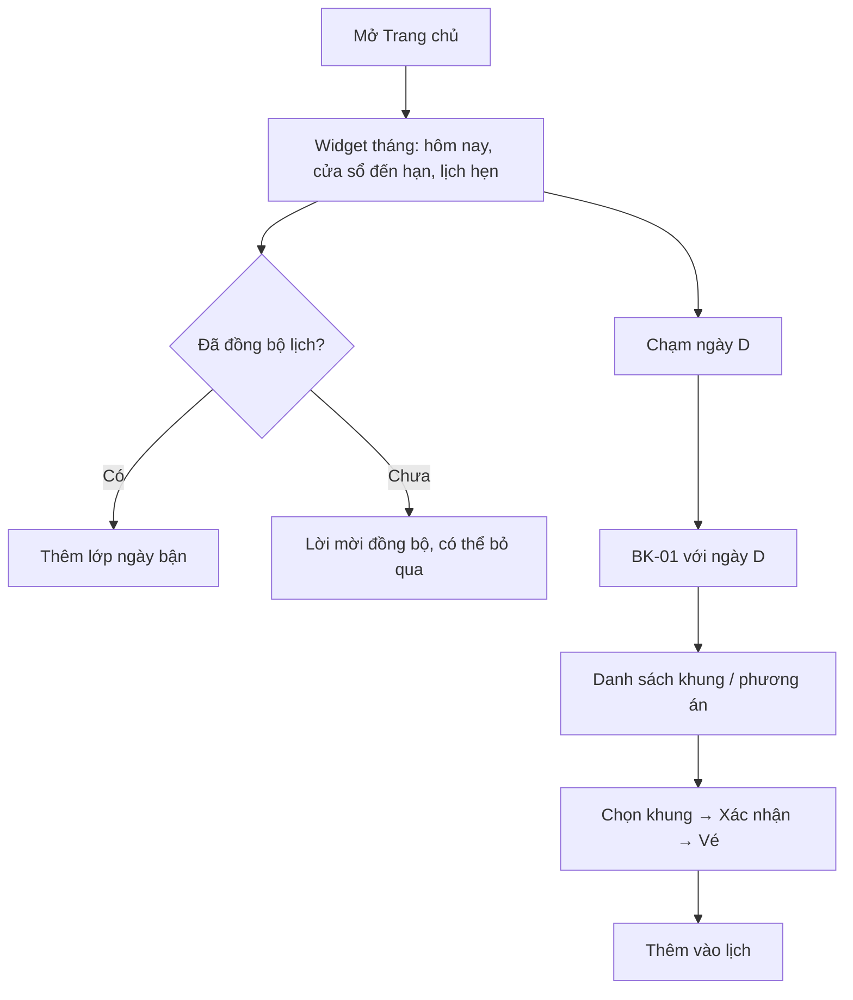

# Functional Specification — Widget lịch

> Đặc tả nghiệp vụ cho **BK-04** trong [PRD Phase 2](../../../product/PRD_EV_Care_Phase2.md).
>
> **Quan hệ tài liệu:** đọc ngày đến hạn từ F3 ([us-017](../../sprint-2/feature-functional/us-017-sprint-2-spec.ff.md)), lịch hẹn từ "Lịch của tôi" ([us-053](../../sprint-3/feature-functional/us-053-sprint-3-spec.ff.md)), chỗ trống từ service sức chứa ([us-029](../../sprint-3/feature-functional/us-029-sprint-3-spec.ff.md)). Đặt lịch từ widget đi qua [BK-01](bk-01-phase2-spec.ff.md). Đồng bộ lịch cá nhân phải có đồng ý ([PL-01](pl-01-phase2-spec.ff.md)).
>
> Quy ước: [README Phase 2](../README.md).

---

# 1. Document Information

| Field | Value |
|---|---|
| Feature ID | `FEAT-P2-BK04` |
| Feature Name | Widget lịch |
| PRD Feature | BK-04 (P2-A, Should, Chức năng) |
| Document Version / Status | `v0.1` / `Draft` |
| Created / Updated | `2026-10-09` |

---

# 2. Feature Overview

## 2.1 Feature Description

Một **widget lịch** dạng tháng (mặc định) hoặc tuần, đặt ở Trang chủ và màn Đặt lịch của chủ xe. Widget hiển thị trên cùng một chỗ:
- cửa sổ đến hạn bảo dưỡng;
- lịch hẹn đã đặt;
- ngày chủ xe bận, nếu đã đồng bộ lịch.

Chạm một ngày thì thấy khung còn chỗ và đặt được ngay. Lịch hẹn có thể thêm vào Google Calendar hoặc tải tệp `.ics`.

Chủ xưởng có bản **lịch tuần** với số chỗ còn lại mỗi khung.

## 2.2 Business Objective

Giúp chủ xe thấy ngay nên đặt khoảng nào; giảm số bước đặt lịch (PP2-01).

## 2.3 User Objective

Nhìn một lần là biết khi nào đến hạn, khi nào có hẹn, khi nào mình rảnh, và đặt ngay.

## 2.4 Business Value

Tăng tỉ lệ đặt lịch trong cửa sổ đến hạn; lịch hẹn nằm trong lịch cá nhân giúp giảm lỡ hẹn (hỗ trợ BK-02).

---

# 3. Scope

## 3.1 In Scope

- Widget chủ xe: tháng / tuần, 4 lớp thông tin (hôm nay, cửa sổ đến hạn, lịch hẹn, ngày bận).
- Chạm ngày → danh sách khung còn chỗ của xưởng đang chọn (hoặc phương án BK-01).
- Thêm vào Google Calendar (cần quyền ghi) hoặc tải `.ics`.
- Đồng bộ trạng thái bận/rảnh từ Google Calendar (cần đồng ý).
- Tự cập nhật sự kiện đã thêm khi lịch hẹn đổi giờ hoặc bị huỷ (khi có quyền ghi).
- Widget tuần cho chủ xưởng.

## 3.2 Out of Scope

- Đọc tiêu đề hoặc nội dung sự kiện trong lịch cá nhân.
- Lịch Apple/Outlook đồng bộ hai chiều (chỉ `.ics` một chiều).
- Chỉnh sửa lịch hẹn bằng kéo thả.

---

# 4. Actors

| Actor | Type | Responsibility |
|---|---|---|
| Chủ xe | User | Xem, chạm ngày, đồng bộ lịch, thêm sự kiện |
| Chủ xưởng | User | Xem lịch tuần số chỗ |
| Google Calendar | Partner | Bận/rảnh, tạo/sửa sự kiện |
| Bộ lập lịch | System | Trả khung còn chỗ cho ngày chọn |

---

# 5. User Story

- `US-P2-BK04-01`: As a chủ xe, I want thấy cửa sổ đến hạn và lịch hẹn trên một lịch, so that tôi biết nên đặt khi nào.
- `US-P2-BK04-02`: As a chủ xe, I want chạm một ngày để đặt ngay, so that tôi không phải đi qua nhiều màn.
- `US-P2-BK04-03`: As a chủ xe, I want lịch hẹn nằm trong lịch điện thoại và tự đổi khi tôi đổi giờ, so that tôi không quên.
- `US-P2-BK04-04`: As a chủ xưởng, I want thấy số chỗ còn lại từng khung trong tuần, so that tôi nắm tải nhanh.

---

# 6. Use Case

| UC | Tên | Trigger | Postcondition |
|---|---|---|---|
| `UC-BK04-01` | Xem widget | Mở Trang chủ / Đặt lịch | Widget tháng hiện tại |
| `UC-BK04-02` | Đặt từ một ngày | Chạm ngày | BK-01 với ràng buộc "ngày = D" |
| `UC-BK04-03` | Đồng bộ bận/rảnh | Bật "Đồng bộ lịch" (PL-01) | Lớp "ngày bận" xuất hiện |
| `UC-BK04-04` | Thêm vào lịch | Bấm "Thêm vào lịch" trên vé | Sự kiện tạo trong Google Calendar hoặc tải `.ics` |
| `UC-BK04-05` | Đồng bộ thay đổi | Lịch hẹn đổi giờ / huỷ | Sự kiện đã tạo được sửa / xoá |
| `UC-BK04-06` | Lịch tuần của xưởng | Chủ xưởng mở Lịch tuần | Lưới khung × ngày với số chỗ còn |

---

# 7. User Flow

---

# 8. Screen / UI Flow

| Screen ID | Name | Purpose |
|---|---|---|
| `SCR-BK04-01` | Widget lịch chủ xe | Tháng/tuần với 4 lớp |
| `SCR-BK04-02` | Bảng khung giờ của ngày | Khung còn chỗ khi chạm ngày |
| `SCR-BK04-03` | Lịch tuần của xưởng | Lưới số chỗ còn |

**SCR-BK04-01:**
- Ô ngày có các trạng thái: hôm nay (viền đậm), cửa sổ đến hạn (tô nền), lịch hẹn (ô đặc màu chính), ngày bận (sọc chéo).
- Có chú giải, nút chuyển tháng/tuần, nút "Hôm nay".
- Ngày quá khứ mờ đi, không chạm được.

**SCR-BK04-03:**
- Hàng là khung giờ, cột là ngày. Ô ghi số chỗ còn, theo quy ước Board "Hết chỗ" và chữ số mono (DESIGN.md FINDING-018).

---

# 9. Main Flow

1. Chủ xe mở Trang chủ, thấy ngày 19–31/10 được tô là cửa sổ đến hạn.
2. Chủ xe chạm ngày 24/10. Bảng khung giờ hiện ra: 08:00, 09:30, 10:30 (còn 1 chỗ) ở xưởng yêu thích.
3. Chọn 08:00, xác nhận, nhận vé.
4. Bấm "Thêm vào lịch". Sự kiện xuất hiện trong Google Calendar.

---

# 10. Alternative Flow

- **AF-BK04-01 — Ngày đã chọn là ngày bận:** vẫn cho chọn, kèm cảnh báo "Lịch của bạn có sự kiện ngày này".
- **AF-BK04-02 — Không có quyền ghi Calendar:** tải tệp `.ics`. Khi lịch đổi, gửi thông báo "Lịch hẹn đã đổi, cập nhật lịch của bạn" kèm tệp mới.
- **AF-BK04-03 — Ngày không còn chỗ:** chạy BK-01 AF-BK01-02 để đưa phương án ở xưởng khác cùng ngày.

---

# 11. Exception Flow

| ID | Condition | Behavior | Recovery |
|---|---|---|---|
| `EF-BK04-01` | Google API lỗi / token hết hạn | Ẩn lớp ngày bận, hiện "Không tải được lịch của bạn" | Nút kết nối lại |
| `EF-BK04-02` | Chủ xe thu hồi quyền ở Google | Lần gọi sau thất bại → tắt đồng bộ trong PL-01, xoá dữ liệu bận/rảnh đã đệm | Thông báo |
| `EF-BK04-03` | Sự kiện đã bị chủ xe xoá thủ công trong Calendar | Khi đổi giờ, không tạo lại; ghi nhận | — |

---

# 12. Business Rules

- **BR-BK04-01 (PRD):** Cửa sổ đến hạn tính từ ngày xe vào `DUE_SOON` đến ngày đến hạn dự kiến (F3). **High.**
- **BR-BK04-02 (PRD):** Chỉ đọc bận/rảnh (free/busy), không đọc nội dung sự kiện. Chỉ hoạt động khi đã đồng ý. **High.**
- **BR-BK04-03 (PRD):** Chạm ngày thì gọi BK-01 với ràng buộc ngày đó. **High.**
- **BR-BK04-04 (PRD):** "Thêm vào lịch" tạo sự kiện Google Calendar (có quyền ghi) hoặc `.ics`. Đổi/huỷ lịch hẹn thì cập nhật sự kiện đã tạo nếu có quyền. **Medium.**
- **BR-BK04-05 (PRD):** Lịch tuần của xưởng nhất quán với Workshop Board. **High.**
- **BR-BK04-06:** Nội dung sự kiện chỉ gồm tên xưởng, địa chỉ, giờ, mã lịch hẹn, link mở app. Không ghi VIN, biển số đầy đủ, chi phí. **High.**
- **BR-BK04-07:** Dữ liệu bận/rảnh chỉ được lưu đệm tối đa 24 giờ, rồi xoá. **High.**

---

# 13. State / Status

Trạng thái kết nối lịch: `not_connected` → `connected` → `revoked` / `error`. Sự kiện đã xuất: `created` → `updated` / `deleted`.

---

# 14. Data Requirements

| Data | Required | Source |
|---|---:|---|
| Cửa sổ đến hạn | Yes | F3 |
| Lịch hẹn của chủ xe | Yes | `booking` |
| Khối bận (bắt đầu, kết thúc) | No | Google free/busy |
| Id sự kiện đã tạo | No | Google |
| Số chỗ còn theo khung | Yes | Service sức chứa |

| Entity | Read/Write |
|---|---|
| `calendar_connection` (mới: trạng thái, phạm vi quyền, token đã mã hoá) | Read/Write |
| `booking_calendar_event` (mới: booking ↔ id sự kiện) | Read/Write |

---

# 15. Business Error & Edge Cases

| Case ID | Scenario | Expected Behavior |
|---|---|---|
| `EDGE-BK04-01` | Sự kiện cả ngày trong Calendar | Cả ngày đánh dấu bận |
| `EDGE-BK04-02` | Nhiều lịch Google (công việc, cá nhân) | Mặc định dùng lịch chính; chủ xe chọn thêm |
| `EDGE-BK04-03` | Cửa sổ đến hạn trải hai tháng | Chuyển tháng vẫn thấy liền mạch |
| `EDGE-BK04-04` | Xe `UNKNOWN` | Không tô cửa sổ đến hạn, ghi chú lý do |

---

# 16. Permissions & Access

| Role | View | Notes |
|---|---:|---|
| Chủ xe | ✅ | Chỉ dữ liệu của mình |
| Chủ xưởng | ✅ lịch tuần xưởng mình | Không thấy dữ liệu bận/rảnh của khách |

---

# 17. Acceptance Criteria

- **AC-BK04-01:** Số chỗ trên widget khớp service sức chứa tại thời điểm tải.
- **AC-BK04-02:** Không có tiêu đề hay nội dung sự kiện cá nhân nào được lưu (kiểm tra dữ liệu).
- **AC-BK04-03:** *Given* sự kiện đã thêm qua Google *When* đổi giờ lịch hẹn *Then* sự kiện đổi theo trong ≤ 1 phút.
- **AC-BK04-04:** *Given* Google API lỗi *Then* widget vẫn hiển thị cửa sổ đến hạn, lịch hẹn và cho đặt lịch.

---

# 18. Non-functional Expectations

Widget tải ≤ 1 s (p90) không tính lớp bận/rảnh; lớp bận/rảnh tải nền. Dùng được bằng bàn phím (NFR-11).

# 19. Dependencies

BK-01, PL-01, Google Calendar API (P2Q-07 ngân sách), F3.

# 20. Assumptions

Phần lớn chủ xe dùng Google Calendar trên điện thoại.

# 21. Business Constraints

Phạm vi quyền OAuth tối thiểu; có màn đồng ý trước khi kết nối.

# 22. Terminology

| Term | Vietnamese | Definition |
|---|---|---|
| Due window | Cửa sổ đến hạn | Khoảng ngày nên bảo dưỡng |
| Free/busy | Bận/rảnh | Chỉ khoảng thời gian bận, không có nội dung |

# 23. Partner Notes

Google Calendar API: cần đăng ký app OAuth, có thể phải xác minh app nếu dùng phạm vi nhạy cảm.

# 24. Open Questions

| ID | Question | Proposal |
|---|---|---|
| `Q-BK04-01` | Quyền ghi Calendar có bắt buộc không, hay chỉ `.ics`? | Tuỳ chọn; mặc định `.ics` |
| `Q-BK04-02` | Widget mặc định tháng hay tuần trên mobile? | Tháng |

# 25. Traceability

PRD Phase 2 BK-04, PP2-01 · BR-BK04-01…07 · AC-BK04-01…04.

# 26. Related Documents

[PRD Phase 2](../../../product/PRD_EV_Care_Phase2.md) · [BK-01](bk-01-phase2-spec.ff.md) · [PL-01](pl-01-phase2-spec.ff.md) · [DESIGN.md](../../../../DESIGN.md)

# 27. Change Log

| Version | Date | Change |
|---|---|---|
| `v0.1` | `2026-10-09` | Bản nháp đầu |

# 28. Approval

| Role | Status |
|---|---|
| Product Owner | Pending |
| Technical Owner | Pending |
