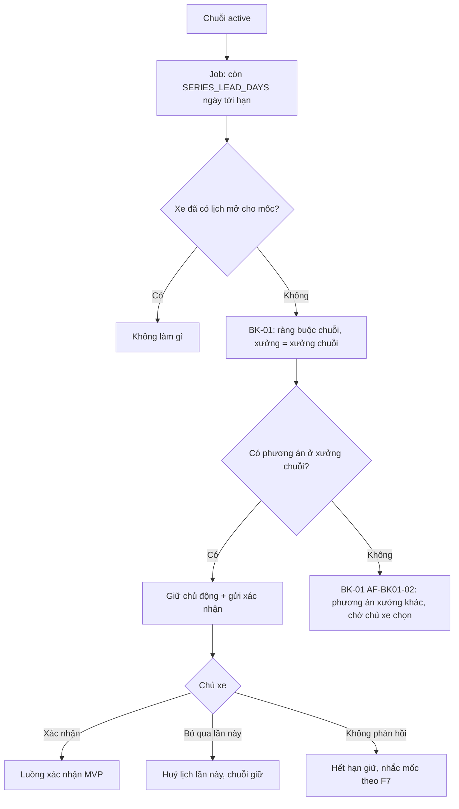
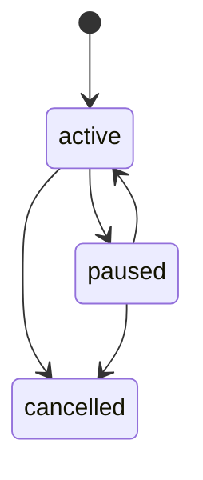

# Functional Specification — Lịch bảo dưỡng định kỳ tại xưởng quen

> Đặc tả nghiệp vụ cho **BK-06** trong [PRD Phase 2](../../../product/PRD_EV_Care_Phase2.md).
>
> **Quan hệ tài liệu:** mỗi lần trong chuỗi được tạo qua [BK-01](bk-01-phase2-spec.ff.md) (giữ chỗ chủ động). Mốc tính theo F3 ([us-017](../../sprint-2/feature-functional/us-017-sprint-2-spec.ff.md)). Huỷ một lần theo [BK-02](bk-02-phase2-spec.ff.md). Quy tắc một lịch mở mỗi xe (us-029 BR-013) giữ nguyên.
>
> Quy ước: [README Phase 2](../README.md).

---

# 1. Document Information

| Field | Value |
|---|---|
| Feature ID | `FEAT-P2-BK06` |
| Feature Name | Lịch bảo dưỡng định kỳ tại xưởng quen |
| PRD Feature | BK-06 (P2-B, Should, Chức năng) |
| Document Version / Status | `v0.1` / `Draft` |
| Created / Updated | `2026-10-09` |

---

# 2. Feature Overview

## 2.1 Feature Description

Chủ xe tạo một **chuỗi lịch định kỳ** gắn với một xưởng, theo mốc bảo dưỡng của hãng.

Hệ thống **không** giữ chỗ trước nhiều tháng. Khoảng `SERIES_LEAD_DAYS` ngày trước ngày đến hạn dự kiến, hệ thống:
1. gọi bộ lập lịch với ràng buộc của chuỗi;
2. giữ chỗ chủ động;
3. gửi chủ xe xác nhận một chạm.

Chủ xe có thể bỏ qua một lần, đổi xưởng cho một lần, hoặc huỷ cả chuỗi.

## 2.2 Business Objective

Bỏ việc đặt lại từ đầu mỗi mốc (PP2-02). Xưởng biết trước lượng khách quen.

## 2.3 User Objective

"Đặt một lần, mỗi mốc chỉ cần bấm xác nhận."

## 2.4 Business Value

Tăng tỉ lệ làm đúng hạn và giữ chân khách cho xưởng.

---

# 3. Scope

## 3.1 In Scope

- Tạo, xem, tạm dừng, tiếp tục, huỷ chuỗi.
- Tự tạo lịch cho lần kế tiếp qua BK-01.
- Bỏ qua một lần; đổi xưởng một lần; đổi giờ một lần.
- Xử lý xưởng ngừng hoạt động, xe làm ở nơi khác, xe đổi chủ.

## 3.2 Out of Scope

- Chu kỳ tự chọn khác mốc hãng.
- Nhiều chuỗi cho một xe.
- Giữ chỗ cứng trước nhiều tháng.

---

# 4. Actors

| Actor | Type | Responsibility |
|---|---|---|
| Chủ xe | User | Tạo và quản lý chuỗi, xác nhận từng lần |
| Job chuỗi định kỳ | System | Kích hoạt tạo lịch đúng thời điểm |
| Bộ lập lịch | System | Tìm và giữ chỗ |
| Chủ xưởng | User | Nhận lịch theo luật (WS-01) |

---

# 5. User Story

- `US-P2-BK06-01`: As a chủ xe, I want đặt lịch định kỳ ở xưởng quen, so that mỗi mốc tôi chỉ cần xác nhận.
- `US-P2-BK06-02`: As a chủ xe, I want bỏ qua một lần mà không mất cả chuỗi, so that khi bận tôi không phải cài lại.
- `US-P2-BK06-03`: As a chủ xưởng, I want biết trước khách quen sắp tới, so that tôi chuẩn bị nhân lực.

---

# 6. Use Case

| UC | Tên | Trigger | Postcondition |
|---|---|---|---|
| `UC-BK06-01` | Tạo chuỗi | Sau khi hoàn tất một lần bảo dưỡng, hoặc từ Cài đặt | Chuỗi `active` |
| `UC-BK06-02` | Tạo lần kế tiếp | Job: còn `SERIES_LEAD_DAYS` ngày tới ngày đến hạn dự kiến | Lịch `pending` giữ chủ động |
| `UC-BK06-03` | Bỏ qua lần này | Chủ xe bấm "Bỏ qua lần này" | Lịch của lần đó `cancelled`; chuỗi giữ nguyên |
| `UC-BK06-04` | Huỷ chuỗi | Chủ xe bấm "Huỷ chuỗi" | Chuỗi `cancelled`; hỏi có huỷ lịch đang mở không |
| `UC-BK06-05` | Tạm dừng chuỗi | Xưởng ngừng hoạt động / chủ xe tạm dừng | Chuỗi `paused` |

---

# 7. User Flow

---

# 8. Screen / UI Flow

| Screen ID | Name | Purpose |
|---|---|---|
| `SCR-BK06-01` | Lịch định kỳ | Xem chuỗi: xưởng, ràng buộc, lần kế tiếp dự kiến, trạng thái; nút Tạm dừng / Huỷ chuỗi |
| `SCR-BK06-02` | Lời mời tạo chuỗi | Sau khi hoàn tất bảo dưỡng: "Đặt định kỳ ở Xưởng Cầu Giấy cho các mốc sau?" |
| `SCR-BK06-03` | Xác nhận lần kế tiếp | Dùng SCR-BK01-04, thêm nút "Bỏ qua lần này" |

---

# 9. Main Flow

1. Chủ xe hoàn tất bảo dưỡng mốc 12.000 km ở Xưởng Cầu Giấy. Hỏi thăm sau dịch vụ có lời mời tạo chuỗi.
2. Chủ xe bấm "Đặt định kỳ". Chuỗi lấy ràng buộc hiện tại (sáng thứ Bảy).
3. Mốc 24.000 km dự kiến ngày 26/10. Ngày 12/10, job gọi BK-01 và giữ 08:00 thứ Bảy 24/10.
4. Chủ xe nhận thông báo và bấm Xác nhận.

---

# 10. Alternative Flow

| ID | Condition | Flow |
|---|---|---|
| `AF-BK06-01` | Xưởng chuỗi kín | Phương án xưởng khác **chỉ cho lần này**, không tự chuyển xưởng của chuỗi |
| `AF-BK06-02` | Chủ xe đổi xưởng lần này | BK-01 AF-BK01-06; chuỗi giữ xưởng gốc |
| `AF-BK06-03` | Chủ xe đổi giờ lần này | Đổi lịch theo us-053 |
| `AF-BK06-04` | Xưởng báo không phục vụ được | BK-01 AF-BK01-08 |
| `AF-BK06-05` | Chủ xe đổi xưởng của chuỗi | Sửa ở SCR-BK06-01; áp dụng từ lần sau |

---

# 11. Exception Flow

| ID | Condition | Behavior |
|---|---|---|
| `EF-BK06-01` | Xưởng chuỗi `inactive` | Chuỗi `paused`, thông báo mời chọn xưởng mới |
| `EF-BK06-02` | Hãng báo xe đã bảo dưỡng ở nơi khác | Tính lại mốc; nếu đã có lịch giữ cho mốc cũ thì huỷ (không tính điểm) và báo chủ xe |
| `EF-BK06-03` | Hãng báo xe đổi chủ | Chuỗi `cancelled`, xoá ràng buộc của chủ cũ |
| `EF-BK06-04` | Mốc `UNKNOWN` | Không tạo lần kế tiếp; báo chủ xe |
| `EF-BK06-05` | Chủ xe không phản hồi | Hết hạn giữ (không tính điểm); chuỗi vẫn `active`; nhắc mốc F7 tiếp tục |

---

# 12. Business Rules

- **BR-BK06-01 (PRD):** Chu kỳ theo mốc hãng (km hoặc thời gian, cái nào đến trước). **High.**
- **BR-BK06-02 (PRD):** Tạo lần kế tiếp lúc còn `SERIES_LEAD_DAYS` ngày tới ngày đến hạn dự kiến. **High.**
- **BR-BK06-03 (PRD):** Hệ thống kiểm tra hợp lệ trước, rồi xưởng chấp nhận theo WS-01. **High.**
- **BR-BK06-04 (PRD):** Chỉ tạo khi xe không có lịch mở. **High.**
- **BR-BK06-05 (PRD):** Bỏ qua một lần khác huỷ cả chuỗi. Huỷ một lần áp dụng BK-02. Bỏ qua trước khi xác nhận thì không tính. **High.**
- **BR-BK06-06:** Mỗi xe tối đa một chuỗi `active` hoặc `paused`. **High.**
- **BR-BK06-07:** Thay đổi mốc hoặc ODO do hãng đồng bộ thì job tính lại ngày kích hoạt. **Medium.**
- **BR-BK06-08:** Chuỗi chỉ tạo khi chủ xe bật "Giữ chỗ sẵn" (mức ≥ 2 của BK-01) và đã đồng ý (PL-01). **High.**

---

# 13. State / Status

| State | Meaning | Entry | Exit |
|---|---|---|---|
| `active` | Đang chạy | Tạo / tiếp tục | Tạm dừng, huỷ |
| `paused` | Tạm dừng | Chủ xe tạm dừng / xưởng ngừng | Tiếp tục (có xưởng hợp lệ) / huỷ |
| `cancelled` | Đã huỷ | Chủ xe huỷ / xe đổi chủ | — |

---

# 14. Data Requirements

| Entity | Purpose | R/W |
|---|---|---|
| `booking_series` (mới) | Xe, xưởng, ràng buộc chuỗi, trạng thái, lần kế tiếp dự kiến | R/W |
| `booking.series_id` (mới) | Gắn lịch với chuỗi | W |
| F3 | Ngày đến hạn dự kiến | R |

---

# 15. Business Error & Edge Cases

| Case ID | Scenario | Expected Behavior |
|---|---|---|
| `EDGE-BK06-01` | Ngày đến hạn dự kiến đã ở trong cửa sổ khi tạo chuỗi | Tạo lần kế tiếp ngay |
| `EDGE-BK06-02` | ODO tăng nhanh làm ngày dự kiến kéo sớm lại | Job hằng ngày kích hoạt theo ngày mới |
| `EDGE-BK06-03` | Chủ xe xoá ràng buộc khung rảnh | Chuỗi dùng giờ mở cửa xưởng; cảnh báo |

---

# 16. Permissions & Access

Chủ xe quản lý chuỗi của xe mình. Chủ xưởng thấy lịch tạo từ chuỗi có nhãn "Khách định kỳ", không thấy cấu hình chuỗi.

---

# 17. Acceptance Criteria

- **AC-BK06-01:** Không thời điểm nào chuỗi tạo quá một lịch mở cho một xe.
- **AC-BK06-02:** "Bỏ qua lần này" không dừng chuỗi; lần sau vẫn được tạo.
- **AC-BK06-03:** "Huỷ chuỗi" không huỷ lịch đã xác nhận nếu chủ xe không chọn huỷ kèm.
- **AC-BK06-04:** Hãng báo xe đã làm ở nơi khác thì lần kế tiếp được lùi, không có nhắc thừa.

---

# 18. Non-functional Expectations

Job chạy hằng ngày; mỗi chuỗi xử lý tối đa một lần mỗi ngày (chạy lại không tạo trùng).

# 19. Dependencies

BK-01, BK-02, F3, F7, PL-01, WS-01.

# 20. Assumptions

Chủ xe muốn hệ thống giữ sẵn lịch cho mốc kế tiếp (H2-03).

# 21. Business Constraints

Không giữ chỗ trước quá `SERIES_LEAD_DAYS` + `SCHEDULER_WINDOW_DAYS`.

# 22. Terminology

| Term | Vietnamese | Definition |
|---|---|---|
| Booking series | Chuỗi lịch định kỳ | Cấu hình tạo lịch cho từng mốc |
| Skip occurrence | Bỏ qua lần này | Huỷ một lần, giữ chuỗi |

# 23. Partner Notes

—

# 24. Open Questions

| ID | Question | Proposal |
|---|---|---|
| `Q-BK06-01` | `SERIES_LEAD_DAYS`? (P2Q-03) | 14 ngày |
| `Q-BK06-02` | Mỗi lần có bắt buộc xác nhận? | Có (mức 2); mức 3 thì tự đặt |

# 25. Traceability

PRD Phase 2 BK-06, PP2-02 · BR-BK06-01…08 · AC-BK06-01…04.

# 26. Related Documents

[PRD Phase 2](../../../product/PRD_EV_Care_Phase2.md) · [BK-01](bk-01-phase2-spec.ff.md) · [BK-02](bk-02-phase2-spec.ff.md)

# 27. Change Log

| Version | Date | Change |
|---|---|---|
| `v0.1` | `2026-10-09` | Bản nháp đầu |

# 28. Approval

| Role | Status |
|---|---|
| Product Owner | Pending |
| Technical Owner | Pending |
