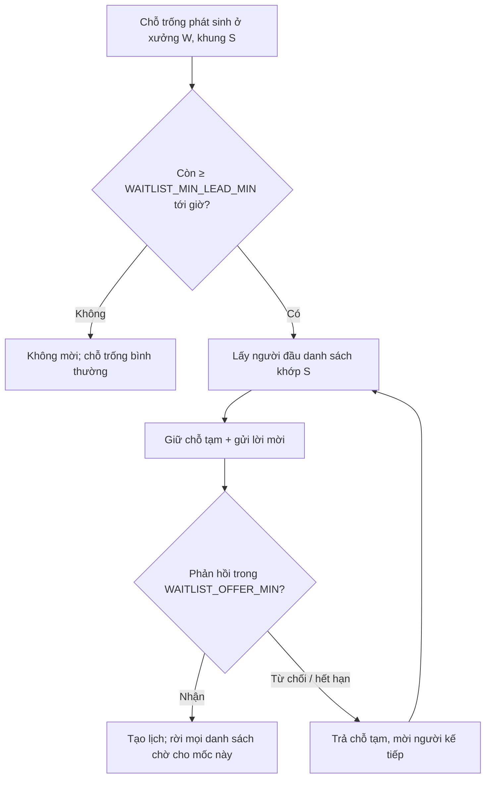

# Functional Specification — Danh sách chờ

> Đặc tả nghiệp vụ cho **BK-07** trong [PRD Phase 2](../../../product/PRD_EV_Care_Phase2.md).
>
> **Quan hệ tài liệu:** chỗ trống phát sinh từ huỷ, lỡ hẹn ([BK-02](bk-02-phase2-spec.ff.md)), hết hạn giữ chỗ ([BK-01](bk-01-phase2-spec.ff.md)), xưởng mở thêm chỗ. Giữ chỗ qua service sức chứa ([us-029](../../sprint-3/feature-functional/us-029-sprint-3-spec.ff.md)).
>
> Quy ước: [README Phase 2](../README.md).

---

# 1. Document Information

| Field | Value |
|---|---|
| Feature ID | `FEAT-P2-BK07` |
| Feature Name | Danh sách chờ |
| PRD Feature | BK-07 (P2-B, Could, Chức năng) |
| Document Version / Status | `v0.1` / `Draft` |
| Created / Updated | `2026-10-09` |

---

# 2. Feature Overview

## 2.1 Feature Description

Khi khung giờ mong muốn đã hết chỗ, chủ xe đăng ký **chờ**:
- một khung cụ thể, hoặc
- một khoảng, ví dụ "bất kỳ khung sáng thứ Bảy này".

Khi có chỗ trống, hệ thống **mời** người đầu danh sách và giữ chỗ cho họ `WAITLIST_OFFER_MIN` phút. Quá hạn thì mời người kế tiếp.

## 2.2 Business Objective

Lấp chỗ trống do huỷ muộn (PP2-10); giảm doanh thu mất của xưởng.

## 2.3 User Objective

Không phải canh liên tục để chộp khung đẹp.

## 2.4 Business Value

Chỉ số M-07 (tỉ lệ chỗ huỷ được lấp lại).

---

# 3. Scope

## 3.1 In Scope

- Đăng ký chờ (khung hoặc khoảng); xem; rời danh sách.
- Mời tuần tự, giữ chỗ tạm cho người được mời.
- Mời song song khi nhiều chỗ trống cùng lúc.
- Tự rời danh sách khi đã có lịch cho mốc.

## 3.2 Out of Scope

- Ưu tiên theo trả phí.
- Chờ ở nhiều xưởng trong một đăng ký (mỗi đăng ký một xưởng).

---

# 4. Actors

| Actor | Type | Responsibility |
|---|---|---|
| Chủ xe | User | Đăng ký, nhận/ từ chối lời mời |
| Hệ thống danh sách chờ | System | Phát hiện chỗ trống, mời, hết hạn |
| Service sức chứa | System | Giữ chỗ tạm |

---

# 5. User Story

- `US-P2-BK07-01`: As a chủ xe, I want đăng ký chờ khung đã hết, so that tôi được báo khi có người huỷ.
- `US-P2-BK07-02`: As a chủ xưởng, I want chỗ bị huỷ được lấp tự động, so that không bị bỏ trống.

---

# 6. Use Case

| UC | Tên | Trigger | Postcondition |
|---|---|---|---|
| `UC-BK07-01` | Đăng ký chờ | Từ SCR-BK01-03 hoặc khung hết chỗ | Mục chờ `waiting` |
| `UC-BK07-02` | Mời | Có chỗ trống khớp | Mục chờ `offered`, chỗ giữ tạm |
| `UC-BK07-03` | Nhận lời mời | Chủ xe bấm "Nhận" | Lịch `pending` qua luồng xác nhận MVP; mục `fulfilled` |
| `UC-BK07-04` | Hết hạn lời mời | Quá `WAITLIST_OFFER_MIN` | Mục `expired`; mời người kế tiếp |

---

# 7. User Flow

---

# 8. Screen / UI Flow

| Screen ID | Name | Purpose |
|---|---|---|
| `SCR-BK07-01` | Đăng ký chờ | Chọn khung hoặc khoảng, xác nhận |
| `SCR-BK07-02` | Danh sách chờ của tôi | Vị trí trong hàng (nếu chọn hiển thị), nút rời |
| `SCR-BK07-03` | Lời mời | Thẻ khung trống, đếm ngược, nút Nhận / Từ chối |

---

# 9. Main Flow

1. Khung 09:30 thứ Bảy ở Cầu Giấy đã hết. Chủ xe B đăng ký chờ.
2. Lúc 07:00 sáng thứ Bảy, chủ xe A huỷ muộn.
3. Hệ thống giữ chỗ tạm cho B và gửi lời mời có đếm ngược 15 phút.
4. B bấm Nhận. Lịch được tạo, B rời danh sách chờ.

---

# 10. Alternative Flow

- **AF-BK07-01 — Hai chỗ trống cùng lúc:** mời song song hai người đầu danh sách.
- **AF-BK07-02 — B đã đặt được chỗ khác cho mốc này:** B tự rời danh sách, không được mời nữa.
- **AF-BK07-03 — Đăng ký theo khoảng:** khớp mọi khung trong khoảng.

---

# 11. Exception Flow

| ID | Condition | Behavior |
|---|---|---|
| `EF-BK07-01` | Người được mời đã có lịch mở | Bỏ qua, mời người kế tiếp |
| `EF-BK07-02` | Chỗ tạm bị mất do lỗi | Huỷ lời mời, xin lỗi, giữ vị trí đầu cho lần sau |
| `EF-BK07-03` | Giờ hẹn đã qua | Mục chờ tự `expired` |

---

# 12. Business Rules

- **BR-BK07-01 (PRD):** Đăng ký theo khung hoặc khoảng. **Medium.**
- **BR-BK07-02 (PRD):** Mời tuần tự; giữ chỗ tạm `WAITLIST_OFFER_MIN` phút; quá hạn thì mời người kế. **High.**
- **BR-BK07-03 (PRD):** Thứ tự theo thời điểm đăng ký. Chủ xe ở bậc ≥ 3 (BK-02) xếp sau. **Medium.**
- **BR-BK07-04 (PRD):** Tối đa `WAITLIST_MAX` mục chờ mỗi chủ xe. Có lịch cho mốc thì tự rời mọi mục chờ. **High.**
- **BR-BK07-05 (PRD):** Không mời khi còn < `WAITLIST_MIN_LEAD_MIN` tới giờ hẹn. **Medium.**
- **BR-BK07-06:** Một chỗ trống chỉ có một lời mời đang mở. **High.**
- **BR-BK07-07:** Từ chối hoặc hết hạn lời mời không tính điểm tin cậy. **Medium.**

---

# 13. State / Status

| State | Meaning |
|---|---|
| `waiting` | Đang chờ |
| `offered` | Đã mời, đang giữ chỗ tạm |
| `fulfilled` | Đã nhận, có lịch |
| `declined` | Từ chối lời mời (vẫn ở danh sách nếu chủ xe chọn "Chờ lần khác") |
| `expired` | Hết hạn |
| `left` | Chủ xe rời / tự rời |

---

# 14. Data Requirements

| Entity | Purpose | R/W |
|---|---|---|
| `booking_waitlist` (mới) | Chủ xe, xe, xưởng, khung/khoảng, thứ tự, trạng thái, hạn lời mời | R/W |
| Service sức chứa | Giữ chỗ tạm | W |

---

# 15. Business Error & Edge Cases

| Case ID | Scenario | Expected Behavior |
|---|---|---|
| `EDGE-BK07-01` | Lời mời đến lúc nửa đêm | Không mời trong giờ yên lặng 22:00–07:00 trừ khi giờ hẹn trong vòng 12 giờ |
| `EDGE-BK07-02` | Chỗ trống do xưởng mở thêm chỗ | Mời như chỗ huỷ |

---

# 16. Permissions & Access

Chủ xe chỉ thấy mục chờ của mình. Chủ xưởng thấy số người đang chờ mỗi khung, không thấy danh tính.

---

# 17. Acceptance Criteria

- **AC-BK07-01:** Một chỗ trống không bao giờ được mời đồng thời cho hai người.
- **AC-BK07-02:** Lời mời hết hạn thì người kế tiếp được mời trong ≤ 1 phút.
- **AC-BK07-03:** Chủ xe có lịch cho mốc thì không còn mục chờ nào ở trạng thái `waiting`.

---

# 18. Non-functional Expectations

Lời mời gửi ≤ 1 phút sau khi có chỗ trống.

# 19. Dependencies

BK-01, BK-02, service sức chứa, kênh thông báo trong app.

# 20. Assumptions

Có đủ khung "đẹp" thường xuyên kín để danh sách chờ có ý nghĩa.

# 21. Business Constraints

Không ưu tiên theo tiền.

# 22. Terminology

| Term | Vietnamese |
|---|---|
| Waitlist | Danh sách chờ |
| Offer | Lời mời |

# 23. Partner Notes

—

# 24. Open Questions

| ID | Question | Proposal |
|---|---|---|
| `Q-BK07-01` | Hiển thị vị trí trong hàng cho chủ xe? | Có, dạng "bạn đứng thứ 2" |
| `Q-BK07-02` | Giờ yên lặng có áp dụng không? | Có, 22:00–07:00 |

# 25. Traceability

PRD Phase 2 BK-07, PP2-10, M-07 · BR-BK07-01…07 · AC-BK07-01…03.

# 26. Related Documents

[PRD Phase 2](../../../product/PRD_EV_Care_Phase2.md) · [BK-02](bk-02-phase2-spec.ff.md)

# 27. Change Log

| Version | Date | Change |
|---|---|---|
| `v0.1` | `2026-10-09` | Bản nháp đầu |

# 28. Approval

| Role | Status |
|---|---|
| Product Owner | Pending |
| Technical Owner | Pending |
