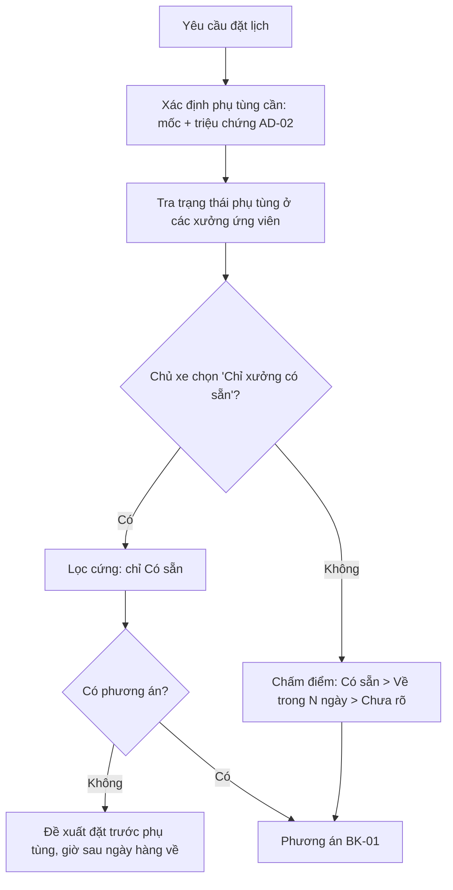

# Functional Specification — Chọn xưởng theo phụ tùng sẵn có

> Đặc tả nghiệp vụ cho **BK-09** trong [PRD Phase 2](../../../product/PRD_EV_Care_Phase2.md).
>
> **Quan hệ tài liệu:** hạng mục theo mốc lấy từ F5 ([us-045](../../sprint-2/feature-functional/us-045-sprint-2-spec.ff.md)); hạng mục sửa chữa từ [AD-02](ad-02-phase2-spec.ff.md). Phụ tùng là một ràng buộc trong [BK-01](bk-01-phase2-spec.ff.md). Phase 2 **không** làm hệ thống kho đầy đủ (PRD §4.2).
>
> Quy ước: [README Phase 2](../README.md).

---

# 1. Document Information

| Field | Value |
|---|---|
| Feature ID | `FEAT-P2-BK09` |
| Feature Name | Chọn xưởng theo phụ tùng sẵn có |
| PRD Feature | BK-09 (P2-C, Could, Chức năng) |
| Document Version / Status | `v0.1` / `Draft` |
| Created / Updated | `2026-10-09` |

---

# 2. Feature Overview

## 2.1 Feature Description

Xưởng khai báo **tồn kho đơn giản** theo mã phụ tùng. Khi chủ xe đặt lịch, hệ thống xác định phụ tùng cần dùng và hiển thị trạng thái phụ tùng ở từng xưởng: **Có sẵn**, **Về trong N ngày**, hoặc **Chưa rõ**. Bộ lập lịch dùng trạng thái này như ràng buộc mềm, hoặc ràng buộc cứng nếu chủ xe chọn "Chỉ xưởng có sẵn".

Khi nhận lịch, xưởng xác nhận lại và giữ phụ tùng cho lịch đó.

## 2.2 Business Objective

Tránh khách đến mà thiếu phụ tùng, phải hẹn lại (PP2-07).

## 2.3 User Objective

Chủ xe biết trước xưởng nào làm được ngay.

## 2.4 Business Value

Giảm T₂ (thời gian xử lý) và giảm số lần đến xưởng.

---

# 3. Scope

## 3.1 In Scope

- Xưởng khai báo tồn kho: mã phụ tùng, số lượng, ngày dự kiến về; nhập tay hoặc tải tệp.
- Xác định phụ tùng cần cho lịch hẹn.
- Hiển thị trạng thái phụ tùng ở thẻ xưởng, phương án, bản đồ.
- Đặt lịch kèm "đặt trước phụ tùng".
- Giữ phụ tùng khi xưởng nhận lịch.

## 3.2 Out of Scope

- WMS/ERP đầy đủ, nhập xuất kho, giá vốn.
- Đồng bộ tự động với phần mềm kho của xưởng (chờ P2Q-08).

---

# 4. Actors

| Actor | Type | Responsibility |
|---|---|---|
| Chủ xưởng | User | Khai báo tồn kho, xác nhận giữ phụ tùng |
| Chủ xe | User | Chọn "Chỉ xưởng có sẵn" hoặc đặt trước |
| Bộ lập lịch | System | Dùng trạng thái phụ tùng |

---

# 5. User Story

- `US-P2-BK09-01`: As a chủ xe, I want biết xưởng nào có sẵn phụ tùng xe tôi cần, so that tôi không phải đến hai lần.
- `US-P2-BK09-02`: As a chủ xưởng, I want khai tồn kho đơn giản, so that hệ thống chỉ gửi tôi khách mà tôi làm được.

---

# 6. Use Case

| UC | Tên | Trigger | Postcondition |
|---|---|---|---|
| `UC-BK09-01` | Khai tồn kho | Chủ xưởng mở Tồn kho | Bản ghi tồn kho có thời điểm cập nhật |
| `UC-BK09-02` | Đặt lịch có phụ tùng | Lịch cần phụ tùng | Phương án có trạng thái phụ tùng |
| `UC-BK09-03` | Đặt trước phụ tùng | Không xưởng nào có sẵn | Giờ hẹn sớm nhất sau ngày hàng về |
| `UC-BK09-04` | Giữ phụ tùng | Xưởng nhận lịch | Số lượng khả dụng giảm |

---

# 7. User Flow

---

# 8. Screen / UI Flow

| Screen ID | Name | Purpose |
|---|---|---|
| `SCR-BK09-01` | Tồn kho (Workshop Portal) | Bảng mã phụ tùng, số lượng, ngày về, cập nhật lần cuối |
| `SCR-BK09-02` | Nhãn phụ tùng trên thẻ xưởng / phương án | Có sẵn / Về 15/10 / Chưa rõ |

---

# 9. Main Flow

1. Chủ xe hỏi thay má phanh trước VF 8 (AD-02), rồi đặt lịch.
2. Phụ tùng cần: má phanh trước VF 8.
3. Cầu Giấy có sẵn, Long Biên "về 15/10".
4. Bộ lập lịch xếp Cầu Giấy lên đầu, lý do "Có sẵn phụ tùng".
5. Xưởng nhận lịch và giữ 1 bộ má phanh.

---

# 10. Alternative Flow

- **AF-BK09-01:** Không xưởng nào có sẵn → UC-BK09-03.
- **AF-BK09-02:** Hạng mục không cần phụ tùng → bỏ qua ràng buộc.

---

# 11. Exception Flow

| ID | Condition | Behavior |
|---|---|---|
| `EF-BK09-01` | Tồn kho quá `STOCK_STALE_DAYS` ngày chưa cập nhật | Trạng thái chuyển "Chưa rõ" |
| `EF-BK09-02` | Hết phụ tùng sau khi xưởng đã nhận lịch | Xưởng báo → BK-01 AF-BK01-08 |
| `EF-BK09-03` | Không xác định được phụ tùng | Bỏ qua ràng buộc, ghi chú "Xưởng sẽ kiểm tra" |

---

# 12. Business Rules

- **BR-BK09-01 (PRD):** Phụ tùng xác định từ hạng mục mốc và chẩn đoán sơ bộ AD-02. **High.**
- **BR-BK09-02 (PRD):** Ba trạng thái hiển thị, kèm thời điểm cập nhật. **High.**
- **BR-BK09-03 (PRD):** Ràng buộc mềm mặc định; cứng khi chủ xe chọn. **Medium.**
- **BR-BK09-04 (PRD):** Không ai có sẵn thì cho đặt trước; giờ hẹn sớm nhất sau ngày hàng về. **Medium.**
- **BR-BK09-05 (PRD):** Xưởng xác nhận và giữ phụ tùng khi nhận lịch; hết hàng thì đi AF-BK01-08. **High.**
- **BR-BK09-06:** Huỷ lịch thì trả phụ tùng đã giữ. **High.**
- **BR-BK09-07:** Số lượng khả dụng = tồn − đã giữ. Không hiển thị số lượng cụ thể cho chủ xe. **Medium.**

---

# 13. State / Status

Giữ phụ tùng: `reserved` → `consumed` (hoàn tất) / `released` (huỷ).

---

# 14. Data Requirements

| Entity | Purpose | R/W |
|---|---|---|
| `workshop_part_stock` (mới) | Mã phụ tùng, số lượng, ngày về, cập nhật lần cuối | R/W |
| `part_reservation` (mới) | Booking ↔ phụ tùng giữ | R/W |
| Danh mục phụ tùng theo model | Ánh xạ hạng mục → mã phụ tùng | R |

---

# 15. Business Error & Edge Cases

| Case ID | Scenario | Expected Behavior |
|---|---|---|
| `EDGE-BK09-01` | Hai lịch giữ phụ tùng cuối | Lịch nhận trước được giữ; lịch sau chuyển "Về trong N ngày" hoặc "Chưa rõ" |
| `EDGE-BK09-02` | Mã phụ tùng thay thế tương đương | Chỉ khi danh mục hãng ghi tương đương |

---

# 16. Permissions & Access

Chỉ chủ xưởng sửa tồn kho xưởng mình. Chủ xe chỉ thấy trạng thái, không thấy số lượng.

---

# 17. Acceptance Criteria

- **AC-BK09-01:** Trạng thái phụ tùng có thời điểm cập nhật; quá `STOCK_STALE_DAYS` thì hiển thị "Chưa rõ".
- **AC-BK09-02:** Huỷ lịch trả phụ tùng đã giữ ngay.
- **AC-BK09-03:** Chọn "Chỉ xưởng có sẵn" thì không phương án nào ở xưởng không có sẵn.

---

# 18. Non-functional Expectations

Giữ phụ tùng nguyên tử cùng với xác nhận lịch.

# 19. Dependencies

BK-01, AD-02, danh mục phụ tùng của hãng, P2Q-08.

# 20. Assumptions

Xưởng sẵn sàng cập nhật tồn kho ít nhất hằng tuần.

# 21. Business Constraints

Không phải WMS; không quản lý giá vốn.

# 22. Terminology

| Term | Vietnamese |
|---|---|
| Part stock | Tồn kho phụ tùng |
| Reservation | Giữ phụ tùng |

# 23. Partner Notes

Cần danh mục mã phụ tùng theo model từ hãng.

# 24. Open Questions

| ID | Question | Proposal |
|---|---|---|
| `Q-BK09-01` | Nhập tay hay tích hợp kho (P2Q-08)? | Nhập tay + tải CSV |
| `Q-BK09-02` | Nguồn danh mục mã phụ tùng? | Mock hãng mở rộng |

# 25. Traceability

PRD Phase 2 BK-09, PP2-07 · BR-BK09-01…07 · AC-BK09-01…03.

# 26. Related Documents

[PRD Phase 2](../../../product/PRD_EV_Care_Phase2.md) · [BK-01](bk-01-phase2-spec.ff.md) · [AD-02](ad-02-phase2-spec.ff.md)

# 27. Change Log

| Version | Date | Change |
|---|---|---|
| `v0.1` | `2026-10-09` | Bản nháp đầu |

# 28. Approval

| Role | Status |
|---|---|
| Product Owner | Pending |
| Technical Owner | Pending |
