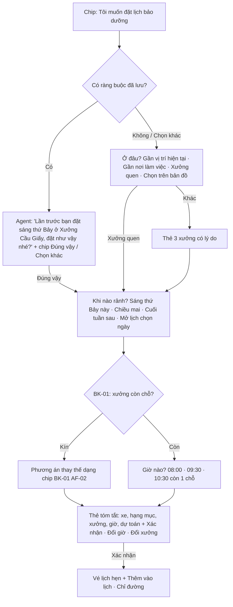

# Functional Specification — Gợi ý một chạm

> Đặc tả nghiệp vụ cho **CH-01** trong [PRD Phase 2](../../../product/PRD_EV_Care_Phase2.md).
>
> **Quan hệ tài liệu:** mở rộng chat F4 ([us-025](../../sprint-2/feature-functional/us-025-sprint-2-spec.ff.md)) và ô gợi ý / đặt lịch nhanh của [us-061](../../sprint-4/feature-functional/us-061-sprint-4-spec.ff.md). Luồng đặt lịch một chạm gọi [BK-01](bk-01-phase2-spec.ff.md). Các nút có tác dụng phụ vẫn theo nguyên tắc "Confirm before side effect" của PRD MVP và quyết định 03/10 của us-061: chỉ nút **Xác nhận** trên thẻ mới tạo booking.
>
> Quy ước: [README Phase 2](../README.md).

---

# 1. Document Information

| Field | Value |
|---|---|
| Feature ID | `FEAT-P2-CH01` |
| Feature Name | Gợi ý một chạm |
| PRD Feature | CH-01 (P2-A, Must, Chức năng) |
| Document Version / Status | `v0.1` / `Draft` |
| Created / Updated | `2026-10-09` |

---

# 2. Feature Overview

## 2.1 Feature Description

Dưới khung chat có các **gợi ý một chạm** (chip). Mỗi chip gắn với một **ý định** mà agent đã xử lý được, nên bấm chip luôn ra kết quả xác định. Chip đến từ ba nguồn:

| Nguồn | Khi nào hiện |
|---|---|
| **Mở đầu** | Khi mở hội thoại |
| **Theo ngữ cảnh** | Sau mỗi câu trả lời, là bước tiếp theo hợp lý |
| **Theo trạng thái** | Theo trạng thái xe và lịch hẹn |

Chủ xe đi hết luồng đặt lịch bằng chạm: ở đâu → xưởng nào → khi nào rảnh → giờ nào → xác nhận. Chủ xe vẫn gõ tự do bất cứ lúc nào.

## 2.2 Business Objective

Đặt lịch không cần gõ chữ; giảm bỏ cuộc vì không biết hỏi gì (PP2-01, PP2-05, G2-1).

## 2.3 User Objective

"Bấm vài lần là xong lịch."

## 2.4 Business Value

M-01 < 60 s, M-02 ≤ 6 chạm và 0 ký tự với luồng chuẩn, M-04 tỉ lệ bấm chip.

---

# 3. Scope

## 3.1 In Scope

- Danh mục chip (ý định + tham số).
- Ba nguồn chip; quy tắc chọn 3–5 chip mỗi lần.
- Luồng đặt lịch một chạm chuẩn.
- Chip theo ngữ cảnh cho các luồng: đến hạn, dự toán, lịch sử, tư vấn (AD), lịch hẹn sắp tới.
- Vô hiệu chip cũ; chống bấm trùng.
- Ghi sự kiện hiển thị và bấm.

## 3.2 Out of Scope

- Chip do LLM tự sinh tự do.
- Nhập bằng giọng nói (TA-02 cho KTV; chủ xe để sau).

---

# 4. Actors

| Actor | Type | Responsibility |
|---|---|---|
| Chủ xe | User | Bấm chip, gõ tự do |
| Service gợi ý | System | Chọn chip theo nguồn và ngữ cảnh |
| AI Agent | System | Xử lý ý định; trả bước tiếp theo |
| Bộ lập lịch | System | Trả phương án cho chip đặt lịch |

---

# 5. User Story

- `US-P2-CH01-01`: As a chủ xe, I want bấm "Tôi muốn đặt lịch bảo dưỡng" rồi chỉ trả lời bằng nút, so that tôi đặt lịch không cần gõ.
- `US-P2-CH01-02`: As a chủ xe mới, I want thấy các câu hỏi phổ biến, so that tôi biết trợ lý làm được gì.
- `US-P2-CH01-03`: As a chủ xe có hẹn ngày mai, I want thấy nút Đổi giờ, Chỉ đường, Tôi đến trễ, so that tôi xử lý nhanh.

---

# 6. Use Case

| UC | Tên | Trigger | Postcondition |
|---|---|---|---|
| `UC-CH01-01` | Hiện chip mở đầu | Mở hội thoại mới | 3–5 chip |
| `UC-CH01-02` | Đặt lịch một chạm | Bấm chip đặt lịch | Vé lịch hẹn |
| `UC-CH01-03` | Chip theo ngữ cảnh | Agent trả lời xong | Chip bước tiếp theo |
| `UC-CH01-04` | Chip theo trạng thái | Xe `DUE_SOON` / có hẹn ≤ 24h | Chip tương ứng ưu tiên |
| `UC-CH01-05` | Gõ tự do giữa luồng | Chủ xe gõ | Agent hiểu như MVP, cập nhật luồng |

---

# 7. User Flow — Luồng đặt lịch một chạm chuẩn

| Step | Câu hỏi của agent | Chip | Bỏ qua khi |
|---|---|---|---|
| 0 | Xác nhận thói quen | Đúng vậy · Chọn khác | Chưa có ràng buộc lưu |
| 1 | Ở đâu? | Gần vị trí hiện tại · Gần nơi làm việc · Xưởng quen · Chọn trên bản đồ | Bước 0 = Đúng vậy |
| 2 | Xưởng nào? | Thẻ 3 xưởng (CH-02) | Chọn Xưởng quen / bản đồ |
| 3 | Khi nào rảnh? | Sáng thứ Bảy này · Chiều mai · Cuối tuần sau · Mở lịch chọn ngày (BK-04) | Bước 0 = Đúng vậy |
| 4 | Giờ nào? | Các khung còn chỗ | — |
| 5 | Xác nhận | Xác nhận đặt lịch · Đổi giờ · Đổi xưởng | — |

Chip của bước 3 được sinh động từ khung rảnh của chủ xe và lịch còn chỗ, không cố định.

---

# 8. Screen / UI Flow

| Screen ID | Name | Purpose |
|---|---|---|
| `SCR-CH01-01` | Hàng chip dưới khung chat | 3–5 chip, chip chính tô đậm, cuộn ngang trên mobile |
| `SCR-CH01-02` | Chip mở đầu ở màn chat trống | Lưới chip lớn hơn |

**Danh mục chip mở đầu mặc định** (khi chưa đủ dữ liệu thống kê):

| Chip | Ý định |
|---|---|
| Tôi muốn đặt lịch bảo dưỡng | `book_maintenance` |
| Xe tôi khi nào đến hạn? | `ask_due_status` |
| Mốc tới hết bao nhiêu? | `ask_cost_estimate` |
| Xem lịch sử bảo dưỡng | `view_history` |
| Xe còn bảo hành không? | `ask_warranty` (AD-03) |

**Chip theo trạng thái:**

| Trạng thái | Chip |
|---|---|
| Xe `DUE_SOON` / `OVERDUE`, chưa có lịch | "Đặt lịch mốc {km}" (ưu tiên đầu) |
| Có lịch giữ chủ động | "Xác nhận lịch giữ sẵn", "Xem phương án khác" |
| Có hẹn trong 24h | "Đổi giờ", "Chỉ đường", "Tôi đến trễ" (BK-08) |
| Có báo giá phát sinh chờ (AD-04) | "Xem báo giá phát sinh" |

---

# 9. Main Flow

1. Chủ xe mở chat, bấm "Tôi muốn đặt lịch bảo dưỡng".
2. Chưa có ràng buộc lưu. Agent hỏi ở đâu, chủ xe bấm "Xưởng quen: Xưởng Cầu Giấy".
3. Agent hỏi khi nào rảnh, chủ xe bấm "Sáng thứ Bảy này".
4. BK-01 trả 08:00, 09:30, 10:30. Chủ xe bấm 08:00.
5. Thẻ tóm tắt hiện ra, chủ xe bấm "Xác nhận đặt lịch". Vé xuất hiện.
6. Tổng cộng 4 lần chạm, 0 ký tự.

---

# 10. Alternative Flow

| ID | Condition | Flow |
|---|---|---|
| `AF-CH01-01` | Xưởng quen kín | BK-01 AF-BK01-02: chip phương án thay thế ("Xưởng Mỹ Đình · 08:00 · 3,4 km", "Xưởng Cầu Giấy · 11:00") |
| `AF-CH01-02` | Gõ "thôi để chiều" giữa luồng | Agent hiểu, cập nhật ràng buộc giờ, tiếp tục bước 4 với khung chiều |
| `AF-CH01-03` | Bấm "Mở lịch chọn ngày" | Mở widget BK-04 dạng bảng nổi; chọn ngày rồi quay lại bước 4 |
| `AF-CH01-04` | Bấm "Chọn trên bản đồ" | Mở BK-05; "Đặt ở đây" rồi quay lại bước 3 |
| `AF-CH01-05` | Chip ngoài luồng đặt lịch (ví dụ "Mốc tới hết bao nhiêu?") | Agent trả lời; chip ngữ cảnh "Đặt lịch luôn" dẫn vào luồng |

---

# 11. Exception Flow

| ID | Condition | Behavior | User Experience |
|---|---|---|---|
| `EF-CH01-01` | Bấm chip cũ phía trên lịch sử chat | Chip của bước đã qua bị vô hiệu | "Gợi ý này đã hết hiệu lực" |
| `EF-CH01-02` | Bấm "Xác nhận" hai lần | Chống trùng bằng `confirmation_token` (us-061 EF-1507) | Một lịch |
| `EF-CH01-03` | Ý định của chip lỗi ở backend | Agent xin lỗi ngắn, đưa chip "Thử lại" và "Gõ câu hỏi" | — |
| `EF-CH01-04` | Mất mạng giữa luồng | Mở lại thì tiếp tục từ bước cuối (checkpoint, AC-F4-04) | — |

---

# 12. Business Rules

- **BR-CH01-01 (PRD):** Mỗi lần `CHIP_MIN`–`CHIP_MAX` chip; chip bước tiếp theo hợp lý được tô đậm. **Medium.**
- **BR-CH01-02 (PRD):** Mỗi chip gắn một ý định + tham số đã định nghĩa; bấm chip gửi thẳng ý định, không qua hiểu ngôn ngữ tự do. **High.**
- **BR-CH01-03 (PRD):** Gõ tự do luôn được; chip không khoá luồng. **High.**
- **BR-CH01-04 (PRD):** Chip mở đầu lấy từ top ý định 30 ngày, cập nhật hằng tuần; có danh sách mặc định. **Medium.**
- **BR-CH01-05 (PRD):** Chip có tác dụng phụ đi kèm thẻ tóm tắt và `confirmation_token`; chỉ nút Xác nhận trên thẻ tạo booking. **High.**
- **BR-CH01-06 (PRD):** Ghi sự kiện hiển thị và bấm từng chip (PL-03). **Medium.**
- **BR-CH01-07:** Chip theo trạng thái có ưu tiên cao hơn chip mở đầu. **Medium.**
- **BR-CH01-08:** Mọi chip phải có nhãn đọc được bằng trình đọc màn hình và vùng chạm ≥ 44 px (NFR-11). **Medium.**
- **BR-CH01-09:** Chip nhãn tiếng Việt, ngắn (≤ 40 ký tự), viết theo ngôn ngữ của chủ xe, không dùng thuật ngữ hệ thống. **Low.**

---

# 13. State / Status

Chip: `active` (bước hiện tại) → `stale` (bước đã qua) → không bấm được.

# 14. Data Requirements

| Data | Source |
|---|---|
| Danh mục chip (ý định, tham số, nhãn) | Cấu hình |
| Thống kê ý định 30 ngày | PL-03 |
| Trạng thái xe, lịch hẹn, báo giá chờ | F3, booking, AD-04 |
| Ràng buộc đã lưu | BK-01, PS-01 |

# 15. Business Error & Edge Cases

| Case ID | Scenario | Expected Behavior |
|---|---|---|
| `EDGE-CH01-01` | Chủ xe có hẹn ngày mai và xe cũng đến hạn mốc sau | Ưu tiên chip của lịch hẹn |
| `EDGE-CH01-02` | Hơn 5 chip đủ điều kiện | Lấy 5 theo ưu tiên: trạng thái > ngữ cảnh > mở đầu |
| `EDGE-CH01-03` | Chủ xe tắt bộ nhớ | Bỏ bước 0, hỏi từ bước 1 |

# 16. Permissions & Access

Chủ xe trong hội thoại của mình.

# 17. Acceptance Criteria

- **AC-CH01-01:** Luồng đặt lịch chuẩn hoàn tất được mà không gõ ký tự nào.
- **AC-CH01-02:** Mỗi chip trong danh mục có ý định tương ứng được backend xử lý (kiểm tra tự động).
- **AC-CH01-03:** Chip của bước cũ không tạo tác dụng phụ khi bấm lại.
- **AC-CH01-04:** Với chủ xe đã có thói quen lưu, luồng chuẩn ≤ 3 chạm (Đúng vậy → giờ → Xác nhận).
- **AC-CH01-05:** Sự kiện hiển thị và bấm có đủ để tính M-04.

# 18. Non-functional Expectations

Chip hiện cùng lúc với câu trả lời (không trễ thêm). Dùng được bằng bàn phím.

# 19. Dependencies

BK-01, BK-04, BK-05, CH-02, PS-01, PL-03, us-061.

# 20. Assumptions

Chủ xe thích bấm hơn gõ trên điện thoại (H2-06).

# 21. Business Constraints

Chip không do LLM sinh tự do.

# 22. Terminology

| Term | Vietnamese |
|---|---|
| Chip | Gợi ý một chạm |
| Intent | Ý định |
| Stale chip | Chip hết hiệu lực |

# 23. Partner Notes

Thay đổi so với us-061: us-061 là "2 chạm" với một thẻ đề xuất cố định. CH-01 giữ ô đó và thêm luồng hỏi từng bước cho chủ xe muốn chọn khác.

# 24. Open Questions

| ID | Question | Proposal |
|---|---|---|
| `Q-CH01-01` | Danh mục chip mở đầu mặc định? | Như mục 8 |
| `Q-CH01-02` | Có hiển thị chip trên Trang chủ (ngoài chat)? | Có, 3 chip theo trạng thái |

# 25. Traceability

PRD Phase 2 CH-01, PP2-01, PP2-05, G2-1, M-01, M-02, M-04 · BR-CH01-01…09 · AC-CH01-01…05 · us-025, us-061.

# 26. Related Documents

[PRD Phase 2](../../../product/PRD_EV_Care_Phase2.md) · [BK-01](bk-01-phase2-spec.ff.md) · [CH-02](ch-02-phase2-spec.ff.md) · [us-061 FF](../../sprint-4/feature-functional/us-061-sprint-4-spec.ff.md)

# 27. Change Log

| Version | Date | Change |
|---|---|---|
| `v0.1` | `2026-10-09` | Bản nháp đầu |

# 28. Approval

| Role | Status |
|---|---|
| Product Owner | Pending |
| Technical Owner | Pending |
