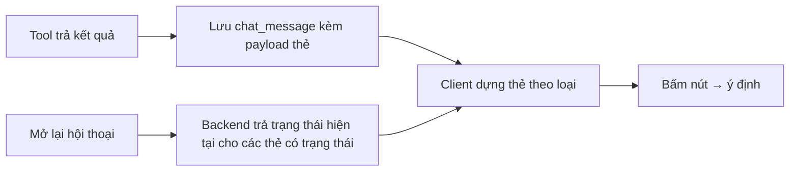

# Functional Specification — Thẻ tương tác trong chat

> Đặc tả nghiệp vụ cho **CH-02** trong [PRD Phase 2](../../../product/PRD_EV_Care_Phase2.md).
>
> **Quan hệ tài liệu:** mở rộng thẻ tóm tắt đặt lịch (`booking_summary`, AI-004) và vé lịch hẹn ([us-053](../../sprint-3/feature-functional/us-053-sprint-3-spec.ff.md)). Dữ liệu trên thẻ lấy từ kết quả tool đã lưu trong `chat_message` (PRD MVP F4).
>
> Quy ước: [README Phase 2](../README.md).

---

# 1. Document Information

| Field | Value |
|---|---|
| Feature ID | `FEAT-P2-CH02` |
| Feature Name | Thẻ tương tác trong chat |
| PRD Feature | CH-02 (P2-A, Should, Cải tiến MVP) |
| Document Version / Status | `v0.1` / `Draft` |
| Created / Updated | `2026-10-09` |

---

# 2. Feature Overview

## 2.1 Feature Description

Agent trả kết quả dưới dạng **thẻ** có cấu trúc và nút hành động, thay vì chỉ có chữ. Danh mục thẻ cố định. Dữ liệu trên thẻ lấy từ tool, không do LLM viết. Mở lại hội thoại thì thẻ hiển thị **trạng thái hiện tại** (ví dụ giữ chỗ đã hết hạn).

## 2.2 Business Objective

Giảm đọc và chép thông tin (PP2-05). Hành động ngay trên thẻ.

## 2.3 User Objective

Nhìn thẻ là hiểu; bấm nút là làm.

## 2.4 Business Value

Rút ngắn luồng; giảm lỗi do LLM diễn đạt sai số liệu.

---

# 3. Scope

## 3.1 In Scope — Danh mục thẻ

| Thẻ | Nội dung | Nút | Nguồn |
|---|---|---|---|
| Thẻ xưởng | Tên, khoảng cách, thời gian di chuyển, đánh giá, phụ tùng, số chỗ, lý do | Chọn, Chỉ đường | BK-01, BK-05 |
| Thẻ khung giờ | Ngày, các khung còn chỗ | Chọn khung | BK-01 |
| Thẻ tóm tắt lịch hẹn | Xe, hạng mục, xưởng, giờ, dự toán, hạng mục gộp | Xác nhận, Đổi giờ, Đổi xưởng | AI-004, HS-02 |
| Vé lịch hẹn | Mã, xưởng, giờ, trạng thái | Thêm vào lịch, Chỉ đường, Đổi, Huỷ | us-053 |
| Thẻ dự toán | Hạng mục, trong bảo hành / tính phí, tổng ước tính | Đặt lịch luôn, So sánh xưởng | F5, AD-01 |
| Thẻ báo giá phát sinh | Ảnh, phụ tùng, lý do, giá, tổng mới | Đồng ý, Không thay, Gọi xưởng | AD-04 |
| Thẻ mục lịch sử | Ngày, ODO, xưởng, hạng mục, chi phí | Xem chi tiết | HS-01 |
| Thẻ lịch giữ sẵn | Lịch đang giữ, đếm ngược | Xác nhận, Xem phương án khác | BK-01 |

## 3.2 Out of Scope

- Thẻ do LLM tự định nghĩa.
- Biểu đồ trong chat.

---

# 4. Actors

| Actor | Type | Responsibility |
|---|---|---|
| Chủ xe | User | Đọc, bấm nút |
| AI Agent | System | Chọn loại thẻ theo kết quả tool |
| Backend | System | Cung cấp dữ liệu, trạng thái hiện tại |

---

# 5. User Story

- `US-P2-CH02-01`: As a chủ xe, I want thông tin xưởng và giờ hiện thành thẻ có nút, so that tôi chọn nhanh mà không đọc đoạn dài.

---

# 6. Use Case

| UC | Tên | Trigger | Postcondition |
|---|---|---|---|
| `UC-CH02-01` | Hiển thị thẻ | Tool trả kết quả có loại thẻ | Thẻ trong tin nhắn |
| `UC-CH02-02` | Hành động trên thẻ | Bấm nút | Ý định tương ứng (CH-01 BR-CH01-02) |
| `UC-CH02-03` | Làm mới trạng thái | Mở lại hội thoại | Thẻ hiện trạng thái hiện tại |

---

# 7. User Flow

# 8. Screen / UI Flow

Thẻ dùng token của DESIGN.md: card trắng, bo 14px, nút chính màu xanh thương hiệu. Số tiền, km, mã lịch hẹn, giờ dùng JetBrains Mono; biển số dùng PlateTile.

# 9. Main Flow

1. BK-01 trả 3 phương án.
2. Agent gửi một câu dẫn ngắn kèm 3 thẻ xưởng.
3. Chủ xe bấm "Chọn" trên thẻ thứ hai, sang thẻ khung giờ.

# 10. Alternative Flow

- **AF-CH02-01:** Thiết bị không dựng được thẻ (phiên bản cũ) → hiện bản chữ tương đương, kèm chip.

# 11. Exception Flow

| ID | Condition | Behavior |
|---|---|---|
| `EF-CH02-01` | Thẻ hết hiệu lực (giữ chỗ hết hạn, báo giá hết hạn) | Nút hành động ẩn; nhãn trạng thái mới; nút "Tìm lại" nếu có |
| `EF-CH02-02` | Dữ liệu thẻ thay đổi từ lúc gửi | Khi bấm, backend kiểm tra lại; thay đổi thì trả thẻ mới |

---

# 12. Business Rules

- **BR-CH02-01 (PRD):** Danh mục thẻ cố định như mục 3.1. **High.**
- **BR-CH02-02 (PRD):** Số liệu trên thẻ lấy từ kết quả tool; LLM không viết số trên thẻ. **High.**
- **BR-CH02-03 (PRD):** Mọi thẻ có nút; thẻ hết hiệu lực hiện trạng thái mới khi mở lại. **High.**
- **BR-CH02-04:** Số tiền chưa được xưởng duyệt có nhãn "ước tính" trên thẻ. **High.**
- **BR-CH02-05:** Thẻ không hiển thị VIN đầy đủ; biển số theo quy tắc hiện hành. **High.**

# 13. State / Status

Thẻ có trạng thái: `active`, `expired`, `superseded`, `completed`.

# 14. Data Requirements

`chat_message` lưu loại thẻ, payload, id đối tượng nghiệp vụ (booking, quote, proposal) để làm mới trạng thái.

# 15. Business Error & Edge Cases

| Case ID | Scenario | Expected Behavior |
|---|---|---|
| `EDGE-CH02-01` | Nhiều thẻ cùng một booking trong lịch sử chat | Chỉ thẻ mới nhất có nút hành động |

# 16. Permissions & Access

Thẻ chỉ hiện trong hội thoại của chủ xe sở hữu dữ liệu.

# 17. Acceptance Criteria

- **AC-CH02-01:** Con số trên thẻ trùng khớp kết quả tool đã lưu trong `chat_message`.
- **AC-CH02-02:** Mở lại hội thoại sau khi giữ chỗ hết hạn thì thẻ hiện "Đã hết hạn" và không có nút Xác nhận.

# 18. Non-functional Expectations

Thẻ dựng ≤ 100 ms sau khi nhận payload. Truy cập được bằng trình đọc màn hình.

# 19. Dependencies

CH-01, BK-01, AD-04, HS-01, F4 lưu hội thoại.

# 20. Assumptions

—

# 21. Business Constraints

Theo DESIGN.md; không thêm màu ngoài token.

# 22. Terminology

| Term | Vietnamese |
|---|---|
| Card | Thẻ tương tác |

# 23. Partner Notes

—

# 24. Open Questions

| ID | Question | Proposal |
|---|---|---|
| `Q-CH02-01` | Có cần thẻ "so sánh 3 xưởng" dạng bảng không? | Có trong AD-01 |

# 25. Traceability

PRD Phase 2 CH-02, PP2-05 · BR-CH02-01…05 · AC-CH02-01…02.

# 26. Related Documents

[PRD Phase 2](../../../product/PRD_EV_Care_Phase2.md) · [CH-01](ch-01-phase2-spec.ff.md) · [DESIGN.md](../../../../DESIGN.md)

# 27. Change Log

| Version | Date | Change |
|---|---|---|
| `v0.1` | `2026-10-09` | Bản nháp đầu |

# 28. Approval

| Role | Status |
|---|---|
| Product Owner | Pending |
| Technical Owner | Pending |
