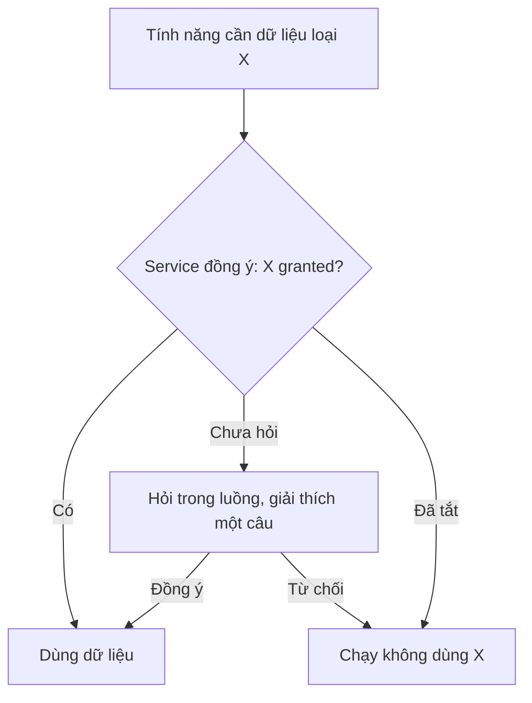

# Functional Specification — Quyền riêng tư và sự đồng ý

> Đặc tả nghiệp vụ cho **PL-01** trong [PRD Phase 2](../../../product/PRD_EV_Care_Phase2.md).
>
> **Quan hệ tài liệu:** mở rộng nguyên tắc Privacy của PRD MVP §7 và quyền xoá hội thoại (F4). Là điều kiện tiên quyết của [BK-01](bk-01-phase2-spec.ff.md) (mức Tự đặt, ràng buộc suy ra), [BK-04](bk-04-phase2-spec.ff.md) (đồng bộ lịch), [BK-05](bk-05-phase2-spec.ff.md) (vị trí), [PS-01](ps-01-phase2-spec.ff.md) (bộ nhớ), [PS-02](ps-02-phase2-spec.ff.md), [PS-04](ps-04-phase2-spec.ff.md) (dùng dữ liệu cho gợi ý).
>
> Quy ước: [README Phase 2](../README.md).

---

# 1. Document Information

| Field | Value |
|---|---|
| Feature ID | `FEAT-P2-PL01` |
| Feature Name | Quyền riêng tư và sự đồng ý |
| PRD Feature | PL-01 (P2-A, Must, Chức năng) |
| Document Version / Status | `v0.1` / `Draft` |
| Created / Updated | `2026-10-09` |

---

# 2. Feature Overview

## 2.1 Feature Description

Một màn **Quyền riêng tư** gom mọi lựa chọn đồng ý về một chỗ. Mỗi loại dùng dữ liệu có một công tắc riêng, giải thích một câu, nút "Xoá dữ liệu liên quan". Tắt thì hệ thống dừng dùng ngay. Mọi thay đổi được ghi log. Các tính năng khác phải hỏi service đồng ý trước khi dùng dữ liệu.

## 2.2 Business Objective

Tự động hoá và cá nhân hoá mà vẫn giữ lòng tin (G2-7); đáp ứng yêu cầu bảo vệ dữ liệu cá nhân.

## 2.3 User Objective

Biết hệ thống dùng dữ liệu gì, bật/tắt và xoá được.

## 2.4 Business Value

Điều kiện để phát hành các tính năng cá nhân hoá; giảm rủi ro pháp lý.

---

# 3. Scope

## 3.1 In Scope

| Mã đồng ý | Loại | Dùng cho | Mặc định đề xuất |
|---|---|---|---|
| `CONSENT_LONG_TERM_MEMORY` | Bộ nhớ dài hạn của agent | PS-01, PS-05, BK-01 ràng buộc suy ra | Bật, có thông báo lần đầu |
| `CONSENT_CALENDAR_SYNC` | Đồng bộ lịch (bận/rảnh, tạo sự kiện) | BK-04, BK-01 | Tắt |
| `CONSENT_LOCATION` | Dùng vị trí thiết bị | BK-01, BK-05 | Hỏi khi cần (quyền trình duyệt) |
| `CONSENT_PERSONALIZATION_DATA` | Dùng dữ liệu cho gợi ý cá nhân và nhóm | PS-02, PS-04 | Bật |
| `CONSENT_AUTO_BOOKING` | Mức tự động hoá "Tự đặt" | BK-01 mức 3 | Tắt |

- Service đồng ý dùng chung (các tính năng hỏi trước khi dùng).
- Xoá dữ liệu theo loại trong `DELETE_SLA_HOURS`.
- Log thay đổi đồng ý.

## 3.2 Out of Scope

- Xuất toàn bộ dữ liệu cá nhân (data export) — để sau.
- Đồng ý cho kênh thông báo ngoài app (thuộc NOTI-01).

---

# 4. Actors

| Actor | Type | Responsibility |
|---|---|---|
| Chủ xe | User | Bật/tắt, xoá |
| Service đồng ý | System | Trả trạng thái, ghi log |
| Job xoá dữ liệu | System | Xoá theo loại |
| Các tính năng | System | Kiểm tra đồng ý trước khi dùng |

---

# 5. User Story

- `US-P2-PL01-01`: As a chủ xe, I want một chỗ duy nhất để quản lý dữ liệu tôi cho phép dùng, so that tôi kiểm soát được.
- `US-P2-PL01-02`: As a chủ xe, I want xoá dữ liệu khi không muốn dùng nữa, so that dữ liệu của tôi không bị giữ.

---

# 6. Use Case

| UC | Tên | Trigger | Postcondition |
|---|---|---|---|
| `UC-PL01-01` | Xem quyền riêng tư | Cài đặt → Quyền riêng tư | Trạng thái các công tắc |
| `UC-PL01-02` | Bật đồng ý | Bật công tắc / đồng ý trong luồng | Đồng ý `granted`, log |
| `UC-PL01-03` | Tắt đồng ý | Tắt công tắc | `revoked`; tính năng dừng dùng ngay |
| `UC-PL01-04` | Xoá dữ liệu | Bấm "Xoá dữ liệu liên quan" + xác nhận | Dữ liệu xoá trong `DELETE_SLA_HOURS` |
| `UC-PL01-05` | Hỏi đồng ý trong luồng | Tính năng cần đồng ý chưa có | Hộp hỏi ngắn; từ chối thì luồng vẫn chạy ở mức thấp hơn |

---

# 7. User Flow

---

# 8. Screen / UI Flow

| Screen ID | Name | Purpose |
|---|---|---|
| `SCR-PL01-01` | Quyền riêng tư | 5 công tắc, mỗi công tắc: tên, giải thích, link "Xem dữ liệu" (nếu có), nút xoá |
| `SCR-PL01-02` | Hộp hỏi đồng ý trong luồng | Ví dụ khi bấm "Đồng bộ lịch" lần đầu |
| `SCR-PL01-03` | Xác nhận xoá | Nói rõ dữ liệu nào bị xoá và hệ quả |

---

# 9. Main Flow

1. Chủ xe vào Quyền riêng tư và tắt "Bộ nhớ dài hạn".
2. Hệ thống ghi log; agent dừng đọc và ghi bộ nhớ dài hạn ngay ở lượt sau.
3. Chủ xe bấm "Xoá dữ liệu liên quan" và xác nhận. Mọi mục nhớ bị xoá trong 24 giờ.

---

# 10. Alternative Flow

- **AF-PL01-01:** Tắt đồng bộ lịch → xoá dữ liệu bận/rảnh đệm, thu hồi token, giữ hoặc xoá sự kiện đã tạo theo lựa chọn của chủ xe.
- **AF-PL01-02:** Tắt "Tự đặt" khi đang có lịch tự đặt → lịch giữ nguyên; chỉ áp cho lần sau.

# 11. Exception Flow

| ID | Condition | Behavior |
|---|---|---|
| `EF-PL01-01` | Service đồng ý lỗi | Các tính năng coi như **chưa đồng ý** (an toàn) |
| `EF-PL01-02` | Job xoá thất bại | Thử lại; quá hạn thì cảnh báo vận hành |

---

# 12. Business Rules

- **BR-PL01-01 (PRD):** Một màn với các công tắc riêng như mục 3.1. **High.**
- **BR-PL01-02 (PRD):** Mặc định như cột "Mặc định đề xuất" (chờ P2Q-11). **High.**
- **BR-PL01-03 (PRD):** Tắt thì dừng dùng ngay; xoá trong `DELETE_SLA_HOURS`. **High.**
- **BR-PL01-04 (PRD):** Log mọi thay đổi (thời điểm, giá trị cũ, giá trị mới, kênh). **High.**
- **BR-PL01-05:** Tính năng không có đồng ý vẫn phải chạy ở mức thấp hơn, không chặn chủ xe (ví dụ không có vị trí thì hỏi khu vực). **High.**
- **BR-PL01-06:** Lỗi service đồng ý thì coi như chưa đồng ý. **High.**

# 13. State / Status

Đồng ý: `not_asked` → `granted` ⇄ `revoked`.

# 14. Data Requirements

| Entity | Purpose |
|---|---|
| `user_consent` (mới) | Chủ xe, mã đồng ý, trạng thái, thời điểm |
| `user_consent_log` (mới) | Lịch sử thay đổi |

# 15. Business Error & Edge Cases

| Case ID | Scenario | Expected Behavior |
|---|---|---|
| `EDGE-PL01-01` | Chủ xe xoá tài khoản | Xoá mọi dữ liệu Phase 2 theo các loại |
| `EDGE-PL01-02` | Bật lại sau khi xoá | Bắt đầu từ rỗng |

# 16. Permissions & Access

Chỉ chủ xe thay đổi đồng ý của mình. Log chỉ vận hành đọc khi cần kiểm tra.

# 17. Acceptance Criteria

- **AC-PL01-01:** Tắt đồng bộ lịch thì lần gọi bộ lập lịch kế tiếp không dùng dữ liệu bận/rảnh.
- **AC-PL01-02:** Xoá bộ nhớ dài hạn thì không còn bản ghi nào sau `DELETE_SLA_HOURS`.
- **AC-PL01-03:** Mọi thay đổi đồng ý có log.
- **AC-PL01-04:** Khi service đồng ý lỗi, không tính năng nào dùng dữ liệu cần đồng ý.

# 18. Non-functional Expectations

Kiểm tra đồng ý ≤ 20 ms (đệm theo phiên, xoá đệm khi đổi).

# 19. Dependencies

Mọi tính năng cá nhân hoá Phase 2.

# 20. Assumptions

—

# 21. Business Constraints

Tối thiểu dữ liệu; tuân thủ quy định bảo vệ dữ liệu cá nhân hiện hành.

# 22. Terminology

| Term | Vietnamese |
|---|---|
| Consent | Sự đồng ý |
| Revoke | Thu hồi |

# 23. Partner Notes

Cần rà soát văn bản giải thích với người hiểu quy định bảo vệ dữ liệu cá nhân trước khi phát hành.

# 24. Open Questions

| ID | Question | Proposal |
|---|---|---|
| `Q-PL01-01` | Mặc định các công tắc (P2Q-11)? | Như mục 3.1 |
| `Q-PL01-02` | `DELETE_SLA_HOURS`? | 24 |

# 25. Traceability

PRD Phase 2 PL-01, G2-7, M-12, NFR-06 · BR-PL01-01…06 · AC-PL01-01…04.

# 26. Related Documents

[PRD Phase 2](../../../product/PRD_EV_Care_Phase2.md) · [PS-01](ps-01-phase2-spec.ff.md) · [BK-04](bk-04-phase2-spec.ff.md)

# 27. Change Log

| Version | Date | Change |
|---|---|---|
| `v0.1` | `2026-10-09` | Bản nháp đầu |

# 28. Approval

| Role | Status |
|---|---|
| Product Owner | Pending |
| Technical Owner | Pending |
