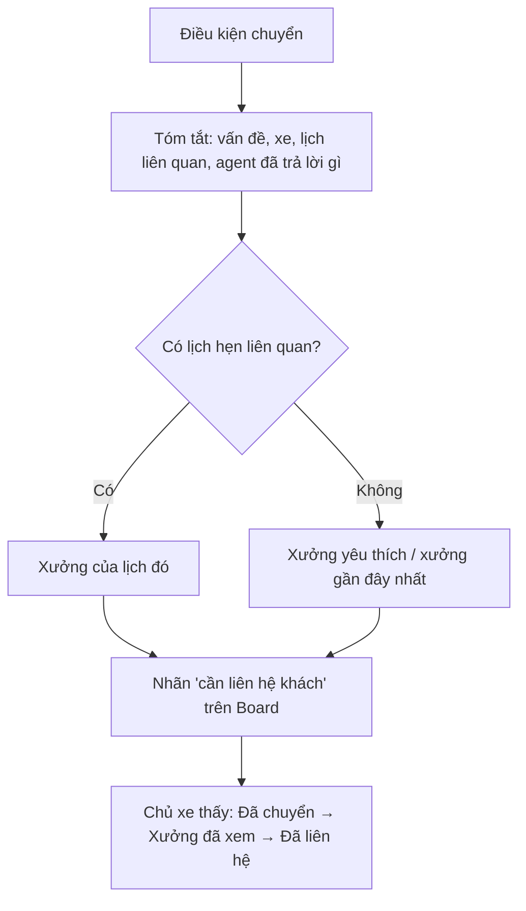

# Functional Specification — Chuyển sang người thật

> Đặc tả nghiệp vụ cho **PL-02** trong [PRD Phase 2](../../../product/PRD_EV_Care_Phase2.md).
>
> **Quan hệ tài liệu:** hiện thực nguyên tắc Escalation của PRD MVP §7. Nhận tín hiệu từ F9 (`has_issue`, `rating` — [us-041](../../sprint-4/feature-functional/us-041-sprint-4-spec.ff.md)). **Không** đưa lại thực thể phiếu hỗ trợ (`support_ticket`) đã bỏ ở PRD MVP v3.7; dùng **nhãn "cần liên hệ khách"** trên Workshop Board.
>
> Quy ước: [README Phase 2](../README.md).

---

# 1. Document Information

| Field | Value |
|---|---|
| Feature ID | `FEAT-P2-PL02` |
| Feature Name | Chuyển sang người thật |
| PRD Feature | PL-02 (P2-B, Should, Chức năng) |
| Document Version / Status | `v0.1` / `Draft` |
| Created / Updated | `2026-10-09` |

---

# 2. Feature Overview

## 2.1 Feature Description

Khi agent không nên tự xử lý tiếp, hệ thống **chuyển cho chủ xưởng** kèm tóm tắt. Các trường hợp: chủ xe yêu cầu, không có nguồn sau nhiều lần, tranh chấp bảo hành, khách bực, đánh giá thấp. Chủ xưởng thấy nhãn **"cần liên hệ khách"** trên Board. Chủ xe thấy trạng thái xử lý.

## 2.2 Business Objective

Không để khách mắc kẹt với agent; xưởng nhận đủ ngữ cảnh (PP2-08, PP2-09).

## 2.3 User Objective

Khi cần người thì có người, không phải kể lại từ đầu.

## 2.4 Business Value

Giảm khách bỏ đi do không được hỗ trợ; đo được M-08 (phần agent không tự trả lời).

---

# 3. Scope

## 3.1 In Scope

- Năm điều kiện chuyển.
- Tóm tắt tự động.
- Chọn xưởng nhận.
- Nhãn trên Board; trạng thái cho chủ xe.

## 3.2 Out of Scope

- Tổng đài, chăm sóc khách hàng của hãng.
- Phiếu hỗ trợ có vòng đời riêng.

---

# 4. Actors

| Actor | Type | Responsibility |
|---|---|---|
| Chủ xe | User | Yêu cầu / được chuyển |
| AI Agent | System | Phát hiện điều kiện, tóm tắt |
| Chủ xưởng | User | Liên hệ khách, cập nhật trạng thái |

---

# 5. User Story

- `US-P2-PL02-01`: As a chủ xe, I want nói chuyện với người của xưởng khi agent không giúp được, so that vấn đề được giải quyết.
- `US-P2-PL02-02`: As a chủ xưởng, I want nhận tóm tắt đầy đủ, so that tôi không phải hỏi lại khách.

---

# 6. Use Case

| UC | Tên | Trigger | Postcondition |
|---|---|---|---|
| `UC-PL02-01` | Chủ xe yêu cầu | Chip / câu "gặp người" | Yêu cầu chuyển `open` |
| `UC-PL02-02` | Tự chuyển | Một trong các điều kiện BR-PL02-01 | Như trên |
| `UC-PL02-03` | Xưởng xử lý | Chủ xưởng bấm "Đã liên hệ" / "Đã xong" | Trạng thái cập nhật, chủ xe thấy |

---

# 7. User Flow

# 8. Screen / UI Flow

| Screen ID | Name | Purpose |
|---|---|---|
| `SCR-PL02-01` | Trạng thái chuyển (chủ xe) | Thẻ trong chat + mục trong Thông báo |
| `SCR-PL02-02` | Hàng "cần liên hệ khách" (Board) | Danh sách, tóm tắt, SĐT khách (chủ xưởng thấy theo quyền MVP), nút cập nhật |

# 9. Main Flow

1. Hỏi thăm sau dịch vụ: 2 sao, "Về nhà thấy phanh trước kêu".
2. `has_issue` = true, điểm ≤ 2, nên chuyển cho xưởng của lịch đó.
3. Board hiện nhãn kèm tóm tắt.
4. Chủ xưởng gọi khách và bấm "Đã liên hệ". Chủ xe thấy trạng thái.

# 10. Alternative Flow

- **AF-PL02-01:** Chủ xe huỷ yêu cầu → `cancelled`.

# 11. Exception Flow

| ID | Condition | Behavior |
|---|---|---|
| `EF-PL02-01` | Xưởng không xem trong 24 giờ làm việc | Nhắc lại; quá 48 giờ báo vận hành |
| `EF-PL02-02` | Dấu hiệu an toàn | Lời khuyên an toàn trước (AD-02), chuyển với mức khẩn |

---

# 12. Business Rules

- **BR-PL02-01 (PRD):** Điều kiện chuyển: chủ xe yêu cầu; không có nguồn sau `HANDOFF_NO_SOURCE_RETRY` lần; tranh chấp bảo hành; dấu hiệu bực (PS-05); hỏi thăm có `has_issue` hoặc điểm ≤ `LOW_RATING_MAX`. **High.**
- **BR-PL02-02 (PRD):** Tóm tắt gồm vấn đề, xe, lịch liên quan, những gì agent đã trả lời; gửi xưởng của lịch hoặc xưởng ưa thích. **High.**
- **BR-PL02-03 (PRD):** Dùng nhãn trên Board, không tạo lại `support_ticket`. **High.**
- **BR-PL02-04 (PRD):** Chủ xe thấy trạng thái. **Medium.**
- **BR-PL02-05:** Mỗi hội thoại chỉ có một yêu cầu chuyển đang mở. **Medium.**

# 13. State / Status

`open` → `seen` → `contacted` → `resolved`; hoặc `cancelled`.

# 14. Data Requirements

| Entity | Purpose |
|---|---|
| `handoff_request` (mới) | Chủ xe, xưởng, lý do, tóm tắt, trạng thái, liên kết hội thoại / follow-up |

> `handoff_request` là nhãn xử lý gọn nhẹ, không phải `support_ticket` (không có SLA nhiều cấp, không phân loại, không gắn nhân viên hỗ trợ).

# 15. Business Error & Edge Cases

| Case ID | Scenario | Expected Behavior |
|---|---|---|
| `EDGE-PL02-01` | Chủ xe chưa từng có lịch, chưa có xưởng ưa thích | Xưởng gần nhất theo điểm neo |

# 16. Permissions & Access

Chủ xưởng nhận chỉ thấy yêu cầu gửi tới xưởng mình.

# 17. Acceptance Criteria

- **AC-PL02-01:** Hỏi thăm có điểm ≤ 2 tạo nhãn "cần liên hệ khách" trong ≤ 1 phút.
- **AC-PL02-02:** Tóm tắt có đủ 4 thành phần (vấn đề, xe, lịch, agent đã trả lời).
- **AC-PL02-03:** Không có bản ghi `support_ticket` nào được tạo.

# 18. Non-functional Expectations

Chuyển ≤ 1 phút.

# 19. Dependencies

F9, PS-05, AD-03, Workshop Board.

# 20. Assumptions

Xưởng xem Board hằng ngày.

# 21. Business Constraints

Giữ quyết định v3.7: không phiếu hỗ trợ.

# 22. Terminology

| Term | Vietnamese |
|---|---|
| Handoff | Chuyển người thật |

# 23. Partner Notes

—

# 24. Open Questions

| ID | Question | Proposal |
|---|---|---|
| `Q-PL02-01` | Có cần cấp vận hành EV Care nhận chuyển khi xưởng không phản hồi? | Ở P2-B chỉ cảnh báo; chưa có vai trò vận hành |

# 25. Traceability

PRD Phase 2 PL-02, M-08 · BR-PL02-01…05 · AC-PL02-01…03 · us-041.

# 26. Related Documents

[PRD Phase 2](../../../product/PRD_EV_Care_Phase2.md) · [PS-02](ps-02-phase2-spec.ff.md) · [AD-03](ad-03-phase2-spec.ff.md)

# 27. Change Log

| Version | Date | Change |
|---|---|---|
| `v0.1` | `2026-10-09` | Bản nháp đầu |

# 28. Approval

| Role | Status |
|---|---|
| Product Owner | Pending |
| Technical Owner | Pending |
