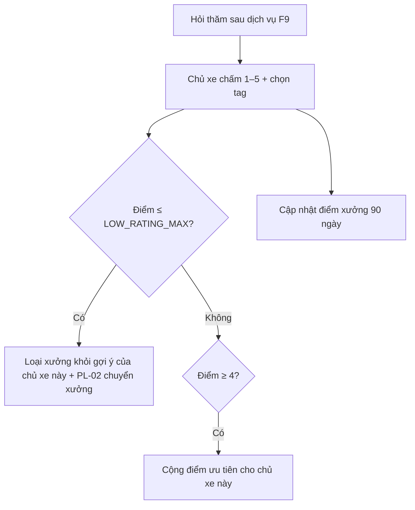

# Functional Specification — Cá nhân hoá theo phản hồi dịch vụ

> Đặc tả nghiệp vụ cho **PS-02** trong [PRD Phase 2](../../../product/PRD_EV_Care_Phase2.md).
>
> **Quan hệ tài liệu:** dựa trên hỏi thăm sau dịch vụ F9 ([us-041](../../sprint-4/feature-functional/us-041-sprint-4-spec.ff.md)): `follow_up.rating` 1–5, `has_issue`, mỗi booking tối đa một follow-up (BR-006). Phiếu hỗ trợ đã bỏ ở PRD MVP v3.7 và **không** được đưa lại; đánh giá thấp được chuyển cho xưởng qua [PL-02](pl-02-phase2-spec.ff.md).
>
> Quy ước: [README Phase 2](../README.md).

---

# 1. Document Information

| Field | Value |
|---|---|
| Feature ID | `FEAT-P2-PS02` |
| Feature Name | Cá nhân hoá theo phản hồi dịch vụ |
| PRD Feature | PS-02 (P2-B, Should, Chức năng) |
| Document Version / Status | `v0.1` / `Draft` |
| Created / Updated | `2026-10-09` |

---

# 2. Feature Overview

## 2.1 Feature Description

Thêm **tag đánh giá nhanh** vào hỏi thăm sau dịch vụ. Dùng điểm và tag theo hai cách:
- **Cho từng chủ xe:** không gợi ý lại xưởng họ không hài lòng; ưu tiên xưởng họ hài lòng.
- **Cho toàn hệ thống:** điểm xưởng là một yếu tố xếp hạng; tổng hợp tag gửi cho chủ xưởng hằng tuần.

## 2.2 Business Objective

Gợi ý phản ánh đúng trải nghiệm thật (PP2-08). Xưởng có phản hồi để cải thiện.

## 2.3 User Objective

Không bị gợi ý lại xưởng mình đã không hài lòng.

## 2.4 Business Value

Tăng lòng tin vào đề xuất; tạo động lực chất lượng cho xưởng.

---

# 3. Scope

## 3.1 In Scope

- Tag đánh giá nhanh (chọn nhiều).
- Quy tắc loại hoặc ưu tiên xưởng theo từng chủ xe.
- Điểm xưởng 90 ngày, ngưỡng `MIN_REVIEWS`.
- Báo cáo tag hằng tuần cho chủ xưởng.

## 3.2 Out of Scope

- Đánh giá công khai dạng bài viết.
- Xưởng trả lời đánh giá.

---

# 4. Actors

| Actor | Type | Responsibility |
|---|---|---|
| Chủ xe | User | Chấm điểm, chọn tag |
| Chủ xưởng | User | Nhận báo cáo |
| Bộ lập lịch | System | Dùng điểm trong xếp hạng |

---

# 5. User Story

- `US-P2-PS02-01`: As a chủ xe, I want không bị gợi ý lại xưởng tôi chấm thấp, so that tôi không phải từ chối mỗi lần.
- `US-P2-PS02-02`: As a chủ xưởng, I want biết khách phàn nàn điều gì, so that tôi cải thiện.

---

# 6. Use Case

| UC | Tên | Trigger | Postcondition |
|---|---|---|---|
| `UC-PS02-01` | Đánh giá có tag | Hỏi thăm F9 | `follow_up.rating` + tag |
| `UC-PS02-02` | Áp vào gợi ý cá nhân | Đánh giá ghi nhận | Xưởng bị loại / được ưu tiên cho chủ xe này |
| `UC-PS02-03` | Báo cáo tuần | Job tuần | Chủ xưởng nhận tổng hợp |

---

# 7. User Flow

---

# 8. Screen / UI Flow

| Screen ID | Name | Purpose |
|---|---|---|
| `SCR-PS02-01` | Hỏi thăm (mở rộng us-041) | 5 sao + chip tag: Đúng giờ, Giá đúng báo giá, Chất lượng tốt, Thái độ tốt, Sạch sẽ (khi ≥ 4 sao); Chờ lâu, Giá cao hơn báo giá, Làm chưa kỹ, Thái độ chưa tốt (khi ≤ 3 sao) |
| `SCR-PS02-02` | Báo cáo tuần (Workshop Portal) | Điểm trung bình, phân bố, top tag tích cực / cần cải thiện |
| `SCR-PS02-03` | Xưởng đã ẩn (Cài đặt chủ xe) | Danh sách xưởng không gợi ý, nút "Gợi ý lại" |

---

# 9. Main Flow

1. Sau khi hoàn tất, chủ xe chấm 2 sao, chọn "Chờ lâu" và "Giá cao hơn báo giá".
2. Xưởng X bị loại khỏi gợi ý của chủ xe này. PL-02 gắn nhãn "cần liên hệ khách" cho xưởng X.
3. Lần đặt sau, BK-01 không đề xuất xưởng X.

---

# 10. Alternative Flow

- **AF-PS02-01:** Chủ xe chọn lại xưởng X thủ công → cho phép; hỏi "Gợi ý lại xưởng này từ nay?".

---

# 11. Exception Flow

| ID | Condition | Behavior |
|---|---|---|
| `EF-PS02-01` | Xưởng có < `MIN_REVIEWS` đánh giá | Không dùng điểm xưởng trong xếp hạng chung; hiển thị "Chưa đủ đánh giá" |
| `EF-PS02-02` | Xưởng yêu thích bị chấm thấp | Bỏ khỏi xưởng yêu thích, hỏi chủ xe xác nhận |

---

# 12. Business Rules

- **BR-PS02-01 (PRD):** Tag đánh giá nhanh, chọn nhiều. **Medium.**
- **BR-PS02-02 (PRD):** Điểm ≤ `LOW_RATING_MAX` thì loại xưởng khỏi gợi ý của chủ xe đó (BK-01 BR-BK01-13); ≥ 4 thì cộng điểm khớp. **High.**
- **BR-PS02-03 (PRD):** Điểm xưởng = trung bình 90 ngày, chỉ dùng khi ≥ `MIN_REVIEWS`; gửi tổng hợp tag hằng tuần. **Medium.**
- **BR-PS02-04 (PRD):** Chỉ booking `completed` được đánh giá, mỗi booking một lần (giữ BR-006). **High.**
- **BR-PS02-05:** Báo cáo cho chủ xưởng không hiện danh tính khách. **High.**

---

# 13. State / Status

Không áp dụng (dùng `follow_up` hiện có).

# 14. Data Requirements

| Entity | Purpose | R/W |
|---|---|---|
| `follow_up.rating` | Điểm | R |
| `review_tag` (mới) | Tag gắn `follow_up` | R/W |
| `owner_hidden_workshop` (mới) | Xưởng bị loại theo chủ xe | R/W |

# 15. Business Error & Edge Cases

| Case ID | Scenario | Expected Behavior |
|---|---|---|
| `EDGE-PS02-01` | Mọi xưởng trong bán kính đều bị loại | BK-01 báo và hỏi chủ xe có muốn gợi ý lại không |
| `EDGE-PS02-02` | Đánh giá sửa lại trong 24 giờ | Cho sửa một lần; áp quy tắc theo điểm mới |

# 16. Permissions & Access

Chủ xe quản lý xưởng đã ẩn của mình. Chủ xưởng chỉ thấy tổng hợp ẩn danh.

# 17. Acceptance Criteria

- **AC-PS02-01:** Sau khi chấm 1 sao một xưởng, lần đặt sau của chủ xe đó không có xưởng này trong phương án.
- **AC-PS02-02:** Xưởng < `MIN_REVIEWS` đánh giá không bị ảnh hưởng bởi điểm trong xếp hạng chung.
- **AC-PS02-03:** Báo cáo tuần không chứa tên, SĐT, biển số khách.

# 18. Non-functional Expectations

Quy tắc áp dụng ngay sau khi đánh giá được ghi.

# 19. Dependencies

F9 (us-041), BK-01, PL-02.

# 20. Assumptions

Đủ tỉ lệ khách phản hồi hỏi thăm.

# 21. Business Constraints

Không công khai đánh giá từng khách.

# 22. Terminology

| Term | Vietnamese |
|---|---|
| Review tag | Tag đánh giá |
| Hidden workshop | Xưởng đã ẩn |

# 23. Partner Notes

—

# 24. Open Questions

| ID | Question | Proposal |
|---|---|---|
| `Q-PS02-01` | Danh sách tag chuẩn? | Như SCR-PS02-01 |
| `Q-PS02-02` | `MIN_REVIEWS`? | 5 |

# 25. Traceability

PRD Phase 2 PS-02, PP2-08 · BR-PS02-01…05 · AC-PS02-01…03 · us-041.

# 26. Related Documents

[PRD Phase 2](../../../product/PRD_EV_Care_Phase2.md) · [PL-02](pl-02-phase2-spec.ff.md) · [BK-01](bk-01-phase2-spec.ff.md)

# 27. Change Log

| Version | Date | Change |
|---|---|---|
| `v0.1` | `2026-10-09` | Bản nháp đầu |

# 28. Approval

| Role | Status |
|---|---|
| Product Owner | Pending |
| Technical Owner | Pending |
