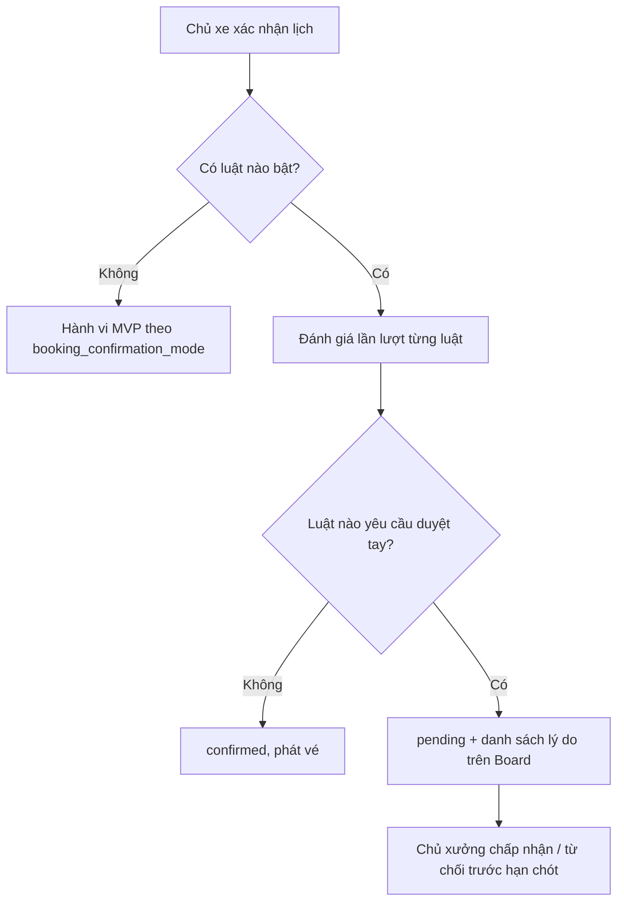

# Functional Specification — Tự nhận lịch hẹn có điều kiện

> Đặc tả nghiệp vụ cho **WS-01** trong [PRD Phase 2](../../../product/PRD_EV_Care_Phase2.md).
>
> **Quan hệ tài liệu:** thay công tắc `workshop.booking_confirmation_mode` (`auto` / `manual`) của [us-029](../../sprint-3/feature-functional/us-029-sprint-3-spec.ff.md) (BR-014, BR-015) bằng bộ luật. Hiển thị trên Workshop Board ([us-037](../../sprint-3/feature-functional/us-037-sprint-3-spec.ff.md)). Bậc tin cậy của khách theo [BK-02](bk-02-phase2-spec.ff.md). Hạn chót duyệt tay (12 giờ) giữ nguyên, cải tiến ở [WS-02](ws-02-phase2-spec.ff.md).
>
> Quy ước: [README Phase 2](../README.md).

---

# 1. Document Information

| Field | Value |
|---|---|
| Feature ID | `FEAT-P2-WS01` |
| Feature Name | Tự nhận lịch hẹn có điều kiện |
| PRD Feature | WS-01 (P2-A, Must, Cải tiến MVP) |
| Document Version / Status | `v0.1` / `Draft` |
| Created / Updated | `2026-10-09` |

---

# 2. Feature Overview

## 2.1 Feature Description

Chủ xưởng đặt **bộ luật tự nhận** một lần. Mỗi lịch mới chủ xe xác nhận được đánh giá qua bộ luật:
- **Thoả mọi luật** thì tự chuyển `confirmed`.
- **Chạm một luật duyệt tay** thì chờ chủ xưởng, kèm **lý do** hiện trên Workshop Board.

Không bật luật nào thì hành vi giữ như chế độ MVP, để tương thích ngược.

## 2.2 Business Objective

Chủ xưởng chỉ duyệt ngoại lệ (PP2-09, G2-4).

## 2.3 User Objective

- Chủ xưởng: không phải bấm duyệt từng lịch.
- Chủ xe: nhận vé ngay trong đa số trường hợp.

## 2.4 Business Value

M-06 ≤ 20% lịch phải duyệt tay.

---

# 3. Scope

## 3.1 In Scope

- Năm luật có sẵn (mục 12), bật/tắt và tham số.
- Đánh giá luật khi chủ xe xác nhận.
- Lý do duyệt tay trên Board.
- Màn cấu hình luật.

## 3.2 Out of Scope

- Luật do xưởng tự viết biểu thức.
- Luật theo doanh thu.

---

# 4. Actors

| Actor | Type | Responsibility |
|---|---|---|
| Chủ xưởng | User | Cấu hình luật, duyệt ngoại lệ |
| Bộ đánh giá luật | System | Quyết định tự nhận / duyệt tay |
| Chủ xe | User | Xác nhận lịch |

---

# 5. User Story

- `US-P2-WS01-01`: As a chủ xưởng, I want lịch bình thường tự được nhận, so that tôi chỉ xem những lịch đặc biệt.
- `US-P2-WS01-02`: As a chủ xưởng, I want biết vì sao một lịch cần tôi duyệt, so that tôi quyết định nhanh.

---

# 6. Use Case

| UC | Tên | Trigger | Postcondition |
|---|---|---|---|
| `UC-WS01-01` | Cấu hình luật | Chủ xưởng mở Luật nhận lịch | Bộ luật lưu, áp cho lịch mới |
| `UC-WS01-02` | Đánh giá lịch | Chủ xe bấm Xác nhận | `confirmed` hoặc `pending` + lý do |
| `UC-WS01-03` | Duyệt ngoại lệ | Chủ xưởng chấp nhận / từ chối | Như MVP |

---

# 7. User Flow

---

# 8. Screen / UI Flow

| Screen ID | Name | Purpose |
|---|---|---|
| `SCR-WS01-01` | Luật nhận lịch (Workshop Portal) | Danh sách 5 luật, công tắc, tham số, mô tả một câu; xem trước "tuần trước sẽ có X% phải duyệt tay" |
| `SCR-WS01-02` | Nhãn lý do trên Board | Chip lý do trên mỗi lịch `pending` |

---

# 9. Main Flow

1. Xưởng bật "Còn chỗ (N = 1)" và "Khách tin cậy thấp".
2. Chủ xe A (bậc Bình thường) xác nhận 08:00. Còn 3 chỗ trong ngày nên lịch tự `confirmed`.
3. Chủ xe B (bậc Giới hạn) xác nhận 09:30. Lịch chờ duyệt, Board ghi "Khách lỡ hẹn nhiều lần (90 ngày)".

---

# 10. Alternative Flow

- **AF-WS01-01:** Chủ xưởng đổi luật → chỉ áp cho lịch mới; lịch đang chờ giữ nguyên.

# 11. Exception Flow

| ID | Condition | Behavior |
|---|---|---|
| `EF-WS01-01` | Bộ đánh giá lỗi | Chuyển duyệt tay với lý do "Cần xem lại" (an toàn hơn tự nhận) |
| `EF-WS01-02` | Lịch duyệt tay quá hạn chót | WS-02 BR-WS02-04 |

---

# 12. Business Rules

## BR-WS01-01 — Danh mục luật (PRD)

| Mã luật | Luật | Ý nghĩa | Mặc định |
|---|---|---|---|
| `R-CAPACITY` | Còn chỗ | Còn ≥ N chỗ trống trong ngày (sau lịch này) thì tự nhận | Bật, N = 1 |
| `R-RELIABILITY` | Khách tin cậy thấp | Chủ xe ở bậc Giới hạn (BK-02) thì duyệt tay | Bật |
| `R-PARTS` | Phụ tùng đặc biệt | Phụ tùng "Chưa rõ" hoặc "Về trong N ngày" thì duyệt tay | Bật khi có BK-09 |
| `R-SLOT` | Khung chỉ duyệt tay | Khung xưởng chọn thì duyệt tay | Không có khung |
| `R-EXTRA` | Có báo giá kèm lớn | Lịch kèm báo giá > X ₫ thì duyệt tay | Tắt |

**Priority:** High.

## BR-WS01-02 — Một luật là đủ (PRD)
Chỉ cần một luật yêu cầu duyệt tay là chuyển duyệt tay; liệt kê **mọi** lý do. **High.**

## BR-WS01-03 — Tương thích ngược (PRD)
Không bật luật nào thì giữ `booking_confirmation_mode` của MVP. **High.**

## BR-WS01-04 — Áp cho lịch mới (PRD). **Medium.**

## BR-WS01-05 — Lịch giữ chủ động
Luật chỉ đánh giá khi chủ xe đã xác nhận, không đánh giá lúc giữ chủ động (BK-01 BR-BK01-06). **High.**

## BR-WS01-06 — Lỗi thì an toàn
Không đánh giá được thì duyệt tay. **High.**

---

# 13. State / Status

Không thêm trạng thái. Thêm thuộc tính `manual_review_reasons` trên lịch `pending`.

# 14. Data Requirements

| Entity | Purpose | R/W |
|---|---|---|
| `workshop_booking_rule` (mới) | Mã luật, bật/tắt, tham số | R/W |
| `booking.manual_review_reasons` (mới) | Lý do | W |
| Bậc tin cậy (BK-02), trạng thái phụ tùng (BK-09), sức chứa | Đầu vào | R |

# 15. Business Error & Edge Cases

| Case ID | Scenario | Expected Behavior |
|---|---|---|
| `EDGE-WS01-01` | Lịch cuối cùng trong ngày với `R-CAPACITY` N = 1 | Sau lịch này còn 0 chỗ → chưa thoả "≥ 1" → duyệt tay. Ghi rõ trong mô tả luật |
| `EDGE-WS01-02` | Xưởng ở chế độ MVP `manual` nhưng bật luật | Luật được ưu tiên; `booking_confirmation_mode` bị bỏ qua khi có luật |

# 16. Permissions & Access

Chỉ chủ xưởng cấu hình luật xưởng mình. KTV không cấu hình.

# 17. Acceptance Criteria

- **AC-WS01-01:** Mỗi lịch chuyển duyệt tay có ít nhất một lý do hiển thị.
- **AC-WS01-02:** Tắt hết luật thì hành vi trùng MVP (chạy lại bộ test us-029 BR-014/015).
- **AC-WS01-03:** Tỉ lệ lịch phải duyệt tay được đo theo xưởng (M-06).

# 18. Non-functional Expectations

Đánh giá luật ≤ 100 ms; nằm trong cùng giao dịch xác nhận.

# 19. Dependencies

us-029, us-037, BK-02, BK-09, WS-02.

# 20. Assumptions

Xưởng chấp nhận luật thay vì duyệt từng lịch.

# 21. Business Constraints

Không vượt sức chứa trong mọi trường hợp.

# 22. Terminology

| Term | Vietnamese |
|---|---|
| Auto-accept rule | Luật tự nhận |
| Manual review reason | Lý do duyệt tay |

# 23. Partner Notes

Xác nhận với chủ xưởng thử nghiệm bộ luật mặc định.

# 24. Open Questions

| ID | Question | Proposal |
|---|---|---|
| `Q-WS01-01` | `R-CAPACITY` tính theo chỗ trong ngày hay trong khung? | Trong ngày |
| `Q-WS01-02` | Có cho xưởng thấy "xem trước tỉ lệ duyệt tay" không? | Có |

# 25. Traceability

PRD Phase 2 WS-01, PP2-09, G2-4, M-06 · BR-WS01-01…06 · AC-WS01-01…03 · us-029 BR-014/015.

# 26. Related Documents

[PRD Phase 2](../../../product/PRD_EV_Care_Phase2.md) · [BK-02](bk-02-phase2-spec.ff.md) · [WS-02](ws-02-phase2-spec.ff.md)

# 27. Change Log

| Version | Date | Change |
|---|---|---|
| `v0.1` | `2026-10-09` | Bản nháp đầu |

# 28. Approval

| Role | Status |
|---|---|
| Product Owner | Pending |
| Technical Owner | Pending |
