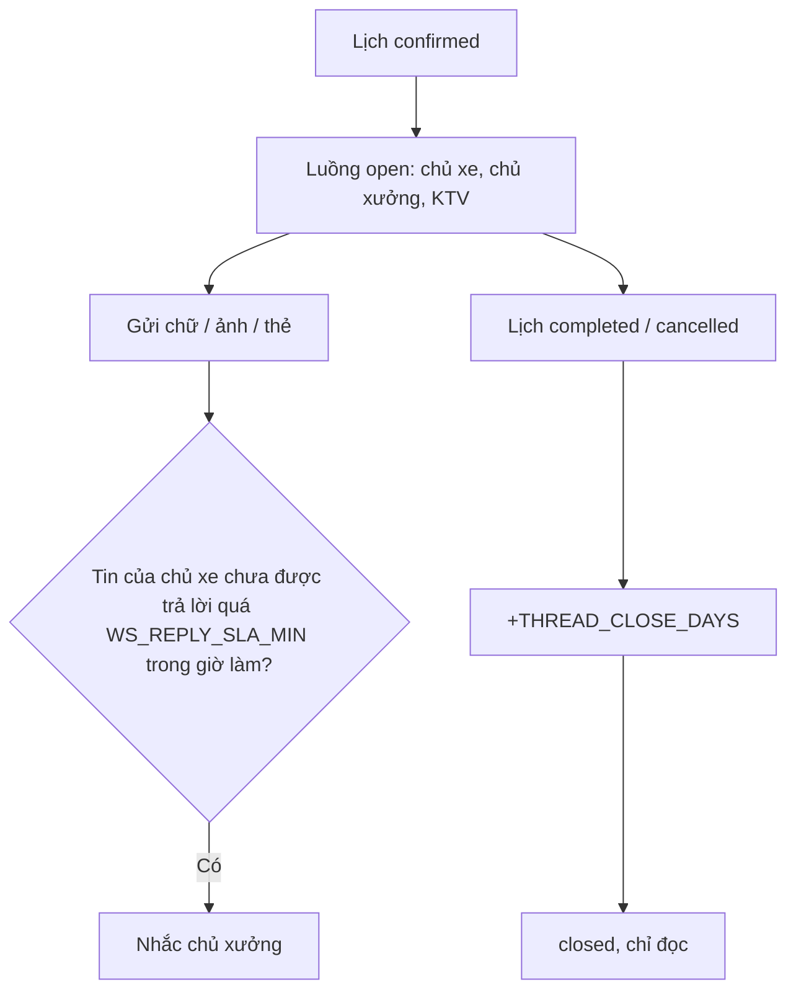

# Functional Specification — Chat theo từng lịch hẹn giữa xưởng và chủ xe

> Đặc tả nghiệp vụ cho **MC-01** trong [PRD Phase 2](../../../product/PRD_EV_Care_Phase2.md).
>
> **Quan hệ tài liệu:** lưu trữ hội thoại theo PRD MVP F4 (PQ-09). Nơi lưu và cơ chế realtime cho chat người–người (PRD MVP §9.1 ADR-01, P2Q-12): **PO chốt 2026-10-12 giữ nguyên công nghệ chat MVP** — Postgres (Supabase) + Redis pub/sub + WebSocket. ADR-02 chỉ ghi lại quyết định này. Cần tài khoản KTV ([WS-03](../workshop-operations/ws-03-phase2-spec.ff.md)).
>
> Quy ước: [README Phase 2](../README.md).
>
> **Đặc tả kỹ thuật:** [API Spec](mc-01-phase2-spec.api.md) · [Entity Spec](mc-01-phase2-spec.entity.md) · [Frontend Spec](mc-01-phase2-spec.fe.md)

---

# 1. Document Information

| Field | Value |
|---|---|
| Feature ID | `FEAT-P2-MC01` |
| Feature Name | Chat theo từng lịch hẹn giữa xưởng và chủ xe |
| PRD Feature | MC-01 (P2-C, Could, Chức năng) |
| Document Version / Status | `v0.3` / `Draft` |
| Created / Updated | `2026-10-09` / `2026-10-12` |
| Related Technical Spec | [API Spec](mc-01-phase2-spec.api.md) · [Entity Spec](mc-01-phase2-spec.entity.md) · [Frontend Spec](mc-01-phase2-spec.fe.md) |

---

# 2. Feature Overview

## 2.1 Feature Description

Mỗi lịch hẹn có một **luồng chat** giữa chủ xe, chủ xưởng và KTV được giao.
- Luồng mở khi lịch `confirmed` và đóng sau `THREAD_CLOSE_DAYS` ngày kể từ khi lịch kết thúc.
- Hỗ trợ chữ, ảnh và thẻ (báo giá phát sinh, cập nhật tiến độ).
- Không bên nào thấy số điện thoại hay email cá nhân của bên kia.
- Mọi tin nhắn được lưu để giải quyết tranh chấp.

## 2.2 Business Objective

Thay trao đổi qua điện thoại và Zalo cá nhân bằng kênh có lưu vết (PP2-13).

## 2.3 User Objective

Hỏi xưởng, nhận ảnh, nhận cập nhật ở một chỗ.

## 2.4 Business Value

Giảm tranh chấp; giữ khách trong hệ sinh thái EV Care.

---

# 3. Scope

## 3.1 In Scope

- Tạo luồng theo lịch; mở/đóng theo vòng đời lịch.
- Tin nhắn chữ, ảnh, thẻ.
- Thông báo tin mới (trong app).
- Cam kết thời gian phản hồi của xưởng, nhắc khi quá hạn.
- Lưu và xem lại.

## 3.2 Out of Scope

- Gọi thoại/video.
- Chat không gắn lịch hẹn.
- Kênh ngoài (Zalo, SMS) — thuộc NOTI-01.

---

# 4. Actors

| Actor | Type | Responsibility |
|---|---|---|
| Chủ xe | User | Nhắn tin |
| Chủ xưởng | User | Trả lời, giám sát |
| KTV được giao | User | Trả lời, gửi ảnh |
| Agent (MC-02) | System | Tham gia khi bật |

---

# 5. User Story

- `US-P2-MC01-01`: As a chủ xe, I want nhắn xưởng về lịch hẹn của tôi trong app, so that tôi không phải gọi điện.
- `US-P2-MC01-02`: As a KTV, I want gửi ảnh cho khách, so that khách hiểu tình trạng xe.
- `US-P2-MC01-03`: As a chủ xưởng, I want mọi trao đổi được lưu, so that có bằng chứng khi tranh chấp.

---

# 6. Use Case

| UC | Tên | Trigger | Postcondition |
|---|---|---|---|
| `UC-MC01-01` | Mở luồng | Lịch `confirmed` | Luồng `open` |
| `UC-MC01-02` | Gửi tin | Một bên gửi | Tin lưu, bên kia được thông báo |
| `UC-MC01-03` | Nhắc phản hồi | Quá `WS_REPLY_SLA_MIN` trong giờ làm | Nhắc chủ xưởng |
| `UC-MC01-04` | Đóng luồng | `THREAD_CLOSE_DAYS` sau khi lịch kết thúc | Luồng `closed` (chỉ đọc) |

---

# 7. User Flow

# 8. Screen / UI Flow

| Screen ID | Name | Purpose |
|---|---|---|
| `SCR-MC01-01` | Tin nhắn với xưởng (chủ xe) | Mở từ vé lịch hẹn; tên hiển thị "Xưởng Cầu Giấy · KTV An" |
| `SCR-MC01-02` | Tin nhắn khách (Workshop Portal) | Danh sách luồng theo lịch, nhãn chưa đọc, nhãn quá hạn phản hồi |

# 9. Main Flow

1. Lịch xác nhận, luồng mở.
2. Chủ xe hỏi "Tôi để xe từ 7h45 được không?".
3. Chủ xưởng trả lời trong 10 phút.
4. Khi xe đang làm, KTV gửi ảnh má phanh mòn kèm thẻ báo giá phát sinh (AD-04).

# 10. Alternative Flow

- **AF-MC01-01:** Lịch đổi giờ → luồng giữ nguyên; tin hệ thống "Lịch đã đổi sang …".
- **AF-MC01-02:** Đổi xưởng (BK-01 AF-06) → luồng cũ đóng, luồng mới mở ở xưởng mới.

# 11. Exception Flow

| ID | Condition | Behavior |
|---|---|---|
| `EF-MC01-01` | Tin chứa SĐT / email | Che tự động, nhắc dùng chat trong app |
| `EF-MC01-02` | Nội dung xúc phạm | Cho báo cáo; chủ xưởng / vận hành xử lý |

---

# 12. Business Rules

- **BR-MC01-01 (PRD):** Mỗi lịch một luồng; mở khi `confirmed`, đóng sau `THREAD_CLOSE_DAYS` kể từ `completed`/`cancelled`; đã đóng thì chỉ đọc. **High.**
- **BR-MC01-02 (PRD):** Người tham gia: chủ xe, chủ xưởng, KTV được giao; không hiển thị SĐT/email cá nhân. **High.**
- **BR-MC01-03 (PRD):** Hỗ trợ chữ, ảnh, thẻ. **Medium.**
- **BR-MC01-04 (PRD):** Cam kết `WS_REPLY_SLA_MIN` trong giờ làm; quá hạn thì nhắc. **Medium.**
- **BR-MC01-05 (PRD):** Lưu toàn bộ theo PQ-09. **High.**
- **BR-MC01-06 (PRD):** Chốt ADR-02 trước khi làm. **High.** — Đã chốt 2026-10-12: giữ công nghệ chat MVP.
- **BR-MC01-07:** Tin nhắn được che SĐT/email bằng bộ lọc trước khi lưu và gửi. **High.**

# 13. State / Status

Luồng: `open` → `closed`.

# 14. Data Requirements

| Entity | Purpose |
|---|---|
| `booking_thread` (mới) | Lịch, trạng thái, người tham gia |
| `booking_thread_message` (mới) | Người gửi, loại, nội dung, ảnh, thời điểm, đã đọc |

# 15. Business Error & Edge Cases

| Case ID | Scenario | Expected Behavior |
|---|---|---|
| `EDGE-MC01-01` | KTV đổi phân công | KTV mới vào luồng, KTV cũ mất quyền gửi |

# 16. Permissions & Access

Chỉ người tham gia đọc luồng. Vận hành truy cập chỉ khi có tranh chấp được báo cáo (log truy cập).

# 17. Acceptance Criteria

- **AC-MC01-01:** Không có SĐT hoặc email cá nhân trong payload gửi cho phía bên kia.
- **AC-MC01-02:** Luồng đóng không cho gửi tin.
- **AC-MC01-03:** Tin nhắn tới bên kia ≤ 2 s (p90) khi cả hai đang mở.

# 18. Non-functional Expectations

Theo ADR-02 (realtime, offline).

# 19. Dependencies

WS-03, ADR-02 (P2Q-12), AD-04, lưu trữ ảnh Phase 2.

# 20. Assumptions

Khách và xưởng chấp nhận chuyển trao đổi vào app.

# 21. Business Constraints

Không lộ thông tin liên hệ cá nhân.

# 22. Terminology

| Term | Vietnamese |
|---|---|
| Booking thread | Luồng chat theo lịch hẹn |

# 23. Partner Notes

Liên quan kế hoạch "chat nhiều bên" trong roadmap.

# 24. Open Questions

| ID | Question | Proposal |
|---|---|---|
| `Q-MC01-01` | ADR-02 realtime: Supabase Realtime hay Firestore? | **Đã chốt 2026-10-12:** giữ Postgres + Redis pub/sub + WebSocket như MVP |
| `Q-MC01-02` | `WS_REPLY_SLA_MIN`? | 60 phút trong giờ làm |

# 25. Traceability

PRD Phase 2 MC-01, PP2-13 · BR-MC01-01…07 · AC-MC01-01…03.

# 26. Related Documents

[PRD Phase 2](../../../product/PRD_EV_Care_Phase2.md) · [MC-02](mc-02-phase2-spec.ff.md) · [PRD MVP §9.1](../../../product/PRD_EV_Care_MVP.md#91-quyết-định-nơi-lưu-tin-nhắn-chat-adr-01) · [API Spec](mc-01-phase2-spec.api.md) · [Entity Spec](mc-01-phase2-spec.entity.md) · [Frontend Spec](mc-01-phase2-spec.fe.md)

# 27. Change Log

| Version | Date | Change |
|---|---|---|
| `v0.1` | `2026-10-09` | Bản nháp đầu |
| `v0.2` | `2026-10-12` | Liên kết đặc tả API, Entity, Frontend |
| `v0.3` | `2026-10-12` | PO chốt: chat người–người giữ nguyên công nghệ chat MVP (P2Q-12 / ADR-02) |

# 28. Approval

| Role | Status |
|---|---|
| Product Owner | Pending |
| Technical Owner | Pending |
