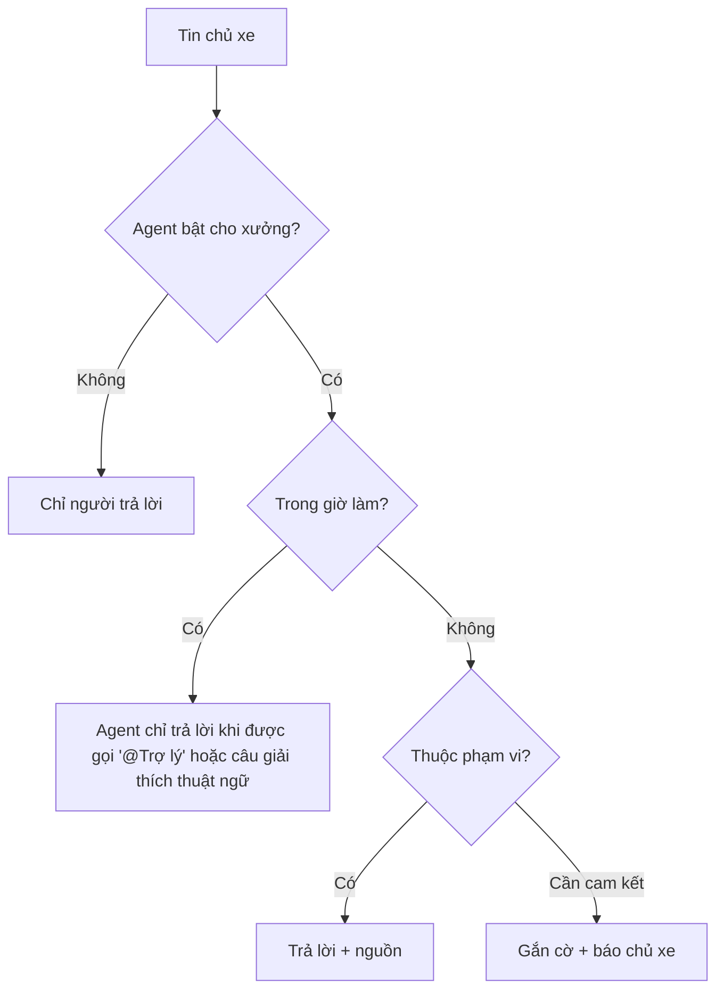

# Functional Specification — Agent cùng tham gia luồng chat

> Đặc tả nghiệp vụ cho **MC-02** trong [PRD Phase 2](../../../product/PRD_EV_Care_Phase2.md).
>
> **Quan hệ tài liệu:** agent tham gia luồng [MC-01](mc-01-phase2-spec.ff.md), chỉ trả lời trong phạm vi tư vấn ([AD-01…03](../advisory-and-quotes/ad-01-phase2-spec.ff.md)) và lịch sử ([HS-01](../service-history/hs-01-phase2-spec.ff.md)). Nguyên tắc AI của PRD MVP §7 và PRD Phase 2 §9 áp dụng.
>
> Quy ước: [README Phase 2](../README.md).
>
> **Đặc tả kỹ thuật:** [API Spec](mc-02-phase2-spec.api.md) · [Entity Spec](mc-02-phase2-spec.entity.md) · [Frontend Spec](mc-02-phase2-spec.fe.md)

---

# 1. Document Information

| Field | Value |
|---|---|
| Feature ID | `FEAT-P2-MC02` |
| Feature Name | Agent cùng tham gia luồng chat |
| PRD Feature | MC-02 (P2-C, Could, Chức năng) |
| Document Version / Status | `v0.2` / `Draft` |
| Created / Updated | `2026-10-09` / `2026-10-12` |
| Related Technical Spec | [API Spec](mc-02-phase2-spec.api.md) · [Entity Spec](mc-02-phase2-spec.entity.md) · [Frontend Spec](mc-02-phase2-spec.fe.md) |

---

# 2. Feature Overview

## 2.1 Feature Description

Trong luồng chat theo lịch hẹn, agent **"Trợ lý EV Care"** làm bốn việc:
- trả lời ngoài giờ các câu thuộc phạm vi giá, bảo hành, lịch sử, thông tin lịch hẹn;
- giải thích thuật ngữ cho chủ xe;
- tóm tắt luồng chat cho xưởng khi được hỏi;
- **gắn cờ** cho người của xưởng khi câu hỏi cần cam kết.

Agent không hứa thay xưởng về giá, thời gian hay bảo hành.

## 2.2 Business Objective

Khách nhắn ngoài giờ vẫn được trả lời; xưởng bớt giải thích lặp lại (PP2-13).

## 2.3 User Objective

Có câu trả lời ngay, biết khi nào cần chờ xưởng.

## 2.4 Business Value

Giảm thời gian phản hồi; giảm tải cho xưởng.

---

# 3. Scope

## 3.1 In Scope

- Agent là người tham gia có nhãn rõ ràng.
- Trả lời trong phạm vi; gắn cờ ngoài phạm vi.
- Giải thích thuật ngữ trong tin nhắn của xưởng khi chủ xe hỏi.
- Tóm tắt luồng cho xưởng.
- Xưởng bật/tắt agent cho xưởng mình.

## 3.2 Out of Scope

- Agent đặt, huỷ, đổi lịch trong luồng (dùng chat chủ xe / CH-01).
- Agent duyệt báo giá.

---

# 4. Actors

| Actor | Type | Responsibility |
|---|---|---|
| Agent | System | Trả lời, gắn cờ, tóm tắt |
| Chủ xe | User | Hỏi |
| Chủ xưởng / KTV | User | Trả lời câu gắn cờ, hỏi tóm tắt |

---

# 5. User Story

- `US-P2-MC02-01`: As a chủ xe nhắn lúc 22h, I want được trả lời những câu cơ bản ngay, so that tôi không phải chờ sáng mai.
- `US-P2-MC02-02`: As a chủ xưởng, I want tóm tắt luồng chat dài, so that tôi nắm nhanh.

---

# 6. Use Case

| UC | Tên | Trigger | Postcondition |
|---|---|---|---|
| `UC-MC02-01` | Trả lời ngoài giờ | Tin chủ xe ngoài giờ làm của xưởng | Câu trả lời của agent hoặc gắn cờ |
| `UC-MC02-02` | Gắn cờ | Câu cần cam kết | Nhãn "Cần xưởng trả lời"; agent báo chủ xe xưởng sẽ trả lời trong giờ làm |
| `UC-MC02-03` | Giải thích | Chủ xe hỏi "… là gì?" | Giải thích có nguồn |
| `UC-MC02-04` | Tóm tắt | Xưởng bấm "Tóm tắt" | Tóm tắt chỉ hiện cho xưởng |

---

# 7. User Flow

# 8. Screen / UI Flow

Tin nhắn của agent có nhãn và avatar riêng "Trợ lý EV Care". Câu gắn cờ có nhãn trên Workshop Portal.

# 9. Main Flow

1. 22:10, chủ xe hỏi "Bảo dưỡng 24.000 km có thay lọc gió không?".
2. Ngoài giờ, câu hỏi thuộc phạm vi. Agent trả lời có nguồn.
3. Chủ xe hỏi tiếp "Mai xưởng giảm giá cho tôi được không?".
4. Agent gắn cờ: "Câu này xưởng sẽ trả lời trong giờ làm việc (từ 8:00)".

# 10. Alternative Flow

- **AF-MC02-01:** Trong giờ, chủ xe gọi "@Trợ lý" → agent trả lời.

# 11. Exception Flow

| ID | Condition | Behavior |
|---|---|---|
| `EF-MC02-01` | Câu an toàn | Lời khuyên an toàn + hotline (AD-02 BR-AD02-04), gắn cờ khẩn cho xưởng |

---

# 12. Business Rules

- **BR-MC02-01 (PRD):** Ngoài giờ, agent trả lời các câu thuộc AD, HS, thông tin lịch hẹn; ghi rõ "Trợ lý EV Care". **High.**
- **BR-MC02-02 (PRD):** Giải thích thuật ngữ cho chủ xe; tóm tắt cho xưởng khi được hỏi. **Medium.**
- **BR-MC02-03 (PRD):** Không hứa thay xưởng về giá, thời gian, bảo hành; câu cần cam kết thì gắn cờ. **High.**
- **BR-MC02-04:** Trong giờ làm, agent chỉ trả lời khi được gọi, để không chen vào hội thoại người–người. **Medium.**
- **BR-MC02-05:** Tóm tắt cho xưởng không hiện cho chủ xe. **Medium.**

# 13. State / Status

Tin gắn cờ: `flagged` → `answered`.

# 14. Data Requirements

Tin nhắn MC-01; cấu hình bật agent theo xưởng; giờ làm của xưởng.

# 15. Business Error & Edge Cases

| Case ID | Scenario | Expected Behavior |
|---|---|---|
| `EDGE-MC02-01` | Xưởng trả lời trước agent | Agent không trả lời câu đó |

# 16. Permissions & Access

Agent chỉ đọc luồng nó tham gia và dữ liệu của chủ xe trong lịch đó.

# 17. Acceptance Criteria

- **AC-MC02-01:** Không câu trả lời nào của agent chứa cam kết về giá, giảm giá, thời gian hoàn thành, quyết định bảo hành (eval).
- **AC-MC02-02:** Câu ngoài phạm vi được gắn cờ trong 100% ca eval.

# 18. Non-functional Expectations

Trả lời ngoài giờ ≤ 10 s.

# 19. Dependencies

MC-01, AD-01…03, HS-01.

# 20. Assumptions

Phần lớn câu hỏi ngoài giờ thuộc phạm vi agent.

# 21. Business Constraints

Agent không thay xưởng cam kết.

# 22. Terminology

| Term | Vietnamese |
|---|---|
| Flag | Gắn cờ |

# 23. Partner Notes

—

# 24. Open Questions

| ID | Question | Proposal |
|---|---|---|
| `Q-MC02-01` | Mặc định bật agent cho xưởng? | Bật, xưởng tắt được |

# 25. Traceability

PRD Phase 2 MC-02, PP2-13 · BR-MC02-01…05 · AC-MC02-01…02.

# 26. Related Documents

[PRD Phase 2](../../../product/PRD_EV_Care_Phase2.md) · [MC-01](mc-01-phase2-spec.ff.md) · [API Spec](mc-02-phase2-spec.api.md) · [Entity Spec](mc-02-phase2-spec.entity.md) · [Frontend Spec](mc-02-phase2-spec.fe.md)

# 27. Change Log

| Version | Date | Change |
|---|---|---|
| `v0.1` | `2026-10-09` | Bản nháp đầu |
| `v0.2` | `2026-10-12` | Liên kết đặc tả API, Entity, Frontend |

# 28. Approval

| Role | Status |
|---|---|
| Product Owner | Pending |
| Technical Owner | Pending |
