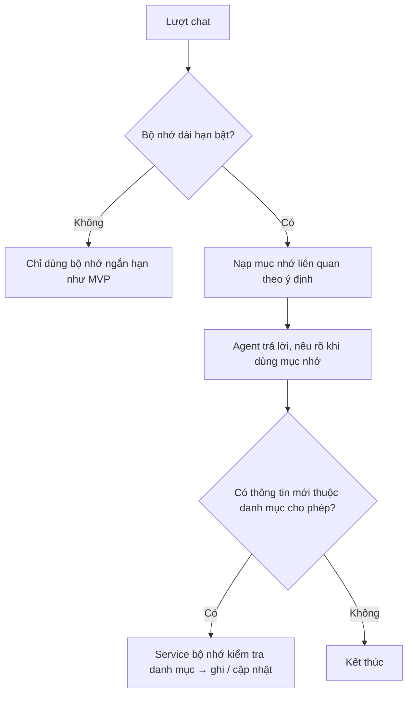

# Functional Specification — Bộ nhớ ngắn hạn và dài hạn của agent

> Đặc tả nghiệp vụ cho **PS-01** trong [PRD Phase 2](../../../product/PRD_EV_Care_Phase2.md).
>
> **Quan hệ tài liệu:** mở rộng [AI-004 §13 Memory](../../ai-agent/ai-004-sprint-3-spec.agent.md) (bộ nhớ hội thoại qua LangGraph checkpoint, xưởng ưa thích). Lưu trữ hội thoại theo PRD MVP F4 (PQ-09). Bộ nhớ dài hạn chỉ hoạt động khi chủ xe đồng ý ([PL-01](../platform/pl-01-phase2-spec.ff.md)).
>
> Quy ước: [README Phase 2](../README.md).
>
> **Đặc tả kỹ thuật:** [API Spec](ps-01-phase2-spec.api.md) · [Entity Spec](ps-01-phase2-spec.entity.md) · [Frontend Spec](ps-01-phase2-spec.fe.md)

---

# 1. Document Information

| Field | Value |
|---|---|
| Feature ID | `FEAT-P2-PS01` |
| Feature Name | Bộ nhớ ngắn hạn và dài hạn của agent |
| PRD Feature | PS-01 (P2-A, Should, Cải tiến MVP) |
| Document Version / Status | `v0.3` / `Draft` |
| Created / Updated | `2026-10-09` / `2026-10-12` |
| Related Technical Spec | [API Spec](ps-01-phase2-spec.api.md) · [Entity Spec](ps-01-phase2-spec.entity.md) · [Frontend Spec](ps-01-phase2-spec.fe.md) |

---

# 2. Feature Overview

## 2.1 Feature Description

Agent có hai loại bộ nhớ:
- **Ngắn hạn**, trong một hội thoại: xe đang nhắc tới, thông tin đặt lịch đang hỏi dở, ý định hiện tại. Đây là checkpoint hiện có.
- **Dài hạn**, theo tài khoản: xưởng hay đến, giờ hay chọn, cách xưng hô, vấn đề xe từng gặp, phản hồi dịch vụ, thói quen huỷ.

Agent nói rõ khi dùng bộ nhớ. Chủ xe xem, sửa, xoá được trên màn **"Agent đang nhớ gì về tôi"**.

## 2.2 Business Objective

Không hỏi lại điều đã biết; cá nhân hoá có kiểm soát (PP2-02, PP2-08, G2-7).

## 2.3 User Objective

Agent "nhớ mình", nhưng mình luôn biết và quyết định agent nhớ gì.

## 2.4 Business Value

Rút ngắn luồng đặt lịch (M-01, M-02); nguồn ràng buộc mềm cho BK-01.

---

# 3. Scope

## 3.1 In Scope

- Danh mục loại mục nhớ cho phép.
- Ghi mục nhớ từ: chủ xe nói, hành vi (suy ra), phản hồi.
- Dùng mục nhớ trong câu trả lời và trong BK-01.
- Màn quản lý bộ nhớ: xem, sửa, xoá từng mục, xoá hết, tắt.
- Hạn mục nhớ, làm mới khi dùng.

## 3.2 Out of Scope

- Lưu nội dung nhạy cảm (CCCD, VIN đầy đủ, sức khoẻ, tài chính, suy đoán tính cách).
- Chia sẻ bộ nhớ giữa các chủ xe.

---

# 4. Actors

| Actor | Type | Responsibility |
|---|---|---|
| Chủ xe | User | Cung cấp thông tin, quản lý bộ nhớ |
| AI Agent | System | Đề xuất ghi, dùng mục nhớ |
| Service bộ nhớ | System | Lưu, kiểm tra danh mục, hạn, xoá |

---

# 5. User Story

- `US-P2-PS01-01`: As a chủ xe, I want agent nhớ xưởng và giờ tôi hay chọn, so that tôi không phải nói lại.
- `US-P2-PS01-02`: As a chủ xe, I want xem và xoá những gì agent nhớ, so that tôi kiểm soát dữ liệu của mình.
- `US-P2-PS01-03`: As a chủ xe, I want agent nói rõ khi dùng điều nó nhớ, so that tôi biết vì sao nó gợi ý vậy.

---

# 6. Use Case

| UC | Tên | Trigger | Postcondition |
|---|---|---|---|
| `UC-PS01-01` | Ghi mục nhớ từ lời chủ xe | Chủ xe nói "tôi thường rảnh sáng thứ Bảy" | Mục nhớ nguồn "chủ xe nói" |
| `UC-PS01-02` | Ghi mục nhớ suy ra | Hành vi lặp ≥ `MEMORY_INFER_MIN_REPEAT` lần | Mục nhớ nguồn "suy ra" |
| `UC-PS01-03` | Dùng mục nhớ | Agent cần thông tin | Câu trả lời có câu dẫn "Lần trước bạn…" |
| `UC-PS01-04` | Quản lý bộ nhớ | Mở màn "Agent đang nhớ gì về tôi" | Mục được sửa / xoá |
| `UC-PS01-05` | Tắt bộ nhớ dài hạn | Tắt trong PL-01 | Agent không đọc/ghi bộ nhớ dài hạn |

---

# 7. User Flow

---

# 8. Screen / UI Flow

| Screen ID | Name | Purpose |
|---|---|---|
| `SCR-PS01-01` | Agent đang nhớ gì về tôi | Nhóm theo loại; mỗi mục: nội dung, nguồn, lần dùng gần nhất, nút sửa/xoá; nút "Xoá tất cả"; công tắc bật/tắt |
| `SCR-PS01-02` | Thông báo lần đầu | Khi bộ nhớ dài hạn được bật lần đầu: giải thích ngắn + link quản lý |

---

# 9. Main Flow

1. Lần trước, chủ xe đặt 08:00 thứ Bảy ở Xưởng Cầu Giấy và nói "gọi tôi là anh Tùng".
2. Hôm nay, chủ xe bấm "Tôi muốn đặt lịch bảo dưỡng".
3. Agent: "Chào anh Tùng. Lần trước anh đặt sáng thứ Bảy ở Xưởng Cầu Giấy, đặt như vậy nhé?" kèm chip "Đúng vậy", "Chọn khác".
4. Bấm "Đúng vậy" thì chạy BK-01 với các ràng buộc này.

---

# 10. Alternative Flow

- **AF-PS01-01:** Chủ xe nói "lần này tôi muốn buổi chiều" → chỉ áp cho lần này (BK-01 BR-BK01-11). Nếu lặp ≥ 2 lần thì cập nhật mục nhớ "giờ hay chọn".
- **AF-PS01-02:** Chủ xe nói "đừng nhớ cái đó" → xoá mục vừa nhắc.

---

# 11. Exception Flow

| ID | Condition | Behavior |
|---|---|---|
| `EF-PS01-01` | Thông tin thuộc danh mục cấm | Không ghi; không thông báo nội dung |
| `EF-PS01-02` | Mục nhớ mâu thuẫn | Dùng mục mới; lưu lịch sử phiên bản |
| `EF-PS01-03` | Service bộ nhớ lỗi | Agent chạy như MVP, không chặn hội thoại |

---

# 12. Business Rules

- **BR-PS01-01 (PRD):** Chỉ lưu loại mục trong danh mục cho phép (mục 14). Cấm CCCD, VIN đầy đủ, sức khoẻ, tài chính cá nhân, suy đoán tính cách. **High.**
- **BR-PS01-02 (PRD):** Mỗi mục có nguồn: chủ xe nói / suy ra / phản hồi. Mục suy ra chỉ dùng khi lặp ≥ `MEMORY_INFER_MIN_REPEAT`. **High.**
- **BR-PS01-03 (PRD):** Mâu thuẫn thì dùng mục mới, lưu lịch sử. **Medium.**
- **BR-PS01-04 (PRD):** Agent nói rõ khi dùng bộ nhớ. **High.**
- **BR-PS01-05 (PRD):** Màn quản lý: xem, sửa, xoá từng mục, xoá hết, tắt. Tắt thì agent hoạt động như MVP. **High.**
- **BR-PS01-06 (PRD):** Chỉ hoạt động khi đã đồng ý (PL-01). **High.**
- **BR-PS01-07:** Hạn `MEMORY_TTL_DAYS`; mỗi lần dùng thì làm mới hạn. **Medium.**
- **BR-PS01-08:** Mục đã xoá bị xoá thật trong `DELETE_SLA_HOURS`, kể cả lịch sử phiên bản. **High.**
- **BR-PS01-09:** LLM đề xuất ghi; service bộ nhớ quyết định theo danh mục. LLM không ghi trực tiếp. **High.**

---

# 13. State / Status

Mục nhớ: `active` → `superseded` (bị thay) / `expired` / `deleted`.

---

# 14. Data Requirements

**Danh mục mục nhớ cho phép**

| Loại | Ví dụ | Nguồn cho phép |
|---|---|---|
| `preferred_workshop` | Xưởng Cầu Giấy | nói, suy ra |
| `preferred_time` | Sáng thứ Bảy, 08:00–10:00 | nói, suy ra |
| `location_anchor` | Nhà ở Cầu Giấy (khu vực, không địa chỉ đầy đủ) | nói |
| `addressing` | "anh Tùng" | nói |
| `vehicle_issue` | Phanh trước kêu (10/2025) | nói, phản hồi |
| `service_feedback` | Không hài lòng thời gian chờ ở xưởng X | phản hồi |
| `cancel_habit` | Hay đổi giờ sát ngày | suy ra |
| `communication_style` | Thích ngắn gọn (PS-05) | nói, suy ra |

| Entity | Purpose | R/W |
|---|---|---|
| `agent_user_memory` (có sẵn từ MVP, mở rộng — PO chốt 2026-10-12) | Loại, giá trị, nguồn, số lần xác nhận, hạn, trạng thái | R/W |
| Checkpoint LangGraph | Bộ nhớ ngắn hạn | R/W (giữ như MVP) |

---

# 15. Business Error & Edge Cases

| Case ID | Scenario | Expected Behavior |
|---|---|---|
| `EDGE-PS01-01` | Chủ xe xoá mục nhưng nói lại ngay | Ghi lại như mục mới |
| `EDGE-PS01-02` | Xe đổi chủ | Bộ nhớ gắn tài khoản, không gắn xe; mục `vehicle_issue` của xe cũ bị xoá |

---

# 16. Permissions & Access

Chỉ chủ xe và agent của chính chủ xe đọc bộ nhớ. Chủ xưởng, KTV không đọc được.

---

# 17. Acceptance Criteria

- **AC-PS01-01:** Mục đã xoá không xuất hiện trong bất kỳ câu trả lời nào sau đó (eval).
- **AC-PS01-02:** Không có mục nhớ thuộc danh mục cấm (kiểm tra tự động trên mẫu dữ liệu).
- **AC-PS01-03:** Tắt bộ nhớ dài hạn thì lượt chat kế tiếp không đọc bộ nhớ dài hạn.
- **AC-PS01-04:** Mỗi câu trả lời dùng mục nhớ có câu dẫn nêu nguồn.

---

# 18. Non-functional Expectations

Nạp bộ nhớ không làm token đầu chậm quá 200 ms so với MVP.

# 19. Dependencies

PL-01, AI-004, BK-01.

# 20. Assumptions

Chủ xe chấp nhận bộ nhớ khi được thấy và xoá.

# 21. Business Constraints

Không đưa mục nhớ vào prompt nếu không liên quan ý định hiện tại (tối thiểu dữ liệu).

# 22. Terminology

| Term | Vietnamese |
|---|---|
| Short-term memory | Bộ nhớ ngắn hạn |
| Long-term memory | Bộ nhớ dài hạn |
| Memory item | Mục nhớ |

# 23. Partner Notes

—

# 24. Open Questions

| ID | Question | Proposal |
|---|---|---|
| `Q-PS01-01` | Mặc định bật hay tắt (P2Q-11)? | Bật kèm thông báo lần đầu |
| `Q-PS01-02` | `MEMORY_TTL_DAYS`? | 365 |

# 25. Traceability

PRD Phase 2 PS-01, PP2-08, G2-7, M-12 · BR-PS01-01…09 · AC-PS01-01…04 · AI-004 §13.

# 26. Related Documents

[PRD Phase 2](../../../product/PRD_EV_Care_Phase2.md) · [PL-01](../platform/pl-01-phase2-spec.ff.md) · [AI-004](../../ai-agent/ai-004-sprint-3-spec.agent.md) · [API Spec](ps-01-phase2-spec.api.md) · [Entity Spec](ps-01-phase2-spec.entity.md) · [Frontend Spec](ps-01-phase2-spec.fe.md)

# 27. Change Log

| Version | Date | Change |
|---|---|---|
| `v0.1` | `2026-10-09` | Bản nháp đầu |
| `v0.2` | `2026-10-12` | Liên kết đặc tả API, Entity, Frontend |
| `v0.3` | `2026-10-12` | PO chốt: mở rộng bảng MVP `agent_user_memory` thay vì tạo `agent_memory` mới |

# 28. Approval

| Role | Status |
|---|---|
| Product Owner | Pending |
| Technical Owner | Pending |
