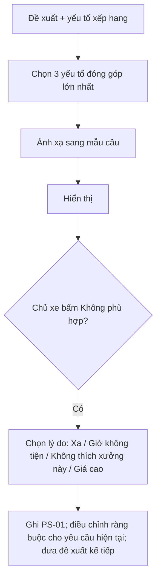

# Functional Specification — Giải thích và phản hồi gợi ý

> Đặc tả nghiệp vụ cho **PS-03** trong [PRD Phase 2](../../../product/PRD_EV_Care_Phase2.md).
>
> **Quan hệ tài liệu:** mở rộng [us-061 BR-1503](../../sprint-4/feature-functional/us-061-sprint-4-spec.ff.md) (lý do đề xuất). Áp cho mọi đề xuất tự động của [BK-01](../booking/bk-01-phase2-spec.ff.md), [HS-02](../service-history/hs-02-phase2-spec.ff.md), [PS-04](ps-04-phase2-spec.ff.md). Phản hồi "Không phù hợp" được ghi vào [PS-01](ps-01-phase2-spec.ff.md).
>
> Quy ước: [README Phase 2](../README.md).
>
> **Đặc tả kỹ thuật:** [API Spec](ps-03-phase2-spec.api.md) · [Entity Spec](ps-03-phase2-spec.entity.md) · [Frontend Spec](ps-03-phase2-spec.fe.md)

---

# 1. Document Information

| Field | Value |
|---|---|
| Feature ID | `FEAT-P2-PS03` |
| Feature Name | Giải thích và phản hồi gợi ý |
| PRD Feature | PS-03 (P2-B, Should, Cải tiến MVP) |
| Document Version / Status | `v0.2` / `Draft` |
| Created / Updated | `2026-10-09` / `2026-10-12` |
| Related Technical Spec | [API Spec](ps-03-phase2-spec.api.md) · [Entity Spec](ps-03-phase2-spec.entity.md) · [Frontend Spec](ps-03-phase2-spec.fe.md) |

---

# 2. Feature Overview

## 2.1 Feature Description

Mọi đề xuất tự động (xưởng, giờ, hạng mục gộp, gợi ý nhóm tương đồng) kèm **tối đa 3 lý do có thật**, lấy từ dữ liệu đã dùng để xếp hạng. Chủ xe bấm **"Không phù hợp"** và chọn lý do nhanh. Hệ thống ghi nhận để lần sau tránh.

## 2.2 Business Objective

Tăng lòng tin và tỉ lệ chấp nhận đề xuất (PP2-08).

## 2.3 User Objective

Hiểu vì sao được gợi ý; nói được "không phải cái này" chỉ bằng một chạm.

## 2.4 Business Value

Tăng tỉ lệ nhận đề xuất tự động; cấp dữ liệu phản hồi cho BK-10, PS-04.

---

# 3. Scope

## 3.1 In Scope

- Sinh lý do từ yếu tố xếp hạng (mẫu câu cố định, không viết tự do bằng LLM).
- Nút "Không phù hợp" + lý do nhanh.
- Ghi phản hồi vào bộ nhớ và áp cho lần sau.

## 3.2 Out of Scope

- Giải thích chi tiết công thức điểm cho người dùng.

---

# 4. Actors

| Actor | Type | Responsibility |
|---|---|---|
| Chủ xe | User | Đọc lý do, phản hồi |
| Bộ lập lịch / bộ gợi ý | System | Trả yếu tố xếp hạng |
| Service lý do | System | Ánh xạ yếu tố → câu |

---

# 5. User Story

- `US-P2-PS03-01`: As a chủ xe, I want biết vì sao được gợi ý xưởng này, so that tôi chọn nhanh.
- `US-P2-PS03-02`: As a chủ xe, I want nói gợi ý không phù hợp kèm lý do, so that lần sau hệ thống gợi ý đúng hơn.

---

# 6. Use Case

| UC | Tên | Trigger | Postcondition |
|---|---|---|---|
| `UC-PS03-01` | Hiển thị lý do | Có đề xuất | 1–3 lý do mỗi đề xuất |
| `UC-PS03-02` | Phản hồi không phù hợp | Bấm "Không phù hợp" → chọn lý do | Mục nhớ / ràng buộc cập nhật; đề xuất kế tiếp |

---

# 7. User Flow

---

# 8. Screen / UI Flow

| Screen ID | Name | Purpose |
|---|---|---|
| `SCR-PS03-01` | Dòng lý do trên thẻ đề xuất | Ví dụ "Đúng xưởng bạn thích · cách 2,1 km · còn 3 chỗ" |
| `SCR-PS03-02` | Bảng "Không phù hợp" | 4 lý do nhanh + "Khác" |

**Mẫu câu lý do (ví dụ):**

| Yếu tố | Mẫu câu |
|---|---|
| Xưởng yêu thích | "Đúng xưởng bạn thích" |
| Khoảng cách | "Cách {km} km" |
| Giờ quen | "Đúng giờ bạn hay chọn" |
| Đánh giá của chính chủ xe | "Bạn chấm {n} sao lần trước" |
| Phụ tùng | "Có sẵn phụ tùng" |
| Chỗ còn ít | "Còn {n} chỗ" |
| Nhóm tương đồng | "Nhiều chủ {model} trong khu vực chọn" |

---

# 9. Main Flow

1. Phương án đầu có dòng "Đúng xưởng bạn thích · cách 2,1 km · còn 3 chỗ".
2. Chủ xe bấm "Không phù hợp" và chọn "Giờ không tiện".
3. Hệ thống loại khung giờ đó cho yêu cầu hiện tại, đưa phương án kế tiếp, và ghi mục nhớ nếu lặp lại.

---

# 10. Alternative Flow

- **AF-PS03-01:** Chọn "Không thích xưởng này" → ẩn xưởng như PS-02 (có xác nhận).

# 11. Exception Flow

| ID | Condition | Behavior |
|---|---|---|
| `EF-PS03-01` | Không có yếu tố nào đủ đóng góp | Hiện lý do mặc định "Phù hợp khung giờ và khu vực của bạn" |

---

# 12. Business Rules

- **BR-PS03-01 (PRD):** Tối đa 3 lý do có thật, lấy từ dữ liệu xếp hạng; không viết tự do bằng LLM. **High.**
- **BR-PS03-02 (PRD):** "Không phù hợp" có lý do nhanh; ghi vào PS-01, dùng lần sau. **Medium.**
- **BR-PS03-03:** Lý do "Không thích xưởng này" áp như loại xưởng ở PS-02, có xác nhận. **Medium.**
- **BR-PS03-04:** Lý do khác chỉ áp cho yêu cầu hiện tại. Chỉ thành mục nhớ khi lặp ≥ `MEMORY_INFER_MIN_REPEAT`. **Medium.**

# 13. State / Status

Không áp dụng.

# 14. Data Requirements

| Data | Source |
|---|---|
| Yếu tố xếp hạng và đóng góp | BK-01 / BK-10 / PS-04 |
| Phản hồi "Không phù hợp" | Chủ xe → PS-01, PL-03 |

# 15. Business Error & Edge Cases

| Case ID | Scenario | Expected Behavior |
|---|---|---|
| `EDGE-PS03-01` | Bộ nhớ dài hạn tắt | Phản hồi chỉ áp cho yêu cầu hiện tại, không ghi nhớ |

# 16. Permissions & Access

Chủ xe trên đề xuất của mình.

# 17. Acceptance Criteria

- **AC-PS03-01:** Mọi lý do hiển thị truy được về một yếu tố trong điểm xếp hạng (log).
- **AC-PS03-02:** Sau "Không phù hợp: Giờ không tiện", đề xuất kế tiếp không cùng khung giờ.

# 18. Non-functional Expectations

Lý do sinh không làm chậm phương án quá 50 ms.

# 19. Dependencies

BK-01, PS-01, PS-02.

# 20. Assumptions

Lý do ngắn giúp tăng tỉ lệ chấp nhận.

# 21. Business Constraints

Lý do không tiết lộ dữ liệu chủ xe khác.

# 22. Terminology

| Term | Vietnamese |
|---|---|
| Reason | Lý do gợi ý |
| Not suitable | Không phù hợp |

# 23. Partner Notes

—

# 24. Open Questions

| ID | Question | Proposal |
|---|---|---|
| `Q-PS03-01` | Có hiện "điểm khớp" dạng số không? | Không |

# 25. Traceability

PRD Phase 2 PS-03 · BR-PS03-01…04 · AC-PS03-01…02 · us-061 BR-1503.

# 26. Related Documents

[PRD Phase 2](../../../product/PRD_EV_Care_Phase2.md) · [BK-01](../booking/bk-01-phase2-spec.ff.md) · [API Spec](ps-03-phase2-spec.api.md) · [Entity Spec](ps-03-phase2-spec.entity.md) · [Frontend Spec](ps-03-phase2-spec.fe.md)

# 27. Change Log

| Version | Date | Change |
|---|---|---|
| `v0.1` | `2026-10-09` | Bản nháp đầu |
| `v0.2` | `2026-10-12` | Liên kết đặc tả API, Entity, Frontend |

# 28. Approval

| Role | Status |
|---|---|
| Product Owner | Pending |
| Technical Owner | Pending |
