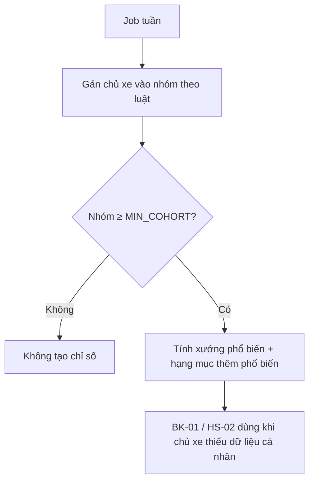

# Functional Specification — Gợi ý từ chủ xe có đặc điểm tương đồng

> Đặc tả nghiệp vụ cho **PS-04** trong [PRD Phase 2](../../../product/PRD_EV_Care_Phase2.md).
>
> **Quan hệ tài liệu:** cung cấp yếu tố xếp hạng bổ sung cho [BK-01](../booking/bk-01-phase2-spec.ff.md) và gợi ý hạng mục cho [HS-02](../service-history/hs-02-phase2-spec.ff.md). Lý do hiển thị theo [PS-03](ps-03-phase2-spec.ff.md). Dùng dữ liệu tổng hợp, ẩn danh; quyền dùng dữ liệu theo [PL-01](../platform/pl-01-phase2-spec.ff.md). Dữ liệu nhóm do Team Data quản lý.
>
> Quy ước: [README Phase 2](../README.md).
>
> **Đặc tả kỹ thuật:** [API Spec](ps-04-phase2-spec.api.md) · [Entity Spec](ps-04-phase2-spec.entity.md) · [Frontend Spec](ps-04-phase2-spec.fe.md)

---

# 1. Document Information

| Field | Value |
|---|---|
| Feature ID | `FEAT-P2-PS04` |
| Feature Name | Gợi ý từ chủ xe có đặc điểm tương đồng |
| PRD Feature | PS-04 (P2-C, Could, Chức năng) |
| Document Version / Status | `v0.2` / `Draft` |
| Created / Updated | `2026-10-09` / `2026-10-12` |
| Data Owner | Team Data (Phase 2) |
| Related Technical Spec | [API Spec](ps-04-phase2-spec.api.md) · [Entity Spec](ps-04-phase2-spec.entity.md) · [Frontend Spec](ps-04-phase2-spec.fe.md) |

---

# 2. Feature Overview

## 2.1 Feature Description

Hệ thống phân chủ xe vào **nhóm tương đồng** theo bốn tiêu chí:
- dòng xe;
- khu vực;
- số km mỗi tháng;
- kiểu sử dụng.

Từ hành vi tổng hợp của mỗi nhóm, hệ thống gợi ý:
- xưởng được nhiều người trong nhóm chọn và đánh giá cao (hữu ích cho người dùng mới);
- hạng mục người trong nhóm thường làm thêm.

Giai đoạn đầu phân nhóm theo luật. Chỉ dùng học máy khi đủ dữ liệu.

## 2.2 Business Objective

Gợi ý tốt cho người dùng mới chưa có lịch sử (cold-start) (PP2-08).

## 2.3 User Objective

Người mới vẫn nhận gợi ý hợp lý.

## 2.4 Business Value

Tăng tỉ lệ đặt lịch thành công ở lần đầu.

---

# 3. Scope

## 3.1 In Scope

- Định nghĩa nhóm theo luật.
- Tính chỉ số tổng hợp theo nhóm: xưởng được chọn nhiều, hạng mục thêm phổ biến.
- Cung cấp yếu tố cho BK-01, HS-02, kèm lý do.

## 3.2 Out of Scope

- Hiển thị thông tin bất kỳ chủ xe cụ thể nào.
- Mô hình học máy ở giai đoạn đầu.

---

# 4. Actors

| Actor | Type | Responsibility |
|---|---|---|
| Job tổng hợp nhóm | System | Tính chỉ số nhóm định kỳ |
| Team Data | Stakeholder | Định nghĩa nhóm, kiểm tra ngưỡng |
| Bộ lập lịch | System | Dùng yếu tố nhóm |

---

# 5. User Story

- `US-P2-PS04-01`: As a chủ xe mới, I want gợi ý xưởng mà người dùng giống tôi tin tưởng, so that tôi chọn yên tâm hơn.

---

# 6. Use Case

| UC | Tên | Trigger | Postcondition |
|---|---|---|---|
| `UC-PS04-01` | Tính chỉ số nhóm | Job hằng tuần | Bảng chỉ số nhóm đủ ngưỡng |
| `UC-PS04-02` | Dùng trong gợi ý | BK-01 / HS-02 | Yếu tố "nhóm tương đồng" + lý do |

---

# 7. User Flow

---

# 8. Screen / UI Flow

Không có màn riêng. Thể hiện bằng lý do trên thẻ đề xuất: "Nhiều chủ VF 8 trong khu vực chọn xưởng này".

# 9. Main Flow

1. Chủ xe mới đăng ký, chưa có lịch sử.
2. Nhóm "VF 8 · Hà Nội · 1.000–2.000 km/tháng · cá nhân" có 120 người; Xưởng Cầu Giấy được chọn nhiều nhất, điểm 4,7.
3. BK-01 cộng yếu tố nhóm cho Cầu Giấy và hiện lý do.

# 10. Alternative Flow

- **AF-PS04-01:** Chủ xe đã có dữ liệu cá nhân → yếu tố nhóm có trọng số thấp hơn yếu tố cá nhân.

# 11. Exception Flow

| ID | Condition | Behavior |
|---|---|---|
| `EF-PS04-01` | Nhóm dưới ngưỡng | Không dùng yếu tố nhóm |
| `EF-PS04-02` | Chủ xe tắt "dùng dữ liệu cho gợi ý" (PL-01) | Không gán chủ xe vào nhóm, không dùng yếu tố nhóm cho họ |

---

# 12. Business Rules

- **BR-PS04-01 (PRD):** Tiêu chí: dòng xe, khu vực, km/tháng theo khoảng, kiểu sử dụng. **Medium.**
- **BR-PS04-02 (PRD):** Phân nhóm theo luật; học máy chỉ khi mỗi nhóm ≥ `MIN_COHORT`. **High.**
- **BR-PS04-03 (PRD):** Chỉ dữ liệu tổng hợp, ẩn danh; không bao giờ hiện thông tin một chủ xe cụ thể. **High.**
- **BR-PS04-04 (PRD):** Ứng dụng cho gợi ý xưởng (người mới) và hạng mục thêm; luôn kèm lý do. **Medium.**
- **BR-PS04-05:** Yếu tố nhóm không được vượt yếu tố cá nhân khi chủ xe đã có lịch sử. **Medium.**

# 13. State / Status

Không áp dụng.

# 14. Data Requirements

| Data | Source | Owner |
|---|---|---|
| Model, khu vực (mức quận/huyện), km/tháng (từ ODO), kiểu sử dụng | Hồ sơ xe, hãng | Team Data |
| Lịch hẹn hoàn tất, đánh giá | EV Care | Team Data |
| `cohort_metric` (mới) | Chỉ số nhóm | Team Data |

# 15. Business Error & Edge Cases

| Case ID | Scenario | Expected Behavior |
|---|---|---|
| `EDGE-PS04-01` | Nhóm có 1 xưởng chiếm gần hết vì ít xưởng trong khu vực | Không dùng lý do "nhiều người chọn" khi khu vực chỉ có ≤ 2 xưởng |

# 16. Permissions & Access

Chỉ job và Team Data (ẩn danh) truy cập dữ liệu nhóm.

# 17. Acceptance Criteria

- **AC-PS04-01:** Không gợi ý nào dựa trên nhóm có số chủ xe dưới ngưỡng.
- **AC-PS04-02:** Bảng chỉ số nhóm không chứa định danh chủ xe.

# 18. Non-functional Expectations

Chỉ số nhóm cập nhật hằng tuần.

# 19. Dependencies

BK-01, HS-02, PS-03, PL-01, workspace Team Data.

# 20. Assumptions

Đủ người dùng để có nhóm ≥ 30.

# 21. Business Constraints

Tuân thủ quyền riêng tư; dữ liệu trên hạ tầng Phase 2.

# 22. Terminology

| Term | Vietnamese |
|---|---|
| Cohort | Nhóm tương đồng |
| Cold-start | Người dùng mới chưa có dữ liệu |

# 23. Partner Notes

Team Data chốt định nghĩa khoảng km và khu vực.

# 24. Open Questions

| ID | Question | Proposal |
|---|---|---|
| `Q-PS04-01` | `MIN_COHORT`? | 30 |
| `Q-PS04-02` | "Kiểu sử dụng" lấy từ đâu? | Chủ xe khai trong hồ sơ, hoặc suy từ km/tháng (> 3.000 km = dịch vụ) |

# 25. Traceability

PRD Phase 2 PS-04 · BR-PS04-01…05 · AC-PS04-01…02.

# 26. Related Documents

[PRD Phase 2](../../../product/PRD_EV_Care_Phase2.md) · [PS-03](ps-03-phase2-spec.ff.md) · [API Spec](ps-04-phase2-spec.api.md) · [Entity Spec](ps-04-phase2-spec.entity.md) · [Frontend Spec](ps-04-phase2-spec.fe.md)

# 27. Change Log

| Version | Date | Change |
|---|---|---|
| `v0.1` | `2026-10-09` | Bản nháp đầu |
| `v0.2` | `2026-10-12` | Liên kết đặc tả API, Entity, Frontend |

# 28. Approval

| Role | Status |
|---|---|
| Product Owner | Pending |
| Team Data | Pending |
