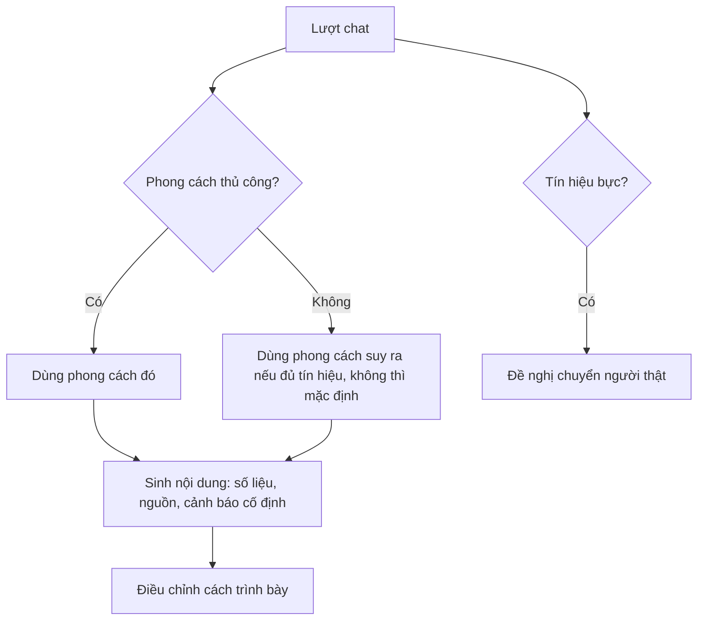

# Functional Specification — Agent trả lời theo phong cách giao tiếp

> Đặc tả nghiệp vụ cho **PS-05** trong [PRD Phase 2](../../../product/PRD_EV_Care_Phase2.md).
>
> **Quan hệ tài liệu:** phong cách là một mục nhớ (`communication_style`) của [PS-01](ps-01-phase2-spec.ff.md). Không thay đổi nguyên tắc nội dung của PRD MVP §7 (trích nguồn, nhãn ước tính, an toàn). Chuyển người thật theo [PL-02](../platform/pl-02-phase2-spec.ff.md).
>
> Quy ước: [README Phase 2](../README.md).
>
> **Đặc tả kỹ thuật:** [API Spec](ps-05-phase2-spec.api.md) · [Entity Spec](ps-05-phase2-spec.entity.md) · [Frontend Spec](ps-05-phase2-spec.fe.md)

---

# 1. Document Information

| Field | Value |
|---|---|
| Feature ID | `FEAT-P2-PS05` |
| Feature Name | Agent trả lời theo phong cách giao tiếp |
| PRD Feature | PS-05 (P2-C, Could, Chức năng) |
| Document Version / Status | `v0.2` / `Draft` |
| Created / Updated | `2026-10-09` / `2026-10-12` |
| Related Technical Spec | [API Spec](ps-05-phase2-spec.api.md) · [Entity Spec](ps-05-phase2-spec.entity.md) · [Frontend Spec](ps-05-phase2-spec.fe.md) |

---

# 2. Feature Overview

## 2.1 Feature Description

Agent nhận diện **phong cách giao tiếp** của chủ xe, không suy diễn tính cách. Năm chiều:
- ngắn gọn hay chi tiết;
- rành kỹ thuật hay không;
- quan tâm giá;
- mức độ gấp;
- cách xưng hô.

Agent điều chỉnh **cách nói** (độ dài, thuật ngữ, thứ tự thông tin) nhưng **không đổi nội dung**. Chủ xe tự chọn phong cách được. Khi phát hiện khách bực, agent đề nghị chuyển người thật.

## 2.2 Business Objective

Câu trả lời phù hợp từng người, giảm bỏ cuộc giữa chừng (PP2-08).

## 2.3 User Objective

Người cần nhanh được trả lời ngắn; người không rành được giải thích dễ hiểu.

## 2.4 Business Value

Tăng hài lòng với chat; giảm chuyển xưởng không cần thiết.

---

# 3. Scope

## 3.1 In Scope

- Nhận diện phong cách từ tín hiệu: độ dài tin nhắn, thuật ngữ dùng, câu hỏi về giá, từ ngữ gấp.
- Chủ xe chọn phong cách thủ công.
- Phát hiện bực bội → đề nghị chuyển người.

## 3.2 Out of Scope

- Suy đoán tính cách, cảm xúc sâu, đặc điểm nhân khẩu học.
- Thay đổi nội dung theo phong cách.

---

# 4. Actors

| Actor | Type | Responsibility |
|---|---|---|
| Chủ xe | User | Chat, chọn phong cách |
| AI Agent | System | Nhận diện, điều chỉnh cách nói |

---

# 5. User Story

- `US-P2-PS05-01`: As a chủ xe bận, I want câu trả lời ngắn, so that tôi đọc nhanh.
- `US-P2-PS05-02`: As a chủ xe không rành kỹ thuật, I want giải thích dễ hiểu, so that tôi biết xe cần gì.

---

# 6. Use Case

| UC | Tên | Trigger | Postcondition |
|---|---|---|---|
| `UC-PS05-01` | Nhận diện | Sau ≥ 3 lượt chat | Phong cách đề xuất (mục nhớ suy ra) |
| `UC-PS05-02` | Chọn thủ công | Cài đặt → Phong cách trả lời | Phong cách cố định |
| `UC-PS05-03` | Bực bội | Tín hiệu bực (lặp câu, từ ngữ tiêu cực, "nói chuyện với người") | Đề nghị chuyển người (PL-02) |

---

# 7. User Flow

---

# 8. Screen / UI Flow

| Screen ID | Name | Purpose |
|---|---|---|
| `SCR-PS05-01` | Phong cách trả lời (Cài đặt) | Chọn: Tự động / Ngắn gọn / Chi tiết / Dễ hiểu (ít thuật ngữ); cách xưng hô |

# 9. Main Flow

1. Chủ xe hay nhắn ngắn ("bao nhiêu", "mấy giờ"). Sau 3 lượt, phong cách suy ra là "Ngắn gọn".
2. Câu trả lời dự toán chỉ còn tổng + 1 dòng hạng mục chính + chip "Xem chi tiết".
3. Nhãn "ước tính" và trích nguồn vẫn giữ nguyên.

# 10. Alternative Flow

- **AF-PS05-01:** Chủ xe bấm "Xem chi tiết" thường xuyên → hạ độ tin cậy của phong cách "Ngắn gọn".

# 11. Exception Flow

| ID | Condition | Behavior |
|---|---|---|
| `EF-PS05-01` | Nội dung an toàn (cảnh báo dừng xe) | Luôn hiển thị đầy đủ, bất kể phong cách |

---

# 12. Business Rules

- **BR-PS05-01 (PRD):** Nhận diện phong cách, không suy diễn tính cách. **High.**
- **BR-PS05-02 (PRD):** Chỉ đổi cách nói; không đổi số liệu, nguồn, cảnh báo, giá, bảo hành. **High.**
- **BR-PS05-03 (PRD):** Lựa chọn thủ công luôn được ưu tiên. **High.**
- **BR-PS05-04 (PRD):** Bực bội thì đề nghị chuyển người. **Medium.**
- **BR-PS05-05:** Phong cách suy ra chỉ áp sau ≥ `MEMORY_INFER_MIN_REPEAT` hội thoại có tín hiệu nhất quán. **Medium.**

# 13. State / Status

Không áp dụng.

# 14. Data Requirements

Mục nhớ `communication_style` (PS-01); tín hiệu hội thoại (không lưu riêng ngoài `chat_message`).

# 15. Business Error & Edge Cases

| Case ID | Scenario | Expected Behavior |
|---|---|---|
| `EDGE-PS05-01` | Bộ nhớ dài hạn tắt | Chỉ dùng phong cách trong hội thoại hiện tại |

# 16. Permissions & Access

Chỉ chủ xe và agent của họ.

# 17. Acceptance Criteria

- **AC-PS05-01:** Cùng một câu hỏi, mọi phong cách cho cùng con số và cùng nguồn trích dẫn (eval).
- **AC-PS05-02:** Cảnh báo an toàn xuất hiện đầy đủ ở mọi phong cách.

# 18. Non-functional Expectations

Không tăng độ trễ trả lời quá 10%.

# 19. Dependencies

PS-01, PL-02, bộ eval AI.

# 20. Assumptions

Tín hiệu hội thoại đủ để nhận diện các chiều đơn giản.

# 21. Business Constraints

Không lưu nhãn cảm xúc của khách.

# 22. Terminology

| Term | Vietnamese |
|---|---|
| Communication style | Phong cách giao tiếp |

# 23. Partner Notes

—

# 24. Open Questions

| ID | Question | Proposal |
|---|---|---|
| `Q-PS05-01` | Có tự áp phong cách suy ra không, hay hỏi chủ xe trước? | Tự áp, hiện trong màn bộ nhớ |

# 25. Traceability

PRD Phase 2 PS-05 · BR-PS05-01…05 · AC-PS05-01…02.

# 26. Related Documents

[PRD Phase 2](../../../product/PRD_EV_Care_Phase2.md) · [PS-01](ps-01-phase2-spec.ff.md) · [PL-02](../platform/pl-02-phase2-spec.ff.md) · [API Spec](ps-05-phase2-spec.api.md) · [Entity Spec](ps-05-phase2-spec.entity.md) · [Frontend Spec](ps-05-phase2-spec.fe.md)

# 27. Change Log

| Version | Date | Change |
|---|---|---|
| `v0.1` | `2026-10-09` | Bản nháp đầu |
| `v0.2` | `2026-10-12` | Liên kết đặc tả API, Entity, Frontend |

# 28. Approval

| Role | Status |
|---|---|
| Product Owner | Pending |
| Technical Owner | Pending |
