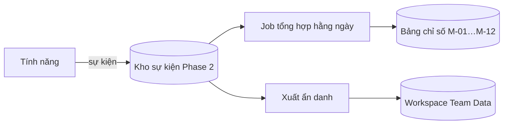

# Functional Specification — Chỉ số đo hiệu quả

> Đặc tả nghiệp vụ cho **PL-03** trong [PRD Phase 2](../../../product/PRD_EV_Care_Phase2.md) — mục 12 (Chỉ số thành công).
>
> **Loại: Phi chức năng.** Cung cấp sự kiện và bảng tổng hợp để đo M-01…M-12, đánh giá A/B của [BK-10](../booking/bk-10-phase2-spec.ff.md), và làm dữ liệu cho **workspace của Team Data** (Phase 2). Dữ liệu nằm trên hạ tầng Phase 2, không ghi vào Phase 1.
>
> Quy ước: [README Phase 2](../README.md).
>
> **Đặc tả kỹ thuật:** [API Spec](pl-03-phase2-spec.api.md) · [Entity Spec](pl-03-phase2-spec.entity.md) · [Frontend Spec](pl-03-phase2-spec.fe.md)

---

# 1. Document Information

| Field | Value |
|---|---|
| Feature ID | `FEAT-P2-PL03` |
| Feature Name | Chỉ số đo hiệu quả |
| PRD Feature | PL-03 (P2-A, Must, Phi chức năng) |
| Document Version / Status | `v0.2` / `Draft` |
| Created / Updated | `2026-10-09` / `2026-10-12` |
| Data Owner | Team Data (Phase 2) |
| Related Technical Spec | [API Spec](pl-03-phase2-spec.api.md) · [Entity Spec](pl-03-phase2-spec.entity.md) · [Frontend Spec](pl-03-phase2-spec.fe.md) |

---

# 2. Feature Overview

## 2.1 Feature Description

Mọi tính năng Phase 2 ghi **sự kiện có cấu trúc** tại các bước quan trọng. Một job tổng hợp hằng ngày tính chỉ số M-01…M-12 thành **bảng tổng hợp**. Người dùng sự kiện:
- PO, PM xem chỉ số;
- Team Data phân tích trong workspace riêng;
- BK-10 dùng cho A/B.

Sự kiện không chứa thông tin cá nhân; định danh được băm.

## 2.2 Business Objective

Biết tính năng có hiệu quả không, dựa trên số liệu (PRD §12).

## 2.3 User Objective

PO/PM/Team Data có số liệu đáng tin mà không phải truy vấn tay.

## 2.4 Business Value

Quyết định ưu tiên dựa trên dữ liệu; điều kiện bật BK-10.

---

# 3. Scope

## 3.1 In Scope

- Danh mục sự kiện (mục 14).
- Quy tắc ẩn danh.
- Job tổng hợp hằng ngày; bảng chỉ số.
- Xuất dữ liệu ẩn danh cho workspace Team Data.

## 3.2 Out of Scope

- Công cụ BI cụ thể (Team Data chọn).
- Theo dõi hành vi ngoài app.

---

# 4. Actors

| Actor | Type | Responsibility |
|---|---|---|
| Các tính năng | System | Ghi sự kiện |
| Job tổng hợp | System | Tính chỉ số |
| PO / PM | User | Xem chỉ số |
| Team Data | Stakeholder | Phân tích, quản lý định nghĩa |

---

# 5. User Story

- `US-P2-PL03-01`: As a PO, I want xem thời gian đặt lịch trung vị theo tuần, so that tôi biết CH-01 và BK-01 có hiệu quả không.
- `US-P2-PL03-02`: As a Team Data, I want dữ liệu sự kiện ẩn danh có cấu trúc, so that tôi phân tích và xây mô hình.

---

# 6. Use Case

| UC | Tên | Trigger | Postcondition |
|---|---|---|---|
| `UC-PL03-01` | Ghi sự kiện | Bước nghiệp vụ xảy ra | Sự kiện lưu |
| `UC-PL03-02` | Tổng hợp | Job hằng ngày | Bảng chỉ số cập nhật |
| `UC-PL03-03` | Xuất cho Team Data | Job / yêu cầu | Dữ liệu ẩn danh trong workspace |

---

# 7. User Flow

# 8. Screen / UI Flow

| Screen ID | Name | Purpose |
|---|---|---|
| `SCR-PL03-01` | Bảng chỉ số (nội bộ) | M-01…M-12 theo tuần, theo xưởng; xu hướng |

# 9. Main Flow

1. Chủ xe bấm chip đặt lịch, sinh sự kiện `booking_intent_started`.
2. Chủ xe xác nhận, sinh sự kiện `booking_confirmed` kèm số chạm.
3. Job đêm tính M-01 (trung vị khoảng thời gian giữa hai sự kiện), M-02 (trung vị số chạm).

# 10. Alternative Flow

—

# 11. Exception Flow

| ID | Condition | Behavior |
|---|---|---|
| `EF-PL03-01` | Ghi sự kiện lỗi | Không chặn luồng nghiệp vụ; thử lại bất đồng bộ; đếm số sự kiện mất |

---

# 12. Business Rules

- **BR-PL03-01 (PRD):** Ghi sự kiện có cấu trúc cho các bước trong danh mục. **High.**
- **BR-PL03-02 (PRD):** Không chứa thông tin cá nhân; định danh người dùng băm có muối. **High.**
- **BR-PL03-03 (PRD):** Bảng tổng hợp cập nhật hằng ngày. **Medium.**
- **BR-PL03-04:** Ghi sự kiện không bao giờ làm hỏng hay chậm luồng nghiệp vụ (bất đồng bộ). **High.**
- **BR-PL03-05:** Mọi sự kiện có `event_name`, `occurred_at` (UTC), `feature_id`, `user_hash`, `workshop_id` (nếu có), `props`. **High.**
- **BR-PL03-06:** Định nghĩa chỉ số được Team Data quản lý phiên bản. Đổi định nghĩa thì ghi lại. **Medium.**
- **BR-PL03-07:** Dữ liệu sự kiện và workspace Team Data nằm trên hạ tầng Phase 2. **High.**

---

# 13. State / Status

Không áp dụng.

# 14. Data Requirements

**Danh mục sự kiện tối thiểu (P2-A)**

| Sự kiện | Ghi bởi | Dùng cho |
|---|---|---|
| `booking_intent_started` | CH-01, màn Đặt lịch | M-01 |
| `scheduler_run` (số phương án, số bị loại theo ràng buộc, thời gian chạy) | BK-01 | M-03, NFR-03 |
| `option_shown`, `option_selected`, `option_rejected` (lý do) | BK-01, PS-03 | Chất lượng gợi ý |
| `booking_confirmed` (số chạm, số ký tự gõ) | Booking | M-01, M-02 |
| `chip_shown`, `chip_clicked` | CH-01 | M-04 |
| `booking_cancelled` (loại: sớm/muộn/xưởng/hết hạn giữ) | BK-02 | M-05 |
| `no_show_marked`, `no_show_waived` | BK-02 | M-05 |
| `booking_manual_review` (lý do) | WS-01 | M-06 |
| `waitlist_offer_sent`, `waitlist_offer_accepted` | BK-07 | M-07 |
| `advisor_answered`, `handoff_created` (lý do) | AD, PL-02 | M-08 |
| `checked_in`, `service_started`, `service_finished`, `vehicle_handed_over` | us-037, us-057 | M-09, M-10 (T₂, T₄, T₅) |
| `technician_assistant_used` | TA-01 | M-11 |
| `consent_changed`, `memory_deleted` | PL-01, PS-01 | M-12 |

**Bảng chỉ số:** đúng như PRD §12 (M-01…M-12), mỗi chỉ số có định nghĩa, công thức, phiên bản.

# 15. Business Error & Edge Cases

| Case ID | Scenario | Expected Behavior |
|---|---|---|
| `EDGE-PL03-01` | Sự kiện đến trễ (sau job) | Job ngày sau tính lại cửa sổ 3 ngày gần nhất |
| `EDGE-PL03-02` | Chủ xe xoá tài khoản | Sự kiện đã băm được giữ (không định danh được); bỏ liên kết |

# 16. Permissions & Access

| Role | Access |
|---|---|
| PO, PM | Bảng chỉ số |
| Team Data | Sự kiện ẩn danh, bảng chỉ số |
| Chủ xưởng | Chỉ số của xưởng mình (WS-01, BK-10 báo cáo) |

# 17. Acceptance Criteria

- **AC-PL03-01:** Tính được đủ M-01…M-12 từ sự kiện, không cần truy vấn tay.
- **AC-PL03-02:** Không sự kiện nào chứa tên, SĐT, email, VIN, biển số đầy đủ (kiểm tra tự động).
- **AC-PL03-03:** Lỗi kho sự kiện không làm lỗi luồng đặt lịch (test).

# 18. Non-functional Expectations

Ghi sự kiện thêm ≤ 5 ms vào luồng (bất đồng bộ). Job tổng hợp xong trước 06:00.

# 19. Dependencies

Mọi tính năng Phase 2; workspace Team Data; hạ tầng Phase 2.

# 20. Assumptions

Team Data sẵn sàng quản lý định nghĩa chỉ số.

# 21. Business Constraints

Không đưa dữ liệu Phase 2 sang hạ tầng Phase 1.

# 22. Terminology

| Term | Vietnamese |
|---|---|
| Event | Sự kiện |
| Metric | Chỉ số |
| Hashed user id | Định danh băm |

# 23. Partner Notes

Workspace Team Data là một dự định riêng của Phase 2 (xem roadmap). Spec này chỉ định nghĩa dữ liệu đầu vào.

# 24. Open Questions

| ID | Question | Proposal |
|---|---|---|
| `Q-PL03-01` | Kho sự kiện: bảng Postgres Phase 2 hay dịch vụ riêng? | Bảng Postgres Phase 2 ở P2-A |
| `Q-PL03-02` | Thời gian giữ sự kiện? | 13 tháng |

# 25. Traceability

PRD Phase 2 PL-03, §12 (M-01…M-12), NFR-09 · BR-PL03-01…07 · AC-PL03-01…03.

# 26. Related Documents

[PRD Phase 2](../../../product/PRD_EV_Care_Phase2.md) · [BK-10](../booking/bk-10-phase2-spec.ff.md) · [README Phase 2](../README.md) · [API Spec](pl-03-phase2-spec.api.md) · [Entity Spec](pl-03-phase2-spec.entity.md) · [Frontend Spec](pl-03-phase2-spec.fe.md)

# 27. Change Log

| Version | Date | Change |
|---|---|---|
| `v0.1` | `2026-10-09` | Bản nháp đầu |
| `v0.2` | `2026-10-12` | Liên kết đặc tả API, Entity, Frontend |

# 28. Approval

| Role | Status |
|---|---|
| Product Owner | Pending |
| Technical Owner | Pending |
| Team Data | Pending |
