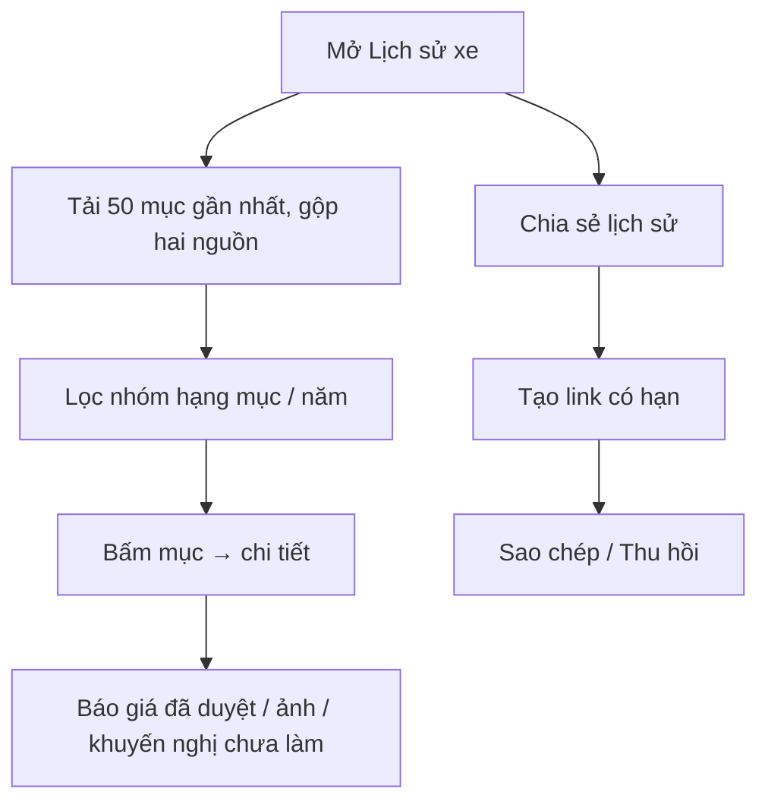

# Functional Specification — Tra cứu lịch sử bảo dưỡng phía chủ xe

> Đặc tả nghiệp vụ cho **HS-01** trong [PRD Phase 2](../../../product/PRD_EV_Care_Phase2.md).
>
> **Quan hệ tài liệu:** nguồn dữ liệu là lịch sử dịch vụ đồng bộ từ hãng (PRD MVP F3: pull + webhook, chỉ từ hãng) và lịch hẹn `completed` trong EV Care. Chi phí lấy từ báo giá đã duyệt (F5b, [us-049](../../sprint-3/feature-functional/us-049-sprint-3-spec.ff.md)) hoặc dữ liệu hãng. Chủ xe không nhập tay lịch sử.
>
> Quy ước: [README Phase 2](../README.md).
>
> **Đặc tả kỹ thuật:** [API Spec](hs-01-phase2-spec.api.md) · [Entity Spec](hs-01-phase2-spec.entity.md) · [Frontend Spec](hs-01-phase2-spec.fe.md)

---

# 1. Document Information

| Field | Value |
|---|---|
| Feature ID | `FEAT-P2-HS01` |
| Feature Name | Tra cứu lịch sử bảo dưỡng phía chủ xe |
| PRD Feature | HS-01 (P2-A, Must, Chức năng) |
| Document Version / Status | `v0.2` / `Draft` |
| Created / Updated | `2026-10-09` / `2026-10-12` |
| Related Technical Spec | [API Spec](hs-01-phase2-spec.api.md) · [Entity Spec](hs-01-phase2-spec.entity.md) · [Frontend Spec](hs-01-phase2-spec.fe.md) |

---

# 2. Feature Overview

## 2.1 Feature Description

Màn **Lịch sử xe** cho chủ xe xem dòng thời gian mọi lần bảo dưỡng và sửa chữa của xe. Mỗi lần gồm: ngày, ODO, xưởng, hạng mục, phụ tùng đã thay, chi phí, báo giá đã duyệt, ảnh, và các khuyến nghị chưa làm.

Có bộ lọc theo nhóm hạng mục và năm. Agent trả lời câu hỏi về lịch sử. Chủ xe tạo được link chỉ đọc có hạn để chia sẻ khi bán xe.

## 2.2 Business Objective

Chủ xe tự quản lý lịch sử xe, không phải giữ giấy tờ hay hỏi xưởng (PP2-03, G2-3).

## 2.3 User Objective

Biết lần trước làm gì, ở đâu, hết bao nhiêu; chứng minh lịch sử khi bán xe.

## 2.4 Business Value

Tăng giá trị giữ chân người dùng; dữ liệu cho TA-01 (KTV tra lịch sử), HS-02 (gộp việc), AD-04 (khuyến nghị chưa làm).

---

# 3. Scope

## 3.1 In Scope

- Dòng thời gian, chi tiết từng lần.
- Gộp bản ghi trùng giữa hai nguồn.
- Lọc theo nhóm hạng mục, năm.
- Tool tra lịch sử cho agent.
- Link chia sẻ có hạn, thu hồi được.
- Hiển thị khuyến nghị chưa làm (từ AD-04).

## 3.2 Out of Scope

- Chủ xe nhập tay hoặc sửa lịch sử.
- Xuất PDF có chữ ký số.
- Lịch sử của xe không thuộc chủ xe hiện tại (trừ phần hãng cung cấp).

---

# 4. Actors

| Actor | Type | Responsibility |
|---|---|---|
| Chủ xe | User | Xem, lọc, hỏi, chia sẻ |
| Hệ thống hãng | Partner | Lịch sử dịch vụ |
| AI Agent | System | Trả lời câu hỏi về lịch sử |
| Người nhận link | External | Xem chỉ đọc |

---

# 5. User Story

- `US-P2-HS01-01`: As a chủ xe, I want xem lại mọi lần bảo dưỡng, so that tôi biết xe đã được làm gì.
- `US-P2-HS01-02`: As a chủ xe, I want hỏi "lần trước thay lốp khi nào", so that tôi không phải tự tìm.
- `US-P2-HS01-03`: As a chủ xe bán xe, I want chia sẻ lịch sử cho người mua, so that họ tin tình trạng xe.

---

# 6. Use Case

| UC | Tên | Trigger | Postcondition |
|---|---|---|---|
| `UC-HS01-01` | Xem dòng thời gian | Mở Lịch sử xe | Danh sách mới nhất trước |
| `UC-HS01-02` | Xem chi tiết | Bấm một mục | Chi tiết + nguồn |
| `UC-HS01-03` | Hỏi agent | Câu hỏi về lịch sử | Câu trả lời + link tới mục |
| `UC-HS01-04` | Tạo link chia sẻ | Bấm "Chia sẻ lịch sử" | Link có hạn `SHARE_LINK_DAYS` |
| `UC-HS01-05` | Thu hồi link | Bấm "Thu hồi" | Link hết hiệu lực ngay |

---

# 7. User Flow

---

# 8. Screen / UI Flow

| Screen ID | Name | Purpose |
|---|---|---|
| `SCR-HS01-01` | Lịch sử xe | Dòng thời gian theo năm; mỗi mục: ngày + ODO (mono), xưởng, tóm tắt hạng mục, chi phí, nhãn nguồn |
| `SCR-HS01-02` | Chi tiết lần bảo dưỡng | Hạng mục, phụ tùng, chi phí từng dòng, ảnh, khuyến nghị chưa làm, nút "Đặt lịch làm tiếp" |
| `SCR-HS01-03` | Chia sẻ lịch sử | Tạo link, hạn, danh sách link đang hoạt động, thu hồi |
| `SCR-HS01-04` | Trang xem công khai | Chỉ đọc, che thông tin cá nhân, ghi hạn link |

---

# 9. Main Flow

1. Chủ xe mở Lịch sử xe và thấy 3 mục năm 2026.
2. Lọc "Phanh", thấy lần thay má phanh trước ngày 15/10/2025 với chi phí 1.480.000 ₫ (báo giá đã duyệt).
3. Bấm vào mục, xem ảnh KTV chụp và báo giá phát sinh đã đồng ý.

---

# 10. Alternative Flow

- **AF-HS01-01 — Hỏi agent:** "Lần trước thay lốp khi nào?" → tool tra lịch sử lọc nhóm lốp → "Ngày 12/04/2026 ở Xưởng Cầu Giấy, 12.040 km" kèm thẻ mục (CH-02).
- **AF-HS01-02 — Lần làm ngoài EV Care:** mục có nhãn "Từ dữ liệu hãng", có thể thiếu chi phí.

---

# 11. Exception Flow

| ID | Condition | Behavior | User Experience |
|---|---|---|---|
| `EF-HS01-01` | Hãng chưa đồng bộ | Hiện thời điểm đồng bộ gần nhất | "Dữ liệu hãng cập nhật lúc …" |
| `EF-HS01-02` | Link hết hạn / thu hồi | Trang báo hết hiệu lực, không lộ dữ liệu | — |
| `EF-HS01-03` | Xe mới, không có lịch sử | Trạng thái rỗng giải thích nguồn | Gợi ý xem mốc đầu |
| `EF-HS01-04` | Agent không tìm thấy mục khớp | Nói rõ không có, không đoán | — |

---

# 12. Business Rules

- **BR-HS01-01 (PRD):** Hai nguồn, ghi nhãn nguồn. Trùng thì gộp một mục, ưu tiên dữ liệu hãng. Khoá trùng: cùng xe, cùng ngày, cùng xưởng. **High.**
- **BR-HS01-02 (PRD):** Lọc theo nhóm hạng mục và năm. **Medium.**
- **BR-HS01-03 (PRD):** Chi phí theo nguồn; chỉ có dự toán thì nhãn "ước tính". **High.**
- **BR-HS01-04 (PRD):** Agent có tool tra lịch sử; câu trả lời dẫn về mục cụ thể; không bịa. **High.**
- **BR-HS01-05 (PRD):** Link chia sẻ chỉ đọc, hạn `SHARE_LINK_DAYS`, thu hồi được. Không có VIN đầy đủ, SĐT, email; biển số che một phần. **High.**
- **BR-HS01-06 (PRD):** Xe đổi chủ: chủ mới chỉ thấy lịch sử hãng; ảnh, ghi chú, báo giá của chủ cũ không chuyển. **High.**
- **BR-HS01-07:** Trang công khai không cho đánh chỉ mục tìm kiếm và không dẫn ngược về tài khoản chủ xe. **Medium.**
- **BR-HS01-08:** Mỗi xe tối đa 3 link đang hoạt động. **Low.**

---

# 13. State / Status

Link chia sẻ: `active` → `expired` / `revoked`.

---

# 14. Data Requirements

| Data | Source |
|---|---|
| Lịch sử dịch vụ hãng (ngày, ODO, xưởng, hạng mục) | Đồng bộ hãng |
| Lịch hẹn `completed`, hạng mục, báo giá đã duyệt, ảnh | EV Care |
| Khuyến nghị chưa làm | AD-04 |
| `history_share_link` (mới) | Token, xe, hạn, trạng thái |

---

# 15. Business Error & Edge Cases

| Case ID | Scenario | Expected Behavior |
|---|---|---|
| `EDGE-HS01-01` | Hai nguồn lệch ODO | Hiện số của hãng; ghi chú lệch trong chi tiết |
| `EDGE-HS01-02` | Lịch hẹn huỷ | Không có trong lịch sử |
| `EDGE-HS01-03` | Báo giá phát sinh bị từ chối | Hiện là khuyến nghị chưa làm |

---

# 16. Permissions & Access

| Role | Access |
|---|---|
| Chủ xe | Toàn bộ lịch sử xe của mình |
| Người có link | Chỉ đọc bản che thông tin, trong hạn |
| Chủ xưởng / KTV | Không qua màn này (dùng TA-01) |

---

# 17. Acceptance Criteria

- **AC-HS01-01:** Một lần bảo dưỡng có ở cả hai nguồn chỉ hiện một mục.
- **AC-HS01-02:** Link chia sẻ không lộ VIN đầy đủ, SĐT, email (kiểm tra payload).
- **AC-HS01-03:** Tải 50 mục gần nhất ≤ 500 ms (p90).
- **AC-HS01-04:** Link thu hồi trả "hết hiệu lực" ngay ở lần truy cập kế tiếp.

---

# 18. Non-functional Expectations

Dữ liệu đọc từ bản đã lưu ở EV Care, không gọi hãng mỗi lần xem (giữ nguyên tắc F3).

# 19. Dependencies

Đồng bộ hãng (F3), F5b, AD-04, CH-02.

# 20. Assumptions

Chủ xe cần lịch sử khi bán xe (H2-04).

# 21. Business Constraints

Không cho nhập hay sửa lịch sử bằng tay.

# 22. Terminology

| Term | Vietnamese | Definition |
|---|---|---|
| Service history | Lịch sử bảo dưỡng | Các lần bảo dưỡng, sửa chữa đã hoàn tất |
| Deferred recommendation | Khuyến nghị chưa làm | Hạng mục KTV đề xuất nhưng chủ xe chưa đồng ý |

# 23. Partner Notes

Cần xác nhận hãng trả đủ hạng mục và phụ tùng trong `ServiceHistory`.

# 24. Open Questions

| ID | Question | Proposal |
|---|---|---|
| `Q-HS01-01` | Có cho tải PDF lịch sử không? | Không ở P2-A |
| `Q-HS01-02` | Hạn link mặc định? | 7 ngày |

# 25. Traceability

PRD Phase 2 HS-01, PP2-03, G2-3 · BR-HS01-01…08 · AC-HS01-01…04.

# 26. Related Documents

[PRD Phase 2](../../../product/PRD_EV_Care_Phase2.md) · [AD-04](../advisory-and-quotes/ad-04-phase2-spec.ff.md) · [TA-01](../technician-assistant/ta-01-phase2-spec.ff.md) · [API Spec](hs-01-phase2-spec.api.md) · [Entity Spec](hs-01-phase2-spec.entity.md) · [Frontend Spec](hs-01-phase2-spec.fe.md)

# 27. Change Log

| Version | Date | Change |
|---|---|---|
| `v0.1` | `2026-10-09` | Bản nháp đầu |
| `v0.2` | `2026-10-12` | Liên kết đặc tả API, Entity, Frontend |

# 28. Approval

| Role | Status |
|---|---|
| Product Owner | Pending |
| Technical Owner | Pending |
