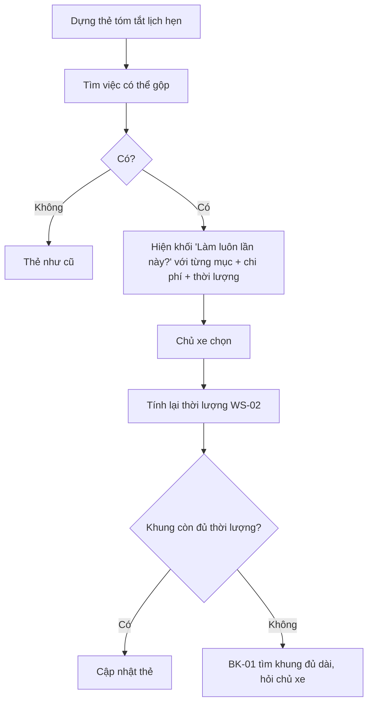

# Functional Specification — Gộp việc vào một lần đến xưởng

> Đặc tả nghiệp vụ cho **HS-02** trong [PRD Phase 2](../../../product/PRD_EV_Care_Phase2.md).
>
> **Quan hệ tài liệu:** gợi ý gộp được đưa vào luồng [BK-01](../booking/bk-01-phase2-spec.ff.md); thời lượng cộng thêm theo [WS-02](../workshop-operations/ws-02-phase2-spec.ff.md). Dữ liệu chiến dịch triệu hồi phụ thuộc P2Q-06.
>
> Quy ước: [README Phase 2](../README.md).
>
> **Đặc tả kỹ thuật:** [API Spec](hs-02-phase2-spec.api.md) · [Entity Spec](hs-02-phase2-spec.entity.md) · [Frontend Spec](hs-02-phase2-spec.fe.md)

---

# 1. Document Information

| Field | Value |
|---|---|
| Feature ID | `FEAT-P2-HS02` |
| Feature Name | Gộp việc vào một lần đến xưởng |
| PRD Feature | HS-02 (P2-B, Could, Chức năng) |
| Document Version / Status | `v0.2` / `Draft` |
| Created / Updated | `2026-10-09` / `2026-10-12` |
| Related Technical Spec | [API Spec](hs-02-phase2-spec.api.md) · [Entity Spec](hs-02-phase2-spec.entity.md) · [Frontend Spec](hs-02-phase2-spec.fe.md) |

---

# 2. Feature Overview

## 2.1 Feature Description

Khi đặt lịch, hệ thống gợi ý làm luôn trong cùng lần những việc sắp phải làm:
- chiến dịch triệu hồi hoặc cập nhật phần mềm của hãng áp cho xe;
- hạng mục sắp đến hạn trong `MERGE_WINDOW_DAYS`;
- khuyến nghị chưa làm từ lần trước (AD-04).

Đây chỉ là **gợi ý**. Chủ xe chọn mục nào cần gộp.

## 2.2 Business Objective

Giảm số lần chủ xe phải đến xưởng (PP2-02, PP2-07).

## 2.3 User Objective

Một lần đi, làm xong nhiều việc.

## 2.4 Business Value

Tăng tỉ lệ hoàn thành triệu hồi; tăng giá trị mỗi lịch hẹn cho xưởng một cách minh bạch.

---

# 3. Scope

## 3.1 In Scope

- Phát hiện việc có thể gộp.
- Gợi ý trong luồng đặt lịch, kèm chi phí ước tính và thời lượng cộng thêm.
- Cập nhật hạng mục và thời lượng lịch hẹn khi chủ xe chọn.

## 3.2 Out of Scope

- Gộp lịch cho nhiều xe (phụ thuộc mở phạm vi nhiều xe — PRD §4.2).
- Tự thêm hạng mục tính phí.

---

# 4. Actors

| Actor | Type | Responsibility |
|---|---|---|
| Chủ xe | User | Chọn gộp |
| Hệ thống hãng | Partner | Chiến dịch triệu hồi, cập nhật phần mềm |
| Bộ lập lịch | System | Tính lại thời lượng, kiểm tra chỗ |

---

# 5. User Story

- `US-P2-HS02-01`: As a chủ xe, I want làm luôn việc sắp đến hạn và triệu hồi trong lần bảo dưỡng này, so that tôi bớt một lần đi.

---

# 6. Use Case

| UC | Tên | Trigger | Postcondition |
|---|---|---|---|
| `UC-HS02-01` | Gợi ý gộp | Thẻ tóm tắt đặt lịch được dựng | Danh sách gợi ý gộp, mặc định chưa chọn (trừ triệu hồi miễn phí) |
| `UC-HS02-02` | Chọn gộp | Chủ xe tick mục | Hạng mục, chi phí ước tính, thời lượng cập nhật; kiểm tra lại chỗ |

---

# 7. User Flow

---

# 8. Screen / UI Flow

| Screen ID | Name | Purpose |
|---|---|---|
| `SCR-HS02-01` | Khối "Làm luôn lần này?" trong thẻ tóm tắt | Danh sách việc gộp, mỗi dòng: tên, lý do (triệu hồi / đến hạn 15/11 / khuyến nghị lần trước), chi phí, +thời lượng |

---

# 9. Main Flow

1. Chủ xe đặt bảo dưỡng mốc 24.000 km.
2. Hãng có chiến dịch cập nhật phần mềm cho xe (miễn phí, +30 phút). Kiểm tra pin đến hạn sau 40 ngày.
3. Thẻ gợi ý cả hai. Triệu hồi được chọn sẵn vì miễn phí; kiểm tra pin để chủ xe tick.
4. Chủ xe tick cả hai. Thời lượng tăng 60 phút, khung 08:00 vẫn đủ. Thẻ cập nhật.

---

# 10. Alternative Flow

- **AF-HS02-01:** Khung không đủ thời lượng → BK-01 tìm khung khác, hỏi chủ xe giữ khung cũ (bỏ gộp) hay đổi khung.

---

# 11. Exception Flow

| ID | Condition | Behavior |
|---|---|---|
| `EF-HS02-01` | Không có dữ liệu triệu hồi từ hãng | Chỉ gợi ý hạng mục đến hạn và khuyến nghị |
| `EF-HS02-02` | Xưởng không làm được hạng mục gộp | Không gợi ý mục đó ở xưởng này |

---

# 12. Business Rules

- **BR-HS02-01 (PRD):** Triệu hồi / cập nhật phần mềm được gợi ý nếu mốc đặt trong `MERGE_WINDOW_DAYS`. **Medium.**
- **BR-HS02-02 (PRD):** Hạng mục đến hạn trong cửa sổ chỉ là gợi ý; chủ xe chọn. **High.**
- **BR-HS02-03 (PRD):** Thời lượng cộng thêm theo WS-02. **High.**
- **BR-HS02-04 (PRD):** Gộp nhiều xe chỉ khi mở phạm vi nhiều xe. **Low.**
- **BR-HS02-05:** Hạng mục tính phí không bao giờ được chọn sẵn. Hạng mục miễn phí (triệu hồi) được chọn sẵn nhưng bỏ chọn được. **High.**
- **BR-HS02-06:** Gộp hạng mục mốc kế tiếp thì F3 coi mốc đó đã làm theo ngày/ODO thực tế (BK-03 BR-BK03-03). **Medium.**

---

# 13. State / Status

Không áp dụng.

# 14. Data Requirements

| Data | Source |
|---|---|
| Chiến dịch triệu hồi theo VIN | Hãng (P2Q-06) |
| Hạng mục đến hạn trong cửa sổ | F3 |
| Khuyến nghị chưa làm | AD-04 / HS-01 |
| Thời lượng, giá | WS-02, F5 |

# 15. Business Error & Edge Cases

| Case ID | Scenario | Expected Behavior |
|---|---|---|
| `EDGE-HS02-01` | Triệu hồi đã được làm ở nơi khác | Hãng báo → không gợi ý |
| `EDGE-HS02-02` | Chủ xe bỏ chọn triệu hồi | Không gợi ý lại trong 30 ngày |

# 16. Permissions & Access

Chủ xe chọn cho lịch của mình. Xưởng thấy hạng mục đã gộp trên lịch.

# 17. Acceptance Criteria

- **AC-HS02-01:** Không hạng mục tính phí nào được thêm vào lịch hẹn khi chủ xe chưa chọn.
- **AC-HS02-02:** Sau khi gộp, thời lượng lịch hẹn bằng tổng thời lượng chuẩn các hạng mục.

# 18. Non-functional Expectations

Gợi ý gộp không làm chậm thẻ tóm tắt quá 300 ms.

# 19. Dependencies

BK-01, WS-02, F3, AD-04, P2Q-06.

# 20. Assumptions

Hãng cung cấp được dữ liệu triệu hồi theo VIN.

# 21. Business Constraints

Không upsell; chỉ gợi ý việc có căn cứ.

# 22. Terminology

| Term | Vietnamese |
|---|---|
| Recall campaign | Chiến dịch triệu hồi |
| Merge | Gộp việc |

# 23. Partner Notes

Cần hãng xác nhận nguồn chiến dịch triệu hồi (P2Q-06).

# 24. Open Questions

| ID | Question | Proposal |
|---|---|---|
| `Q-HS02-01` | `MERGE_WINDOW_DAYS`? | 60 ngày |

# 25. Traceability

PRD Phase 2 HS-02 · BR-HS02-01…06 · AC-HS02-01…02.

# 26. Related Documents

[PRD Phase 2](../../../product/PRD_EV_Care_Phase2.md) · [BK-01](../booking/bk-01-phase2-spec.ff.md) · [API Spec](hs-02-phase2-spec.api.md) · [Entity Spec](hs-02-phase2-spec.entity.md) · [Frontend Spec](hs-02-phase2-spec.fe.md)

# 27. Change Log

| Version | Date | Change |
|---|---|---|
| `v0.1` | `2026-10-09` | Bản nháp đầu |
| `v0.2` | `2026-10-12` | Liên kết đặc tả API, Entity, Frontend |

# 28. Approval

| Role | Status |
|---|---|
| Product Owner | Pending |
| Technical Owner | Pending |
