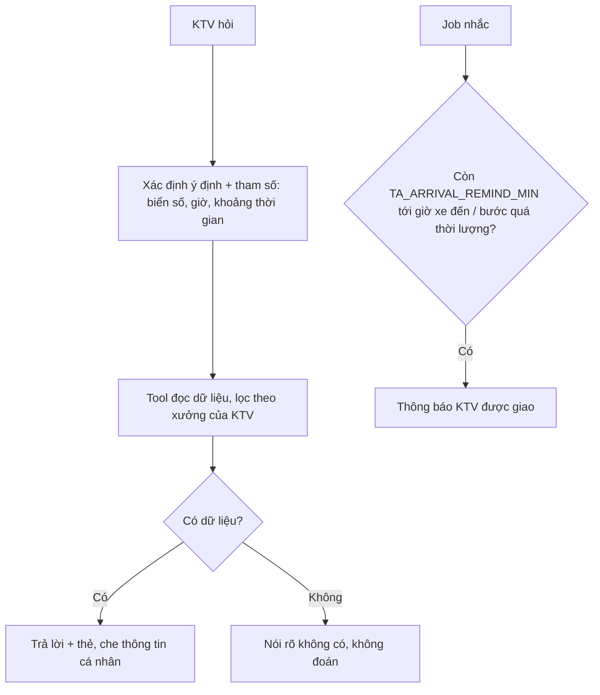

# Functional Specification — Trợ lý tra cứu và nhắc việc cho kỹ thuật viên

> Đặc tả nghiệp vụ cho **TA-01** trong [PRD Phase 2](../../../product/PRD_EV_Care_Phase2.md).
>
> **Quan hệ tài liệu:** cần tài khoản KTV ([WS-03](../workshop-operations/ws-03-phase2-spec.ff.md)). Dữ liệu từ lịch sử dịch vụ hãng, lịch hẹn, tiến độ ([us-057](../../sprint-4/feature-functional/us-057-sprint-4-spec.ff.md)), triệu chứng chủ xe kể ([AD-02](../advisory-and-quotes/ad-02-phase2-spec.ff.md)), báo giá đã duyệt (F5b), khuyến nghị chưa làm ([AD-04](../advisory-and-quotes/ad-04-phase2-spec.ff.md)). Chủ xưởng đã đọc được đoạn hội thoại dẫn tới booking của xưởng mình (PRD MVP F4).
>
> Quy ước: [README Phase 2](../README.md).
>
> **Đặc tả kỹ thuật:** [API Spec](ta-01-phase2-spec.api.md) · [Entity Spec](ta-01-phase2-spec.entity.md) · [Frontend Spec](ta-01-phase2-spec.fe.md)

---

# 1. Document Information

| Field | Value |
|---|---|
| Feature ID | `FEAT-P2-TA01` |
| Feature Name | Trợ lý tra cứu và nhắc việc cho KTV |
| PRD Feature | TA-01 (P2-B, Should, Chức năng) |
| Document Version / Status | `v0.2` / `Draft` |
| Created / Updated | `2026-10-09` / `2026-10-12` |
| Related Technical Spec | [API Spec](ta-01-phase2-spec.api.md) · [Entity Spec](ta-01-phase2-spec.entity.md) · [Frontend Spec](ta-01-phase2-spec.fe.md) |

---

# 2. Feature Overview

## 2.1 Feature Description

Một trợ lý chat trong Workshop Portal cho KTV và chủ xưởng, với bốn tình huống:

| Tình huống | Agent làm gì | Ví dụ câu hỏi |
|---|---|---|
| Tra lịch sử bảo dưỡng của xe | Tìm theo biển số, VIN, tên khách, mã lịch hẹn; gồm lần làm ở xưởng khác (dữ liệu hãng) | "Xe 30A-123.45 lần trước thay gì?" |
| Nhắc lịch cho KTV | Lịch hôm nay, xe sắp đến, bước tiến độ chưa cập nhật | "Hôm nay tôi có mấy xe?" |
| Tình trạng xe trước khi nhận | Tóm tắt ODO, mốc, triệu chứng khách kể, báo giá đã duyệt, khuyến nghị chưa làm, triệu hồi | "Tóm tắt xe 10 giờ sắp vào" |
| KTV quên mình đã làm cho ai | Liệt kê việc đã làm theo thời gian | "Tuần trước tôi làm những xe nào?" |

Ngoài ra trợ lý **nhắc chủ động**: trước giờ xe đến và khi một bước tiến độ quá thời lượng chuẩn.

## 2.2 Business Objective

KTV tra cứu nhanh thay vì lục sổ hay hỏi đồng nghiệp (PP2-12, G2-6).

## 2.3 User Objective

Biết đủ thông tin về xe trước khi làm; không quên lịch.

## 2.4 Business Value

M-11; giảm thời gian chẩn đoán (T₂).

---

# 3. Scope

## 3.1 In Scope

- Bốn tình huống tra cứu.
- Nhắc chủ động: `TA_ARRIVAL_REMIND_MIN` trước giờ đến; bước quá thời lượng.
- Che thông tin cá nhân chủ xe.
- Gợi ý một chạm cho KTV ("Hôm nay tôi có mấy xe?", "Xe tiếp theo", "Việc chưa cập nhật").

## 3.2 Out of Scope

- Hướng dẫn kỹ thuật chi tiết (TA-02).
- Ghi dữ liệu thay KTV (trừ khi KTV xác nhận).

---

# 4. Actors

| Actor | Type | Responsibility |
|---|---|---|
| KTV | User | Hỏi, nhận nhắc |
| Chủ xưởng | User | Hỏi (phạm vi toàn xưởng) |
| Trợ lý xưởng (agent) | System | Gọi tool đọc dữ liệu xưởng |

---

# 5. User Story

- `US-P2-TA01-01`: As a KTV, I want hỏi lịch sử xe bằng biển số, so that tôi biết xe đã làm gì.
- `US-P2-TA01-02`: As a KTV, I want được nhắc trước khi xe đến, so that tôi không quên.
- `US-P2-TA01-03`: As a KTV, I want tóm tắt xe sắp vào, so that tôi chuẩn bị phụ tùng và dụng cụ.
- `US-P2-TA01-04`: As a KTV, I want tra lại những xe tôi đã làm, so that tôi trả lời khi khách quay lại.

---

# 6. Use Case

| UC | Tên | Trigger | Postcondition |
|---|---|---|---|
| `UC-TA01-01` | Tra lịch sử xe | Câu hỏi có biển số / mã | Danh sách lần bảo dưỡng |
| `UC-TA01-02` | Lịch của tôi hôm nay | "Hôm nay tôi có mấy xe?" | Danh sách theo giờ |
| `UC-TA01-03` | Tóm tắt xe sắp vào | "Tóm tắt xe 10 giờ" | Thẻ tóm tắt |
| `UC-TA01-04` | Việc đã làm | "Tuần trước tôi làm xe nào?" | Danh sách |
| `UC-TA01-05` | Nhắc chủ động | Thời điểm / bước quá giờ | Thông báo cho KTV |

---

# 7. User Flow

---

# 8. Screen / UI Flow

| Screen ID | Name | Purpose |
|---|---|---|
| `SCR-TA01-01` | Trợ lý xưởng (panel trong Workshop Portal) | Chat + chip gợi ý cho KTV |
| `SCR-TA01-02` | Thẻ tóm tắt xe | Biển số (PlateTile), model, ODO, mốc, hạng mục, triệu chứng khách kể (nguyên văn), báo giá đã duyệt, khuyến nghị lần trước, triệu hồi |
| `SCR-TA01-03` | Thông báo nhắc | "Xe 30A-123.45 đến lúc 10:00 · bảo dưỡng 24.000 km" |

---

# 9. Main Flow

1. 09:45, KTV An nhận nhắc: xe 10:00 sắp đến.
2. An hỏi "Tóm tắt xe 10 giờ".
3. Thẻ tóm tắt hiện ra: VF 8, 23.400 km, mốc 24.000 km; khách kể "phanh trước kêu khi dừng"; lần trước có khuyến nghị chưa làm "thay lốp sau trái".
4. An chuẩn bị má phanh, và hỏi khách về lốp khi nhận xe.

---

# 10. Alternative Flow

- **AF-TA01-01:** Chủ xưởng hỏi "Hôm nay xưởng có mấy xe?" → phạm vi toàn xưởng.
- **AF-TA01-02:** Xe chưa từng làm ở xưởng → chỉ dữ liệu hãng, ghi rõ nguồn.

# 11. Exception Flow

| ID | Condition | Behavior |
|---|---|---|
| `EF-TA01-01` | Hỏi xe không có lịch với xưởng mình | Từ chối, không lộ dữ liệu |
| `EF-TA01-02` | Biển số mơ hồ (thiếu ký tự) | Hỏi lại hoặc đưa tối đa 3 lựa chọn trong lịch của xưởng |

---

# 12. Business Rules

- **BR-TA01-01 (PRD):** Chỉ dữ liệu xưởng mình. Xe chỉ tra được khi có lịch hẹn (bất kỳ trạng thái) với xưởng. Tên khách rút gọn, SĐT ẩn. **High.**
- **BR-TA01-02 (PRD):** Nhắc `TA_ARRIVAL_REMIND_MIN` trước giờ đến; nhắc khi bước tiến độ quá thời lượng chuẩn. **Medium.**
- **BR-TA01-03 (PRD):** Tóm tắt chỉ dùng dữ liệu có thật; thiếu thì nói thiếu. **High.**
- **BR-TA01-04:** KTV chỉ thấy lịch được giao (theo WS-03 BR-WS03-03), trừ khi chủ xưởng cho phép xem toàn xưởng. **High.**
- **BR-TA01-05:** Triệu chứng khách kể hiển thị nguyên văn, có nhãn "Khách mô tả". **Medium.**
- **BR-TA01-06:** Trợ lý không ghi dữ liệu nghiệp vụ. Muốn cập nhật tiến độ thì KTV bấm nút trên thẻ. **High.**

# 13. State / Status

Không áp dụng.

# 14. Data Requirements

| Data | Source |
|---|---|
| Lịch hẹn, phân công | booking, WS-03 |
| Lịch sử dịch vụ | Hãng + EV Care (HS-01) |
| Triệu chứng | `booking.reported_symptom` (AD-02) |
| Báo giá đã duyệt, khuyến nghị | F5b, AD-04 |
| Tiến độ | us-057 |

# 15. Business Error & Edge Cases

| Case ID | Scenario | Expected Behavior |
|---|---|---|
| `EDGE-TA01-01` | Hai xe cùng giờ | Liệt kê cả hai, hỏi chọn |
| `EDGE-TA01-02` | KTV hỏi về KTV khác | Chỉ chủ xưởng được hỏi |

# 16. Permissions & Access

| Role | Phạm vi |
|---|---|
| KTV | Lịch được giao (+ toàn xưởng nếu được phép) |
| Chủ xưởng | Toàn xưởng |

# 17. Acceptance Criteria

- **AC-TA01-01:** KTV hỏi về xe không thuộc xưởng mình thì bị từ chối.
- **AC-TA01-02:** Tóm tắt xe trùng khớp dữ liệu nguồn (eval ≥ 30 ca).
- **AC-TA01-03:** Nhắc đến trước giờ xe đến đúng `TA_ARRIVAL_REMIND_MIN` ± 1 phút.
- **AC-TA01-04:** Không câu trả lời nào chứa SĐT đầy đủ của chủ xe.

# 18. Non-functional Expectations

Token đầu ≤ 1,5 s (p50), như chat chủ xe.

# 19. Dependencies

WS-03, HS-01, AD-02, AD-04, us-057.

# 20. Assumptions

KTV dùng điện thoại hoặc máy tính bảng tại xưởng (H2-11).

# 21. Business Constraints

Agent xưởng tách biệt với agent chủ xe; không chia sẻ bộ nhớ.

# 22. Terminology

| Term | Vietnamese |
|---|---|
| Workshop assistant | Trợ lý xưởng |
| Vehicle brief | Tóm tắt xe |

# 23. Partner Notes

Cần spec agent riêng (dải `ai-agent`) khi làm kỹ thuật.

# 24. Open Questions

| ID | Question | Proposal |
|---|---|---|
| `Q-TA01-01` | Trợ lý xưởng dùng chung orchestrator với agent chủ xe? | Dùng chung hạ tầng, tách tool và prompt |

# 25. Traceability

PRD Phase 2 TA-01, PP2-12, G2-6, M-11 · BR-TA01-01…06 · AC-TA01-01…04.

# 26. Related Documents

[PRD Phase 2](../../../product/PRD_EV_Care_Phase2.md) · [WS-03](../workshop-operations/ws-03-phase2-spec.ff.md) · [TA-02](ta-02-phase2-spec.ff.md) · [API Spec](ta-01-phase2-spec.api.md) · [Entity Spec](ta-01-phase2-spec.entity.md) · [Frontend Spec](ta-01-phase2-spec.fe.md)

# 27. Change Log

| Version | Date | Change |
|---|---|---|
| `v0.1` | `2026-10-09` | Bản nháp đầu |
| `v0.2` | `2026-10-12` | Liên kết đặc tả API, Entity, Frontend |

# 28. Approval

| Role | Status |
|---|---|
| Product Owner | Pending |
| Technical Owner | Pending |
