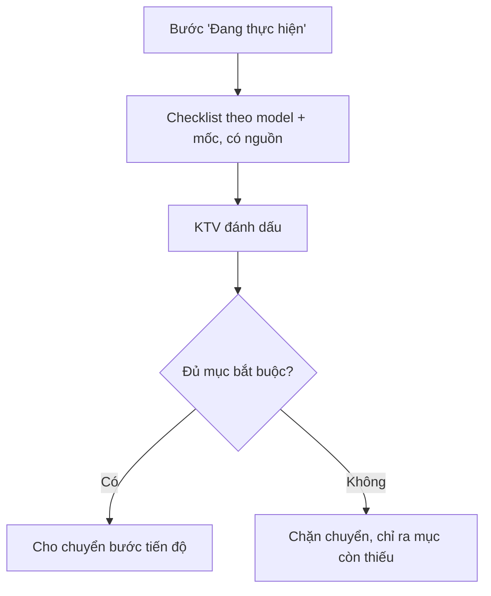

# Functional Specification — Hỗ trợ tại khoang làm việc

> Đặc tả nghiệp vụ cho **TA-02** trong [PRD Phase 2](../../../product/PRD_EV_Care_Phase2.md).
>
> **Quan hệ tài liệu:** mở rộng [TA-01](ta-01-phase2-spec.ff.md). Checklist lấy từ tài liệu kỹ thuật hãng (`maintenance_manual`, F4 RAG). Gắn với tiến độ 6 bước ([us-057](../../sprint-4/feature-functional/us-057-sprint-4-spec.ff.md)).
>
> Quy ước: [README Phase 2](../README.md).
>
> **Đặc tả kỹ thuật:** [API Spec](ta-02-phase2-spec.api.md) · [Entity Spec](ta-02-phase2-spec.entity.md) · [Frontend Spec](ta-02-phase2-spec.fe.md)

---

# 1. Document Information

| Field | Value |
|---|---|
| Feature ID | `FEAT-P2-TA02` |
| Feature Name | Hỗ trợ tại khoang làm việc |
| PRD Feature | TA-02 (P2-C, Could, Chức năng) |
| Document Version / Status | `v0.3` / `Draft` |
| Created / Updated | `2026-10-09` / `2026-10-12` |
| Related Technical Spec | [API Spec](ta-02-phase2-spec.api.md) · [Entity Spec](ta-02-phase2-spec.entity.md) · [Frontend Spec](ta-02-phase2-spec.fe.md) |

---

# 2. Feature Overview

## 2.1 Feature Description

Ba công cụ cho KTV khi đang làm xe:
1. **Checklist hạng mục theo mốc**, lấy từ tài liệu hãng. KTV đánh dấu từng mục; checklist bắt buộc phải xong mới chuyển bước tiến độ.
2. **Tóm tắt giao ca**: xe làm dở, chờ phụ tùng, chờ khách duyệt.
3. **Hỏi và nhập bằng giọng nói** khi tay bận; KTV xác nhận văn bản trước khi lưu.

## 2.2 Business Objective

Giảm sót hạng mục, giao ca không mất thông tin (PP2-12).

## 2.3 User Objective

KTV làm đủ, đúng, ít phải dừng tay để gõ.

## 2.4 Business Value

Chất lượng dịch vụ đồng đều; dữ liệu thời gian từng mục cho WS-02, BK-10.

---

# 3. Scope

## 3.1 In Scope

- Checklist theo model + mốc, có mục bắt buộc / tuỳ chọn, nguồn tài liệu.
- Ràng buộc chuyển bước tiến độ.
- Tóm tắt giao ca theo yêu cầu hoặc giờ cố định.
- Nhập giọng nói (khi trình duyệt cho phép), xác nhận trước khi lưu.

## 3.2 Out of Scope

- Hướng dẫn sửa chữa từng bước có hình ảnh động.
- Đọc mã lỗi từ xe.

---

# 4. Actors

| Actor | Type | Responsibility |
|---|---|---|
| KTV | User | Đánh dấu checklist, nhập giọng nói |
| Chủ xưởng | User | Xem tóm tắt giao ca |
| Trợ lý xưởng | System | Sinh checklist từ tài liệu, tóm tắt |

---

# 5. User Story

- `US-P2-TA02-01`: As a KTV, I want checklist đúng mốc của xe, so that tôi không bỏ sót.
- `US-P2-TA02-02`: As a KTV ca sau, I want tóm tắt giao ca, so that tôi biết xe nào đang dở.
- `US-P2-TA02-03`: As a KTV tay đang bẩn, I want nói thay vì gõ, so that tôi không phải dừng việc.

---

# 6. Use Case

| UC | Tên | Trigger | Postcondition |
|---|---|---|---|
| `UC-TA02-01` | Mở checklist | Bước tiến độ "Đang thực hiện" | Checklist theo model + mốc |
| `UC-TA02-02` | Hoàn tất checklist | Đánh dấu đủ mục bắt buộc | Cho chuyển bước kế tiếp |
| `UC-TA02-03` | Giao ca | Giờ giao ca / KTV yêu cầu | Tóm tắt |
| `UC-TA02-04` | Nhập giọng nói | Bấm micro | Văn bản chờ xác nhận |

---

# 7. User Flow

---

# 8. Screen / UI Flow

| Screen ID | Name | Purpose |
|---|---|---|
| `SCR-TA02-01` | Checklist (mobile/tablet) | Mục lớn dễ chạm; mục bắt buộc có dấu; link nguồn |
| `SCR-TA02-02` | Tóm tắt giao ca | Danh sách xe theo trạng thái |
| `SCR-TA02-03` | Nhập giọng nói | Nút micro, văn bản nhận dạng, Xác nhận / Sửa / Huỷ |

# 9. Main Flow

1. KTV mở bước "Đang thực hiện" của xe VF 8, mốc 24.000 km.
2. Checklist có 8 mục, 6 mục bắt buộc.
3. KTV đánh dấu đủ 6 mục bắt buộc và chuyển sang bước "Kiểm tra chất lượng".

# 10. Alternative Flow

- **AF-TA02-01:** Hạng mục bỏ qua có lý do (ví dụ khách từ chối) → đánh dấu "Bỏ qua" kèm lý do; được tính như đã xử lý.

# 11. Exception Flow

| ID | Condition | Behavior |
|---|---|---|
| `EF-TA02-01` | Không có tài liệu checklist cho model | Dùng danh sách hạng mục của `maintenance_rule`, ghi "chưa có checklist chi tiết" |
| `EF-TA02-02` | Trình duyệt không cho dùng micro | Ẩn nút giọng nói |

---

# 12. Business Rules

- **BR-TA02-01 (PRD):** Checklist từ tài liệu hãng; hoàn tất mục bắt buộc là điều kiện chuyển bước. **High.**
- **BR-TA02-02 (PRD):** Tóm tắt giao ca: xe làm dở, chờ phụ tùng, chờ khách duyệt. **Medium.**
- **BR-TA02-03 (PRD):** Văn bản từ giọng nói phải được KTV xác nhận trước khi lưu. **High.**
- **BR-TA02-04:** Ghi thời điểm đánh dấu từng mục để đo thời lượng thực tế. **Medium.**

# 13. State / Status

Mục checklist: `pending` → `done` / `skipped` (có lý do).

# 14. Data Requirements

| Entity | Purpose |
|---|---|
| `service_checklist_template` (mới) | Mẫu theo model + mốc, nguồn |
| `service_checklist_item` (mới) | Trạng thái theo booking, thời điểm, KTV |

# 15. Business Error & Edge Cases

| Case ID | Scenario | Expected Behavior |
|---|---|---|
| `EDGE-TA02-01` | Hai KTV cùng làm một xe | Cả hai đánh dấu được; log ghi người đánh dấu |

# 16. Permissions & Access

KTV được giao và chủ xưởng.

# 17. Acceptance Criteria

- **AC-TA02-01:** Không chuyển được sang bước kế tiếp khi checklist bắt buộc còn mục `pending`.
- **AC-TA02-02:** Văn bản từ giọng nói không được lưu khi chưa xác nhận.

# 18. Non-functional Expectations

Checklist dùng được một tay trên tablet; vùng chạm ≥ 48 px.

# 19. Dependencies

TA-01, WS-03, us-057, tài liệu kỹ thuật hãng.

# 20. Assumptions

Có tài liệu checklist theo mốc từ hãng.

# 21. Business Constraints

Không thay hướng dẫn chính thức của hãng.

# 22. Terminology

| Term | Vietnamese |
|---|---|
| Checklist | Danh mục kiểm tra |
| Shift handover | Giao ca |

# 23. Partner Notes

Cần xác nhận quyền dùng tài liệu kỹ thuật của hãng trong app.

# 24. Open Questions

| ID | Question | Proposal |
|---|---|---|
| `Q-TA02-01` | Giờ giao ca cố định? | Theo cấu hình xưởng; mặc định không tự gửi |
| `Q-TA02-02` | Công nghệ nhập giọng nói (nhận dạng của trình duyệt / dịch vụ chuyển giọng nói qua backend / bỏ ở Phase 2): quyền riêng tư, chi phí, khả thi | **Pending** — PO đang xem xét (2026-10-12). Chưa làm UC-TA02-04 / SCR-TA02-03 cho tới khi chốt |

# 25. Traceability

PRD Phase 2 TA-02, PP2-12 · BR-TA02-01…04 · AC-TA02-01…02.

# 26. Related Documents

[PRD Phase 2](../../../product/PRD_EV_Care_Phase2.md) · [TA-01](ta-01-phase2-spec.ff.md) · [API Spec](ta-02-phase2-spec.api.md) · [Entity Spec](ta-02-phase2-spec.entity.md) · [Frontend Spec](ta-02-phase2-spec.fe.md)

# 27. Change Log

| Version | Date | Change |
|---|---|---|
| `v0.1` | `2026-10-09` | Bản nháp đầu |
| `v0.2` | `2026-10-12` | Liên kết đặc tả API, Entity, Frontend |
| `v0.3` | `2026-10-12` | Nhập giọng nói chuyển Pending (Q-TA02-02), PO đang xem xét công nghệ |

# 28. Approval

| Role | Status |
|---|---|
| Product Owner | Pending |
| Technical Owner | Pending |
