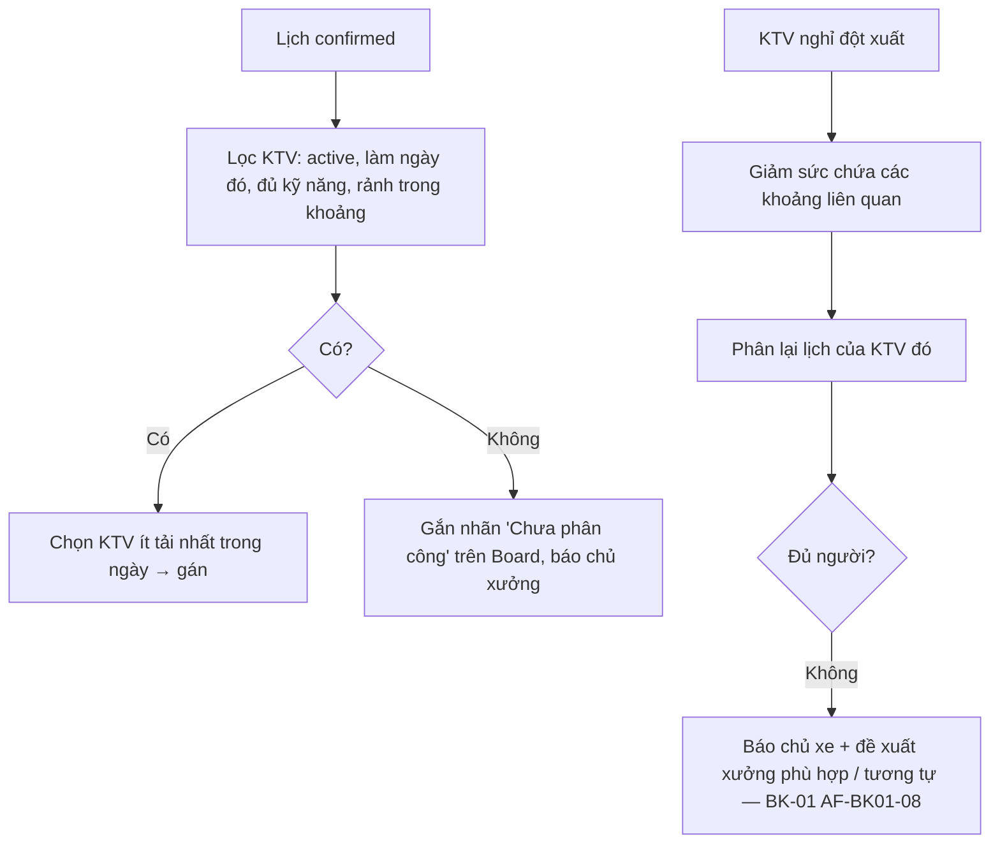

# Functional Specification — Tài khoản kỹ thuật viên và tự phân công

> Đặc tả nghiệp vụ cho **WS-03** trong [PRD Phase 2](../../../product/PRD_EV_Care_Phase2.md).
>
> **Quan trọng — tên vai trò:** trong MVP, "Kỹ thuật viên / Technician" trên giao diện và route `/technician/*` chỉ **chủ xưởng** (`workshop_owner`) (PRD MVP §4). WS-03 tạo vai trò **mới** là kỹ thuật viên thật. Cách đặt tên trong mã nguồn chờ chốt **P2Q-01** (đề xuất: chuyển route chủ xưởng sang `/workshop/*`, vai trò mới là `technician`).
>
> **Quan hệ tài liệu:** khác chủ xe / chủ xưởng (đăng nhập Google, F2 — [us-009](../../sprint-1/feature-functional/us-009-sprint-1-spec.ff.md), [us-013](../../sprint-1/feature-functional/us-013-sprint-1-spec.ff.md)), tài khoản KTV do **xưởng tạo** bằng tên đăng nhập + mật khẩu (PO chốt 2026-10-12). Sức chứa hiện dựa trên `workshop.total_technicians`.
>
> Quy ước: [README Phase 2](../README.md).
>
> **Đặc tả kỹ thuật:** [API Spec](ws-03-phase2-spec.api.md) · [Entity Spec](ws-03-phase2-spec.entity.md) · [Frontend Spec](ws-03-phase2-spec.fe.md)

---

# 1. Document Information

| Field | Value |
|---|---|
| Feature ID | `FEAT-P2-WS03` |
| Feature Name | Tài khoản kỹ thuật viên và tự phân công |
| PRD Feature | WS-03 (P2-B, Must, Chức năng) |
| Document Version / Status | `v0.3` / `Draft` |
| Created / Updated | `2026-10-09` / `2026-10-12` |
| Related Technical Spec | [API Spec](ws-03-phase2-spec.api.md) · [Entity Spec](ws-03-phase2-spec.entity.md) · [Frontend Spec](ws-03-phase2-spec.fe.md) |

---

# 2. Feature Overview

## 2.1 Feature Description

Chủ xưởng **tạo tài khoản** cho KTV (tên đăng nhập + mật khẩu tạm) và là **quản trị viên** của các tài khoản này. KTV đăng nhập lần đầu **phải đổi mật khẩu**, sau đó có hồ sơ gồm kỹ năng và lịch làm. Lịch hẹn đã xác nhận được **tự phân công** cho KTV đủ kỹ năng và ít việc nhất. Chủ xưởng đổi tay được.

KTV xem lịch được giao, cập nhật tiến độ, tạo nháp báo giá phát sinh (AD-04), dùng trợ lý TA-01. Số KTV đang làm thay cho `total_technicians` trong tính sức chứa.

## 2.2 Business Objective

KTV có công cụ riêng (PP2-12). Đây là điều kiện tiên quyết cho TA-01, TA-02, AD-04 (KTV tạo), MC-01, BK-10.

## 2.3 User Objective

- KTV biết hôm nay làm xe nào.
- Chủ xưởng không phải phân việc bằng miệng.

## 2.4 Business Value

M-11; dữ liệu gán thợ cho BK-10.

---

# 3. Scope

## 3.1 In Scope

- Tạo tài khoản KTV (tên đăng nhập + mật khẩu tạm), bắt đổi mật khẩu lần đầu, đặt lại mật khẩu, vô hiệu / bật lại.
- Hồ sơ: tên, kỹ năng, lịch làm (ngày làm, nghỉ).
- Phân quyền KTV.
- Tự phân công và phân công tay.
- Đánh dấu KTV nghỉ đột xuất → cập nhật sức chứa.
- Log hành động KTV.

## 3.2 Out of Scope

- Chấm công, lương.
- KTV làm cho nhiều xưởng.
- KTV tự đăng ký, đăng nhập Google, tự lấy lại mật khẩu qua email (quên mật khẩu ⇒ chủ xưởng đặt lại).
- Ca làm phức tạp (ca kíp, nghỉ trưa).

---

# 4. Actors

| Actor | Type | Responsibility |
|---|---|---|
| Chủ xưởng | User | Quản trị tài khoản KTV (tạo, đặt lại mật khẩu, vô hiệu), quản lý hồ sơ, phân công tay |
| KTV | User | Đăng nhập, đổi mật khẩu lần đầu, xem việc, cập nhật tiến độ |
| Bộ phân công | System | Tự gán |
| Service sức chứa | System | Dùng số KTV khả dụng |

---

# 5. User Story

- `US-P2-WS03-01`: As a chủ xưởng, I want tạo tài khoản cho KTV của xưởng, so that họ tự xem việc được giao mà xưởng vẫn kiểm soát tài khoản.
- `US-P2-WS03-02`: As a KTV, I want thấy danh sách xe hôm nay của mình, so that tôi chuẩn bị.
- `US-P2-WS03-03`: As a chủ xưởng, I want khi một KTV nghỉ, hệ thống tự điều chỉnh, so that không nhận quá sức.

---

# 6. Use Case

| UC | Tên | Trigger | Postcondition |
|---|---|---|---|
| `UC-WS03-01` | Tạo tài khoản KTV | Chủ xưởng nhập tên đăng nhập, tên gọi, mật khẩu tạm | Tài khoản `pending_activation`, gắn xưởng |
| `UC-WS03-02` | Kích hoạt | KTV đăng nhập lần đầu bằng mật khẩu tạm và đổi mật khẩu | Tài khoản `active` |
| `UC-WS03-07` | Đặt lại mật khẩu | KTV quên mật khẩu, báo chủ xưởng | Mật khẩu tạm mới, phiên cũ bị đăng xuất, `pending_activation` |
| `UC-WS03-03` | Tự phân công | Lịch chuyển `confirmed` | Lịch có KTV được giao |
| `UC-WS03-04` | Phân công tay | Chủ xưởng đổi KTV | Cập nhật, thông báo hai KTV |
| `UC-WS03-05` | KTV nghỉ đột xuất | Chủ xưởng đánh dấu | Sức chứa giảm; lịch được phân lại; lịch không còn người làm ⇒ báo chủ xe + đề xuất xưởng phù hợp / tương tự (BK-01 AF-08) |
| `UC-WS03-06` | Vô hiệu KTV | Chủ xưởng tắt | Mất quyền ngay; lịch được phân lại |

---

# 7. User Flow

---

# 8. Screen / UI Flow

| Screen ID | Name | Purpose |
|---|---|---|
| `SCR-WS03-01` | Quản lý KTV (chủ xưởng) | Danh sách, trạng thái, kỹ năng, lịch làm; nút Tạo tài khoản, Đặt lại mật khẩu, Nghỉ hôm nay, Vô hiệu |
| `SCR-WS03-04` | Đăng nhập / đổi mật khẩu lần đầu (KTV) | Tên đăng nhập + mật khẩu; lần đầu bắt buộc đặt mật khẩu mới |
| `SCR-WS03-02` | Việc của tôi (KTV, mobile-first) | Lịch hôm nay theo giờ, mỗi xe: giờ, biển số (PlateTile), hạng mục, nút Cập nhật tiến độ, Phát sinh |
| `SCR-WS03-03` | Cột KTV trên Workshop Board | Lịch có tên KTV; kéo thả hoặc chọn để đổi |

---

# 9. Main Flow

1. Chủ xưởng tạo tài khoản `xuongminhphat.an`, tên gọi "An", kỹ năng "Bảo dưỡng định kỳ, Lốp, Phanh", mật khẩu tạm; đưa trực tiếp cho An.
2. An đăng nhập bằng mật khẩu tạm, hệ thống bắt đặt mật khẩu mới; tài khoản `active`.
3. Lịch 08:00 bảo dưỡng mốc được xác nhận. Bộ phân công gán cho An (đủ kỹ năng, ít tải).
4. An mở "Việc của tôi" và thấy xe 08:00.

---

# 10. Alternative Flow

- **AF-WS03-01:** KTV quên mật khẩu → màn đăng nhập báo "Liên hệ chủ xưởng để đặt lại mật khẩu"; chủ xưởng đặt lại (UC-WS03-07).
- **AF-WS03-02:** Chủ xưởng phân công tay → bộ phân công không tự đổi lại lịch đó.

# 11. Exception Flow

| ID | Condition | Behavior |
|---|---|---|
| `EF-WS03-01` | Mật khẩu tạm quá 7 ngày chưa đổi | Không đăng nhập được; chủ xưởng đặt lại mật khẩu |
| `EF-WS03-02` | Không KTV nào đủ kỹ năng | Nhãn "Chưa phân công"; luật WS-01 có thể chuyển duyệt tay |
| `EF-WS03-03` | Tên đăng nhập đã tồn tại | Báo trùng, gợi ý tên khác |
| `EF-WS03-04` | Nhập sai mật khẩu nhiều lần | Tạm khoá đăng nhập theo cơ chế chống dò mật khẩu; chủ xưởng có thể đặt lại |

---

# 12. Business Rules

- **BR-WS03-01 (PO 2026-10-12, thay PRD "mời bằng email Google"):** Tài khoản KTV do chủ xưởng tạo (tên đăng nhập + mật khẩu tạm); xưởng là quản trị viên và chịu trách nhiệm về tài khoản. KTV gắn đúng một xưởng. **High.**
- **BR-WS03-02 (PRD):** Hồ sơ gồm tên, kỹ năng, lịch làm. Số KTV `active` làm ngày đó thay `total_technicians` khi xưởng bật mô hình KTV. **High.**
- **BR-WS03-03 (PRD):** Quyền KTV: xem lịch được giao (và lịch của xưởng nếu chủ xưởng cho phép), cập nhật tiến độ, tạo nháp phát sinh, dùng TA-01. Không: duyệt báo giá, đổi luật, xem doanh thu, quản lý KTV. **High.**
- **BR-WS03-04 (PRD):** Tự phân công cho KTV đủ kỹ năng, ít tải nhất; chủ xưởng đổi tay được. **Medium.**
- **BR-WS03-05 (PRD, PO làm rõ 2026-10-12):** KTV nghỉ đột xuất thì sức chứa giảm ngay; phân lại cho KTV khác. Lịch mà xưởng không còn đủ người làm ⇒ báo chủ xe và đề xuất xưởng phù hợp hoặc tương tự (BK-01 AF-BK01-08). **High.**
- **BR-WS03-06 (PRD):** Log mọi hành động KTV (người, thời điểm, đối tượng). **High.**
- **BR-WS03-07:** Hồ sơ KTV không hiển thị cho chủ xe ngoài tên gọi (khi MC-01 bật). **Medium.**
- **BR-WS03-08 (PO 2026-10-12):** Lần đăng nhập đầu và sau mỗi lần đặt lại, KTV phải đổi mật khẩu trước khi dùng bất kỳ chức năng nào. Chủ xưởng không xem được mật khẩu (mật khẩu tạm chỉ hiện một lần lúc tạo / đặt lại). **High.**

---

# 13. State / Status

| State | Meaning |
|---|---|
| `pending_activation` | Đã tạo / vừa đặt lại mật khẩu, chưa đổi mật khẩu (mật khẩu tạm quá 7 ngày ⇒ không đăng nhập được) |
| `active` | Đang làm |
| `disabled` | Bị vô hiệu (chủ xưởng bật lại được) |

---

# 14. Data Requirements

| Entity | Purpose | R/W |
|---|---|---|
| `technician` (mới) | Tài khoản, xưởng, trạng thái | R/W |
| `technician_skill` (mới) | Kỹ năng theo nhóm hạng mục | R/W |
| `technician_schedule` (mới) | Ngày làm, nghỉ | R/W |
| `booking_assignment` (mới) | Lịch ↔ KTV, nguồn (tự / tay) | R/W |
| `technician_audit_log` (mới) | Log hành động | W |

# 15. Business Error & Edge Cases

| Case ID | Scenario | Expected Behavior |
|---|---|---|
| `EDGE-WS03-01` | Xưởng chưa có KTV nào active | Giữ mô hình `total_technicians` của MVP |
| `EDGE-WS03-02` | KTV bị vô hiệu khi đang làm xe | Lịch giữ nguyên trạng thái; chủ xưởng chọn KTV khác |

# 16. Permissions & Access

| Role | View | Create | Update | Delete |
|---|---:|---:|---:|---:|
| Chủ xưởng | ✅ KTV xưởng mình | ✅ tạo tài khoản | ✅ hồ sơ, đặt lại mật khẩu | ✅ (vô hiệu) |
| KTV | ✅ hồ sơ mình, lịch được giao | ❌ | ✅ mật khẩu của mình, tiến độ, nháp phát sinh | ❌ |

# 17. Acceptance Criteria

- **AC-WS03-01:** KTV không truy cập được dữ liệu xưởng khác (test phân quyền).
- **AC-WS03-02:** Đánh dấu KTV nghỉ làm giảm sức chứa các khoảng liên quan ngay.
- **AC-WS03-03:** Lịch tự phân công luôn cho KTV đủ kỹ năng.
- **AC-WS03-04:** Mọi hành động KTV có bản ghi log.
- **AC-WS03-05:** Tài khoản `pending_activation` không gọi được chức năng nào ngoài đổi mật khẩu.

# 18. Non-functional Expectations

Màn "Việc của tôi" tải ≤ 1 s trên mobile 4G.

# 19. Dependencies

Firebase Auth (bật thêm đăng nhập mật khẩu), P2Q-01, WS-02, BK-01 AF-08, us-057, us-037.

# 20. Assumptions

Xưởng sẵn sàng tạo tài khoản cho KTV.

# 21. Business Constraints

Tài khoản KTV tách biệt với tài khoản chủ xe / chủ xưởng (không dùng Google); một tài khoản một vai trò ở P2-B.

# 22. Terminology

| Term | Vietnamese | Note |
|---|---|---|
| Technician | Kỹ thuật viên (KTV) | Vai trò mới; **khác** nhãn "Kỹ thuật viên" của chủ xưởng trong MVP |
| Assignment | Phân công | |

# 23. Partner Notes

Cần đổi nhãn giao diện MVP "Kỹ thuật viên" → "Chủ xưởng" (hoặc "Xưởng") trước khi phát hành WS-03 để tránh nhầm.

# 24. Open Questions

| ID | Question | Proposal |
|---|---|---|
| `Q-WS03-01` | Đặt tên vai trò và route (P2Q-01)? | Route chủ xưởng `/workshop/*`; vai trò mới `technician` |
| `Q-WS03-02` | KTV có xem toàn bộ lịch xưởng không? | Chủ xưởng chọn; mặc định chỉ lịch được giao |

# 25. Traceability

PRD Phase 2 WS-03, PP2-12, G2-6, M-11 · BR-WS03-01…08 · AC-WS03-01…05.

# 26. Related Documents

[PRD Phase 2](../../../product/PRD_EV_Care_Phase2.md) · [TA-01](../technician-assistant/ta-01-phase2-spec.ff.md) · [AD-04](../advisory-and-quotes/ad-04-phase2-spec.ff.md) · [API Spec](ws-03-phase2-spec.api.md) · [Entity Spec](ws-03-phase2-spec.entity.md) · [Frontend Spec](ws-03-phase2-spec.fe.md)

# 27. Change Log

| Version | Date | Change |
|---|---|---|
| `v0.1` | `2026-10-09` | Bản nháp đầu |
| `v0.2` | `2026-10-12` | Liên kết đặc tả API, Entity, Frontend |
| `v0.3` | `2026-10-12` | PO chốt: tài khoản KTV do xưởng tạo (tên đăng nhập + mật khẩu, đổi mật khẩu lần đầu) thay lời mời Google; KTV nghỉ đột xuất không đủ người ⇒ báo chủ xe + đề xuất xưởng phù hợp / tương tự |

# 28. Approval

| Role | Status |
|---|---|
| Product Owner | Pending |
| Technical Owner | Pending |
