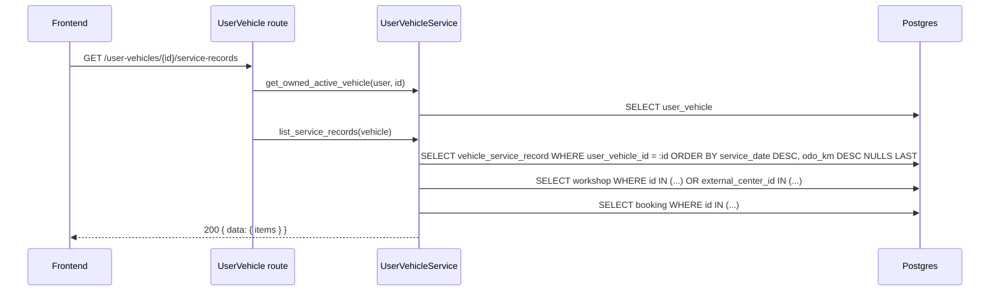

# API Technical Specification — Lịch sử dịch vụ của xe

> Backend cho Feature `FEAT-VEH-002` — phần mở rộng của PRD F3 (US-065 → US-068).
>
> **Nguồn nghiệp vụ:** [Functional Spec](../feature-functional/us-065-sprint-4-spec.ff.md) là chuẩn; API **không** định nghĩa lại nghiệp vụ, chỉ trỏ `BR-xxx` / `EF-xxx` / `EDGE-xxx`. **Entity:** [Entity Spec](../entity/us-065-sprint-4-spec.entity.md) — đọc `vehicle_service_record` (ENT-415), không thêm bảng.
>
> **Bối cảnh:** endpoint đã chạy (`backend/src/modules/user_vehicle/route.py`) trước khi có đặc tả. Tài liệu ghi lại hợp đồng hiện tại; mã `API-VEH-005` nối tiếp dải `API-VEH-001…004` của [us-017 API](../../sprint-2/api/us-017-sprint-2-spec.api.md).

---

# 0. Document Information

| Field | Value |
|---|---|
| Document ID | `API-SPEC-VEH-002` |
| Version | `v1.0` |
| Status | `Draft` |
| Base URL | `/api/v1` |
| Module | `backend/src/modules/user_vehicle` |
| Created Date | `2026-10-07` |

---

# 1. API Group

| API ID | Method | Endpoint | Actor | Mục đích | FF |
|---|---|---|---|---|---|
| `API-VEH-005` | `GET` | `/api/v1/user-vehicles/{userVehicleId}/service-records` | Chủ xe | Toàn bộ lịch sử dịch vụ của xe, mới nhất trước | UC-1601, UC-1602 |

Không có API ghi cho chủ xe (FF BR-1601). Dữ liệu được ghi bởi:

| Writer | Ở đâu | Nguồn |
|---|---|---|
| `JOB-VEH-001` (đồng bộ hãng, webhook) | [us-017 API](../../sprint-2/api/us-017-sprint-2-spec.api.md) | `OEM` |
| `API-WB-04` action `COMPLETE` | [us-037 API](../../sprint-3/api/us-037-sprint-3-spec.api.md) | `EV_CARE` |

---

# 2. Authentication & Authorization

| Bước | Quy tắc | Lỗi |
|---|---|---|
| Xác thực | `Authorization: Bearer <Firebase ID token>` | `401` (body mặc định của FastAPI: `{"detail": "Invalid or expired Firebase token."}`) |
| Tài khoản | `require_active_vehicle_owner`: chủ xe đã đăng ký, `ACTIVE`, đã xong onboarding | `404 USER_NOT_REGISTERED`, `403 ONBOARDING_REQUIRED`, `403 ACCOUNT_SUSPENDED`, `403 ACCOUNT_INACTIVE` |
| Quyền với xe | `get_owned_active_vehicle`: `user_vehicle.user_id = uid` | Xe không tồn tại **hoặc** của người khác ⇒ `404 VEHICLE_NOT_FOUND` (FF BR-1608, không tiết lộ sự tồn tại) |
| Xe hoạt động | Liên kết và xác thực còn hiệu lực (us-017 BR-010) | `409 VEHICLE_NOT_ACTIVE` |

---

# 3. Request

```http
GET /api/v1/user-vehicles/{userVehicleId}/service-records
Authorization: Bearer <token>
```

| Param | In | Type | Required | Rule |
|---|---|---|---:|---|
| `userVehicleId` | path | `uuid` | Yes | Sai định dạng ⇒ `400 INVALID_REQUEST`, `details.field = "userVehicleId"` (prefix `/user-vehicles` dùng envelope lỗi chung) |

Không có query param. Không phân trang phía máy chủ trong MVP (FF EDGE-1605, Q-1602).

---

# 4. Internal Processing



1. Kiểm tra quyền (§2).
2. Đọc mọi `vehicle_service_record` của xe, sắp theo FF BR-1603.
3. Ghép xưởng (FF BR-1606): ưu tiên `workshop_id`; không có thì ghép `external_center_id` với `workshop.external_center_id`; không ghép được ⇒ `workshop = null`.
4. Ghép lịch hẹn cho dòng `ev_care` có `booking_id` ⇒ `bookingCode`, `actualCost` (FF BR-1607, BR-1609). Lịch hẹn đã xoá (`booking_id` bị `SET NULL`) ⇒ cả hai `null` (FF EDGE-1604).
5. Trả kết quả. Tổng cộng 3 truy vấn, không phụ thuộc số dòng (không N+1).

Không ghi dữ liệu, không gọi hệ thống hãng.

---

# 5. Response

## 5.1 Success — `200 OK`

```json
{
  "data": {
    "items": [
      {
        "recordId": "6f1c…",
        "source": "EV_CARE",
        "serviceDate": "2026-09-20",
        "odoKm": 12050,
        "isPeriodic": true,
        "itemsDone": null,
        "workshop": { "workshopId": "5b0e…", "name": "VinFast Smart City" },
        "bookingId": "8d2e…",
        "bookingCode": "EVC-1A2B3C4D",
        "actualCost": "1250000.00"
      },
      {
        "recordId": "a91d…",
        "source": "OEM",
        "serviceDate": "2026-04-12",
        "odoKm": 6020,
        "isPeriodic": true,
        "itemsDone": "Thay lọc gió, kiểm tra phanh",
        "workshop": { "workshopId": "c3a0…", "name": "VinFast Hà Nội" },
        "bookingId": null,
        "bookingCode": null,
        "actualCost": null
      }
    ]
  }
}
```

Xe chưa có lần nào ⇒ `items: []` (FF AF-1601), vẫn `200`.

## 5.2 Response Fields

| Field | Type | Nullable | Description | FF |
|---|---|---:|---|---|
| `recordId` | `uuid` | No | `vehicle_service_record.id` | — |
| `source` | `"OEM" \| "EV_CARE"` | No | Nguồn của dòng | BR-1602 |
| `serviceDate` | `date` (`YYYY-MM-DD`) | No | Ngày dịch vụ (giờ Việt Nam) | BR-1603 |
| `odoKm` | `integer` | Yes | ODO lúc làm | EDGE-1602 |
| `isPeriodic` | `boolean` | No | Định kỳ hay sửa chữa/kiểm tra | BR-1604 |
| `itemsDone` | `string` | Yes | Ghi chú hạng mục; FE dùng nhãn theo loại khi `null` | BR-1605 |
| `workshop` | `{ workshopId: uuid \| null, name: string }` | Yes | Xưởng đã ghép | BR-1606 |
| `bookingId` | `uuid` | Yes | Chỉ dòng `EV_CARE` | BR-1609 |
| `bookingCode` | `string` | Yes | Mã lịch hẹn (`EVC-…`) | BR-1609, BR-1610 |
| `actualCost` | `decimal` (chuỗi số) | Yes | Chi phí thực tế khi hoàn tất; `null` với `OEM` | BR-1607 |

---

# 6. Error Handling

Định dạng lỗi chung của backend:

```json
{ "error": { "code": "VEHICLE_NOT_FOUND", "message": "…", "details": null, "traceId": "c0ffee…" } }
```

| HTTP | Code | Khi nào | FF |
|---|---|---|---|
| `401` | — (`detail`) | Thiếu hoặc sai token; không theo envelope chung | — |
| `403` | `ONBOARDING_REQUIRED` | Chưa xong onboarding | §16.2 |
| `403` | `ACCOUNT_SUSPENDED` / `ACCOUNT_INACTIVE` | Tài khoản bị khoá / ngừng | §16.2 |
| `404` | `USER_NOT_REGISTERED` | Token hợp lệ nhưng chưa có tài khoản EV Care | — |
| `404` | `VEHICLE_NOT_FOUND` | Xe không tồn tại hoặc của người khác | EF-1602, AC-1605 |
| `409` | `VEHICLE_NOT_ACTIVE` | Xe của chủ xe nhưng liên kết không còn hiệu lực | EF-1602 |
| `400` | `INVALID_REQUEST` | `userVehicleId` không phải UUID | — |
| `5xx` | — | Lỗi máy chủ / DB | EF-1601 |

---

# 7. Database / Entity Interaction

| Entity | Bảng | Read / Write | Cột dùng |
|---|---|---|---|
| `ENT-415` VehicleServiceRecord | `vehicle_service_record` | Read | Mọi cột hiển thị; index `ix_service_record_vehicle_date (user_vehicle_id, service_date, odo_km)` |
| `ENT-003` UserVehicle | `user_vehicle` | Read | `user_id`, trạng thái liên kết |
| `ENT-008` Workshop | `workshop` | Read | `id`, `name`, `external_center_id` |
| `ENT-402` Booking | `booking` | Read | `booking_code`, `actual_cost` |

Không có transaction ghi.

---

# 8. Idempotency & Concurrency

`GET` an toàn, idempotent. Đọc trong lúc job đồng bộ đang upsert có thể thấy hoặc chưa thấy dòng mới; lần tải sau sẽ thấy (FF AF-1603).

---

# 9. Observability & Performance

| Mục | Yêu cầu |
|---|---|
| Log | Access log chuẩn kèm `traceId`; không log `itemsDone` (có thể chứa thông tin cá nhân hãng ghi) |
| Hiệu năng | ≤ 500 ms p90 (PRD §8) với ≤ 100 dòng/xe |
| Cache | Không cache phía máy chủ; FE cache theo khoá `service-records:{userVehicleId}` |

---

# 10. Example

```bash
curl -s https://<host>/api/v1/user-vehicles/3f5a…/service-records \
  -H "Authorization: Bearer $ID_TOKEN"
```

---

# 11. Test Coverage

| Test | File |
|---|---|
| Gộp hai nguồn, thứ tự, ghép xưởng theo mã trung tâm, chi phí chỉ ở EV Care | `backend/tests/test_api/test_user_vehicle_api.py` |
| Xe chưa có lần nào ⇒ `items: []` | `test_service_records_empty_before_any_service` |
| Xe của người khác ⇒ `404 VEHICLE_NOT_FOUND` | `test_other_owners_vehicle_is_not_found_ac008` |

---

# 12. Open Questions

| ID | Question | Status |
|---|---|---|
| `Q-1602` | Thêm `limit` / `cursor` khi một xe có > 100 lần | Open — `[Đề xuất]` chưa cần trong MVP |
| `Q-1603` | Ghi `items_done` cho dòng `EV_CARE` khi hoàn tất (tên mốc) | Open — sửa ở `WorkshopBoardService._on_completed` nếu PO đồng ý |

---

# 13. Change Log

| Version | Date | Author | Change |
|---|---|---|---|
| `v1.0` | `2026-10-07` | Team 4 Người | Bản đầu, theo endpoint đã triển khai |

---

# 14. References

- [us-065 FF](../feature-functional/us-065-sprint-4-spec.ff.md) · [us-065 FE](../frontend/us-065-sprint-4-spec.fe.md) · [us-065 Entity](../entity/us-065-sprint-4-spec.entity.md)
- [us-017 API](../../sprint-2/api/us-017-sprint-2-spec.api.md) — đồng bộ hãng, `API-VEH-001…004`
- [us-037 API](../../sprint-3/api/us-037-sprint-3-spec.api.md) — `API-WB-04` `COMPLETE`
