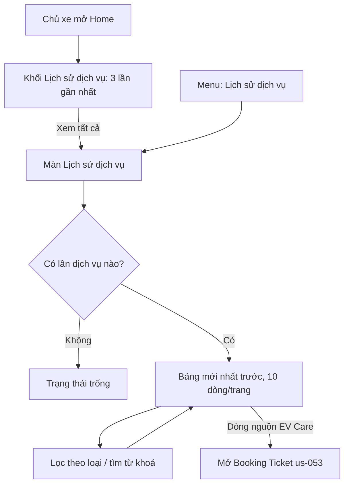

# Functional Specification — Lịch sử dịch vụ của xe

> Tài liệu đặc tả chức năng/nghiệp vụ cho màn **Lịch sử dịch vụ**, phần mở rộng của Feature **F3 — Hồ sơ xe & trạng thái đến hạn** trong [PRD EV Care MVP](../../../product/PRD_EV_Care_MVP.md#f3--hồ-sơ-xe--trạng-thái-đến-hạn).
>
> **Bối cảnh:** màn `/history` và API `API-VEH-005` đã chạy trước khi có đặc tả (báo cáo [đối chiếu spec–code 03/10](../../../reports/2026-10-03_0245_bao-cao-doi-chieu-spec-code.md), mục SP-01). Tài liệu này mô tả hành vi đang chạy và chốt nó thành nghiệp vụ. Chỗ chưa chốt được đánh dấu `[Đề xuất]` (đã có giá trị mặc định để triển khai) hoặc `[Cần xác nhận]`, và được liệt kê lại ở mục 24.

---

# 1. Document Information

| Field | Value |
|---|---|
| Feature ID | `FEAT-VEH-002` |
| Feature Name | `Lịch sử dịch vụ của xe` |
| PRD Feature | `F3` (Must, S1–S2) — phần mở rộng |
| Document Version | `v1.0` |
| Status | `Draft` |
| Product / Project | EV Care — AI Agent Chăm sóc sau bán & lịch bảo dưỡng xe điện |
| Business Owner | Lê Đức Tùng (PO) |
| Author | Team 4 Người |
| Reviewer | Tech Lead |
| Stakeholders | Product, Frontend, Backend, Hệ thống hãng xe |
| Created Date | `2026-10-07` |
| Updated Date | `2026-10-07` |
| Related PRD | [PRD_EV_Care_MVP.md §F3](../../../product/PRD_EV_Care_MVP.md) (v3.8) |
| Related Frontend Spec | [us-065-sprint-4-spec.fe.md](../frontend/us-065-sprint-4-spec.fe.md) |
| Related API Spec | [us-065-sprint-4-spec.api.md](../api/us-065-sprint-4-spec.api.md) |
| Related Entity Spec | [us-065-sprint-4-spec.entity.md](../entity/us-065-sprint-4-spec.entity.md) |
| Related Feature Spec | [us-017 FF](../../sprint-2/feature-functional/us-017-sprint-2-spec.ff.md) (nguồn dữ liệu, mốc gốc) · [us-037 FF](../../sprint-3/feature-functional/us-037-sprint-3-spec.ff.md) (hoàn tất trên Board) |
| Related Design / Figma | [wireframe.md](../../../design/wireframe.md) |
| Related GitHub Issue | `[Cần điền]` |

---

# 2. Feature Overview

## 2.1 Feature Description

Chủ xe xem **mọi lần bảo dưỡng và sửa chữa** của xe mình ở một nơi. Danh sách gộp hai nguồn:

1. **Hãng** — lịch sử dịch vụ hãng ghi nhận, EV Care đồng bộ về bằng job định kỳ và webhook (us-017 BR-003, BR-011, BR-012).
2. **EV Care** — lịch hẹn được chủ xưởng bấm **Hoàn tất** trên Workshop Board (us-037).

Mỗi lần dịch vụ hiện ngày, số km, hạng mục, xưởng, nguồn và chi phí thực tế (nếu có). Lần làm qua EV Care có liên kết mở lại lịch hẹn. Trang chủ (Home) hiện 3 lần gần nhất, kèm lối sang màn đầy đủ.

Danh sách **chỉ để đọc**: chủ xe không thêm, sửa hay xoá được lần nào (us-017 BR-003).

## 2.2 Business Objective

Giải quyết một phần PP-01 (khó theo dõi lịch bảo dưỡng định kỳ). Chủ xe thấy được lần bảo dưỡng gần nhất mà hệ thống dùng làm mốc gốc khi tính mốc tiếp theo (us-017 BR-005), nên tin vào trạng thái đến hạn hơn.

## 2.3 User Objective

Biết xe đã làm gì, khi nào, ở đâu, tốn bao nhiêu, mà không phải giữ hoá đơn giấy hay hỏi lại xưởng.

## 2.4 Business Value

- Chủ xe tự kiểm tra được vì sao mốc tiếp theo là mốc đó.
- Lần làm qua EV Care nối được về lịch hẹn và chi phí thực tế, khác với sổ bảo dưỡng giấy.
- Một nguồn dữ liệu dùng chung cho Home, màn lịch sử và phép tính mốc.

---

# 3. Scope

## 3.1 In Scope

- Xem toàn bộ lịch sử dịch vụ của xe đang hoạt động thuộc chủ xe, mới nhất trước.
- Lọc theo loại: bảo dưỡng định kỳ / sửa chữa – kiểm tra.
- Tìm theo hạng mục, tên xưởng, mã lịch hẹn.
- Xem 3 lần gần nhất trên Home.
- Mở lại lịch hẹn (Booking Ticket, us-053) từ lần làm qua EV Care.

## 3.2 Out of Scope

- Chủ xe nhập, sửa, xoá hay ẩn một lần dịch vụ (us-017 BR-003).
- Tải hoá đơn, ảnh, biên bản kỹ thuật.
- Chi phí của lần làm do hãng ghi nhận (hãng không gửi chi phí — Q-1604).
- Xuất file (PDF/CSV), chia sẻ lịch sử.
- Chủ xưởng xem lịch sử dịch vụ của xe khách (trang Khách hàng `/customers` chưa có spec).
- AI Agent đọc lịch sử dịch vụ qua tool riêng (Agent dùng trạng thái đến hạn của us-017).
- Nhiều xe/tài khoản.

---

# 4. Actors & Stakeholders

## 4.1 Actors

| Actor | Type | Responsibility |
|---|---|---|
| Chủ xe | User | Xem, lọc, tìm lịch sử dịch vụ của xe mình |
| Hệ thống hãng xe | System / Partner | Ghi nhận lịch sử dịch vụ, cung cấp qua API đọc và webhook |
| Job đồng bộ EV Care | System | Kéo lịch sử dịch vụ của hãng về (us-017 JOB-VEH-001) |
| Chủ xưởng | User (gián tiếp) | Bấm Hoàn tất trên Board, nhập chi phí thực tế ⇒ sinh lần dịch vụ nguồn EV Care |
| Backend EV Care | System | Lưu, gộp hai nguồn, trả danh sách theo thứ tự |

## 4.2 Stakeholders

| Stakeholder | Organization / Team | Interest / Responsibility |
|---|---|---|
| Product Owner | Product | Chốt các điểm `[Đề xuất]` ở mục 24 |
| Backend Team | Engineering | API-VEH-005, ghi bản ghi EV Care khi hoàn tất |
| Frontend Team | Engineering | Màn `/history`, khối lịch sử trên Home |
| Hệ thống hãng | Partner | Hợp đồng `ServiceHistory` (us-017 O7) |

---

# 5. User Story

## US-065

**As a** chủ xe đã hoàn tất onboarding

**I want to** xem toàn bộ các lần bảo dưỡng và sửa chữa của xe, từ hãng và từ EV Care

**So that** tôi biết xe đã được làm gì, khi nào, ở đâu và tốn bao nhiêu.

### Additional User Stories

- `US-066`: As a chủ xe, I want to thấy 3 lần dịch vụ gần nhất ngay trên Home, so that tôi không phải mở thêm màn mới để biết lần gần nhất.
- `US-067`: As a chủ xe, I want to lọc theo bảo dưỡng định kỳ hay sửa chữa và tìm theo hạng mục, xưởng, mã lịch hẹn, so that tôi tìm nhanh một lần cụ thể.
- `US-068`: As a chủ xe, I want to mở lại lịch hẹn từ một lần làm qua EV Care, so that tôi xem lại chi tiết lịch hẹn, tiến độ và chi phí của lần đó.

---

# 6. Use Case

## UC-1601 — Xem lịch sử dịch vụ

### 6.1 Use Case Description

Chủ xe mở màn **Lịch sử dịch vụ**. Hệ thống hiển thị mọi lần dịch vụ của xe, mới nhất trước, có lọc, tìm và phân trang.

### 6.2 Primary Actor

Chủ xe

### 6.3 Supporting Actors / Systems

- Backend EV Care (API-VEH-005)
- Dữ liệu đồng bộ từ hãng (us-017)
- Workshop Board (us-037) — nguồn các lần EV Care

### 6.4 Trigger

Chủ xe chọn "Lịch sử dịch vụ" ở menu, hoặc "Xem tất cả" trên khối lịch sử của Home.

### 6.5 Preconditions

- Chủ xe đã đăng nhập, tài khoản `ACTIVE` (FEAT-AUTH-001).
- Xe đã được hãng xác thực và đang hoạt động (us-017 BR-010).

### 6.6 Postconditions

- Không thay đổi dữ liệu nào (chỉ đọc).

## UC-1602 — Xem lịch sử gần nhất trên Home

### 6.1 Use Case Description

Home hiển thị 3 lần dịch vụ gần nhất dưới thẻ xe, kèm liên kết "Xem tất cả".

### 6.2 Primary Actor

Chủ xe

### 6.4 Trigger

Chủ xe mở Home (us-017 SCR-301).

### 6.5 Preconditions

Như UC-1601.

### 6.6 Postconditions

Không thay đổi dữ liệu.

---

# 7. User Flow

## 7.1 Main User Flow



## 7.2 Flow Description

| Step | Actor | Action / Event | System Response | Result |
|---|---|---|---|---|
| 1 | Chủ xe | Mở màn Lịch sử dịch vụ | Lấy xe đang hoạt động, gọi API-VEH-005 | Bảng hoặc trạng thái trống |
| 2 | Chủ xe | Chọn bộ lọc "Bảo dưỡng định kỳ" | Giữ lại các lần định kỳ, về trang 1 | Bảng thu gọn |
| 3 | Chủ xe | Gõ "phanh" vào ô tìm | Lọc theo hạng mục, tên xưởng, mã lịch hẹn | Bảng thu gọn hoặc "Không tìm thấy" |
| 4 | Chủ xe | Bấm "Lịch hẹn" ở dòng EV Care | Mở `/bookings/:bookingId` | Booking Ticket (us-053) |

---

# 8. Screen / UI Flow

## 8.1 Screen Flow

```text
[Home — SCR-301]
    └── khối "Lịch sử dịch vụ" (SCR-1602)
            └── Xem tất cả ──> [Lịch sử dịch vụ — SCR-1601]
                                   ├── dòng EV Care ──> [Booking Ticket — us-053 SCR-1201]
                                   ├── [Trạng thái trống]
                                   └── [Trạng thái lỗi]
```

## 8.2 Screen List

| Screen ID | Screen Name | Purpose | Entry From | Exit To |
|---|---|---|---|---|
| `SCR-1601` | Lịch sử dịch vụ (`/history`) | Toàn bộ lịch sử, lọc, tìm, phân trang | Menu, SCR-1602 | Booking Ticket |
| `SCR-1602` | Khối "Lịch sử dịch vụ" trên Home | 3 lần gần nhất | SCR-301 | SCR-1601 |

## 8.3 Screen / UI Reference

### SCR-1601 — Lịch sử dịch vụ

**Main UI**

- Tiêu đề "Lịch sử dịch vụ", phụ đề "Các lần bảo dưỡng và sửa chữa của xe, đồng bộ từ hãng và từ EV Care".
- Bộ lọc: Tất cả · Bảo dưỡng định kỳ · Sửa chữa / kiểm tra.
- Ô tìm "Tìm hạng mục, xưởng, mã lịch hẹn...".
- Bảng: Ngày · Số km · Hạng mục · Xưởng dịch vụ · Nguồn (Hãng / EV Care) · Chi phí · liên kết "Lịch hẹn".
- Chân bảng: "Hiển thị a–b trong n kết quả" và phân trang.

**Business Meaning:** mỗi dòng là một lần xe được làm dịch vụ đã được ghi nhận chính thức (hãng hoặc xưởng qua EV Care).

**User Action:** lọc, tìm, chuyển trang, mở lịch hẹn.

**System Behavior:** chỉ đọc; không có nút thêm/sửa/xoá.

### SCR-1602 — Khối lịch sử trên Home

- 3 lần gần nhất: Số km · Ngày · Hạng mục · Xưởng · Nguồn; liên kết "Xem tất cả →".
- Chưa có lần nào: "Chưa có lịch sử bảo dưỡng — mốc được tính từ ngày mua." (us-017 BR-005).

---

# 9. Main Flow

## 9.1 Happy Path

1. Chủ xe mở màn Lịch sử dịch vụ.
2. Hệ thống xác định xe đang hoạt động của chủ xe.
3. Hệ thống trả mọi lần dịch vụ của xe theo thứ tự BR-1603.
4. Màn hiển thị trang 1 (10 dòng) cùng tổng số kết quả.
5. Chủ xe lọc hoặc tìm; bảng cập nhật ngay, không gọi lại backend.
6. Chủ xe bấm "Lịch hẹn" ở một dòng EV Care và xem Booking Ticket.

---

# 10. Alternative Flow

## AF-1601 — Xe chưa có lần dịch vụ nào

**Condition:** hãng chưa ghi nhận lần nào và chưa có lịch hẹn hoàn tất qua EV Care.

**Flow:** màn hiện trạng thái trống "Chưa có lịch sử dịch vụ" — "Các lần bảo dưỡng từ hãng và lịch hẹn hoàn thành trên EV Care sẽ hiện ở đây."; Home hiện câu ở SCR-1602.

**Expected Result:** không báo lỗi; mốc tiếp theo vẫn tính từ ngày mua (us-017 BR-005).

## AF-1602 — Lọc/tìm không ra kết quả

**Condition:** có lịch sử nhưng không dòng nào khớp bộ lọc + từ khoá.

**Flow:** bảng hiện "Không tìm thấy kết quả phù hợp", phân trang về 1.

**Expected Result:** chủ xe đổi bộ lọc hoặc xoá từ khoá để xem lại.

## AF-1603 — Hãng vừa đồng bộ thêm lần mới

**Condition:** job đồng bộ hoặc webhook (us-017) ghi thêm một lần dịch vụ trong lúc chủ xe đang xem.

**Flow:** lần mới hiện ở lần tải dữ liệu kế tiếp (có thể trễ vài phút do cache phía app); không có cập nhật tức thời.

**Expected Result:** dữ liệu khớp bản đã đồng bộ, không gọi hãng khi xem (us-017 §2.1).

---

# 11. Exception Flow

## EF-1601 — Không tải được lịch sử

**Condition:** lỗi mạng hoặc lỗi máy chủ khi gọi API-VEH-005.

**System Behavior:** không hiển thị dữ liệu cũ sai lệch; trả lỗi kèm mã truy vết (`traceId`).

**User Experience:** "Chưa tải được lịch sử dịch vụ." kèm nút **Thử lại** và mã truy vết.

**Recovery:** thử lại; dữ liệu đã tải trước đó vẫn được giữ nếu lần làm mới sau bị lỗi.

## EF-1602 — Xe không thuộc chủ xe hoặc không còn hoạt động

**Condition:** xe không tồn tại, của người khác, hoặc liên kết không còn hiệu lực.

**System Behavior:** từ chối, không tiết lộ xe có tồn tại hay không (BR-1608).

**User Experience:** màn hiện trạng thái của cổng chọn xe (chưa có xe / xe không còn hoạt động) như các màn xe khác (us-017).

**Recovery:** quay lại Home.

---

# 12. Business Rules

## BR-1601 — Chỉ đọc

**Rule:** lịch sử dịch vụ chỉ được ghi bởi đồng bộ hãng và bởi thao tác Hoàn tất của chủ xưởng. Không có API, màn hình hay tool AI nào để chủ xe thêm/sửa/xoá (kế thừa us-017 BR-003).

**Priority:** High

## BR-1602 — Hai nguồn, mỗi lần dịch vụ một dòng

**Rule:**

- **Nguồn `OEM`:** mỗi đơn dịch vụ của hãng (`external_order_id`) là một dòng; đồng bộ lại thì cập nhật dòng cũ, không tạo dòng mới (us-017 BR-ENT-433).
- **Nguồn `EV_CARE`:** mỗi lịch hẹn chuyển sang `COMPLETED` trên Board sinh đúng một dòng (us-037 BR-807); hoàn tất lại không tạo dòng thứ hai.

**Priority:** High

## BR-1603 — Thứ tự hiển thị

**Rule:** mới nhất trước theo ngày dịch vụ; cùng ngày thì số km lớn hơn trước; dòng không có số km xếp cuối trong ngày đó.

**Priority:** Medium

## BR-1604 — Loại lần dịch vụ

**Rule:**

- Mỗi dòng có cờ **định kỳ / ngoài định kỳ**.
- `OEM`: theo cờ của hãng; hãng không gửi cờ ⇒ coi là định kỳ (us-017 Q-304).
- `EV_CARE`: lịch hẹn có mốc bảo dưỡng (`odo_milestone`) ⇒ định kỳ; không có mốc ⇒ sửa chữa/kiểm tra.
- Chỉ lần **định kỳ** được dùng làm mốc gốc khi tính mốc tiếp theo (us-017 BR-005). Lần ngoài định kỳ vẫn hiện trong lịch sử.

**Priority:** High

## BR-1605 — Hạng mục hiển thị

**Rule:** hiện ghi chú hạng mục đã làm (`items_done`) của hãng hoặc xưởng. Trống ⇒ hiện nhãn theo loại: "Bảo dưỡng định kỳ" hoặc "Sửa chữa / kiểm tra". `[Đề xuất]` lần EV Care ghi tên mốc vào hạng mục (Q-1603).

**Priority:** Medium

## BR-1606 — Xưởng dịch vụ

**Rule:** hiện tên xưởng nếu ghép được với xưởng trong mạng lưới EV Care (theo xưởng của lịch hẹn, hoặc mã trung tâm dịch vụ của hãng). Không ghép được ⇒ "—".

**Priority:** Low

## BR-1607 — Chi phí

**Rule:** chỉ hiện **chi phí thực tế** chủ xưởng nhập khi hoàn tất lịch hẹn (us-037). Dòng `OEM` và dòng EV Care không có chi phí thực tế ⇒ "—". Lịch sử **không** hiện chi phí ước tính (F5) hay giá báo giá (F5b).

**Priority:** High

## BR-1608 — Quyền xem

**Rule:** chủ xe chỉ xem được lịch sử của xe mình đang hoạt động. Xe của người khác hoặc không tồn tại đều bị từ chối như nhau (không tiết lộ sự tồn tại).

**Priority:** High

## BR-1609 — Liên kết lịch hẹn

**Rule:** dòng `EV_CARE` có liên kết sang Booking Ticket của lịch hẹn đó. Lịch hẹn đã bị xoá ⇒ dòng vẫn hiện nhưng không có liên kết, mã lịch hẹn và chi phí.

**Priority:** Medium

## BR-1610 — Lọc và tìm

**Rule:**

- Bộ lọc: Tất cả / Bảo dưỡng định kỳ / Sửa chữa – kiểm tra (theo BR-1604).
- Tìm: không phân biệt hoa thường, khớp một phần với hạng mục, tên xưởng, mã lịch hẹn.
- Đổi bộ lọc hay từ khoá ⇒ về trang 1.

**Priority:** Low

---

# 13. State / Status

Không có vòng đời: một lần dịch vụ đã ghi là sự kiện đã xảy ra. Dòng `OEM` có thể được cập nhật nội dung khi hãng sửa đơn (BR-1602).

---

# 14. Data Requirements

## 14.1 Required Data

| Data | Type | Required | Description | Source |
|---|---|---:|---|---|
| Ngày dịch vụ | `date` | Yes | Ngày làm (giờ Việt Nam) | Hãng / ngày hoàn tất trên Board |
| Số km | `number` | No | ODO lúc làm | Hãng / ODO mới nhất khi hoàn tất |
| Định kỳ | `boolean` | Yes | BR-1604 | Hãng / mốc của lịch hẹn |
| Hạng mục | `string` | No | BR-1605 | Hãng / xưởng |
| Xưởng | `string` | No | BR-1606 | `workshop` |
| Nguồn | `enum` | Yes | `OEM` / `EV_CARE` | Hệ thống |
| Mã lịch hẹn | `string` | No | Chỉ `EV_CARE` | `booking` |
| Chi phí thực tế | `number` | No | BR-1607 | `booking.actual_cost` |

## 14.2 Data Dependency

| Data / Entity | Why Needed | Read / Write | Owner |
|---|---|---|---|
| `vehicle_service_record` (ENT-415) | Các lần dịch vụ | Read | Backend (ghi bởi job đồng bộ và Board) |
| `booking` (ENT-402) | Mã lịch hẹn, chi phí thực tế | Read | Backend |
| `workshop` (ENT-008) | Tên xưởng | Read | Backend |
| `user_vehicle` (ENT-003) | Quyền sở hữu, trạng thái xe | Read | Backend |

---

# 15. Business Error & Edge Cases

| Case ID | Scenario | Expected Business Behavior | User Outcome |
|---|---|---|---|
| `EDGE-1601` | Hãng cũng ghi nhận lần làm ở xưởng qua EV Care | Hiện cả hai dòng (một `OEM`, một `EV_CARE`) `[Đề xuất]` — Q-1601 | Thấy hai dòng cùng ngày, khác nguồn |
| `EDGE-1602` | Dòng không có số km | Hiện "—"; xếp cuối trong ngày (BR-1603) | Vẫn thấy dòng |
| `EDGE-1603` | Xưởng ngoài mạng lưới EV Care | "—" ở cột xưởng (BR-1606) | Vẫn thấy dòng |
| `EDGE-1604` | Lịch hẹn của dòng EV Care đã bị xoá | Giữ dòng, bỏ liên kết, mã, chi phí (BR-1609) | Thấy dòng không có liên kết |
| `EDGE-1605` | Xe có nhiều lần dịch vụ (vài chục) | Trả đủ trong một lần, phân trang phía màn hình `[Đề xuất]` — Q-1602 | Phân trang 10 dòng |
| `EDGE-1606` | Lần sửa chữa ngoài định kỳ mới hơn lần định kỳ | Hiện đầu danh sách nhưng không làm mốc gốc (BR-1604) | Mốc tiếp theo vẫn tính theo lần định kỳ |
| `EDGE-1607` | Xưởng vừa hoàn tất lịch hẹn của chủ xe | Dòng EV Care có ngay ở backend; màn có thể trễ tối đa vài phút do cache phía app (FE §6), tải lại trang thì thấy ngay | Thấy lần mới |

---

# 16. Permissions & Access

## 16.1 Access Matrix

| Role / Actor | View | Create | Update | Delete | Notes |
|---|---:|---:|---:|---:|---|
| Chủ xe | ✅ | ❌ | ❌ | ❌ | Chỉ xe mình đang hoạt động (BR-1608) |
| Chủ xưởng | ❌ | ✅ (gián tiếp) | ❌ | ❌ | Tạo dòng EV Care bằng Hoàn tất trên Board; chưa có màn xem lịch sử khách |
| Job đồng bộ hãng | — | ✅ | ✅ | ❌ | Chỉ dòng `OEM` |

## 16.2 Business Authorization Rules

- Mọi truy vấn lọc theo xe của chủ xe đang đăng nhập.
- Tài khoản chưa xong onboarding hoặc bị khoá không xem được (FEAT-AUTH-001).

---

# 17. Acceptance Criteria

## AC-1601 — Gộp hai nguồn, mới nhất trước

**Given** xe có 1 lần `OEM` ngày 01/03/2026 và 1 lần `EV_CARE` ngày 02/10/2026

**When** chủ xe mở Lịch sử dịch vụ

**Then** dòng 02/10/2026 (nguồn EV Care) ở trên, dòng 01/03/2026 (nguồn Hãng) ở dưới.

## AC-1602 — Chi phí chỉ là chi phí thực tế

**Given** một lịch hẹn hoàn tất với chi phí thực tế 1.850.000 ₫ và một dòng `OEM`

**When** chủ xe xem lịch sử

**Then** dòng EV Care hiện 1.850.000 ₫; dòng Hãng hiện "—".

## AC-1603 — Không sửa được

**Given** chủ xe đang xem lịch sử

**When** chủ xe tìm cách thêm hoặc sửa một lần dịch vụ

**Then** không có thao tác nào cho việc đó trên màn hình, và không có API nào nhận yêu cầu ghi từ chủ xe.

## AC-1604 — Lọc định kỳ

**Given** xe có 2 lần định kỳ và 1 lần sửa chữa

**When** chủ xe chọn "Sửa chữa / kiểm tra"

**Then** bảng còn đúng 1 dòng và chân bảng ghi "trong 1 kết quả".

## AC-1605 — Không xem được xe người khác

**Given** chủ xe A biết mã xe của chủ xe B

**When** A gọi lịch sử với mã xe của B

**Then** bị từ chối với cùng kết quả như mã xe không tồn tại.

## AC-1606 — Mở lại lịch hẹn

**Given** dòng nguồn EV Care có lịch hẹn còn tồn tại

**When** chủ xe bấm "Lịch hẹn"

**Then** mở đúng Booking Ticket của lịch hẹn đó.

## AC-1607 — Home hiện 3 lần gần nhất

**Given** xe có 5 lần dịch vụ

**When** chủ xe mở Home

**Then** khối lịch sử hiện đúng 3 lần mới nhất và liên kết "Xem tất cả".

---

# 18. Non-functional Expectations

| Requirement | Expected Behavior |
|---|---|
| Response Experience | Danh sách ≤ 500 ms (p90) như API nghiệp vụ khác (PRD §8) |
| Freshness | Phản ánh bản đã đồng bộ gần nhất; không gọi hãng khi xem |
| Duplicate Handling | BR-1602 |
| Ngôn ngữ / định dạng | Tiếng Việt; ngày `dd/mm/yyyy`, km có dấu chấm nghìn, VNĐ |

---

# 19. Dependencies

| Dependency | Purpose | Owner | Required | Related Document |
|---|---|---|---:|---|
| Đồng bộ hãng (JOB-VEH-001, webhook) | Dòng `OEM` | Backend | Yes | [us-017 API](../../sprint-2/api/us-017-sprint-2-spec.api.md) |
| Workshop Board — Hoàn tất | Dòng `EV_CARE` | Backend | Yes | [us-037 FF](../../sprint-3/feature-functional/us-037-sprint-3-spec.ff.md) |
| Booking Ticket | Đích của liên kết | Frontend | No | [us-053 FF](../../sprint-3/feature-functional/us-053-sprint-3-spec.ff.md) |

---

# 20. Assumptions

- Hãng trả ngày dịch vụ theo ngày lịch Việt Nam.
- Mỗi chủ xe có một xe (PRD §5).
- Số lần dịch vụ của một xe trong MVP đủ nhỏ để trả trong một lần (Q-1602).

---

# 21. Business Constraints

- Hãng là nguồn sự thật của lịch sử dịch vụ ngoài EV Care (PRD F3).
- Không hiển thị VIN, CCCD trên màn này.

---

# 22. Terminology / Glossary

| Term ID | Term | Vietnamese Name | Definition | Example / Notes |
|---|---|---|---|---|
| `TERM-1601` | Service record | Lần dịch vụ | Một lần xe được bảo dưỡng hoặc sửa chữa đã ghi nhận chính thức | 02/10/2026 · 12.050 km · VinFast Smart City |
| `TERM-1602` | Periodic service | Bảo dưỡng định kỳ | Lần làm theo mốc của hãng; dùng làm mốc gốc | Mốc 12.000 km |
| `TERM-1603` | Repair / inspection | Sửa chữa / kiểm tra | Lần làm ngoài lịch định kỳ | Thay gạt mưa |
| `TERM-1604` | Source | Nguồn | `Hãng` (đồng bộ) hoặc `EV Care` (hoàn tất trên Board) | — |
| `TERM-1605` | Actual cost | Chi phí thực tế | Số tiền chủ xưởng nhập khi hoàn tất lịch hẹn | Khác "chi phí ước tính" (F5) |

### Important Terminology Rules

- "Lịch sử dịch vụ" là tên màn; "lần dịch vụ" là một dòng. Không gọi là "lịch sử bảo dưỡng" khi có cả sửa chữa.
- Không dùng "chi phí" trống trơn cho số ước tính; trên màn này "Chi phí" luôn là chi phí thực tế.

---

# 23. Partner / Stakeholder Notes

## 23.1 Confirmed

- Hãng gửi lịch sử qua `GET /vehicles/{id}/service-history` và sự kiện `vehicle.service_history.updated` (us-017 O7).

## 23.2 Pending Confirmation

- Hãng có ghi lại lần làm ở xưởng qua EV Care không (EDGE-1601, Q-1601).

---

# 24. Open Questions

| ID | Question | Owner | Status | Decision / Due Date |
|---|---|---|---|---|
| `Q-1601` | Hãng cũng ghi nhận lần làm qua EV Care ⇒ có hai dòng cho một lần. Gộp hay hiện cả hai? | PO | Open | `[Đề xuất]` MVP hiện cả hai; phase sau gộp theo (xưởng, ngày) |
| `Q-1602` | Có cần phân trang phía máy chủ không? | Tech Lead | Open | `[Đề xuất]` chưa cần trong MVP; thêm `limit`/`cursor` khi một xe có > 100 lần |
| `Q-1603` | Dòng EV Care đang để trống hạng mục ⇒ chỉ hiện "Bảo dưỡng định kỳ". Có ghi tên mốc / hạng mục của mốc không? | PO | Open | `[Đề xuất]` ghi "Bảo dưỡng mốc 12.000 km" khi hoàn tất |
| `Q-1604` | Hãng có cung cấp chi phí của lần làm không? | PO + Hãng | Open | `[Cần xác nhận]`; hiện coi là không |

---

# 25. Traceability

| Item | Reference |
|---|---|
| PRD | F3 |
| User Story | `US-065` → `US-068` |
| Use Case | `UC-1601`, `UC-1602` |
| Business Rules | `BR-1601` → `BR-1610`; kế thừa us-017 `BR-003`, `BR-005` |
| Acceptance Criteria | `AC-1601` → `AC-1607` |
| Frontend Specification | [us-065 FE](../frontend/us-065-sprint-4-spec.fe.md) |
| API Specification | [us-065 API](../api/us-065-sprint-4-spec.api.md) |
| Test Cases | `backend/tests/test_api/test_user_vehicle_api.py` (API-VEH-005), `frontend/src/features/maintenance/utils.test.ts`, `frontend/src/mocks/server/demoFlow.test.ts` |
| GitHub Issue / Epic | `[Cần điền]` |

---

# 26. Related Documents

- [PRD](../../../product/PRD_EV_Care_MVP.md)
- [us-017 FF — Hồ sơ xe & trạng thái đến hạn](../../sprint-2/feature-functional/us-017-sprint-2-spec.ff.md)
- [us-037 FF — Workshop Board](../../sprint-3/feature-functional/us-037-sprint-3-spec.ff.md)
- [us-053 FF — Booking Ticket](../../sprint-3/feature-functional/us-053-sprint-3-spec.ff.md)
- [Báo cáo đối chiếu spec–code 03/10](../../../reports/2026-10-03_0245_bao-cao-doi-chieu-spec-code.md) (SP-01)

---

# 27. Change Log

| Version | Date | Author | Change |
|---|---|---|---|
| `v1.0` | `2026-10-07` | Team 4 Người | Bản đầu, viết theo hành vi đã triển khai (API-VEH-005, `/history`) |

---

# 28. Approval

| Role | Name | Status | Date |
|---|---|---|---|
| Product Owner | Lê Đức Tùng | Pending | — |
| Technical Owner | Tech Lead | Pending | — |
