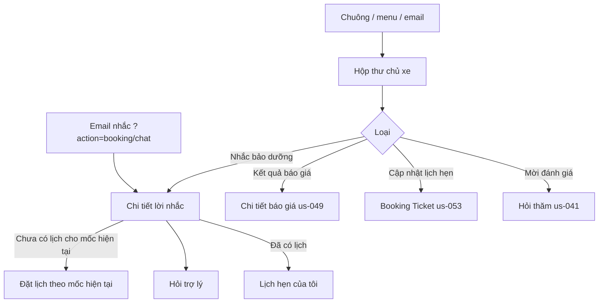

# Functional Specification — Hộp thư Thông báo trong app

> Tài liệu đặc tả chức năng/nghiệp vụ cho mục **Thông báo** của app chủ xe và Workshop Portal. Đây là kênh nhận thông báo mặc định của MVP theo [PRD EV Care MVP](../../../product/PRD_EV_Care_MVP.md#f7--nhắc) F7 (v3.7: "Mọi lần nhắc được ghi lại và hiện trong mục Thông báo của app"), và cũng là nơi hiện kết quả của F5b, F6b, F9.
>
> **Bối cảnh:** màn `/notifications`, `/notifications/reminders/:id`, `/technician/notifications` và API `API-NOTI-003` đã chạy trước khi có đặc tả (báo cáo [đối chiếu spec–code 03/10](../../../reports/2026-10-03_0245_bao-cao-doi-chieu-spec-code.md), mục SP-02). Tài liệu này mô tả hành vi đang chạy và chốt nó thành nghiệp vụ. Nhắc lịch hẹn 24h (BR-1707) được thêm vào hộp thư ngày 07/10/2026 theo PRD F7. Chỗ chưa chốt được đánh dấu `[Đề xuất]` hoặc `[Cần xác nhận]`, liệt kê lại ở mục 24.

---

# 1. Document Information

| Field | Value |
|---|---|
| Feature ID | `FEAT-NOTI-003` |
| Feature Name | `Hộp thư Thông báo trong app` |
| PRD Feature | `F7` (Should, S3–S4) — kênh trong app; hiển thị kết quả của F5b, F6b, F9 |
| Document Version | `v1.1` |
| Status | `Draft` |
| Product / Project | EV Care — AI Agent Chăm sóc sau bán & lịch bảo dưỡng xe điện |
| Business Owner | Lê Đức Tùng (PO) |
| Author | Team 4 Người |
| Reviewer | Tech Lead |
| Stakeholders | Product, Frontend, Backend |
| Created Date | `2026-10-07` |
| Updated Date | `2026-10-07` |
| Related PRD | [PRD_EV_Care_MVP.md §F7](../../../product/PRD_EV_Care_MVP.md) (v3.8) |
| Related Frontend Spec | [us-069-sprint-4-spec.fe.md](../frontend/us-069-sprint-4-spec.fe.md) |
| Related API Spec | [us-069-sprint-4-spec.api.md](../api/us-069-sprint-4-spec.api.md) |
| Related Entity Spec | [us-069-sprint-4-spec.entity.md](../entity/us-069-sprint-4-spec.entity.md) |
| Related Feature Spec | [us-021](../../sprint-2/feature-functional/us-021-sprint-2-spec.ff.md) (nhắc mốc, cài đặt) · [us-033](../../sprint-3/feature-functional/us-033-sprint-3-spec.ff.md) (nhắc 24h) · [us-037](../../sprint-3/feature-functional/us-037-sprint-3-spec.ff.md) (Board) · [us-041](us-041-sprint-4-spec.ff.md) (hỏi thăm) · [us-049](../../sprint-3/feature-functional/us-049-sprint-3-spec.ff.md) (báo giá) |
| Related GitHub Issue | `[Cần điền]` |

---

# 2. Feature Overview

## 2.1 Feature Description

Mục **Thông báo** gom ở một nơi những việc chủ xe (hoặc chủ xưởng) cần biết hoặc cần làm:

**Chủ xe** (`/notifications`):

| Loại | Nguồn | Ví dụ |
|---|---|---|
| Nhắc bảo dưỡng | us-021 — job nhắc mốc | "Sắp đến mốc bảo dưỡng — Xe sắp tới mốc bảo dưỡng 12.000 km." |
| Kết quả báo giá | us-049 — chủ xưởng duyệt / từ chối | "Báo giá đã được duyệt — Xưởng tại VinFast Smart City đã duyệt báo giá: 1.400.000 ₫." |
| Cập nhật lịch hẹn | us-029 / us-037 — xưởng hoặc hệ thống xác nhận, huỷ, hoàn tất | "Lịch hẹn đã được xác nhận — EVC-7K2M · 14:00 04/10/2026 tại …" |
| Mời đánh giá | us-041 — hỏi thăm sau dịch vụ | "Mời bạn đánh giá lần dịch vụ" |
| Nhắc lịch hẹn 24h | us-033 — job nhắc lịch hẹn | "Nhắc lịch hẹn sắp tới — EVC-7K2M · 09:00 08/10/2026 tại … Xác nhận bạn sẽ đến, hoặc đổi / huỷ nếu cần." (BR-1707) |

Mỗi thông báo có nút dẫn tới màn xử lý (đặt lịch, xem báo giá, xem lịch hẹn, đánh giá). Nhắc bảo dưỡng có **màn chi tiết lời nhắc**: dữ liệu tại thời điểm nhắc, tình trạng hiện tại, trạng thái gửi email, và các bước tiếp theo.

**Chủ xưởng** (`/technician/notifications`): danh sách việc chờ xưởng — báo giá chờ duyệt và lịch hẹn 7 ngày tới đang chờ xác nhận.

Hộp thư **không lưu trạng thái đã đọc**: nó được dựng lại từ dữ liệu sẵn có của từng tính năng mỗi khi mở (BR-1702).

## 2.2 Business Objective

- PRD F7 v3.7 bỏ kênh Discord: mục Thông báo trở thành kênh nhận mặc định, nên lời nhắc, kết quả và lời mời phải đến được chủ xe mà không cần kênh ngoài.
- Giảm việc chủ xe bỏ lỡ mốc bảo dưỡng (AC-F7-01) và kết quả báo giá (AC-F5b-02).

## 2.3 User Objective

Mở một chỗ là biết có gì mới và bấm thẳng tới việc cần làm.

## 2.4 Business Value

- Không cần bảng thông báo riêng hay job ghi thông báo: mỗi tính năng chỉ cần giữ dữ liệu của mình.
- Chủ xưởng thấy ngay việc tồn đọng có hạn (báo giá chờ > 24h, lịch hẹn sắp quá hạn xác nhận).

---

# 3. Scope

## 3.1 In Scope

- Hộp thư chủ xe: 5 loại ở §2.1, 90 ngày gần nhất, tối đa 50 mục.
- Đếm số việc cần chủ xe xem (`unreadCount`).
- Màn chi tiết lời nhắc bảo dưỡng: dữ liệu lúc nhắc, tình trạng hiện tại, trạng thái gửi, hành động.
- Liên kết sâu từ email nhắc (`?action=chat` / `?action=booking`).
- Hộp thư chủ xưởng: báo giá chờ duyệt + lịch hẹn chờ xác nhận.
- Chuông ở thanh trên mở hộp thư.

## 3.2 Out of Scope

- Đánh dấu đã đọc, xoá, lưu trữ thông báo (Q-1702).
- Bảng `in_app_notification` riêng (us-049 entity Q-ENT-1103, Q-1702).
- Push notification, Zalo, SMS, Telegram (Phụ lục B NOTI-01). Email nhắc bảo dưỡng do us-021 + adapter email xử lý; màn này chỉ **hiển thị** trạng thái gửi.
- Cài đặt nhận thông báo — us-021 SCR-501.
- Trang thư mô phỏng `/notifications/demo-email` và webhook email (công cụ demo).
- Thông báo cho chủ xưởng khi chủ xe huỷ lịch (us-033 §3.2): Board phản ánh ngay.
- Phân trang quá 50 mục.

---

# 4. Actors & Stakeholders

## 4.1 Actors

| Actor | Type | Responsibility |
|---|---|---|
| Chủ xe | User | Xem hộp thư, mở chi tiết lời nhắc, đi tới việc cần làm |
| Chủ xưởng | User | Xem việc chờ xưởng |
| Job nhắc mốc (us-021) | System | Tạo lời nhắc, gửi email nếu chủ xe bật |
| Workshop Board (us-037), dịch vụ đặt lịch (us-029) | System | Sinh sự kiện đổi trạng thái lịch hẹn |
| Dịch vụ báo giá (us-049) | System | Ghi kết quả duyệt và thời điểm chủ xe đã xem |
| Dịch vụ hỏi thăm (us-041) | System | Gửi lời mời đánh giá |
| Backend EV Care | System | Dựng hộp thư từ các nguồn trên |

## 4.2 Stakeholders

| Stakeholder | Organization / Team | Interest / Responsibility |
|---|---|---|
| Product Owner | Product | Chốt Q-1702…Q-1706 |
| Backend Team | Engineering | API-NOTI-003, API-NOTI-004 |
| Frontend Team | Engineering | 3 màn, chuông |

---

# 5. User Story

## US-069

**As a** chủ xe

**I want to** xem ở một chỗ các lời nhắc bảo dưỡng, kết quả báo giá, cập nhật lịch hẹn và lời mời đánh giá

**So that** tôi không bỏ lỡ việc cần làm và đi thẳng tới đó.

### Additional User Stories

- `US-070`: As a chủ xe, I want to mở chi tiết một lời nhắc bảo dưỡng để thấy vì sao được nhắc, xe hiện ra sao và email đã gửi chưa, so that tôi quyết định đặt lịch hay hỏi trợ lý.
- `US-071`: As a chủ xe nhận email nhắc, I want to bấm link trong email là vào thẳng đặt lịch hoặc trợ lý, so that tôi không phải tự tìm.
- `US-072`: As a chủ xưởng, I want to thấy báo giá chờ duyệt và lịch hẹn chờ xác nhận, so that tôi xử lý trước khi khách phải chờ lâu.

---

# 6. Use Case

## UC-1701 — Chủ xe xem hộp thư

### 6.1 Description

Chủ xe mở Thông báo. Hệ thống dựng danh sách từ các nguồn ở §2.1, mới nhất trước, và đếm số việc cần xem.

### 6.2 Primary Actor

Chủ xe

### 6.4 Trigger

Bấm chuông ở thanh trên, mục "Thông báo" ở menu, hoặc link trong email.

### 6.5 Preconditions

Chủ xe `ACTIVE`, đã xong onboarding.

### 6.6 Postconditions

Không thay đổi dữ liệu. (Mở một báo giá từ hộp thư thì us-049 API-QT-03 đánh dấu đã xem — BR-1704.)

## UC-1702 — Chủ xe xem chi tiết lời nhắc

### 6.1 Description

Chủ xe bấm "Xem lời nhắc". Hệ thống hiện mốc, lý do nhắc, hạn, ODO và hạng mục **lúc tạo lời nhắc**; tình trạng **hiện tại** của xe; trạng thái gửi email; và hành động phù hợp.

### 6.4 Trigger

"Xem lời nhắc" trong hộp thư, hoặc link trong email nhắc.

### 6.5 Preconditions

Lời nhắc thuộc xe của chủ xe.

### 6.6 Postconditions

Không thay đổi dữ liệu.

## UC-1703 — Chủ xưởng xem việc chờ xưởng

### 6.1 Description

Chủ xưởng mở Thông báo trên Portal. Hệ thống liệt kê báo giá đang chờ duyệt và lịch hẹn 7 ngày tới đang chờ xác nhận của xưởng mình.

### 6.4 Trigger

Chuông hoặc menu "Thông báo" trên Portal.

### 6.5 Preconditions

Chủ xưởng `ACTIVE`, đã liên kết đúng một xưởng (FEAT-AUTH-003).

---

# 7. User Flow

## 7.1 Main User Flow



## 7.2 Flow Description

| Step | Actor | Action / Event | System Response | Result |
|---|---|---|---|---|
| 1 | Chủ xe | Bấm chuông | Dựng hộp thư (BR-1701) | Danh sách + "n việc cần bạn xem" |
| 2 | Chủ xe | Bấm "Xem lời nhắc" | Trả chi tiết lời nhắc (BR-1705) | Màn chi tiết |
| 3 | Chủ xe | Bấm "Đặt lịch theo mốc hiện tại" | Mở đặt lịch với xe + mốc hiện tại | us-029 |
| 4 | Chủ xe | Bấm "Xem báo giá" | Mở báo giá; us-049 ghi đã xem | Lần mở hộp thư sau, mục đó hết "mới" |

---

# 8. Screen / UI Flow

## 8.1 Screen Flow

```text
[Thanh trên — chuông] ──> [SCR-1701 Hộp thư chủ xe /notifications]
                              ├── Cài đặt ──> [us-021 SCR-501]
                              ├── Xem lời nhắc ──> [SCR-1702 Chi tiết lời nhắc]
                              │                       ├── Đặt lịch ──> [us-029]
                              │                       ├── Hỏi trợ lý ──> [us-025]
                              │                       └── Xem lịch hẹn ──> [us-053 Lịch của tôi]
                              ├── Xem báo giá ──> [us-049]
                              ├── Xem lịch hẹn ──> [us-053 Ticket]
                              └── Đánh giá ──> [us-041]

[Portal — chuông] ──> [SCR-1703 Hộp thư chủ xưởng /technician/notifications]
                         ├── Duyệt báo giá ──> [us-049 duyệt báo giá]
                         └── Xem lịch hẹn ──> [us-037 Board]
```

## 8.2 Screen List

| Screen ID | Screen Name | Purpose | Entry From | Exit To |
|---|---|---|---|---|
| `SCR-1701` | Thông báo (chủ xe) | Hộp thư | Chuông, menu, email | Màn xử lý theo loại |
| `SCR-1702` | Lời nhắc bảo dưỡng | Chi tiết + hành động | SCR-1701, email | Đặt lịch, trợ lý, lịch hẹn |
| `SCR-1703` | Thông báo (chủ xưởng) | Việc chờ xưởng | Chuông, menu Portal | Duyệt báo giá, Board |

## 8.3 Screen / UI Reference

### SCR-1701

- Tiêu đề "Thông báo"; phụ đề "{n} việc cần bạn xem" khi `n > 0`, ngược lại "Hoạt động 90 ngày gần nhất".
- Nút "Cài đặt" ⇒ us-021 SCR-501.
- Thẻ thông báo: biểu tượng theo sắc thái (cảnh báo / thành công / thông tin / lỗi), tiêu đề, chấm "mới", thời điểm tương đối, nội dung, nút hành động.

### SCR-1702

- Ghi chú khi lời nhắc cũ chưa lưu dữ liệu lúc tạo (BR-1706), hoặc khi lời nhắc đã đóng (lý do — BR-1705).
- Khối "Dữ liệu dùng cho lời nhắc": mốc km / tháng, lý do nhắc (theo km / thời gian / cả hai), hạn theo thời gian, ODO + ngày cập nhật (cảnh báo nếu ODO cũ), danh sách hạng mục.
- Khối "Trạng thái gửi lời nhắc" (khi có lần gửi email).
- Khối "Tình trạng hiện tại": mốc tiếp theo + hạn; nút "Đặt lịch theo mốc hiện tại" hoặc "Xem lịch hẹn"; nút "Hỏi trợ lý".
- Liên kết "Quản lý / tắt nhận email".

### SCR-1703

- Phụ đề "Báo giá chờ duyệt và lịch hẹn 7 ngày tới đang chờ xưởng xác nhận". Không có nút Cài đặt.

---

# 9. Main Flow

## 9.1 Happy Path

1. Job nhắc mốc (us-021) tạo lời nhắc cho xe sắp đến hạn.
2. Chủ xe bấm chuông; hộp thư có mục "Sắp đến mốc bảo dưỡng".
3. Chủ xe bấm "Xem lời nhắc"; màn chi tiết cho biết lý do và các hạng mục.
4. Xe chưa có lịch cho mốc hiện tại ⇒ chủ xe bấm "Đặt lịch theo mốc hiện tại".
5. Đặt lịch xong (us-029); khi xưởng xác nhận, hộp thư có "Lịch hẹn đã được xác nhận"; lời nhắc chuyển sang "đã có lịch hẹn cho mốc này".

---

# 10. Alternative Flow

## AF-1701 — Hộp thư trống

**Condition:** 90 ngày qua không có mục nào. **Flow:** "Chưa có thông báo" — "Nhắc bảo dưỡng, kết quả báo giá, cập nhật lịch hẹn và khảo sát sau dịch vụ sẽ hiện ở đây." **Expected Result:** không báo lỗi.

## AF-1702 — Lời nhắc đã đóng

**Condition:** lời nhắc `resolved` (đã có lịch, đã bảo dưỡng, đổi mốc…). **Flow:** thẻ trong hộp thư ghi lý do đóng; màn chi tiết hiện ghi chú lý do; không hiện nút đặt lịch nếu mốc hiện tại đã có lịch. **Expected Result:** chủ xe hiểu vì sao không cần làm gì thêm.

## AF-1703 — Mở từ email với `action`

**Condition:** link email có `?action=booking` hoặc `?action=chat`. **Flow:** tải chi tiết lời nhắc, rồi chuyển thẳng sang đặt lịch (nếu được phép theo BR-1705) hoặc trợ lý với câu hỏi soạn sẵn. **Expected Result:** một chạm từ email tới việc cần làm. `action=booking` khi mốc đã có lịch ⇒ ở lại màn chi tiết.

## AF-1704 — Lời nhắc cũ không có dữ liệu lúc tạo

**Condition:** lời nhắc tạo trước khi hệ thống lưu ảnh chụp dữ liệu. **Flow:** BR-1706. **Expected Result:** không hiện số liệu hôm nay như thể là số liệu lúc nhắc.

## AF-1705 — Chủ xưởng không có việc chờ

**Condition:** không có báo giá chờ duyệt và lịch chờ xác nhận. **Flow:** "Không có việc chờ xử lý" — "Báo giá mới và lịch hẹn cần xác nhận sẽ hiện ở đây."

---

# 11. Exception Flow

## EF-1701 — Không tải được hộp thư

**System Behavior:** trả lỗi kèm `traceId`. **User Experience:** "Chưa tải được thông báo." + Thử lại. **Recovery:** thử lại; nếu đã có dữ liệu trước đó thì giữ dữ liệu cũ.

## EF-1702 — Lời nhắc không tồn tại hoặc không thuộc chủ xe

**System Behavior:** từ chối như "không tìm thấy" (BR-1708). **User Experience:** "Không tải được lời nhắc." + Thử lại. **Recovery:** quay lại hộp thư.

## EF-1703 — Một nguồn của hộp thư chủ xưởng lỗi

**Condition:** API báo giá hoặc Board lỗi. **System Behavior:** cả hộp thư báo lỗi `[Đề xuất]` giữ nguyên (Q-1705). **User Experience:** như EF-1701.

---

# 12. Business Rules

## BR-1701 — Nguồn và cửa sổ của hộp thư chủ xe

**Rule:** hộp thư gồm các mục trong **90 ngày** gần nhất, gộp từ:

| Loại | Lấy khi | Thời điểm của mục | Liên kết |
|---|---|---|---|
| `MAINTENANCE_REMINDER` | Mọi lời nhắc của xe chủ xe (kể cả đã đóng) | Lúc lời nhắc được lên lịch | Chi tiết lời nhắc |
| `QUOTE_RESULT` | Báo giá của xe chủ xe đã `approved` / `rejected` | Lúc xưởng duyệt | Chi tiết báo giá |
| `BOOKING_UPDATE` | Lịch hẹn chuyển sang `CONFIRMED` / `CANCELLED` / `COMPLETED` **do xưởng hoặc hệ thống** | Lúc đổi trạng thái | Booking Ticket |
| `BOOKING_REMINDER` | Lời nhắc lịch hẹn 24h đã được job xử lý (BR-1707) | Lúc gửi, chưa gửi được kênh ngoài thì lúc đến hạn nhắc | Booking Ticket (`src=REMINDER_24H`) |
| `FOLLOW_UP` | Lời mời đánh giá đã gửi và **đang chờ trả lời** | Lúc gửi | Màn hỏi thăm |

Sắp xếp mới nhất trước; giữ **50 mục** mới nhất.

**Priority:** High

## BR-1702 — Không có trạng thái đã đọc riêng

**Rule:** hộp thư không lưu "đã đọc". Mục được coi là **cần xem** (`unread`) chỉ khi:

- `QUOTE_RESULT`: chủ xe chưa mở chi tiết báo giá đó (us-049 BR-1109);
- `FOLLOW_UP`: lời mời còn chờ trả lời;
- `BOOKING_REMINDER`: lịch hẹn vẫn ở trạng thái đã xác nhận, chủ xe chưa xác nhận sẽ đến, và chưa tới giờ hẹn.

Các loại khác luôn không có chấm "mới". Không có nút "đánh dấu tất cả đã đọc". `unreadCount` = số mục cần xem trong 50 mục trả về.

**Priority:** High

## BR-1703 — Chỉ báo việc người khác làm

**Rule:** `BOOKING_UPDATE` bỏ qua thay đổi do chính chủ xe làm (ví dụ chủ xe tự huỷ), vì chủ xe đã biết.

**Priority:** Medium

## BR-1704 — Mở báo giá thì hết "mới"

**Rule:** mục `QUOTE_RESULT` hết "mới" khi chủ xe mở chi tiết báo giá (us-049 API-QT-03 ghi thời điểm đã xem). Hộp thư không tự ghi.

**Priority:** Medium

## BR-1705 — Chi tiết lời nhắc và hành động

**Rule:**

- Hiện dữ liệu **lúc tạo lời nhắc** (lý do nhắc theo km / thời gian / cả hai, hạn, mốc tháng, ODO + ngày cập nhật + cờ ODO cũ, hạng mục) và tình trạng **hiện tại** (mốc tiếp theo, hạn) tách riêng.
- "Đặt lịch theo mốc hiện tại" chỉ hiện khi có mốc hiện tại và mốc đó **chưa có lịch hẹn đang mở**; đặt lịch dùng mốc hiện tại, không dùng mốc cũ của lời nhắc.
- Mốc đã có lịch ⇒ hiện "Xem lịch hẹn".
- Luôn có "Hỏi trợ lý" với câu hỏi soạn sẵn về lời nhắc này.
- Lời nhắc đã đóng ⇒ hiện lý do: đã có lịch hẹn · đã hoàn tất bảo dưỡng · xe đã chuyển sang mốc khác · đã được thay bằng lời nhắc quá hạn · xe chưa nằm trong khoảng nhắc · tình trạng xe đã thay đổi.
- Hiện trạng thái từng lần gửi email (đã tiếp nhận, đã giao, bị trả về, bị chặn…, số lần thử).

**Priority:** High

## BR-1706 — Không trình bày số liệu hiện tại như số liệu cũ

**Rule:** lời nhắc tạo trước khi có ảnh chụp dữ liệu ⇒ không hiện lý do, hạn, ODO, hạng mục của thời điểm đó; ghi rõ "Lời nhắc cũ chưa lưu dữ liệu tại thời điểm tạo" và chỉ hiện tình trạng hiện tại.

**Priority:** Medium

## BR-1707 — Nhắc lịch hẹn 24h trong hộp thư

**Rule:** theo PRD F7, lời nhắc lịch hẹn 24h (us-033) hiện trong hộp thư, với nút tới Booking Ticket (`src=REMINDER_24H`) để xác nhận đến / đổi / huỷ.

- Hộp thư là kênh mặc định, nên mọi lời nhắc mà job **đã xử lý** đều hiện, kể cả khi chủ xe không bật kênh ngoài nào hoặc kênh ngoài gửi lỗi. Lời nhắc bị bỏ qua (lịch đã huỷ, đổi giờ, quá sát giờ hẹn…) không hiện.
- Thời điểm của mục: lúc gửi thành công qua kênh ngoài; không có thì lúc đến hạn nhắc.
- Cần xem khi còn việc để làm (BR-1702).

**Priority:** High

## BR-1708 — Quyền xem

**Rule:** chủ xe chỉ thấy mục của xe và lịch hẹn của mình; lời nhắc của người khác bị từ chối như không tồn tại. Chủ xưởng chỉ thấy báo giá và lịch hẹn của xưởng mình.

**Priority:** High

## BR-1709 — Nội dung an toàn

**Rule:** nội dung thông báo không chứa VIN, SĐT, email, CCCD (us-021 BR-509). Được hiện: mã lịch hẹn, tên xưởng, mốc km, số tiền báo giá. Hộp thư chủ xưởng được hiện họ tên khách và dòng xe (us-037 BR-813).

**Priority:** High

## BR-1710 — Hộp thư chủ xưởng

**Rule:**

- Báo giá đang chờ duyệt của xưởng: chờ ≥ 24 giờ ⇒ sắc thái cảnh báo, tiêu đề "Báo giá chờ duyệt quá 24 giờ" và được coi là cần xem (us-049 Q-1105).
- Lịch hẹn trạng thái chờ xác nhận, ngày hẹn từ hôm nay tới 6 ngày sau: luôn cần xem.
- Báo giá đứng trước lịch hẹn.

**Priority:** Medium

## BR-1711 — Mục không rõ loại

**Rule:** mục có loại mà app chưa biết (backend mới hơn) hoặc thiếu dữ liệu đi kèm ⇒ bỏ qua mục đó, không làm hỏng cả danh sách.

**Priority:** Low

---

# 13. State / Status

Hộp thư không có vòng đời riêng. Trạng thái hiển thị của mỗi mục lấy từ nguồn:

| Loại | Trạng thái nguồn dùng |
|---|---|
| `MAINTENANCE_REMINDER` | Mức `EARLY` / `WARNING` / `URGENT` / `EXPIRED`; đã đóng + lý do (us-021) |
| `QUOTE_RESULT` | `APPROVED` / `REJECTED`; đã xem hay chưa |
| `BOOKING_UPDATE` | `CONFIRMED` / `CANCELLED` / `COMPLETED` |
| `BOOKING_REMINDER` | Lời nhắc `sent` / `failed` (đã xử lý); `skipped` không hiện |
| `FOLLOW_UP` | Chỉ hiện khi `sent` (chờ trả lời); trả lời xong thì mục biến khỏi hộp thư (Q-1704) |

---

# 14. Data Requirements

## 14.1 Required Data

| Data | Type | Required | Description | Source |
|---|---|---:|---|---|
| Mã mục | `string` | Yes | `{loại}:{id nguồn}`, ổn định giữa các lần tải | Backend |
| Loại | `enum` | Yes | BR-1701 | Backend |
| Thời điểm | `datetime` | Yes | BR-1701 | Nguồn |
| Cần xem | `boolean` | Yes | BR-1702 | Nguồn |
| Dữ liệu đi kèm | `object` | Yes | Theo loại | Nguồn |

## 14.2 Data Dependency

| Data / Entity | Why Needed | Read / Write | Owner |
|---|---|---|---|
| `reminder` (ENT-405) | Nhắc bảo dưỡng, ảnh chụp dữ liệu | Read | us-021 |
| `reminder_delivery` (ENT-420), `email_outbox` | Trạng thái gửi email | Read | us-021 / email |
| `quote` (ENT-410) | Kết quả báo giá, đã xem | Read | us-049 |
| `booking_status_event` (ENT-426), `booking` (ENT-402) | Cập nhật lịch hẹn | Read | us-029 / us-037 |
| `follow_up` (ENT-412) | Lời mời đánh giá | Read | us-041 |
| `booking_reminder` (ENT-424) | Nhắc 24h — BR-1707 | Read | us-033 |
| `workshop` (ENT-008) | Tên xưởng | Read | — |

---

# 15. Business Error & Edge Cases

| Case ID | Scenario | Expected Business Behavior | User Outcome |
|---|---|---|---|
| `EDGE-1701` | Hơn 50 mục trong 90 ngày | Chỉ giữ 50 mục mới nhất (Q-1706) | Không thấy mục cũ hơn |
| `EDGE-1702` | Mục cũ hơn 90 ngày | Không hiện | — |
| `EDGE-1703` | Chủ xe tự huỷ lịch | Không có `BOOKING_UPDATE` (BR-1703) | — |
| `EDGE-1704` | Xưởng đã bị xoá tên / không ghép được | Nội dung bỏ phần "tại {xưởng}" | Câu vẫn đọc được |
| `EDGE-1705` | Lời mời đánh giá đã trả lời | Mục biến khỏi hộp thư (Q-1704) | Không còn thấy lời mời |
| `EDGE-1706` | Lời nhắc có mốc cũ nhưng xe đã sang mốc mới | Chi tiết hiện cả mốc cũ (dữ liệu lúc nhắc) và mốc hiện tại; đặt lịch theo mốc hiện tại (BR-1705) | Không đặt nhầm mốc |
| `EDGE-1707` | ODO lúc nhắc đã cũ | Cảnh báo "Dữ liệu ODO đã cũ" | Biết số km có thể lệch |
| `EDGE-1708` | Lời nhắc của xe đã gỡ liên kết | Chi tiết bị từ chối như xe không còn hoạt động | Quay lại hộp thư |

---

# 16. Permissions & Access

## 16.1 Access Matrix

| Role / Actor | View | Create | Update | Delete | Notes |
|---|---:|---:|---:|---:|---|
| Chủ xe | ✅ | ❌ | ❌ | ❌ | Hộp thư + chi tiết lời nhắc của mình |
| Chủ xưởng | ✅ | ❌ | ❌ | ❌ | Việc chờ xưởng mình |
| Hệ thống | — | ✅ (gián tiếp) | ✅ (gián tiếp) | — | Mỗi tính năng ghi dữ liệu nguồn của mình |

## 16.2 Business Authorization Rules

- BR-1708.
- Tài khoản chưa xong onboarding hoặc bị khoá không xem được.

---

# 17. Acceptance Criteria

## AC-1701 — Gộp nguồn, mới nhất trước

**Given** chủ xe có 1 lời nhắc 5 ngày trước, 1 báo giá được duyệt 3 ngày trước, 1 lịch hẹn được xưởng xác nhận 2 ngày trước, 1 lời mời đánh giá gửi hôm qua

**When** mở Thông báo

**Then** thứ tự: Mời đánh giá · Lịch hẹn đã được xác nhận · Báo giá đã được duyệt · Nhắc bảo dưỡng.

## AC-1702 — Đếm việc cần xem

**Given** như AC-1701, báo giá chưa mở, lời mời chưa trả lời

**When** mở Thông báo

**Then** phụ đề "2 việc cần bạn xem"; chỉ 2 mục đó có chấm "mới".

## AC-1703 — Mở báo giá thì hết mới

**Given** AC-1702

**When** chủ xe bấm "Xem báo giá" rồi quay lại hộp thư (sau khi dữ liệu được tải lại)

**Then** mục báo giá không còn chấm "mới"; phụ đề "1 việc cần bạn xem".

## AC-1704 — Không báo việc chủ xe tự làm

**Given** chủ xe tự huỷ một lịch hẹn

**When** mở Thông báo

**Then** không có mục "Lịch hẹn đã bị huỷ" cho lần huỷ đó.

## AC-1705 — Đặt lịch theo mốc hiện tại

**Given** lời nhắc mốc 12.000 km, xe hiện ở mốc 24.000 km chưa có lịch

**When** chủ xe bấm "Đặt lịch theo mốc hiện tại"

**Then** mở đặt lịch với mốc 24.000 km.

## AC-1706 — Mốc đã có lịch

**Given** mốc hiện tại đã có lịch hẹn đang mở

**When** mở chi tiết lời nhắc

**Then** không có "Đặt lịch theo mốc hiện tại"; có "Xem lịch hẹn".

## AC-1707 — Lời nhắc của người khác

**Given** chủ xe A biết mã lời nhắc của chủ xe B

**When** A mở chi tiết lời nhắc đó

**Then** bị từ chối như không tìm thấy.

## AC-1708 — Chủ xưởng thấy báo giá chờ lâu

**Given** xưởng có 1 báo giá gửi 30 giờ trước và 1 lịch hẹn chờ xác nhận ngày mai

**When** chủ xưởng mở Thông báo

**Then** "Báo giá chờ duyệt quá 24 giờ" đứng đầu, sau đó "Lịch hẹn chờ xác nhận".

## AC-1709 — Nhắc 24h hiện cả khi không có kênh ngoài

**Given** lịch hẹn đã xác nhận cho ngày mai, chủ xe không bật kênh ngoài nào, job đã xử lý lời nhắc 24h

**When** chủ xe mở Thông báo

**Then** có mục "Nhắc lịch hẹn sắp tới" có chấm "mới"; bấm vào mở Booking Ticket với `src=REMINDER_24H`. Sau khi chủ xe xác nhận sẽ đến, mục không còn chấm "mới".

---

# 18. Non-functional Expectations

| Requirement | Expected Behavior |
|---|---|
| Response Experience | Hộp thư ≤ 500 ms (p90) như API nghiệp vụ khác (PRD §8) |
| Freshness | Chủ xe: tải lại khi dữ liệu cũ hơn 1 phút; không realtime |
| Privacy | BR-1709 |
| Ngôn ngữ | Tiếng Việt; thời điểm hiện dạng tương đối (hôm nay, hôm qua, …) |

---

# 19. Dependencies

| Dependency | Purpose | Owner | Required | Related Document |
|---|---|---|---:|---|
| us-021 nhắc mốc | Lời nhắc, ảnh chụp dữ liệu, gửi email | Mai Văn Trung | Yes | [us-021 FF](../../sprint-2/feature-functional/us-021-sprint-2-spec.ff.md) |
| us-049 báo giá | `QUOTE_RESULT`, API-QT-03, API-QT-11 | Nguyễn Lê Phước Tiến | Yes | [us-049 FF](../../sprint-3/feature-functional/us-049-sprint-3-spec.ff.md) |
| us-037 Board | Sự kiện trạng thái, API-WB-01 | Lê Đức Tùng | Yes | [us-037 FF](../../sprint-3/feature-functional/us-037-sprint-3-spec.ff.md) |
| us-041 hỏi thăm | `FOLLOW_UP` | — | Yes | [us-041 FF](us-041-sprint-4-spec.ff.md) |
| us-033 nhắc 24h | BR-1707 | Nguyễn Lê Phước Tiến | Yes | [us-033 FF](../../sprint-3/feature-functional/us-033-sprint-3-spec.ff.md) |
| us-017 trạng thái đến hạn | Tình trạng hiện tại trong chi tiết lời nhắc | Mai Văn Trung | Yes | [us-017 FF](../../sprint-2/feature-functional/us-017-sprint-2-spec.ff.md) |

---

# 20. Assumptions

- Lượng mục mỗi chủ xe trong 90 ngày nhỏ (vài chục) ⇒ dựng lại mỗi lần mở là đủ nhanh.
- MVP một xe/chủ xe, một xưởng/chủ xưởng.

---

# 21. Business Constraints

- Không thêm kênh ngoài trong MVP (PRD v3.7).
- Không lưu dữ liệu cá nhân thừa cho mục đích thông báo.

---

# 22. Terminology / Glossary

| Term ID | Term | Vietnamese Name | Definition | Example / Notes |
|---|---|---|---|---|
| `TERM-1701` | In-app inbox | Hộp thư Thông báo | Mục Thông báo trong app | `/notifications` |
| `TERM-1702` | Feed item | Mục thông báo | Một dòng trong hộp thư | "Báo giá đã được duyệt" |
| `TERM-1703` | Needs attention | Cần xem / mới | Mục có chấm "mới" theo BR-1702 | Báo giá chưa mở |
| `TERM-1704` | Reminder snapshot | Dữ liệu lúc nhắc | Số liệu ghi lại khi tạo lời nhắc | ODO 11.600 km lúc nhắc |
| `TERM-1705` | Current status | Tình trạng hiện tại | Kết quả us-017 tại lúc xem | Mốc tiếp theo 24.000 km |

### Important Terminology Rules

- "Cần xem" không đồng nghĩa "chưa đọc": hệ thống không theo dõi việc đọc.
- "Lời nhắc" chỉ nhắc bảo dưỡng (us-021) hoặc nhắc lịch hẹn (us-033); không gọi kết quả báo giá là lời nhắc.

---

# 23. Partner / Stakeholder Notes

## 23.1 Confirmed

- PRD v3.7: thông báo mặc định hiện trong app, kênh ngoài "Sắp có".

## 23.2 Pending Confirmation

- Không có.

---

# 24. Open Questions

| ID | Question | Owner | Status | Decision / Due Date |
|---|---|---|---|---|
| `Q-1701` | Đưa nhắc lịch hẹn 24h vào hộp thư (BR-1707) | PO | **Resolved** | Đã làm 07/10/2026 — kể cả lời nhắc chỉ đến được trong app |
| `Q-1702` | Cần trạng thái đã đọc thật (bảng `in_app_notification`, us-049 Q-ENT-1103)? | PO + Tech Lead | Open | `[Đề xuất]` chưa cần MVP |
| `Q-1703` | Chuông có hiện số việc cần xem? | PO | Open | `[Đề xuất]` có, dùng `unreadCount` |
| `Q-1704` | Lời mời đã trả lời có giữ lại dạng "đã đánh giá"? | PO | Open | `[Đề xuất]` giữ, không có chấm mới |
| `Q-1705` | Hộp thư chủ xưởng có cần API riêng phía máy chủ, và một nguồn lỗi thì vẫn hiện nguồn còn lại? | Tech Lead | Open | `[Đề xuất]` hiện nguồn còn lại kèm cảnh báo |
| `Q-1706` | Giới hạn 50 mục có đủ? | PO | Open | `[Đề xuất]` đủ cho MVP |
| `Q-1707` | Chi tiết lời nhắc của người khác trả mã "xe không tìm thấy" thay vì "lời nhắc không tìm thấy" | Tech Lead | **Resolved** | 07/10/2026: trả `REMINDER_NOT_FOUND` như lời nhắc không tồn tại (API §4.3) |

---

# 25. Traceability

| Item | Reference |
|---|---|
| PRD | F7 (kênh trong app), AC-F7-01, AC-F5b-02 |
| User Story | `US-069` → `US-072` |
| Use Case | `UC-1701` → `UC-1703` |
| Business Rules | `BR-1701` → `BR-1711` |
| Acceptance Criteria | `AC-1701` → `AC-1709` |
| Frontend Specification | [us-069 FE](../frontend/us-069-sprint-4-spec.fe.md) |
| API Specification | [us-069 API](../api/us-069-sprint-4-spec.api.md) |
| Test Cases | `backend/tests/test_api/test_notification_feed_api.py`, `frontend/src/features/notifications/feed.test.ts` |
| GitHub Issue / Epic | `[Cần điền]` |

---

# 26. Related Documents

- [PRD](../../../product/PRD_EV_Care_MVP.md)
- [us-021 FF — Nhắc mốc & cài đặt thông báo](../../sprint-2/feature-functional/us-021-sprint-2-spec.ff.md)
- [us-033 FF — Nhắc lịch hẹn 24h](../../sprint-3/feature-functional/us-033-sprint-3-spec.ff.md)
- [us-049 FF — Báo giá HITL](../../sprint-3/feature-functional/us-049-sprint-3-spec.ff.md)
- [Báo cáo đối chiếu spec–code 03/10](../../../reports/2026-10-03_0245_bao-cao-doi-chieu-spec-code.md) (SP-02)

---

# 27. Change Log

| Version | Date | Author | Change |
|---|---|---|---|
| `v1.0` | `2026-10-07` | Team 4 Người | Bản đầu, viết theo hành vi đã triển khai; ghi BR-1707 chưa triển khai |
| `v1.1` | `2026-10-07` | Team 4 Người | BR-1707 đã triển khai (loại `BOOKING_REMINDER`, gồm lời nhắc chỉ đến được trong app); chốt Q-1701, Q-1707; AC-1709 cụ thể hoá |

---

# 28. Approval

| Role | Name | Status | Date |
|---|---|---|---|
| Product Owner | Lê Đức Tùng | Pending | — |
| Technical Owner | Tech Lead | Pending | — |
