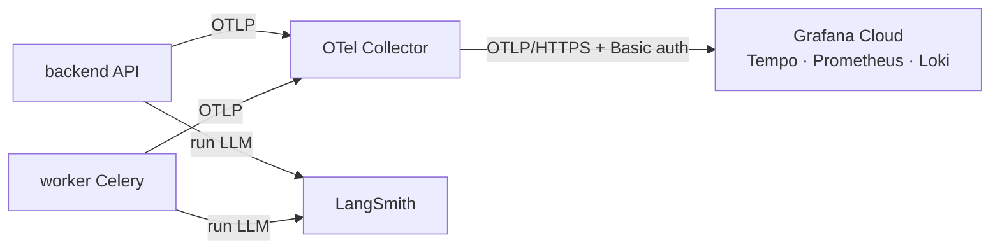

# Observability: OpenTelemetry, Grafana Cloud, LangSmith

> Cập nhật: 2026-10-12. Trang tóm tắt để chọn đúng tài liệu. Chi tiết nằm ở [docs/observability/](../observability/).

## 1. Mô hình

| Câu hỏi | Công cụ |
| --- | --- |
| Request chậm ở đâu, lỗi 5xx tăng không, Celery task nào lỗi | Grafana (trace, metric, log) |
| Agent gọi tool nào, guardrail nào chặn, RAG có tìm thấy không | Grafana (span mỏng + metric agent) |
| Prompt/câu trả lời cụ thể, token, chi phí, độ trễ LLM của một lượt chat | LangSmith |

**Phân vai có chủ đích:** LangSmith giữ nội dung đầy đủ (có thể chứa PII, nên che bằng `LANGCHAIN_REDACT_PII`); Grafana không bao giờ nhận nội dung prompt. `trace_id` OTel nằm trong metadata LangSmith và run id LangSmith nằm trong span, để nhảy qua lại.

## 2. Thành phần trong code

| File | Việc |
| --- | --- |
| `backend/src/infrastructure/observability/telemetry.py` | Khởi tạo SDK OTel (`setup_telemetry`), định danh `service.name` (`ev-care-backend`, `ev-care-worker`, `mock-ev-system`), `deployment.environment`, `service.version` |
| `tracing.py`, `metrics.py`, `context.py` | Span thủ công (`step()`), metric, propagate `traceparent` qua message Celery |
| `log_handler.py` | Log structlog → OTLP, kèm `trace_id` |
| `langsmith.py` | Chép cấu hình `LANGCHAIN_*` vào môi trường, project riêng cho worker (`<project>-jobs`), anonymizer che PII |
| `agent_hooks.py` | Callback LLM → span/metric, bọc từng tool để ghi trạng thái |
| `backend/src/infrastructure/llm/traced.py` | Trace các lời gọi LLM ngoài LangChain (RAG rewrite/generate, tool review, hỏi thăm) |
| `backend/src/agents/telemetry.py` | Metric và attribute riêng của agent (tool, guardrail, RAG) |
| `infrastructure/observability/otel-collector/` | `config.yaml` + Dockerfile của Collector |

Quyết định chính: qua Collector (token Grafana chỉ ở một chỗ); sampling 100% bỏ `/health`; nhãn metric chỉ `http.route` (template), method, status; tắt an toàn (`OTEL_ENABLED=false`, test đặt `OTEL_SDK_DISABLED=true`, collector chết thì app vẫn chạy). Danh sách đầy đủ 12 quyết định: [OBSERVABILITY_SETUP.md §3](../observability/OBSERVABILITY_SETUP.md).

## 3. Cấu hình

| Biến | Ghi chú |
| --- | --- |
| `OTEL_ENABLED`, `OTEL_EXPORTER_OTLP_ENDPOINT`, `OTEL_DEPLOYMENT_ENVIRONMENT` | Backend/worker. Railway: `http://otel-collector.railway.internal:4318` |
| `GRAFANA_CLOUD_OTLP_ENDPOINT`, `GRAFANA_CLOUD_INSTANCE_ID`, `GRAFANA_CLOUD_API_TOKEN` | **Chỉ** collector |
| `LANGCHAIN_TRACING_V2`, `LANGCHAIN_API_KEY`, `LANGCHAIN_ENDPOINT`, `LANGCHAIN_WORKSPACE_ID`, `LANGCHAIN_PROJECT`, `LANGCHAIN_JOBS_PROJECT` | LangSmith |
| `LANGCHAIN_REDACT_PII` | `true` ở staging, `false` ở local |

## 4. Tài liệu chi tiết

| Tài liệu | Dùng khi |
| --- | --- |
| [OBSERVABILITY_SETUP.md](../observability/OBSERVABILITY_SETUP.md) | Dựng Grafana Cloud/LangSmith, biến môi trường, chạy collector, deploy Railway, xử lý sự cố |
| [OBSERVABILITY_USAGE.md](../observability/OBSERVABILITY_USAGE.md) | Đọc trace/log/metric, truy vấn mẫu (TraceQL, LogQL, PromQL), LangSmith |
| [GRAFANA_GUIDE.md](../observability/GRAFANA_GUIDE.md) | Dashboard Grafana |
| [GRAFANA_ALERTING.md](../observability/GRAFANA_ALERTING.md) | Alert (Discord) |
| [RAILWAY_BACKEND_DEPLOYMENT.MD](../deployments/RAILWAY_BACKEND_DEPLOYMENT.MD) | Bước 5c: service `otel-collector` |

## 5. Còn thiếu

Bật trên Railway (`OTEL_ENABLED=true` sau khi deploy collector), dashboard và alert chính thức, metric nghiệp vụ (booking, onboarding, OEM, thông báo), instrument `mock-ev-system`. Giới hạn free tier Grafana: 10k series, 50 GB trace/tháng.

## 6. Test

`backend/tests/test_infrastructure/test_observability.py`, `test_agent_observability.py`.
